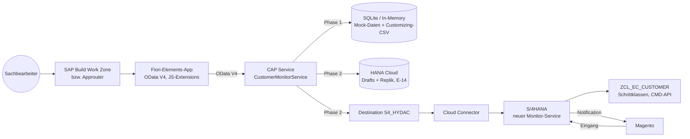

# 02 – Zielarchitektur BTP

## 1. Überblick



| Komponente | Rolle |
|---|---|
| Fiori-Elements-App (`app/monitor`) | Liste, Detail, Bearbeitung (Draft), Schrittausführung – annotationsgetrieben, ~300 Zeilen eigene Extensions. Keine Geschäftslogik. Siehe [09](09_migration_fiori_elements.md). |
| CAP Service (`srv/`) | Stabiler OData-V4-Vertrag für die UI inkl. UI-Semantik (Annotationen, E-13); Phase 1 Mock, Phase 2 Fassade zu S/4 mit lokaler Replik (E-14). Berechtigungsprüfung (VKORG), Fehler-Mapping. |
| S/4HANA | Bleibt System of Record: Tabellen `ZEC_CUSTOMER*`, Customizing, Schrittklassen, Stammdatenanlage, Notifications an Magento. |
| Magento | Unverändert: Eingang über `ZEC_CUSTOMER_CREATE_SRV`, Notifications. |

## 2. Phasen

| Phase | Inhalt | Ergebnis |
|---|---|---|
| **1 – Frontend** | Freestyle-UI5-App + CAP-Mock mit Customizing-CSV und simulierter Statuslogik (erledigt) | Vollständig klickbare App lokal (`cds watch`) |
| **1b – Fiori Elements** | Migration auf Fiori Elements V4 gemäß [09](09_migration_fiori_elements.md): Aktionen je Schritt, Draft, Annotationen als Vertrag (F-11–F-22) | FE-App gegen den Mock, Freestyle-App entfernt |
| 2 – S/4-Anbindung | Neuer Remote-Service in S/4 (Liste mit Delta, Detail, `change_data`, `get_functions`, `execute_function`), CAP-Fassade mit HANA-Replik (E-14) per Destination + Cloud Connector, Principal Propagation | App arbeitet auf Echtdaten (Q-System) |
| 3 – Betrieb | XSUAA-Rollen, VKORG-Attribut, MTA, HTML5 Repo, Work Zone, HANA Cloud, Monitoring | Produktiv |

## 3. Entscheidungen

| ID | Entscheidung | Status |
|---|---|---|
| E-01 | Datenzugriff der UI ausschließlich über CAP OData V4 | entschieden |
| E-02 | UI: **SAP Fiori Elements für OData V4** (`sap.fe.templates`, List Report + Object Page, FCL) mit JavaScript-Extensions; ersetzt Freestyle SAPUI5 (Phase 1). Begründung und Design: [09](09_migration_fiori_elements.md) | entschieden (22.10.2026) |
| E-03 | Phase 1 gegen CAP-Mock, Vertrag identisch zu Phase 2 | entschieden |
| E-04 | Schrittausführung über **je eine gebundene Aktion pro Schritt** (`release`, `rejectRequest`, `clarify`, `reset`, `createCustomer`, `createShipTo`, `modifyContact`, `convertToNewCustomer`, `completeManually`, `assignExistingCustomer`, `changeCustomerAssignment`); erlaubte Schritte liefert das Backend als Flags `can*` (`Core.OperationAvailable`, aus Customizing `ZEC_CUST_PROCESS` + Rollen); Rückfragen per OData Strict Handling (`Prefer: handling=strict` → 412). Ersetzt `executeStep`/`availableSteps`. | entschieden (22.10.2026) |
| E-05 | ETag bei `draftEdit` (Bearbeitungsbeginn), bei PATCH auf dem Draft und bei Schrittaktionen am aktiven Vorgang; während der Bearbeitung pessimistische Draft-Sperre (15 min, verlängert bei jeder Änderung); Schritte sind gesperrt, solange ein Draft existiert. Ersetzt „ETag statt Sperre“. | angepasst (22.10.2026) |
| E-06 | Logik bleibt in S/4 (`ZCL_EC_CUSTOMER`, Schrittklassen). CAP reimplementiert **keine** Stammdatenanlage. | vorgeschlagen |
| E-07 | S/4-Service-Technik: RAP (OData V4) oder SEGW (OData V2) | **offen** – Phase 2 |
| E-08 | Statusmaschine im Mock aus CSV-Kopie des Customizings (`ZEC_CUST_PROCESS`, `ZEC_CUST_STEPS`) | vorgeschlagen |
| E-09 | Bestätigungsdialog auch für CREATE / CREATE_WE / AP_MODIFY (Altsystem: ohne) | vorgeschlagen, mit Fachbereich klären |
| E-10 | Namespace / App-ID `hydac.custmon` | vorgeschlagen |
| E-11 | Bearbeiten nur bei offenem Status (0xx/1xx) und freigegebenem Vorgang (`isEditable`); geprüft bei `draftEdit` | vorgeschlagen, mit Fachbereich klären |
| E-12 | `Requests` ist **draft-enabled** (`@odata.draft.enabled`): Fiori Elements V4 bietet Bearbeiten/Sichern/Abbrechen nur für Draft-Entitäten; Protokoll (`log`) bleibt Assoziation ohne Draft. Drafts benötigen ab Phase 2 eine persistente Datenbank (HANA Cloud). | entschieden (22.10.2026) |
| E-13 | Annotationen in `srv/monitor-annotations.cds` (Labels, Texte, Wertehilfen, Kritikalität, Side Effects, Edit-Sichtbarkeit) sind **Teil des Service-Vertrags**; `app/monitor/annotations.cds` enthält nur Layout. | entschieden (22.10.2026) |
| E-14 | Phase 2: CAP hält eine **HANA-Replik** von `Requests` (+ Kinder, Protokoll) mit Write-through nach jedem S/4-Aufruf und Delta-Pull beim Listenlesen; S/4 bleibt System of Record (E-06). Notwendig, weil CAPs generische ETag-Prüfung für gebundene Aktionen und die Draft-Sperre lokale Tabellen voraussetzen. | entschieden (22.10.2026) |

## 4. Repository-Struktur

```
kundenmonitor-btp/
├── CLAUDE.md
├── README.md
├── docs/
├── package.json            # CAP-Root, npm workspaces ["app/*"]
├── .cdsrc.json
├── db/
│   ├── schema.cds
│   ├── data/               # CSV: Mock-Vorgänge + Customizing-Kopie
│   ├── src/.hdiconfig      # HDI-Konfiguration (O-02)
│   └── undeploy.json
├── srv/
│   ├── monitor-service.cds       # Entitäten (Draft-Root), Aktionen je Schritt, Capabilities, @restrict
│   ├── monitor-annotations.cds   # Vertrags-Semantik: Labels, Common.Text, Wertehilfen, Side Effects (E-13)
│   ├── monitor-service.js        # Mock-Implementierung (Phase 1): Flags, Dispatcher, Strict Handling, Draft-Guards
│   └── lib/                      # status-machine.js (unverändert), errors.js
├── _i18n/                        # i18n*.properties (Labels), messages*.properties (Meldungen)
├── app/
│   └── monitor/                  # Fiori-Elements-App (eigene package.json, ui5.yaml; ui5-deploy.yaml, ui5-tasks/, xs-app.json für das HTML5-Repository)
│       ├── annotations.cds       # Layout: SelectionFields, LineItem, HeaderInfo, Facets, Aktionsgruppe
│       └── webapp/               # Component, manifest, ext/ (Fragments, Controller-Extension), i18n, test/
├── test/                   # Service-Tests
├── xs-security.json        # Rollen, Attribut SalesOrg (O-01, §5)
├── mta.yaml                # Deployment-Deskriptor (O-02, §7)
└── mta-cloud-logging.mtaext # optionale Cloud-Logging-Bindung (O-03, §8)
```

## 5. Berechtigungen (Ziel)

| Rolle (Role Template) | Darf | Altsystem-Pendant |
|---|---|---|
| `MonitorViewer` | Lesen | Anzeige |
| `MonitorEditor` | Lesen, Bearbeiten, Schritte ausführen | Änderung |
| `MonitorReleaser` | zusätzlich nicht freigegebene Vorgänge sehen, Freigeben | `ZEC_MONITO` ACTVT 43 |

- Attribut `SalesOrg` (Liste von VKORG) am Benutzer; CAP filtert per `@restrict … where: 'salesOrganization = $user.SalesOrg'` (Verhalten bei mehrwertigen Attributen beim Setup gegen die aktuelle CAP-Doku prüfen). Ersetzt `V_KNA1_VKO` + `V_VBAK_VKO` durch **eine** Regel (siehe [07](07_anforderungen_aus_altsystem.md), R-08).
- Umsetzung (O-01): `xs-security.json` mit Scopes/Role Templates `MonitorViewer`, `MonitorEditor`, `MonitorReleaser` (jede mit Attribut `SalesOrg`) und Role Collections `Kundenmonitor_Viewer`, `Kundenmonitor_Editor`, `Kundenmonitor_Releaser` (jeweils inkl. Viewer, da der Service `MonitorViewer` verlangt). `SalesOrg` ist optional: ohne Wert sieht der Benutzer nichts (fail closed); Werte pflegt der Admin je Rolle im Cockpit (statisch oder IdP-Mapping). `MonitorReleaser` prüft nur der Handler, daher fehlt er in `cds compile --to xsuaa` – `test/xs-security.test.js` sichert die Datei gegen Modell und Mock-User ab.
- Phase 2: Principal Propagation, damit S/4-Berechtigungen und Änderungsbelege auf den echten Benutzer laufen.
- Phase 1: Mock-User in `.cdsrc.json` (`alice` = alle Rollen, VKORG 0001/2000/7050; `bob` = Viewer, VKORG 0001).

## 6. Phase 2 – Anforderungen an den S/4-Service (Vorschau)

Der S/4-Service muss den CAP-Vertrag ([03](03_service_vertrag.md)) bedienen können:

- Lesen `ZEC_CUSTOMER` + strukturierte Arbeitsdaten aus `PAYLOAD_CHNG` (Haupt-, Vertriebs-, Admin-, WE-Daten) + Protokoll; zusätzlich **Delta-Lesen** („geändert seit“) für die Replik (E-14).
- Ändern der Arbeitsdaten inkl. Änderungsprotokoll (`check_changes`/`change_data`/`log_changes`); wird von der CAP-Fassade bei der Draft-Aktivierung aufgerufen.
- `get_functions` → Flags `can*` je Aktion; `execute_function(step, …)` ← Aktions-Dispatcher der Fassade, ohne SAP-GUI-Popups (Eingaben kommen als Parameter); Rückfragen als Nachricht, die die Fassade als Strict-Handling-412 zurückgibt.
- ETag-fähiges Änderungskennzeichen (heute nur `CHDAT`/`CHTIM` sekundengenau → besser Versionszähler), das die Fassade auf `modifiedAt` der Replik abbildet.
- Die Popups in den Schrittklassen (`POPUP_TO_CONFIRM`, `POPUP_GET_VALUES*`, `ZEC_CUST_POPUP_DECLINE`) müssen durch Parameter ersetzt werden → Refactoring der Schrittklassen (Interface um Eingabestruktur erweitern).

## 7. Deployment auf BTP (O-02)

Erzeugt mit `cds add hana,xsuaa,html5-repo,workzone,mta` (cds-dk 9) und an das Projekt angepasst:

| Baustein | Datei / Modul | Hinweis |
|---|---|---|
| CAP-Service (Node.js) | `mta.yaml` → `kundenmonitor-btp-srv` (`gen/srv`) | Profil `production`: `db: hana`, `auth: xsuaa` (`package.json` → `cds.requires`); lokal bleiben SQLite in-memory und Mock-Auth (`.cdsrc.json`) |
| SAP HANA Cloud (HDI) | `kundenmonitor-btp-db-deployer` (`gen/db`), `db/src/.hdiconfig`, `db/undeploy.json` | Drafts liegen im HDI-Container (E-12). In Phase 1 deployt der Deployer auch die Demo-CSVs (`db/data`) – das System ist dann ein Mock mit Testdaten, kein Produktivsystem |
| XSUAA | Ressource `kundenmonitor-btp-auth` → `xs-security.json` (O-01) | `xsappname` je Org/Space aus `mta.yaml` |
| HTML5-Repository + Managed Approuter | `kundenmonitorbtpmonitor` (`app/monitor`, `npm run build` → `ui5-deploy.yaml`), `kundenmonitor-btp-app-deployer`, `kundenmonitor-btp-destinations`, `app/monitor/xs-app.json` | `sap.cloud.service` = `kundenmonitorbtp.service`; Route `^/odata/` → Destination `srv-api` (Token-Weitergabe). Der Build schreibt die OData-URI im `manifest.json` relativ (`ui5-tasks/relative-odata-uri.js`), die Quelle bleibt absolut für `cds watch` |
| Work-Zone-Kachel | `manifest.json` → `sap.app.crossNavigation` (Intent `Kundenmonitor-display`, Titel/Untertitel aus i18n) | Im Work-Zone-Content-Manager: Content-Provider „HTML5 Apps“ aktualisieren, App einer Gruppe/Rolle zuordnen; Role Collections aus O-01 an Benutzer bzw. Gruppen |

Build und Deployment:

```bash
npx mbt build -t mta_archives          # → mta_archives/kundenmonitor-btp_0.1.0.mtar (mbt global oder per npx)
cf deploy mta_archives/kundenmonitor-btp_0.1.0.mtar
```

Voraussetzungen im Subaccount: Cloud-Foundry-Space, SAP HANA Cloud-Instanz (für `hdi-shared`), Einträge für `html5-apps-repo`, `destination`, `xsuaa`, SAP Build Work Zone (standard). Nach dem ersten Deployment prüfen: Role Collections vorhanden (siehe O-01), `SalesOrg`-Werte je Rolle gepflegt.

## 8. Betrieb: Logging, Monitoring, Transport (O-03)

- **Health Check:** `mta.yaml` → `kundenmonitor-btp-srv` nutzt `health-check-type: http` auf `/health` (CAP, ohne Anmeldung; `test/monitor-service.test.js` „O-03“). Antwortet der Endpunkt nicht, startet Cloud Foundry die Instanz neu.
- **Logging:** CAP schreibt strukturierte Logs nach stdout; mit Bindung an SAP Cloud Logging formatiert es sie automatisch passend (`cds.env.log.aspects`: `cf`, `als`, `cls`), inkl. Korrelations-ID je Request. Die Bindung ist optional, weil sie ein Entitlement braucht: Ressource `kundenmonitor-btp-logging` steht in `mta.yaml` auf `active: false` und wird mit `cf deploy … -e mta-cloud-logging.mtaext` aktiviert. Ohne Bindung bleiben die Logs über `cf logs kundenmonitor-btp-srv` erreichbar. Autorisierungs-Header und Cookies maskiert CAP (`log.mask_headers`).
- **Monitoring:** Instanz-Status, Neustarts und Speicher im BTP-Cockpit bzw. `cf app kundenmonitor-btp-srv`; Dashboards und Alarme in SAP Cloud Logging (bei Bindung). Fachliche Kennzahlen (offene/fehlerhafte Vorgänge) liefert die App selbst über die Sichten mit Zählern (F-26).
- **Transport (DEV → QAS → PRD):** Ein Build, ein Archiv: `mbt build` erzeugt `kundenmonitor-btp_<version>.mtar`, das unverändert durch die Landschaft wandert. Empfohlen: SAP Cloud Transport Management mit den Knoten DEV, QAS, PRD (je Knoten Destination auf den Deploy-Service des Ziel-Spaces); das Archiv wird in DEV hochgeladen (manuell, per SAP Continuous Integration and Delivery oder `cTMS`-Upload) und nach Test in QAS importiert bzw. weitergeleitet. Ohne CTMS: `cf deploy` des gleichen Archivs in den jeweiligen Space. Space-spezifische Werte (z. B. Cloud-Logging-Bindung) kommen über MTA-Extension-Deskriptoren, nicht über geänderte Archive. Vor jeder Weitergabe: Version in `mta.yaml`/`package.json` erhöhen.
- **Datenstand Phase 1:** Der Deployer lädt die Demo-CSVs; vor einer produktiven Nutzung (Phase 2, S/4-Anbindung B-04/B-06) die Testdaten aus `db/data` entfernen bzw. auf Customizing beschränken.
