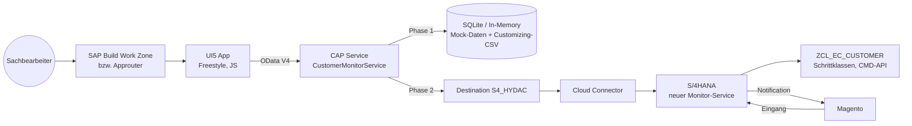

# 02 – Zielarchitektur BTP

## 1. Überblick



| Komponente | Rolle |
|---|---|
| UI5 App (`app/monitor`) | Liste, Detail, Bearbeitung, Schrittausführung. Keine Geschäftslogik. |
| CAP Service (`srv/`) | Stabiler OData-V4-Vertrag für die UI; Phase 1 Mock, Phase 2 Fassade zu S/4 (Delegation). Berechtigungsprüfung (VKORG), Fehler-Mapping. |
| S/4HANA | Bleibt System of Record: Tabellen `ZEC_CUSTOMER*`, Customizing, Schrittklassen, Stammdatenanlage, Notifications an Magento. |
| Magento | Unverändert: Eingang über `ZEC_CUSTOMER_CREATE_SRV`, Notifications. |

## 2. Phasen

| Phase | Inhalt | Ergebnis |
|---|---|---|
| **1 – Frontend** | UI5 App + CAP-Mock mit Customizing-CSV und simulierter Statuslogik | Vollständig klickbare App lokal (`cds watch`) |
| 2 – S/4-Anbindung | Neuer Remote-Service in S/4 (Liste, Detail, Update, `executeStep`, `availableSteps`), CAP-Delegation per Destination + Cloud Connector, Principal Propagation | App arbeitet auf Echtdaten (Q-System) |
| 3 – Betrieb | XSUAA-Rollen, VKORG-Attribut, MTA, HTML5 Repo, Work Zone, Monitoring | Produktiv |

## 3. Entscheidungen

| ID | Entscheidung | Status |
|---|---|---|
| E-01 | Datenzugriff der UI ausschließlich über CAP OData V4 | entschieden |
| E-02 | UI: Freestyle SAPUI5, JavaScript | entschieden |
| E-03 | Phase 1 gegen CAP-Mock, Vertrag identisch zu Phase 2 | entschieden |
| E-04 | Schrittausführung generisch über `executeStep(step, …)`; erlaubte Schritte liefert `availableSteps()` (backend-getrieben, wie Customizing im Altsystem) | vorgeschlagen |
| E-05 | Optimistische Sperre per ETag statt Enqueue-Sperre im Bearbeitungsmodus (HTTP ist zustandslos) | vorgeschlagen |
| E-06 | Logik bleibt in S/4 (`ZCL_EC_CUSTOMER`, Schrittklassen). CAP reimplementiert **keine** Stammdatenanlage. | vorgeschlagen |
| E-07 | S/4-Service-Technik: RAP (OData V4) oder SEGW (OData V2) | **offen** – Phase 2 |
| E-08 | Statusmaschine im Mock aus CSV-Kopie des Customizings (`ZEC_CUST_PROCESS`, `ZEC_CUST_STEPS`) | vorgeschlagen |
| E-09 | Bestätigungsdialog auch für CREATE / CREATE_WE / AP_MODIFY (Altsystem: ohne) | vorgeschlagen, mit Fachbereich klären |
| E-10 | Namespace / App-ID `hydac.custmon` | vorgeschlagen |
| E-11 | Bearbeiten nur bei offenem Status (0xx/1xx) und freigegebenem Vorgang (`isEditable`) | vorgeschlagen, mit Fachbereich klären |

## 4. Repository-Struktur

```
kundenmonitor-btp/
├── CLAUDE.md
├── README.md
├── docs/
├── package.json            # CAP-Root, npm workspaces ["app/*"]
├── .cdsrc.json
├── db/
│   ├── schema.cds
│   └── data/               # CSV: Mock-Vorgänge + Customizing-Kopie
├── srv/
│   ├── monitor-service.cds
│   ├── monitor-service.js  # Mock-Implementierung (Phase 1)
│   └── lib/                # status-machine.js, errors.js
├── app/
│   └── monitor/            # UI5 App (eigene package.json, ui5.yaml)
│       └── webapp/
├── test/                   # Service-Tests
├── xs-security.json        # Phase 3
└── mta.yaml                # Phase 3
```

## 5. Berechtigungen (Ziel)

| Rolle (Role Template) | Darf | Altsystem-Pendant |
|---|---|---|
| `MonitorViewer` | Lesen | Anzeige |
| `MonitorEditor` | Lesen, Bearbeiten, Schritte ausführen | Änderung |
| `MonitorReleaser` | zusätzlich nicht freigegebene Vorgänge sehen, Freigeben | `ZEC_MONITO` ACTVT 43 |

- Attribut `SalesOrg` (Liste von VKORG) am Benutzer; CAP filtert per `@restrict … where: 'salesOrganization = $user.SalesOrg'` (Verhalten bei mehrwertigen Attributen beim Setup gegen die aktuelle CAP-Doku prüfen). Ersetzt `V_KNA1_VKO` + `V_VBAK_VKO` durch **eine** Regel (siehe [07](07_anforderungen_aus_altsystem.md), R-08).
- Phase 2: Principal Propagation, damit S/4-Berechtigungen und Änderungsbelege auf den echten Benutzer laufen.
- Phase 1: Mock-User in `.cdsrc.json` (`alice` = alle Rollen, VKORG 0001/2000/7050; `bob` = Viewer, VKORG 0001).

## 6. Phase 2 – Anforderungen an den S/4-Service (Vorschau)

Der S/4-Service muss den CAP-Vertrag ([03](03_service_vertrag.md)) bedienen können:

- Lesen `ZEC_CUSTOMER` + strukturierte Arbeitsdaten aus `PAYLOAD_CHNG` (Haupt-, Vertriebs-, Admin-, WE-Daten) + Protokoll.
- Ändern der Arbeitsdaten inkl. Änderungsprotokoll (`check_changes`/`change_data`/`log_changes`).
- `availableSteps` = Logik `get_functions`; `executeStep` = `execute_function` ohne SAP-GUI-Popups (Eingaben kommen als Parameter).
- ETag-fähiges Änderungskennzeichen (heute nur `CHDAT`/`CHTIM` sekundengenau → besser Versionszähler).
- Die Popups in den Schrittklassen (`POPUP_TO_CONFIRM`, `POPUP_GET_VALUES*`, `ZEC_CUST_POPUP_DECLINE`) müssen durch Parameter ersetzt werden → Refactoring der Schrittklassen (Interface um Eingabestruktur erweitern).
