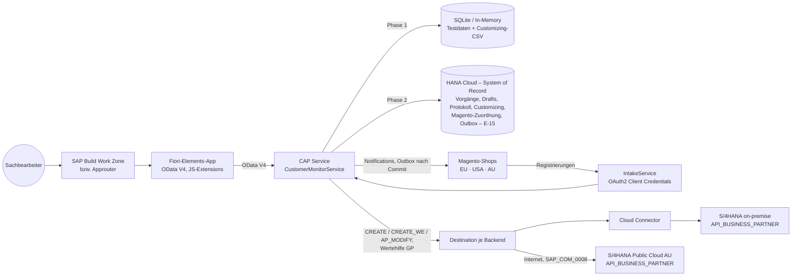

# 02 – Zielarchitektur BTP

## 1. Überblick



| Komponente | Rolle |
|---|---|
| Fiori-Elements-App (`app/monitor`) | Liste, Detail, Bearbeitung (Draft), Schrittausführung – annotationsgetrieben, ~300 Zeilen eigene Extensions. Keine Geschäftslogik. Siehe [09](09_migration_fiori_elements.md). |
| CAP Service (`srv/`) | Stabiler OData-V4-Vertrag für die UI inkl. UI-Semantik (Annotationen, E-13). **Ab Phase 2 das führende System für die Vorgänge** (E-15): Eingang aus Magento, Freigabeprüfung, Statusmaschine und Schrittlogik, Änderungsprotokoll, Notifications; Berechtigungsprüfung (Rolle + VKORG je Backend), Fehler-Mapping. |
| SAP HANA Cloud (HDI) | Vorgänge mit Arbeitsdaten und Protokoll, Drafts, Customizing je Backend, Magento-Zuordnung (Company/Customer/Address ↔ SAP-Nummern), Benutzer-Zuordnung (VKORG), Outbox. Tägliche Sicherung, Log-Backups ≤ 15 min, Point-in-Time Recovery (§8). |
| S/4HANA (on-premise, Public Cloud) | **Stammdatensystem, kein Monitor-Code.** Wird nur über die freigegebene Standard-API `API_BUSINESS_PARTNER` angesprochen (Geschäftspartner, Debitor, Ansprechpartner, Warenempfänger, Wertehilfe). Keine Z-Tabellen, keine Z-Services, keine Schrittklassen mehr für den Monitor ([10](10_s4_schnittstelle.md)). |
| Magento | Sendet Registrierungen, Shop-Benutzer und Lieferadressen an den `IntakeService` (Payload wie heute an `ZEC_CUSTOMER_CREATE_SRV`); empfängt Notifications vom CAP-Service (gleiche Ziele und Inhalte wie heute). Umstellung der Endpunkte durch TechDivision in Phase 3 (Cutover). |
| Integration Suite | Nicht im Laufzeitpfad nötig. Optional: API-Management-Proxy vor dem `IntakeService` (API-Key, Quota, Analytics) oder ein iFlow, falls HYDAC alle externen Aufrufe zentral führen will (E-16). |

## 2. Phasen

| Phase | Inhalt | Ergebnis |
|---|---|---|
| **1 – Frontend** | Freestyle-UI5-App + CAP-Mock mit Customizing-CSV und simulierter Statuslogik (erledigt) | Vollständig klickbare App lokal (`cds watch`) |
| **1b – Fiori Elements** | Migration auf Fiori Elements V4 gemäß [09](09_migration_fiori_elements.md): Aktionen je Schritt, Draft, Annotationen als Vertrag (F-11–F-22) | FE-App gegen den Mock, Freestyle-App entfernt |
| 2 – Persistenz und Anbindung (E-15) | HANA Cloud als führende Ablage (Customizing-Tabellen je Backend + Pflege-App, `backendSystem`), Magento-Eingang (`IntakeService`), Schrittlogik produktiv, Notifications per Outbox, Geschäftspartner-API gegen Q4H über Destination + Cloud Connector + Principal Propagation | App arbeitet auf echten Vorgängen gegen das Q-System |
| 2b – Weitere Backends | Destinations für USA und AU Public Cloud (`SAP_COM_0008`, OAuth2 SAML Bearer), Backend-Registry, Magento-Shops je Region | Eine App, mehrere Backends |
| 3 – Betrieb und Cutover | XSUAA-Rollen, VKORG-Zuordnung, MTA, HTML5 Repo, Work Zone, HANA Cloud, Monitoring; Übernahme offener Vorgänge aus `ZEC_CUSTOMER`, Umschaltung der Magento-Endpunkte, Stilllegung der Z-Services | Produktiv |

## 3. Entscheidungen

| ID | Entscheidung | Status |
|---|---|---|
| E-01 | Datenzugriff der UI ausschließlich über CAP OData V4 | entschieden |
| E-02 | UI: **SAP Fiori Elements für OData V4** (`sap.fe.templates`, List Report + Object Page, FCL) mit JavaScript-Extensions; ersetzt Freestyle SAPUI5 (Phase 1). Begründung und Design: [09](09_migration_fiori_elements.md) | entschieden (22.10.2026) |
| E-03 | Phase 1 gegen CAP-Mock, Vertrag identisch zu Phase 2 | entschieden |
| E-04 | Schrittausführung über **je eine gebundene Aktion pro Schritt** (`release`, `rejectRequest`, `clarify`, `reset`, `createCustomer`, `createShipTo`, `modifyContact`, `convertToNewCustomer`, `completeManually`, `assignExistingCustomer`, `changeCustomerAssignment`); erlaubte Schritte liefert der Service als Flags `can*` (`Core.OperationAvailable`, aus Customizing + Rollen); Rückfragen per OData Strict Handling (`Prefer: handling=strict` → 412). Ersetzt `executeStep`/`availableSteps`. | entschieden (22.10.2026) |
| E-05 | ETag bei `draftEdit` (Bearbeitungsbeginn), bei PATCH auf dem Draft und bei Schrittaktionen am aktiven Vorgang; während der Bearbeitung pessimistische Draft-Sperre (15 min, verlängert bei jeder Änderung); Schritte sind gesperrt, solange ein Draft existiert. Ersetzt „ETag statt Sperre“. | angepasst (22.10.2026) |
| E-06 | ~~Logik bleibt in S/4 (`ZCL_EC_CUSTOMER`, Schrittklassen). CAP reimplementiert keine Stammdatenanlage.~~ | **abgelöst durch E-15** (06.11.2026) |
| E-07 | ~~S/4-Service-Technik: RAP (OData V4) oder SEGW (OData V2)~~ | **entfällt** – kein eigener S/4-Service mehr (E-15) |
| E-08 | Statusmaschine aus einer Kopie des Customizings (`ZEC_CUST_PROCESS`, `ZEC_CUST_STEPS`, `ZEC_CUST_APPROV`); Phase 1 als CSV, ab Phase 2 als Tabellen in HANA je Backend (E-18) | entschieden |
| E-09 | Bestätigungsdialog auch für CREATE / CREATE_WE / AP_MODIFY (Altsystem: ohne) | vorgeschlagen, mit Fachbereich klären |
| E-10 | Namespace / App-ID `hydac.custmon` | vorgeschlagen |
| E-11 | Bearbeiten nur bei offenem Status (0xx/1xx) und freigegebenem Vorgang (`isEditable`); geprüft bei `draftEdit` | vorgeschlagen, mit Fachbereich klären |
| E-12 | `Requests` ist **draft-enabled** (`@odata.draft.enabled`): Fiori Elements V4 bietet Bearbeiten/Sichern/Abbrechen nur für Draft-Entitäten; Protokoll (`log`) bleibt Assoziation ohne Draft. Drafts benötigen ab Phase 2 eine persistente Datenbank (HANA Cloud). | entschieden (22.10.2026) |
| E-13 | Annotationen in `srv/monitor-annotations.cds` (Labels, Texte, Wertehilfen, Kritikalität, Side Effects, Edit-Sichtbarkeit) sind **Teil des Service-Vertrags**; `app/monitor/annotations.cds` enthält nur Layout. | entschieden (22.10.2026) |
| E-14 | ~~Phase 2: CAP hält eine HANA-Replik von `Requests` mit Write-through und Delta-Pull; S/4 bleibt System of Record.~~ | **abgelöst durch E-15** (06.11.2026) |
| E-15 | **BTP ist das führende System für die Vorgänge; S/4 nur über Standard-APIs.** Vorgänge, Arbeitsdaten, Protokoll, Customizing und Magento-Zuordnung liegen in HANA Cloud. Magento liefert an den CAP-Service, die Schrittlogik (heutige Statusmaschine) läuft in CAP, die Stammdatenschritte rufen `API_BUSINESS_PARTNER` des jeweiligen S/4-Systems, Notifications gehen aus CAP nach dem Commit über die Outbox. **Keine Z-Schnittstellen in S/4** – weder on-premise noch in der Public Cloud; ein Design für alle Regionen. Ersetzt E-06, E-07, E-14. Begründung: Clean Core auf beiden Seiten, kein ABAP-Entwicklungsbedarf (insbesondere nicht in der AU Public Cloud, wo die freigegebenen ABAP-Cloud-Objekte keine Debitorrollen anlegen können), die Schrittlogik existiert bereits in CAP (Phase 1), R-01/R-03/R-04/R-11 werden mit CAP-Mitteln (Transaktion, Outbox) gelöst. | entschieden (06.11.2026) |
| E-16 | **Magento-Eingang** direkt am CAP-`IntakeService` (XSUAA Client Credentials, Service Key für TechDivision), Payload-Struktur wie heute (`ZEC_CUSTOMER_CREATE_SRV`), idempotent auf Magento-IDs. Optional API-Management-Proxy (Integration Suite) als externer Einstiegspunkt mit Quota und Analytics. | vorgeschlagen |
| E-17 | **Notifications** aus der persistenten CAP-Outbox (`cds.queued`) über eine HTTP-Destination je Magento-Shop; Ziele und Inhalte wie heute (ID-Notification, `RejectCusomterSet`), Versand nur nach Commit, Wiederholung automatisch, Ergebnis im Protokoll (R-03/R-04). Kein iFlow im Laufzeitpfad. | vorgeschlagen |
| E-18 | **Customizing als Tabellen in HANA** je `backendSystem` (`ProcessSteps`, `ApprovalRules`, `Steps`, Statustexte), Pflege über eine kleine Fiori-Elements-Liste (Rolle `MonitorAdmin`), Initialbestand aus den CSVs in `db/data`; Cache mit Invalidierung beim Sichern. | vorgeschlagen |
| E-19 | **Personenbezogene Daten auf BTP:** `@PersonalData`-Annotationen auf Ansprechpartner-/Adressfeldern, Audit Logging über `@cap-js/audit-logging` + SAP Audit Log Service (Lesen/Ändern personenbezogener Daten), Löschregel für abgeschlossene Vorgänge als Job (SAP Job Scheduling Service), Datenresidenz je Deployment-Option ([11](11_design_review_hydac.md) §6.3). | vorgeschlagen, mit HYDAC Datenschutz klären |

## 4. Repository-Struktur

```
kundenmonitor-btp/
├── CLAUDE.md
├── README.md
├── docs/
├── package.json            # CAP-Root, npm workspaces ["app/*"]
├── .cdsrc.json
├── db/
│   ├── schema.cds
│   ├── data/               # CSV: Testvorgänge (Phase 1) + Customizing-Kopie (Initialbestand ab Phase 2, E-18)
│   ├── src/.hdiconfig      # HDI-Konfiguration (O-02)
│   └── undeploy.json
├── srv/
│   ├── monitor-service.cds       # Entitäten (Draft-Root), Aktionen je Schritt, Capabilities, @restrict
│   ├── monitor-annotations.cds   # Vertrags-Semantik: Labels, Common.Text, Wertehilfen, Side Effects (E-13)
│   ├── monitor-service.js        # Flags, Dispatcher, Strict Handling, Draft-Guards
│   ├── intake-service.cds/.js    # Phase 2: Eingang aus Magento (E-16)
│   ├── backend/                  # Schrittlogik (B-04): index.js, mock.js (Phase 1 → Produktivlogik ab Phase 2), s4-bp.js (Geschäftspartner-API, B-03)
│   ├── external/                 # Phase 2: API_BUSINESS_PARTNER.edmx/.csn (cds import), data/ für cds mock
│   └── lib/                      # status-machine.js (unverändert), errors.js
├── _i18n/                        # i18n*.properties (Labels), messages*.properties (Meldungen)
├── app/
│   └── monitor/                  # Fiori-Elements-App (eigene package.json, ui5.yaml; ui5-deploy.yaml, ui5-tasks/, xs-app.json für das HTML5-Repository)
│       ├── annotations.cds       # Layout: SelectionFields, LineItem, HeaderInfo, Facets, Aktionsgruppe
│       └── webapp/               # Component, manifest, ext/ (Fragments, Controller-Extension), i18n, test/
├── test/                   # Service-Tests
├── xs-security.json        # Rollen, Attribut SalesOrg (O-01, §5)
├── mta.yaml                # Deployment-Deskriptor (O-02, §7)
└── mta-cloud-logging.mtaext # optionale Cloud-Logging-Bindung (O-03, §8)
```

## 5. Berechtigungen (Ziel)

| Rolle (Role Template) | Darf | Altsystem-Pendant |
|---|---|---|
| `MonitorViewer` | Lesen | Anzeige |
| `MonitorEditor` | Lesen, Bearbeiten, Schritte ausführen | Änderung |
| `MonitorReleaser` | zusätzlich nicht freigegebene Vorgänge sehen, Freigeben | `ZEC_MONITO` ACTVT 43 |
| `MonitorAdmin` (Phase 2) | Customizing und VKORG-Zuordnung je Backend pflegen | Customizing-Transaktionen |

- Attribut `SalesOrg` (Liste von VKORG) am Benutzer; CAP filtert per `@restrict … where: 'salesOrganization = $user.SalesOrg'` (Verhalten bei mehrwertigen Attributen beim Setup gegen die aktuelle CAP-Doku prüfen). Ersetzt `V_KNA1_VKO` + `V_VBAK_VKO` durch **eine** Regel (siehe [07](07_anforderungen_aus_altsystem.md), R-08). Ab Phase 2b alternativ Tabelle `UserAssignments` (Benutzer, Backend, VKORG), siehe [11](11_design_review_hydac.md) §6.5.
- Umsetzung (O-01): `xs-security.json` mit Scopes/Role Templates `MonitorViewer`, `MonitorEditor`, `MonitorReleaser` (jede mit Attribut `SalesOrg`) und Role Collections `Kundenmonitor_Viewer`, `Kundenmonitor_Editor`, `Kundenmonitor_Releaser` (jeweils inkl. Viewer, da der Service `MonitorViewer` verlangt). `SalesOrg` ist optional: ohne Wert sieht der Benutzer nichts (fail closed); Werte pflegt der Admin je Rolle im Cockpit (statisch oder IdP-Mapping). `MonitorReleaser` prüft nur der Handler, daher fehlt er in `cds compile --to xsuaa` – `test/xs-security.test.js` sichert die Datei gegen Modell und Mock-User ab. **Redirect-URIs** (Code-Review 06.11.2026): kein landschaftsweiter Wildcard (`https://*.hana.ondemand.com/**` ließe jede App der Landschaft als Login-Ziel zu); `xs-security.json` enthält nur den Business-Application-Studio-Eintrag, `mta.yaml` setzt `https://*.${default-domain}/**` (DEV), und für QAS/PRD wird der Work-Zone-Host per `mta-redirect-uris.mtaext` eingetragen.
- Phase 2: Principal Propagation für die Geschäftspartner-API, damit S/4 die Anlageberechtigung des echten Benutzers prüft und Änderungsbelege auf ihn laufen. Da die Vorgänge in HANA liegen, ist der CAP-Filter die einzige Leseberechtigung – es gibt keinen zweiten Lesepfad.
- Phase 1: Mock-User in `.cdsrc.json` (`alice` = alle Rollen, VKORG 0001/2000/7050; `bob` = Viewer, VKORG 0001).

## 6. Phase 2 – Anbindung an S/4 über Standard-APIs (E-15)

Es gibt keinen eigenen S/4-Service mehr. S/4 muss je Backend bereitstellen ([10](10_s4_schnittstelle.md)):

- **On-premise (Q4H/GWQ, Produktion):** den aktivierten Standard-OData-Service `API_BUSINESS_PARTNER` (OData V2; Aktivierung in `/IWFND/MAINT_SERVICE`, Release/SP von Q4H zu bestätigen), den Pfad `/sap/opu/odata/sap/API_BUSINESS_PARTNER/` im Cloud Connector, Principal Propagation (Systemzertifikat, `CERTRULE`) oder übergangsweise einen technischen Benutzer, Berechtigungen für Geschäftspartner-/Debitoranlage je VKORG.
- **Public Cloud (AU):** Kommunikationsszenario `SAP_COM_0008` mit Kommunikationssystem und -vereinbarung; Benutzerweitergabe per OAuth 2.0 SAML Bearer Assertion (Destination `OAuth2SAMLBearerAssertion`), sonst Zertifikat; Business-Rollen für die Stammdatenanlage.
- **Felder:** dort, wo die Schrittklassen heute Z-Felder schreiben (Magento-Company am Debitor, CRM-Nummer VKORG 2000), entweder Key-User-Custom-Fields (werden in `API_BUSINESS_PARTNER` ausgespielt) oder die Zuordnung bleibt in HANA ([10](10_s4_schnittstelle.md) §3). Zu prüfen im System.

BTP implementiert: Eingang (E-16), Freigabeprüfung und Statusmaschine (vorhanden), Stammdatenschritte als Aufruffolgen auf die Geschäftspartner-API mit sofortiger Persistenz der erzeugten Nummern (R-11), Notifications (E-17), Customizing-Pflege (E-18), Cutover-Werkzeuge (B-08).

## 7. Deployment auf BTP (O-02)

Erzeugt mit `cds add hana,xsuaa,html5-repo,workzone,mta` (cds-dk 9) und an das Projekt angepasst:

| Baustein | Datei / Modul | Hinweis |
|---|---|---|
| CAP-Service (Node.js) | `mta.yaml` → `kundenmonitor-btp-srv` (`gen/srv`) | Profil `production`: `db: hana`, `auth: xsuaa` (`package.json` → `cds.requires`); lokal bleiben SQLite in-memory und Mock-Auth (`.cdsrc.json`). Phase 2: `cds.requires.outbox` / Queue für die Notifications (E-17), Remote-Service `API_BUSINESS_PARTNER` mit `credentials.destination` je Backend |
| SAP HANA Cloud (HDI) | `kundenmonitor-btp-db-deployer` (`gen/db`), `db/src/.hdiconfig`, `db/undeploy.json` | Drafts, Vorgänge, Customizing und Outbox liegen im HDI-Container (E-12, E-15). In Phase 1 deployt der Deployer auch die Demo-CSVs (`db/data`) – das System ist dann ein Mock mit Testdaten, kein Produktivsystem |
| XSUAA | Ressource `kundenmonitor-btp-auth` → `xs-security.json` (O-01) | `xsappname` je Org/Space und Redirect-URIs aus `mta.yaml` (QAS/PRD: `mta-redirect-uris.mtaext`, §5); Phase 2 zusätzlich ein Service Key (Client Credentials) für den Magento-Eingang (E-16) |
| HTML5-Repository + Managed Approuter | `kundenmonitorbtpmonitor` (`app/monitor`, `npm run build` → `ui5-deploy.yaml`), `kundenmonitor-btp-app-deployer`, `kundenmonitor-btp-destinations`, `app/monitor/xs-app.json` | `sap.cloud.service` = `kundenmonitorbtp.service`; Route `^/odata/` → Destination `srv-api` (Token-Weitergabe). Der Build schreibt die OData-URI im `manifest.json` relativ (`ui5-tasks/relative-odata-uri.js`), die Quelle bleibt absolut für `cds watch` |
| Work-Zone-Kachel | `manifest.json` → `sap.app.crossNavigation` (Intent `Kundenmonitor-display`, Titel/Untertitel aus i18n) | Im Work-Zone-Content-Manager: Content-Provider „HTML5 Apps“ aktualisieren, App einer Gruppe/Rolle zuordnen; Role Collections aus O-01 an Benutzer bzw. Gruppen |

Build und Deployment:

```bash
npx mbt build -t mta_archives          # → mta_archives/kundenmonitor-btp_0.1.0.mtar (mbt global oder per npx)
cf deploy mta_archives/kundenmonitor-btp_0.1.0.mtar
```

Voraussetzungen im Subaccount: Cloud-Foundry-Space, SAP HANA Cloud-Instanz (für `hdi-shared`), Einträge für `html5-apps-repo`, `destination`, `xsuaa`, SAP Build Work Zone (standard); Phase 2 zusätzlich `connectivity` (Cloud Connector), optional SAP Audit Log Service (E-19) und Job Scheduling Service. Nach dem ersten Deployment prüfen: Role Collections vorhanden (siehe O-01), `SalesOrg`-Werte je Rolle gepflegt.

## 8. Betrieb: Logging, Monitoring, Transport (O-03)

- **Health Check:** `mta.yaml` → `kundenmonitor-btp-srv` nutzt `health-check-type: http` auf `/health` (CAP, ohne Anmeldung; `test/monitor-service.test.js` „O-03“). Antwortet der Endpunkt nicht, startet Cloud Foundry die Instanz neu.
- **Logging:** CAP schreibt strukturierte Logs nach stdout; mit Bindung an SAP Cloud Logging formatiert es sie automatisch passend (`cds.env.log.aspects`: `cf`, `als`, `cls`), inkl. Korrelations-ID je Request. Die Bindung ist optional, weil sie ein Entitlement braucht: Ressource `kundenmonitor-btp-logging` steht in `mta.yaml` auf `active: false` und wird mit `cf deploy … -e mta-cloud-logging.mtaext` aktiviert. Ohne Bindung bleiben die Logs über `cf logs kundenmonitor-btp-srv` erreichbar. Autorisierungs-Header und Cookies maskiert CAP (`log.mask_headers`).
- **Monitoring:** Instanz-Status, Neustarts und Speicher im BTP-Cockpit bzw. `cf app kundenmonitor-btp-srv`; Dashboards und Alarme in SAP Cloud Logging (bei Bindung). Fachliche Kennzahlen (offene/fehlerhafte Vorgänge) liefert die App selbst über die Sichten mit Zählern (F-26). Phase 2: Outbox-Status (`cds.outbox.Messages`: Status, Versuche, letzter Fehler) als Kennzahl für hängende Notifications.
- **Datensicherung (ab Phase 2 geschäftskritisch, E-15):** SAP HANA Cloud sichert automatisch täglich (Datensicherung) und fortlaufend (Log-Backups, spätestens alle 15 min); Aufbewahrung standardmäßig 14 Tage, konfigurierbar 1–215 Tage je Instanz; Point-in-Time Recovery über HANA Cloud Central. Für PRD: Aufbewahrungsdauer nach HYDAC-Vorgabe setzen, Wiederherstellung einmal üben.
- **Transport (DEV → QAS → PRD):** Ein Build, ein Archiv: `mbt build` erzeugt `kundenmonitor-btp_<version>.mtar`, das unverändert durch die Landschaft wandert. Empfohlen: SAP Cloud Transport Management mit den Knoten DEV, QAS, PRD (je Knoten Destination auf den Deploy-Service des Ziel-Spaces); das Archiv wird in DEV hochgeladen (manuell, per SAP Continuous Integration and Delivery oder `cTMS`-Upload) und nach Test in QAS importiert bzw. weitergeleitet. Ohne CTMS: `cf deploy` des gleichen Archivs in den jeweiligen Space. Space-spezifische Werte (z. B. Cloud-Logging-Bindung, Destinations je Backend) kommen über MTA-Extension-Deskriptoren, nicht über geänderte Archive. Vor jeder Weitergabe: Version in `mta.yaml`/`package.json` erhöhen.
- **Datenstand Phase 1:** Der Deployer lädt die Demo-CSVs; vor einer produktiven Nutzung (Phase 2/3) die Testvorgänge aus `db/data` entfernen. Die Customizing-CSVs bleiben als Initialbestand der HANA-Tabellen (E-18) und werden danach nur noch über die Pflege-App geändert.
