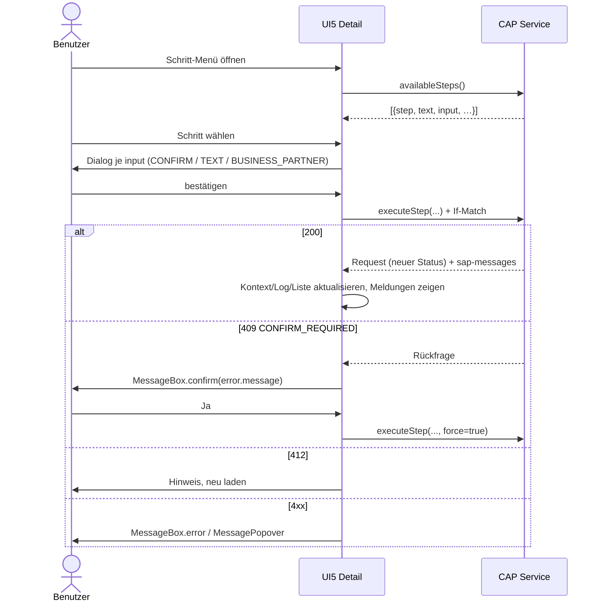

# 04 – UI-Spezifikation (Freestyle SAPUI5)

Zielgruppe: Innendienst, Desktop zuerst (≥ 1280 px), Tablet benutzbar. SAP Horizon Theme, Fiori-Design-Guidelines.

---

## 1. Layout und Navigation

`sap.f.FlexibleColumnLayout` mit Router (`sap.f.routing.Router`).

| Route | Pattern | Layout | Inhalt |
|---|---|---|---|
| `list` | `` | `OneColumn` | Filter + Vorgangsliste |
| `detail` | `requests/{id}` | `TwoColumnsMidExpanded` | Liste + Detail |
| `detailFull` | `requests/{id}/full` | `MidColumnFullScreen` | Detail im Vollbild |

- Spaltenaktionen im Detail: Vollbild ein/aus, Schließen (→ `list`).
- Deep-Link auf `requests/{id}` muss funktionieren (Lesezeichen, Mail-Link).
- Navigation weg von einem Detail mit ungesicherten Änderungen → Rückfrage „Änderungen verwerfen?“.

## 2. Liste (Begin Column)

`sap.f.DynamicPage`, Titel „Kundenmonitor“, Header = Filterbereich (einklappbar), Inhalt = `sap.m.Table`.

### 2.1 Filter

Filter werden mit **Start** (oder Enter in einem Feld) angewendet, **Zurücksetzen** stellt Defaults her. Aufbau mit `sap.m`-Controls in einem responsiven Grid; **kein** `sap.ui.comp`.

| Filter | Control | Default | OData |
|---|---|---|---|
| Suche (Name, Name 2, Magento-Company) | `SearchField` | – | `contains` auf name/name2/magentoCompany |
| Debitor | `Input` | – | `customer eq` |
| Verkaufsorganisation | `MultiComboBox` (Werte: VKORG des Benutzers) | alle erlaubten | `salesOrganization in` |
| Prozessart | `MultiComboBox` ← `/ProcessTypes` | alle | `processType in` |
| Status | `MultiComboBox` ← `/Statuses` | alle offenen | `status_code in` |
| Quelle | `MultiComboBox` | alle | `source in` |
| Bestellung vorhanden | `Select` (Alle/Ja/Nein) | Alle | `orderExists eq` |
| Erstellt am | `DateRangeSelection` | – | `createdAt ge/le` |
| Erstellt von / Geändert von | `Input` | – | `createdBy` / `modifiedBy` |
| Geändert am | `DateRangeSelection` | – | `modifiedAt ge/le` |
| Erledigte einbeziehen (9xx) | `CheckBox` | aus | ohne Haken: `status_code` nicht 9xx |
| Abgelehnte einbeziehen (8xx) | `CheckBox` | aus | ohne Haken: `status_code` nicht 8xx |
| Nur nicht freigegebene | `CheckBox` | aus | `released eq false` |
| Nur in Klärung | `CheckBox` | aus | `inClarification eq true` |

Filterzustand bleibt beim Wechsel Liste ↔ Detail erhalten (JSON-Model `view`), nicht über Sessions hinweg.

Umsetzung Status-Filter: Ist im Status-Filter explizit etwas gewählt, gilt nur diese Auswahl; die Haken „Erledigte/Abgelehnte einbeziehen“ wirken nur bei leerem Status-Filter. Werte für VKORG und Quelle per `$apply=groupby(...)` aus den für den Benutzer sichtbaren Vorgängen.

### 2.2 Tabelle

`sap.m.Table`, `growing` (Threshold 50), `sticky` Header, Titel „Vorgänge ({count})“ über `$count`. Default-Sortierung `createdAt` aufsteigend (Arbeitsvorrat: ältester zuerst), Sortierung per Spaltenmenü/`ViewSettingsDialog`.

| Spalte | Inhalt | Popin < 1024 px |
|---|---|---|
| Status | `ObjectStatus` (Icon + Text, State nach Gruppe, §5) | nein |
| Hinweise | Icons: nicht freigegeben, in Klärung, Bestellung vorhanden (je Tooltip) | nein |
| Prozessart | Text aus `ProcessTypes` | ja |
| Name | `ObjectIdentifier` (Titel name, Text name2) | nein |
| Debitor | customer | ja |
| VKORG | salesOrganization | ja |
| Magento-Company | magentoCompany | ja |
| Bestellvolumen | `ObjectNumber` (orderVolume, currency) | ja |
| Erstellt | createdAt (Datum/Zeit), createdBy | ja |
| Geändert | modifiedAt, modifiedBy | ja |

- Zeilen mit `orderExists = true`: `highlight="Information"` (Ersatz für die farbige Zeile im Altsystem).
- Status- und Prozessarttexte/-gruppen kommen aus den Codelisten `/Statuses` und `/ProcessTypes`, die die Komponente einmal lädt (Code → Text/Gruppe). `status` wird **nicht** expandiert: ändert ein Schritt den Statusschlüssel, scheitert sonst der Refresh der (selektierten, kept-alive) Listenzeile im V4-Model.
- Toolbar: Aktualisieren, Sortieren.
- Klick auf Zeile → Route `detail`. Ausgewählte Zeile bleibt markiert.
- Leerzustand: „Keine Vorgänge für die Filterkriterien gefunden.“

## 3. Detail (Mid Column)

`sap.uxap.ObjectPageLayout` mit `ObjectPageDynamicHeaderTitle`. Element-Binding auf `/Requests({id})` mit `$$updateGroupId: 'changes'`; `$expand`/`$select` für `salesData`, `admin`, `shipTo`, `log` erzeugt `autoExpandSelect` aus den Bindings (Status über Codeliste, s. §2.2).

### 3.1 Header

| Bereich | Inhalt |
|---|---|
| Titel | name (+ name2) |
| Untertitel | Prozessart-Text · Magento-Company |
| Status | `ObjectStatus` Status (Icon, State) |
| Freigabe | „Freigegeben (automatisch/manuell/nicht erforderlich)“ bzw. „Nicht freigegeben“ (State Warning) |
| Klärung | bei `inClarification`: `MessageStrip` (Warning) mit `clarificationComment` |
| Kennzahlen | Debitor, Geschäftspartner, VKORG, Bestellung vorhanden, Bestellvolumen |
| Verwaltung | Erstellt von/am, Geändert von/am |

### 3.2 Header-Aktionen

| Aktion | Sichtbar / aktiv wenn |
|---|---|
| Bearbeiten | Anzeigemodus, `isEditable`, Rolle Editor |
| Sichern (emphasized) / Abbrechen | Bearbeitungsmodus |
| Schritt ausführen (`Button` + `sap.m.Menu`; Menü wird erst nach dem Laden von `availableSteps()` geöffnet) | Anzeigemodus, Rolle Editor; Einträge aus `availableSteps()` (bei jedem Öffnen neu laden); deaktiviert bei ungesicherten Änderungen (Tooltip „Bitte zuerst sichern oder verwerfen“) |
| Aktualisieren | immer |

Destruktive Schritte (`destructive = true`) werden im Menü zuletzt und mit Warn-Icon angezeigt.

### 3.3 Abschnitte

Formulare als `sap.ui.layout.form.Form` mit `ColumnLayout`. Im Anzeigemodus `Text`, im Bearbeitungsmodus `Input`/`Select` (ein Control mit `editable`-Binding genügt).

| Abschnitt | Sichtbar | Felder (ro = nie editierbar) |
|---|---|---|
| Hauptdaten | immer | Anrede, Name 1–4 · Straße, Hausnummer, Straße 4, Straße 5, PLZ, Ort, Land · Sprache, Telefon, E-Mail · USt-IdNr., Steuernummer 2, Suchbegriff 2, Branche, DUNS |
| Ansprechpartner (Admin) | `processType ≠ CR_WE` | AP-Nummer (ro), GP (ro), Magento-Customer (ro), Webshop-Rolle, Anrede, Vorname, Nachname, Funktion, Abteilung, Sprache, Telefon, E-Mail |
| Vertriebsdaten | immer | VKORG (ro), Vertriebsweg, Sparte, Verkäufergruppe, Verkaufsbüro, Kundengruppe, Verkaufsbezirk, Incoterms 1/2 |
| Warenempfänger | `processType = CR_WE` | WE-Nummer (ro), GP (ro), Magento-Address (ro), „Adresse in Auftrag verwendet“ (ro), Name 1–4, Straße, Hausnummer, Straße 4/5, PLZ, Ort, Land, USt-IdNr. |
| Zuordnung | immer | Debitor, Geschäftspartner, Warenempfänger, AP-Nummer, Magento-Company/-Customer/-Address, Quelle, Freigabeverfahren, Freigegeben von/am (alle ro) |
| Protokoll | immer | Tabelle `log` (s. u.) |

Protokoll-Tabelle: Typ (Icon), Zeitpunkt, Benutzer, Schritt, Meldung, Feld, Alter Wert, Neuer Wert. Neueste zuerst. Wird nach jedem Sichern und jedem Schritt neu geladen.

Feldlängen/Pflichtfelder aus Metadaten; Validierung clientseitig nur für Format (Länge, E-Mail), fachliche Prüfung im Backend.

## 4. Abläufe

### 4.1 Bearbeiten und Sichern

1. **Bearbeiten** → `view>/editMode = true`.
2. Änderungen landen in Update-Gruppe `changes` (kein Auto-Submit).
3. **Sichern** → `submitBatch('changes')`.
   - Erfolg: MessageToast „Gesichert“, `editMode = false`, Log neu laden.
   - 412: MessageBox „Der Vorgang wurde zwischenzeitlich geändert. Daten werden neu geladen; Ihre Änderungen gehen verloren.“ → `resetChanges('changes')`, Refresh.
   - Fachlicher Fehler: Meldungen im `MessagePopover`, Bearbeitungsmodus bleibt.
4. **Abbrechen** → bei `hasPendingChanges()` Rückfrage, dann `resetChanges('changes')`, `editMode = false`.

### 4.2 Schritt ausführen

Dialoge je `input`:

| input | Dialog |
|---|---|
| `CONFIRM` | `MessageBox.confirm` mit Schritttext; bei `destructive` Titel/Icon Warning, Default-Aktion Abbrechen |
| `TEXT` | `Dialog` mit `TextArea` (Pflicht, `maxLength = textMaxLength`, Zeichenzähler sichtbar); OK erst aktiv bei Eingabe |
| `BUSINESS_PARTNER` | `Dialog` mit `Input` (max. 10 Zeichen, nur Ziffern; führende Nullen ergänzt der Server); Phase 2: Wertehilfe |
| `NONE` | direkt ausführen |

Während des Aufrufs: ObjectPage `busy`. Nach Erfolg: MessageToast mit Schritttext + neuem Status; bei Fehlerstatus (140/150/160) MessageBox.warning mit den Meldungen. Geänderte Prozessart blendet Abschnitte automatisch um (Binding).

### 4.3 Meldungen

- Zentrales Message-Model (`sap.ui.core.Messaging`), `MessagePopover` über Button im Detail-Footer (Anzahl als Badge, Button-Typ nach höchstem Schweregrad).
- Technische Fehler (Netzwerk, 5xx): `MessageBox.error` mit Hinweis auf erneuten Versuch.

## 5. Status-Darstellung (Formatter)

Gruppe kommt vom Service (`Statuses.group`), die UI mappt nur:

| group | Status | ValueState | Icon |
|---|---|---|---|
| OPEN | 000, 010, 110, 120, 130 | Information | `sap-icon://pending` |
| ERROR | 140, 150, 160 | Error | `sap-icon://error` |
| REJECTED | 899 | None | `sap-icon://decline` |
| DONE | 997, 998, 999 | Success | `sap-icon://complete` |

Hinweis-Icons: nicht freigegeben `sap-icon://locked`, in Klärung `sap-icon://question-mark`, Bestellung `sap-icon://cart`.

## 6. Texte und Sprachen

- UI-Texte: `i18n.properties` (EN, Fallback) und `i18n_de.properties`. Weitere Sprachen (FR, IT, NL, SV) später; Schlüssel stabil halten.
- Status-, Prozessart- und Schritttexte kommen sprachabhängig vom Service.
- Domänenbegriffe deutsch wie im Altsystem (Debitor, Warenempfänger, Freigabe, Klärung).

## 7. Nicht im Umfang Phase 1

- Geschäftspartner in S/4 anzeigen (Link-Ziel klären: Fiori-App vs. GUI-Transaktion) → Phase 2.
- Wertehilfen für Land, Sprache, BP, Verkaufsdaten → Phase 2.
- Delta-Ansicht Original-Payload vs. aktueller Stand (Altsystem `ZDELTA`) → klären, ob benötigt.
- Personalisierung (Tabellenvarianten), Export nach Excel.
