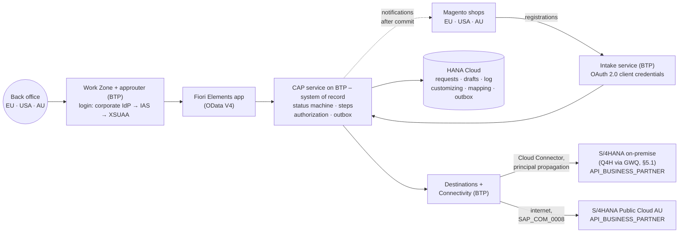
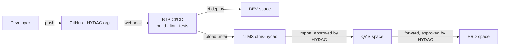
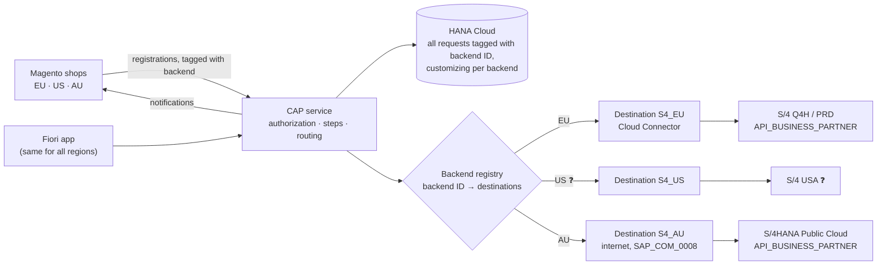
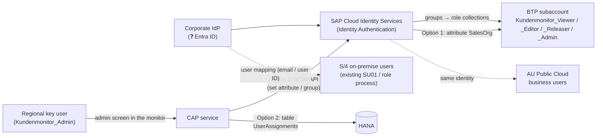

# 11 – Customer Monitor on SAP BTP: Design Review

Status: **Draft for the review session with HYDAC IT, 6 November 2026** (revision 2: BTP is the system of record, no custom interfaces in S/4 — decision E-15). Prepared by purplecat (Igor Vorobev) in reply to Peter Wurst's request.
Audience: Peter Wurst, Uli, Franca, Mathias, Gareth.
Proposed slot: **Fri 6 Nov, 17:00–18:00 CET (11:00 ET)**. The Wed 4 Nov slot can no longer be prepared in time. Duration: 60 min. Pre-read: this document, sent at least 24 h ahead; the session walks through §1, §3, §4, §5 and §6, the rest is reference.

This document is the basis for the review session. Each numbered section can be presented as one or two slides. Detailed specifications live in the project repository (`docs/01`–`docs/10`) and are referenced where relevant.

**Legend:** ✅ built and tested · 🟡 designed, not built · 💡 proposal, needs agreement · ❓ open question for HYDAC · *Assumption* = our current understanding, please correct.

---

## Agenda (60 min)

| # | Topic | Time | Section |
|---|---|---|---|
| 1 | Summary and current status | 5 min | §1 |
| 2 | Functional design: purpose, users, use cases, data | 10 min | §2 |
| 3 | Solution architecture: BTP as system of record, S/4 through standard APIs only | 5 min | §3 |
| 4 | Requested BTP, Git and transport elements mapped to requirements | 10 min | §4 |
| 5 | Integration: Magento intake, business-partner API (Q4H / GWQ, production, Public Cloud), notifications, Integration Suite | 10 min | §5 |
| 6 | **Multi-region: EU, USA, Australia – backends, data restriction, user management** | 10 min | §6 |
| 7 | Ongoing administration and ownership | 5 min | §7 |
| 8 | Decisions and next steps | 5 min | §8–§10 |

---

## 1. Summary

- **What:** a replacement for the SAP GUI report `ZEC_CUSTOMER_MONITOR`. Back-office staff use it to review and process the customer, contact person and ship-to requests that the Magento B2B shops send to SAP.
- **Where:** one monitor for the back offices in **Europe, the USA and Australia**. The requests of all regions live in one place on BTP; the master data is created in the region's SAP system: S/4HANA on-premise (Q4H/GWQ and production) and HYDAC Australia's S/4HANA Public Cloud (§6).
- **How:** a SAP Fiori Elements app (OData V4) on top of a SAP CAP (Node.js) service with SAP HANA Cloud on SAP BTP, Cloud Foundry. Users open it from SAP Build Work Zone. **The CAP service is the system of record for the requests:** Magento sends registrations to BTP, the approval check, the status machine and the steps run in CAP, and CAP notifies Magento. The SAP systems are reached **only through the released standard API `API_BUSINESS_PARTNER`** (business partner, customer, contact person, ship-to). **No custom (Z) interfaces in S/4**, neither on-premise nor in the Public Cloud (§5).
- **Data restriction:** every user sees only the requests of the sales organizations assigned to them, per backend (region), enforced in the CAP service. Master-data steps reach the SAP system as the real user (principal propagation), so S/4 checks the creation authorization again (§6.4).
- **User management:** identity and roles come from HYDAC's corporate identity provider (groups → role collections); the sales-org scope is assigned by regional key users in an admin screen of the monitor. No per-user maintenance in the BTP cockpit (§6.5).
- **Status today:**
  - ✅ Phase 1 is finished: the complete UI runs against a CAP mock service that reproduces the legacy status machine from a copy of the S/4 customizing. It covers 26 test requests, all process types and all steps, with automated tests (service tests and browser UI journeys). Under the new design this mock logic **is** the production step logic; it does not get thrown away.
  - ✅ The deployment package is ready: roles, MTA descriptor, HANA Cloud (HDI), HTML5 repository, Work Zone tile, health check and logging. The MTA archive builds locally. **Nothing has been deployed yet**, because a BTP subaccount is not available yet.
  - 🟡 For phase 2 there is a draft of the three backend interfaces (`docs/10`): Magento intake, business-partner API calls per step, notifications. **No development in S/4 is required.** The multi-backend routing (§6) is a design proposal.
- **Ask:** the BTP, Git and transport setup from our email, so that we can deploy, connect to Q4H/GWQ and start phase 2. §4 maps each item to a requirement. Nothing in §6 blocks the DEV setup; it shapes the decisions D4 and D8–D10.

---

## 2. Functional design

### 2.1 Business purpose

Magento sends three kinds of input to SAP (today: the custom service `ZEC_CUSTOMER_CREATE_SRV` in S/4 on-premise; target: the monitor's intake service on BTP, §5.2):

1. **Company registrations.** New companies, or companies that already exist as a customer (Debitor).
2. **New shop users.** Contact persons (Ansprechpartner) for an existing customer.
3. **New delivery addresses.** Ship-to parties (Warenempfänger) for an existing customer.

Neither today nor in the target does the intake create master data directly. Each input is stored as a **request** (today: table `ZEC_CUSTOMER` in S/4; target: HANA Cloud on BTP) with the original and a working copy of the payload, and an approval check runs. The back office reviews and completes the request in the monitor. They then trigger **steps** that create or assign the business partner, customer, contact person or ship-to in the SAP system. The monitor reports the results back to Magento.

Business value of the new monitor compared with the SAP GUI report:

| Area | Legacy (SAP GUI) | New (BTP / Fiori) |
|---|---|---|
| Access | SAP GUI, transaction, one system | Browser via Work Zone, one app for all regions, deep links (e.g. in emails) |
| Work queue | One list with filters | Tabs with counters: My work, Errors, Clarification, Release, All; sorted by priority and waiting time; "next step" recommendation per request |
| Concurrency | Steps run without a lock, so two users can create the same customer twice (R-01) | Edit lock (draft), version check (ETag) on every step, steps serialized per request in one HANA transaction |
| Authorization | Two different sales-org checks (R-08) | One sales-org rule in the CAP service for the list, the detail and all sub-data; S/4 checks the real user when master data is created |
| Robustness | Several known defects (R-01…R-16, `docs/07`) | Fixed by design in the CAP service; nothing depends on changes in S/4 |
| Custom code in SAP | Tables, customizing, step classes, Gateway services, BAdI (`ZEC_*`, `ZCL_EC_*`) | **None.** The SAP systems serve the standard business-partner API only |

### 2.2 Users and roles

| Role (BTP role collection) | Who | May | Legacy equivalent |
|---|---|---|---|
| `Kundenmonitor_Viewer` | Sales / customer service staff who only need to look up requests | Read requests of their own sales organizations | Display |
| `Kundenmonitor_Editor` | Back office (Innendienst) per sales organization, in EU, USA, AU | + edit request data, run steps | Change |
| `Kundenmonitor_Releaser` | Users who approve requests that need a release (Freigabe) | + see unreleased requests and release them | Auth. object `ZEC_MONITO` ACTVT 43 |
| `Kundenmonitor_Admin` 💡 | Regional key users | Maintain customizing (steps, approval rules, texts) and sales-org assignments for their region | Customizing transactions |

The roles define **what** a user may do. **Which** requests they see is defined by the sales organizations assigned to them per backend (§6.4, §6.5). A user without an assignment sees nothing (fail closed). The same role collections serve all regions; there are no region-specific roles.

❓ Number of users per role, region and sales organization, and request volume per day per region. We need these for sizing and for the user administration effort (§7).

### 2.3 Use cases

| ID | Use case | Role | Result |
|---|---|---|---|
| UC-01 | **Work the queue:** open the monitor, see My work / Errors / Clarification / Release with counters, sorted by priority and waiting time; only the user's own sales orgs (and therefore regions) | Viewer+ | – (read) |
| UC-02 | **Review a request:** main data, contact person or ship-to, sales data, assignment (SAP and Magento numbers, release reason), processing log | Viewer+ | – (read) |
| UC-03 | **Correct or complete data** before processing (draft: edit, save, cancel; locked for other users while editing; every field change logged) | Editor | Working copy updated, change log |
| UC-04 | **Release** a request that needs approval (rule per process type + sales org: manual, by credit card, or by order volume limit) | Releaser | Released (manual), log |
| UC-05 | **Create customer and admin contact** (step CREATE) | Editor | Business partner + customer + contact person created in S/4 through the standard API; Magento notified by the monitor |
| UC-06 | **Create / change contact person** (AP_MODIFY) | Editor | Contact person created or changed in S/4; Magento notified |
| UC-07 | **Create ship-to party** (CREATE_WE) | Editor | Ship-to created in S/4 and assigned to the sold-to (partner function); Magento notified |
| UC-08 | **Handle duplicates:** assign an existing customer (CHNG_OLD), change the assignment (CNG_DEBI, with a confirmation question if the customer already belongs to another Magento company), convert to a new customer (CNG_NEW) | Editor | Process type changes, release re-checked; customer read from S/4, Magento mapping from the monitor |
| UC-09 | **Put in clarification (Klärung)** with a mandatory comment | Editor | Flag + comment, status unchanged |
| UC-10 | **Reject** with a mandatory reason (≤ 100 characters) | Editor | Status Rejected; Magento notified with reason |
| UC-11 | **Complete manually** (handled outside the monitor) / **reset** a closed request for reprocessing | Editor | Status Manually completed / back to open |
| UC-12 | **Fix errors:** a failed step sets an error status (140/150/160) and logs the messages from S/4; the user corrects the data and repeats the step. Numbers already created in S/4 are kept, so a repeat never creates a second business partner (R-11) | Editor | Step repeated |
| UC-13 💡 | **Maintain customizing** per region: allowed steps, approval rules and limits, status texts; sales-org assignments of users | Admin | Takes effect without a deployment |

Which steps are allowed is decided **by the service** (customizing per backend/region + role). Each region keeps its own rules. The UI only shows what the service allows.

### 2.4 Process types, statuses and steps (compact)

| Process type | Meaning | Start | Typical end |
|---|---|---|---|
| `CR_DEB` | New company without SAP customer | 000 New | CREATE → 999 Done |
| `CH_DEB` | Company with existing customer | 000 | AP_MODIFY → 999 |
| `CR_AP` | New shop user for existing customer | 000 | AP_MODIFY → 999 |
| `CH_AP` | Change of existing contact person | 997 Automatically done | – |
| `CR_WE` | New delivery address | 010 | CREATE_WE → 999 |

Status groups: **open** (0xx/1xx), **error** (140, 150, 160), **rejected** (899), **done** (997, 998, 999).
Steps: CREATE, CREATE_WE, AP_MODIFY, CHNG_OLD, CNG_DEBI, CNG_NEW, MANUAL_OK, REJECT, plus RELEASE, CLARIFY, RESET. Full rules: `docs/01` §3–§6. Only CREATE, CREATE_WE and AP_MODIFY touch S/4; all other steps change the request in HANA only.

### 2.5 Data displayed and acted on

| Entity | Content | Source | Editable |
|---|---|---|---|
| Request (`Requests`) | Backend/region (💡 §6.2), process type, status, source, sales org; SAP numbers (customer, business partner, ship-to, contact person); Magento IDs (company, customer, address); order volume, currency, credit card; release (flag, procedure, reason, limit, by/at); clarification; main data (name 1–4, address, communication, VAT/tax numbers, industry, DUNS) | HANA Cloud (today: `ZEC_CUSTOMER` + working copy `PAYLOAD_CHNG`); created by the intake, changed by the user and the steps | Main data only; numbers, status, release are read-only |
| Sales data (`SalesData`) | Sales org, distribution channel, division, sales group/office, customer group, sales district, Incoterms | Payload | Yes (except sales org) |
| Contact person (`ContactPersons`) | Shop role, title, name, function, department, language, phone, email | Payload | Yes (not for `CR_WE`) |
| Ship-to (`ShipToParties`) | Name, address, VAT number, "address used in order" | Payload | Yes (only `CR_WE`) |
| Log (`LogEntries`) | Message type/class/number/text, step, field, old/new value, user, time; messages returned by the S/4 API; notification results | Monitor log in HANA | Read-only |
| Code lists | Statuses, status groups, process types, steps, release states and reasons (texts DE/EN, FR/IT where maintained) | Customizing tables in HANA Cloud per backend, initial load from `ZEC_CUST_*`, maintained in the admin screen (UC-13) | Read-only for users |
| Business partner value help | Number, name, customer, customer role, Magento company (from the request's backend only) | `API_BUSINESS_PARTNER` of the request's backend + Magento mapping in HANA | Read-only |
| Magento mapping 💡 | Magento company / customer / address ↔ business partner / customer / contact / ship-to | HANA Cloud (today: field or table on the customer in S/4 ❓) | Written by the steps |

Multi-currency (EUR, USD, AUD) is already supported: the order volume and the release limit are always shown with their currency.

**Personal data:** requests contain names, email addresses and phone numbers of contact persons. From phase 2 the requests are stored in HANA Cloud on BTP, which is then the **only** copy (§3). Where it is stored is a data residency question (§6.3). The service will mark these fields as personal data (CAP `@PersonalData`) and write read/change audit entries to the SAP Audit Log service 💡. ❓ Retention and deletion rules for completed requests (a scheduled retention job deletes them).

Full field list: `docs/03` §1–§2.

### 2.6 Screens

| Screen | Content |
|---|---|
| **List** (List Report) | Filter bar (search, region 💡, status group, released, in clarification, customer, sales org, process type, status, source, order exists, created/changed at/by); tabs My work / Errors / Clarification / Release / All with counters; columns status, hints (lock, clarification, order), release reason, process type, name, next step, waiting since, customer, sales org, Magento company, order volume, created, changed; errors highlighted red |
| **Detail** (Object Page) | Header: status, release, next step, key figures; sections Main data, Contact person *or* Ship-to (depending on process type), Sales data, Assignment, Log; actions: Edit, "Run step" menu (only allowed steps active), Refresh |
| **Dialogs** | Parameter dialogs for reject (reason), clarify (comment), assign / change assignment (business partner with value help); confirmation questions coming from the service |
| **Admin** 💡 | Small Fiori Elements lists for customizing and user assignments per region (role `Kundenmonitor_Admin`) |

UI languages: English and German (more can be added). Times are shown in the user's local time zone. We can show a live demo of the current version (mock data) in the session.

### 2.7 Requirements from the legacy system

The analysis of the SAP GUI monitor found 16 defects (`docs/07`). The most relevant for HYDAC IT:

- **R-01:** duplicate master data from parallel steps. The new solution prevents this with a version check plus serialization per request in the CAP service.
- **R-03 / R-04:** notifications to Magento are sent before the commit, and errors are swallowed. The monitor sends notifications only after the commit (persistent outbox), retries them and logs the result.
- **R-05 / R-16:** a rejected address cannot be identified in Magento, and the typo `RejectCusomterSet` is part of the Magento contract. Both need coordination with TechDivision / Magento; the monitor keeps the name.
- **R-07:** the release limit is compared without currency conversion. This matters more with EUR, USD and AUD.
- **R-08:** two different authorization checks. The new solution uses one sales-org rule.
- **R-11:** a lost ship-to number after a partial failure creates a second ship-to on retry. The monitor persists every number returned by the S/4 API immediately and repeats only the missing part.

---

## 3. Solution architecture

### 3.1 Why BTP, and not a Fiori app inside S/4

| Alternative | Why not |
|---|---|
| Fiori Elements app inside S/4 on-premise (RAP, embedded launchpad) | Serves only the system it runs in. The AU requests would need a second implementation in ABAP Cloud in the Public Cloud tenant, and every change to the process would be a transport in each SAP system. It keeps all the custom code (`ZEC_*`) that HYDAC wants to get rid of. |
| One app per backend (RAP on-premise + ABAP Cloud RAP in AU) | Two UIs and two codebases for the same process, no common work queue, no cross-region support. |
| **BTP side-by-side (chosen)** | One UI, one service, one request store and one step logic for all regions. Each SAP system keeps only its standard master-data API: **clean core on both sides, no custom code in S/4, no ABAP development anywhere.** The price is HANA Cloud as a business-critical database, explained below. |

If HYDAC decided that only one on-premise S/4 is in scope and accepted custom ABAP, an in-S/4 RAP app would be the cheaper choice. The multi-region requirement and the wish for no custom interfaces in S/4 make BTP the right place.

### 3.2 Overview

| Component | Role |
|---|---|
| Fiori Elements app | List, detail, editing, steps. Annotation-driven, no business logic. Same app for all regions. |
| CAP service | **System of record for the requests:** intake from Magento, approval check, status machine, steps, change log, authorization (role + sales org per backend), notifications (outbox), and routing of the master-data calls to the request's SAP system (§6.2). Stable OData V4 contract for the UI. |
| HANA Cloud (HDI) | Requests with working data and log, drafts, customizing per backend, Magento mapping, user assignments, outbox. **Why it is needed:** the draft lock, the version check and the step serialization run on local rows (decisions E-12, E-15). HANA Cloud is now a business-critical database: SAP-managed daily backups, log backups at least every 15 minutes, point-in-time recovery, retention 14 days by default (configurable 1–215 days). |
| XSUAA | Login, role collections, attribute `SalesOrg`; a technical client (service key) per Magento shop for the intake. |
| S/4HANA on-premise / Public Cloud | **Master-data systems.** They provide only the activated standard API `API_BUSINESS_PARTNER` plus the authorizations of the propagated users. No monitor code, tables or customizing. |
| Magento | Sends registrations to the intake service and receives notifications from the monitor, with the same payloads as today. The endpoint switch per shop is done by TechDivision at cutover (§5.4). ❓ AU and US shop flows to be confirmed. |
| Integration Suite | Not in the runtime path. Optional API Management proxy in front of the intake (§5.6). |

Phases: **1** UI + mock ✅ → **2** HANA Cloud persistence, Magento intake, outbox, business-partner API against Q4H/GWQ 🟡 → **2b** further SAP systems and shops (AU Public Cloud, US ❓) 🟡 → **3** production and cutover (open requests migrated from `ZEC_CUSTOMER`, Magento switched per shop, custom S/4 services retired) 🟡.

---

## 4. Requested elements mapped to requirements

Requirements referenced below:

- **REQ-A Access:** business users in EU, USA and AU open the app in the browser via Work Zone, with roles per sales org.
- **REQ-P Persistence:** requests, drafts, customizing, Magento mapping and outbox in HANA Cloud (E-12, E-15).
- **REQ-I Integration:** Magento intake and notifications; master data through the business-partner API of each SAP system (Q4H/GWQ first).
- **REQ-S Security:** authorization per role and sales org; S/4 authorizations and change documents on the real user for master-data creation.
- **REQ-D Delivery:** reproducible builds, automated tests, controlled transport DEV → QAS → PRD.
- **REQ-O Operation:** health monitoring, logs, backups, support.
- **REQ-V Version control:** source code and iFlows versioned and reviewable, owned by HYDAC.

### 4.1 Subaccount

| Item | Requirement | Why | Note |
|---|---|---|---|
| Development subaccount (FSM-DEV-CPI or a dedicated one) | all | Place for the DEV space, service instances and subscriptions | ❓ FSM-DEV-CPI also hosts Integration Suite. That works for DEV. For QAS/PRD we recommend separate subaccounts (or at least separate spaces) so that application and integration lifecycles stay independent. The region of the productive subaccount(s) depends on the data residency decision (§6.3). HYDAC decides. |

### 4.2 Entitlements

| Entitlement | Requirement | Why it is needed | Needed from | If not granted |
|---|---|---|---|---|
| **Cloud Foundry Runtime (MEMORY), 2–4 GB** | REQ-A, REQ-I | Runs the CAP service (≈ 256–512 MB), the HDI deployer task and the content deployers during deployment. Headroom for zero-downtime redeploys. | First deployment | No deployment possible |
| **SAP HANA Cloud** (`hana-cloud` / `hana` + tools) | REQ-P | Database instance for the HDI container; **the system of record from phase 2** | First deployment | No persistence at all. ❓ An existing HANA Cloud instance in HYDAC's global account could be shared (instance mapping) to save cost. HANA Cloud is the **main cost item** of the setup. Non-productive instances can be stopped outside working hours; for PRD set the backup retention to HYDAC's policy. |
| **SAP HANA Schemas & HDI Containers** (`hana` / `hdi-shared`) | REQ-P | The application's own schema (container) in the HANA Cloud instance, deployed from `db/` | First deployment | as above |
| **Continuous Integration and Delivery** (`cicd-app` / `default`) | REQ-D | Builds the MTA archive on every push to Git, runs lint and service tests, deploys to DEV, uploads to cTMS | When Git is set up | Alternative: GitHub Actions + `cf` CLI (no entitlement, but a pipeline to maintain). Manual builds are possible but not reproducible. |
| **SAP Build Work Zone, standard edition** (`SAPLaunchpad` / `standard`) | REQ-A | Entry point for business users: tile, role-based visibility, later navigation to the S/4 app "Manage Business Partners" (B-05) | Before user tests | Users would need a direct app URL. ❓ If HYDAC already runs a Work Zone site, the app can be added there instead. |
| **Cloud Transport Management** (`transport` / `standard`) | REQ-D | Connects the subaccount to the existing cTMS tenant so that the same archive moves DEV → QAS → PRD with approval and audit trail | Before QAS exists | DEV alone works without it. Without cTMS, transports are manual `cf deploy` runs per space. |

Already entitled in FSM-DEV-CPI (no new entitlement):

| Service | Requirement | Why |
|---|---|---|
| `xsuaa` (application) | REQ-A, REQ-S | Login, roles `Viewer`/`Editor`/`Releaser`/`Admin`, attribute `SalesOrg`; technical client per Magento shop |
| `destination` (lite) | REQ-A, REQ-I | Route UI → CAP; one destination per SAP system and per Magento shop (Q4H/GWQ, AU Public Cloud, shops EU/US/AU) |
| `connectivity` (lite) | REQ-I | Cloud Connector tunnel from the CF app to the on-premise business-partner API (not needed for Public Cloud) |
| `html5-apps-repo` (app-host, app-runtime) | REQ-A | Hosting the UI for Work Zone / managed approuter |
| `application-logs` / Cloud Logging | REQ-O | Central logs. CAP supports both. Our MTA has an optional SAP Cloud Logging binding; without it logs stay available via `cf logs`. |

Not requested yet: **SAP Cloud Identity Services** (Identity Authentication) for the user management proposal (§6.5) — ❓ HYDAC probably already has a tenant (every S/4HANA Public Cloud comes with one). Optional, recommended once personal data is on BTP (§2.5): **SAP Audit Log service** (audit of personal-data access) and **SAP Job Scheduling Service** (retention job).

### 4.3 Cloud Foundry space and roles

| Item | Requirement | Why | Least-privilege alternative |
|---|---|---|---|
| CF space `cap-monitor` (DEV) | all | Isolated runtime for the app and its service instances | – |
| **Space Developer** for purplecat developers | REQ-D | Deploy the MTA, create service instances in the space, read logs | – (needed) |
| **Org Manager** | – | Only needed to create spaces or manage org members ourselves | **Not needed if HYDAC creates the spaces.** Space Manager is enough for adding team members to the space. We are happy to drop this. |
| **Subaccount Service Administrator** (role collection) | REQ-A, REQ-D | Create subscriptions (Work Zone, CI/CD, cTMS) and service instances in the cockpit | HYDAC's BTP admin does the one-time subscriptions and assigns the app role collections. After that Space Developer is enough for daily work. |
| App role collections `Kundenmonitor_*` for test users | REQ-S | Testing the role and sales-org behaviour | Assigned by HYDAC or by us; in production through IdP groups (§6.5) |
| Work Zone `Launchpad_Admin` (DEV) | REQ-A | Add the tile to a site, assign roles | Can stay with HYDAC |
| CI/CD `CICD Service Administrator` / `Developer` | REQ-D | Configure the pipeline and credentials | – |
| cTMS roles (e.g. `TMS_Viewer`, `TMS_Export_Operator`; import roles stay with HYDAC) | REQ-D | Upload archives and track transports; HYDAC controls imports into QAS/PRD | – |

### 4.4 Connectivity to Q4H / GWQ

| Item | Requirement | Why |
|---|---|---|
| Confirmation that GWQ is exposed via Cloud Connector (or a destination for it) | REQ-I | The business-partner API will be called on the system where HYDAC publishes Gateway services (§5.1) |
| Activation of the standard service `API_BUSINESS_PARTNER` in Q4H/GWQ (`/IWFND/MAINT_SERVICE`) | REQ-I | Standard SAP service, delivered with S/4HANA since 1709; no development. ❓ Release/SP of Q4H |
| Cloud Connector resource: `/sap/opu/odata/sap/API_BUSINESS_PARTNER/` (path and all sub-paths) | REQ-I | The Cloud Connector only lets through the paths that are listed explicitly. **This is the only path the monitor needs** (§5.2). |
| Authentication method | REQ-S | Principal propagation (recommended) or a technical user (§5.3) |
| S/4 test users for purplecat developers in Q4H/GWQ with business-partner creation authorizations per sales org | REQ-I | Testing the steps with real authorizations. No development access (SE80/ADT) needed. |

### 4.5 Git

| Item | Requirement | Why |
|---|---|---|
| HYDAC-owned GitHub organization | REQ-V | HYDAC owns the code; Integration Suite's built-in Git integration only supports github.com |
| Repositories `cap-monitor` and `cpi-iflows` | REQ-V, REQ-D | One repository per lifecycle: the app is built by CI/CD, the iFlows (if any, §5.6) are pushed and pulled by Integration Suite |
| Write access for purplecat developers | REQ-V | Daily development; branch protection and reviews as HYDAC requires |
| Personal access tokens (fine-grained, limited to these repos, with expiry) | REQ-V | Integration Suite asks for a token on every push/pull |
| Read-only technical access + webhook to BTP CI/CD | REQ-D | Builds start automatically on push |
| Integration Suite tenant admin registers the repositories (Settings → Integrations → Git Access) | REQ-V | One-time setup per repository |

Limitation: the built-in feature covers iFlows only, not message mappings or script collections. These stay in Integration Suite packages until SAP extends the feature.

### 4.6 Transport

| Item | Requirement | Why |
|---|---|---|
| Confirm owner of the cTMS tenant `ctms-hydac` (eu10) and reuse | REQ-D | One transport tool for all HYDAC BTP content |
| Transport node for the DEV space, later QAS and PRD nodes (each with a destination to the deploy service of the target space; with regional deployments one PRD node per region, §6.3) | REQ-D | Same MTA archive through all stages and regions; space-specific values (destinations, backends) via MTA extension descriptors, never a rebuilt archive |
| TMS role collections for the team | REQ-D | Export/upload by purplecat, import approval by HYDAC |

Customizing (steps, approval rules, texts) is **data, not code**: it is maintained in the admin screen per region and does not travel with the archive.

---

## 5. Integration

### 5.1 Landscape and system mapping

*Assumption:* Q4H is the S/4HANA quality system (master data). GWQ is the SAP Gateway (hub) system of the same stage, where OData services are published (today `ZEC_CUSTOMER_CREATE_SRV` to Magento; tomorrow `API_BUSINESS_PARTNER` to BTP). ❓ Please confirm, including the production pair (P-system / Gateway).

| BTP stage | SAP system EU (on-premise) | SAP system USA | SAP system AU (Public Cloud) |
|---|---|---|---|
| DEV (now) | Q4H via GWQ | ❓ | ❓ AU test tenant |
| QAS (later) | Q4H (❓ or a separate test client) | ❓ | ❓ AU test tenant |
| PRD (later) | ❓ production S/4 + Gateway | ❓ | ❓ AU production tenant |

The same archive is deployed on every stage. Only the destinations, which the admin maintains per subaccount/space, point to different systems and shops.

### 5.2 Interfaces

Three interfaces replace the six custom objects of today (`ZEC_CUSTOMER_CREATE_SRV`, `ZEC_CUSTOMER_READ_SRV`, `RejectCusomterSet`, `ZEC_CUSTOMER*` tables, `ZCL_EC_CUSTOMER` step classes, BAdI notification). **No RFC, no custom OData, no ABAP.** CAP calls the standard API through SAP's destination and connectivity services (SAP Cloud SDK underneath).

| ID | Interface | Direction | Content | Technology |
|---|---|---|---|---|
| I-01 | **Intake:** company registration, new shop user, new delivery address | Magento → BTP | Today's payload structure; creates the request, runs the approval check, writes the "Eingang" log entries; idempotent on the Magento IDs | CAP `IntakeService` (REST/OData V4), OAuth 2.0 client credentials (XSUAA service key per shop/region); optional SAP API Management proxy (§5.6) |
| I-02 | **Master data:** steps CREATE, CREATE_WE, AP_MODIFY; duplicate check (CHNG_OLD, CNG_DEBI); value help | BTP → S/4 | Business partner with address, roles, tax numbers; customer with company code and sales area; contact person; ship-to and partner function; search by number/name | **Standard `API_BUSINESS_PARTNER`** (OData V2) via destination: Cloud Connector + principal propagation (on-premise), communication scenario `SAP_COM_0008` + OAuth 2.0 SAML bearer (Public Cloud) |
| I-03 | **Notifications:** ID notification after a successful step, rejection | BTP → Magento | Same targets and payloads as today (`RejectCusomterSet` kept, R-16; address ID for `CR_WE` rejections to agree, R-05) | CAP persistent outbox → HTTP destination per shop; sent only after the commit, retried, result logged |
| – | Legacy Magento ↔ S/4 custom services | – | Retired at cutover (§5.4), parallel run per shop | – |

How the steps map to the standard API (details and open "to verify" points in `docs/10` §3):

| Step | Calls on `API_BUSINESS_PARTNER` |
|---|---|
| CREATE (`CR_DEB`) | Create business partner (organization, address, roles, tax numbers) with customer, company code and sales area data in one deep insert; then create the admin contact person with address and function. Sales org 7110: carrier as supplier role ❓ still needed? |
| CREATE for an existing business partner without customer role | Add the customer role and customer data to the existing business partner |
| AP_MODIFY (`CR_AP`, `CH_DEB`) | Read, then create or update the contact person, its address and function/department. Sales org 2000: "CRM number mandatory" ❓ which field, still needed? |
| CREATE_WE (`CR_WE`) | Create the ship-to as a customer, then add the partner function on the sold-to's sales area. The new number is persisted before the second call (R-11). |
| CHNG_OLD, CNG_DEBI | Read the business partner with customer role (`BP_NOT_FOUND` / `BP_NOT_CUSTOMER`, R-06); the Magento mapping is checked in HANA |
| Value help | Search by number or name with customer data; Magento company from the monitor's mapping |
| RELEASE, REJECT, CLARIFY, RESET, CNG_NEW, MANUAL_OK | No S/4 call |

**Cloud Connector resource:** `gwq-virtual:443` (HTTPS), path `/sap/opu/odata/sap/API_BUSINESS_PARTNER/` and sub-paths. Nothing else.

**Magento mapping 💡:** today the Magento company hangs on the customer in S/4 (❓ Z field or table). The monitor keeps this mapping in HANA (written by the steps, migrated at cutover). No Z field in S/4 is needed. If S/4 users must see the Magento company, a key-user custom field on the business partner can be written through the same API (decision D13).

### 5.3 Authentication

| Hop | Mechanism |
|---|---|
| User → Work Zone / app | HYDAC corporate identity provider via SAP Cloud Identity Services (❓ Entra ID?) → XSUAA, role collections (§6.5) |
| UI → CAP | OAuth token forwarded by the managed approuter |
| Magento → CAP (intake) | OAuth 2.0 client credentials: one XSUAA service key per shop/region (identifies the backend), rotated by HYDAC; optionally API key + quota in API Management |
| CAP → S/4 on-premise (master-data steps, value help) | **Recommended: principal propagation.** The Cloud Connector issues a short-lived X.509 certificate for the logged-in user, and S/4 maps it to the S/4 user (rule in `CERTRULE`). Alternative: technical user (basic auth) |
| CAP → S/4HANA Public Cloud | Communication arrangement `SAP_COM_0008` in the AU tenant; user propagation via OAuth 2.0 SAML bearer assertion (destination type `OAuth2SAMLBearerAssertion`), alternative client certificate with a communication user |
| CAP → Magento (notifications) | As S/4 does it today (basic auth or token per shop; ❓ TechDivision), stored in the destination |

Why principal propagation for the master-data steps:

- S/4 checks the authorization of the real user to create business partners for that sales org and company code (R-08, §6.4).
- Change documents and the created master data show the real user, not a technical one.
- No shared password to rotate.

Effort for HYDAC: a one-time Cloud Connector trust setup (system certificate, CA), an ICM/certificate mapping in GWQ/Q4H, and a user mapping rule (e.g. email → S/4 user). Only editors who run CREATE / CREATE_WE / AP_MODIFY need an S/4 user; viewers and releasers do not.

Pragmatic start: a **technical user on DEV** for the first connectivity tests, then principal propagation **before user tests on QAS**. ❓ HYDAC decides. If HYDAC prefers a technical user permanently, S/4 cannot check per user who creates master data; the monitor's own authorization (role + sales org) is then the only check, and the real user appears in the request log only.

### 5.4 Magento

- **No change for Magento in phase 2** (development and tests on DEV/QAS with test shops or replayed payloads).
- **Change at cutover (phase 3):** TechDivision switches each shop's endpoint and credentials from `ZEC_CUSTOMER_CREATE_SRV` to the intake service. The payload structure stays. Notifications then arrive from BTP instead of S/4 with the same content. What Magento reads back today via `ZEC_CUSTOMER_READ_SRV` after an ID notification is either included in the notification or read from the intake service (❓ TechDivision).
- Parallel run per shop: a shop is switched when its open requests have been migrated (B-08); the legacy services are retired after one release cycle.
- Coordination with TechDivision / Magento is needed for: address-level rejection (R-05), keeping `RejectCusomterSet` as is (R-16), the read-back, and the switch plan.
- ❓ Do US and AU use separate Magento instances, and how do AU registrations reach SAP today?

### 5.5 S/4HANA Public Cloud (HYDAC Australia): what is different

| Aspect | On-premise S/4 (Q4H) | S/4HANA Public Cloud (Australia) |
|---|---|---|
| Connection | Cloud Connector, principal propagation | Internet, no Cloud Connector; communication arrangement `SAP_COM_0008` (OAuth 2.0 SAML bearer for user propagation, or a communication user with certificate) |
| API | `API_BUSINESS_PARTNER` (activated standard service) | `API_BUSINESS_PARTNER` — **the same API, the same adapter**. In the Public Cloud it is the only way to create customers anyway: the released ABAP Cloud business-partner object cannot create customer roles (SAP note 3655149). |
| Custom code | None needed | None needed. **No ABAP Cloud development, no developer extensibility required.** |
| Custom fields | Z fields on the customer today (Magento company, CRM number ❓) | Key-user custom fields, if HYDAC wants them visible in S/4; otherwise the mapping lives in the monitor (D13) |
| Number ranges, grouping | ❓ per sales org | ❓ per AU configuration |
| Users | S/4 users mapped by email / user ID | Business users with a business role for business-partner maintenance; same IAS identity possible (§6.5) |

How Australia fits into the monitor: see §6.2.

### 5.6 Relationship to the Integration Suite iFlows

- **The monitor's runtime calls do not go through Integration Suite.** The master-data calls are synchronous user calls with user context (principal propagation); the notifications come from the outbox with their own retry. An iFlow in between would add latency and a second place to monitor without benefit.
- **Integration Suite is relevant for:**
  - an **API Management proxy** in front of the intake service, if HYDAC wants all external APIs (TechDivision is external) behind one gateway with API keys, quotas and analytics (D4);
  - a Cloud Integration iFlow only if a Magento shop cannot adapt its payload and a transformation is needed;
  - the Magento ↔ SAP flows that may be routed through Integration Suite today (❓ please confirm the current Magento ↔ GWQ and Magento ↔ AU paths);
  - later, replacing the legacy BAdI notification (customer maintenance with partner role ZO → Magento) with business-partner events from S/4 to BTP. That one is outside the monitor's scope today.
- **Version control:** iFlows go into the separate repository `cpi-iflows` in the same GitHub organization (§4.5), so app and integration changes can be reviewed and traced together.

---

## 6. Multi-region: EU, USA, Australia

### 6.1 Requirement

One monitor for the back offices in **Europe, the USA and Australia**. Users work only on the requests of their own sales organizations. The requests of all regions are stored in the monitor; the master data goes to the region's SAP system:

| Region | SAP system (master data) | Connection | Status |
|---|---|---|---|
| EU | S/4HANA on-premise (Q4H/GWQ → production) | Cloud Connector | Interface draft ready (`docs/10`) |
| USA | ❓ Same S/4 on-premise as EU (own sales orgs) **or** own system | Cloud Connector (if on-premise) | ❓ to confirm |
| AU | S/4HANA Public Cloud | Internet, `SAP_COM_0008` | Same design; scope to agree (§6.2); no ABAP development |

If the USA runs on the same S/4 as Europe, it is simply more sales orgs in the same backend, with no extra integration.

### 6.2 Multi-backend design 💡

**Principle: one UI, one service, one request store, one step logic; per region one SAP destination and one Magento destination.**

| Element | How it works |
|---|---|
| **Backend ID per request** | Every request carries the backend it belongs to (`backendSystem`, e.g. `EU`, `US`, `AU`), set by the intake from the shop's technical client. It is read-only and appears in the UI as a filter and column "Region". 💡 This is a small extension of the service contract. |
| **Backend registry** | Configuration (not code): backend ID → S/4 destination, Magento destination, number rules. Adding a region means adding an entry and two destinations, without changing the app. It builds on the adapter seam that already exists in the CAP service (`srv/backend/`, B-04). |
| **Reading** | Everything is read from HANA: one list across all regions, filtered by the user's sales orgs (§6.4). No remote reads, no sync. |
| **Writing** | Every step and every save changes the request in HANA. CREATE, CREATE_WE and AP_MODIFY additionally call the S/4 system of the request, as the real user. |
| **Rules per backend** | Allowed steps, approval rules and texts are customizing tables per backend, maintained by the regional key users (UC-13). Each region keeps its own rules. |
| **Value help** | The business partner value help searches only in the SAP system of the current request. |
| **Isolation** | If one SAP system is unreachable, only the master-data steps of that region fail, with a clear message (💡 new error code `BACKEND_UNAVAILABLE`); everything else keeps working. If a Magento shop is unreachable, its notifications wait in the outbox and are retried. |

**Australia is the same design.** The AU Public Cloud is one more S/4 destination (`SAP_COM_0008`, SAML bearer) and one more Magento destination. There is no ABAP Cloud development, no developer extensibility and no second backend implementation. What has to be agreed with Gareth in a short workshop ❓: scope and AU sales orgs, the AU Magento flow today, whether AU wants the review-before-create process at all (if Magento AU creates customers directly today, that is a business decision before any technical one), business-partner number ranges and grouping in the AU tenant, and the identity setup (§6.5). The effort for AU is configuration and testing, not a second backend.

### 6.3 Deployment options and data residency

| | **Central** (one deployment) | **Regional** (one deployment per region) |
|---|---|---|
| Setup | One subaccount (e.g. EU region), one app, one HANA Cloud, all backends registered | Same archive deployed into one subaccount per region (EU, US, AU), each with its own SAP system(s), shop(s) and HANA Cloud |
| Data location | All requests of all regions in one HANA Cloud in one BTP region — the **only** copy of the request data | Each region's requests stay in its BTP region (e.g. Sydney for AU) |
| Users | One URL / tile for everyone, cross-region support possible | One tile per region (can be in one Work Zone site) |
| Cost and operation | 1× HANA Cloud, 1× deployment | 3× HANA Cloud, 3× deployments (one cTMS route per region) |
| Code | Multi-backend routing (§6.2) | Works without routing (one backend per deployment), routing still possible |

The code supports both options with the same archive. **Recommendation:** central, **on the condition** that HYDAC data protection confirms AU contact data may be stored in an EU BTP region (Australian Privacy Principle 8 restricts cross-border disclosure of personal information). If not: regional for AU (one more subaccount and HANA Cloud instance, same archive), central for EU and US. Since BTP now holds the only copy of the AU requests, this decision is needed before AU goes live, not before DEV. ❓ HYDAC data protection decides, before the productive subaccount is created (§4.1).

### 6.4 Data restriction per user

A user sees and changes only what all of these layers allow:

| # | Layer | Where | Controls |
|---|---|---|---|
| 1 | Login | Corporate IdP → Identity Services → XSUAA | Only HYDAC users; the Work Zone tile is visible only with the Work Zone content role for the monitor (its own role collection) |
| 2 | Function | Role collection (Viewer / Editor / Releaser / Admin) | Read, edit and run steps, release, maintain customizing |
| 3 | **Rows** | Sales-org assignment **per backend** (§6.5): app table `UserAssignments` (backend, sales org), or IAS attribute `SalesOrg` with backend-qualified values such as `EU-0001`, `AU-xxxx` | Which requests are visible: list, counters, detail, sub-data (sales data, contact person, ship-to), log, value helps. Enforced in the CAP service on every read (✅ today with the attribute, one backend). The region follows from the assignment: a user with only AU sales orgs sees only Australian requests. **This is the single read authorization**: reads never touch S/4, so this layer is tested as such. |
| 4 | Release | Releaser role | Unreleased requests are visible only to releasers (✅) |
| 5 | **S/4 check** | Principal propagation on the master-data steps: S/4 on-premise via Cloud Connector, Public Cloud via SAML bearer | Creating a business partner, customer, contact or ship-to runs in S/4 as the real user, so S/4 checks the creation authorization (sales org, company code) and writes the change documents on that user. There is no technical user that can create master data anywhere (§5.3). |

Why per backend: the same sales org code (e.g. `1000`) can exist in different backends with a different meaning. The app table carries the backend as its own column; the IAS attribute (Option 1) is a flat list and needs the `EU-` prefix plus a stored key column in the service. ❓ If HYDAC confirms that sales org codes are unique across all systems, plain codes are enough in both options.

Example:

| User | Roles | Backend: sales orgs | Sees |
|---|---|---|---|
| Back office Germany | Editor | EU: 0001, 2000 | Open EU requests of 0001/2000, can run steps |
| Back office USA | Editor, Releaser | US: xxxx | US requests incl. unreleased ones, can release |
| Back office Australia | Editor | AU: xxxx | AU requests only |
| Global support | Viewer | all backends, all sales orgs | Everything, read only |

### 6.5 User management 💡

**Goal: no user-by-user maintenance in the BTP cockpit.** Identity and roles come from HYDAC's corporate identity provider through SAP Cloud Identity Services (IAS). For the **data scope (sales orgs per user)** there are two workable options; both were checked against SAP's documentation (Nov 2026) and both keep the UI and the service contract unchanged except for an admin screen.

**Building blocks (documented by SAP; not yet tried in a HYDAC tenant)**

| Block | What SAP provides | Status |
|---|---|---|
| Identity | Corporate IdP → IAS (as proxy) → BTP trust. IAS users are created at first login or by Identity Provisioning. One login for all regions, SSO to Work Zone. | Standard |
| Roles | IAS groups (e.g. `CUSTMON_VIEWER`, `CUSTMON_EDITOR`, `CUSTMON_RELEASER`, `CUSTMON_ADMIN`) mapped once to the role collections in the subaccount trust configuration (`Groups` assertion attribute). | Standard |
| Data scope via an IAS attribute | IAS user attribute (custom attribute 1–10, or an attribute of a custom schema; up to 20 schemas × 20 attributes, attributes can be `multiValued`) → application "Attributes" configuration (e.g. `${customAttribute1}` sent as `SalesOrg`) → BTP role attribute with source **Identity Provider** → JWT `xs.user.attributes.SalesOrg` → CAP `$user.SalesOrg`. CAP treats the attribute as a list: a row is visible if any value matches, an empty list means nothing is visible. **This is exactly how the service filters today** (mock users carry the attribute). | Documented; points (1) and (2) below to confirm |
| Identity Directory SCIM API | `POST /scim/Users`, `PATCH /scim/Groups/{id}` (membership), attribute values via the extension `urn:sap:cloud:scim:schemas:extension:custom:2.0:User` (or the custom schema). Authentication: API client (secret or certificate) of an administrator of type *system* with the authorizations `Manage Users` / `Manage Groups`. | Documented |

**Option 1 – IAS is the authorization store, administered from the monitor**

A regional key user with the role `Kundenmonitor_Admin` opens an admin screen in the monitor and assigns a user their role group and sales orgs. The CAP service writes this to IAS through the SCIM API (group membership, `SalesOrg` attribute). The user gets the new scope at the next login (token).

| Pros | Cons |
|---|---|
| One source of truth for identity, roles and scope | The CAP service holds a **tenant-wide `Manage Users` credential**. The IAS tenant is probably shared with other HYDAC applications and the AU Public Cloud, so HYDAC's identity owners must accept this |
| Existing CAP filter unchanged | Effective only at the next token, not immediately |
| Visible in the IAS admin console and audit log | Custom attributes 1–10 are single-valued: several sales orgs need a multi-valued custom-schema attribute or a delimited string that CAP splits |
| Users can also be pre-registered in IAS from the screen (user record; the login still comes from the corporate IdP) | Attribute source "Identity Provider" is documented for SAML trust; to confirm for an OIDC trust |

**Option 2 – data scope in the application, roles in IAS**

Roles come from IAS groups as above, with no API. The sales-org assignment lives in an application table (`UserAssignments`: user, backend, sales org), maintained by regional key users in the same admin screen (a small Fiori Elements list, role `Kundenmonitor_Admin` per backend). The CAP filter reads the table instead of `$user.SalesOrg`.

| Pros | Cons |
|---|---|
| No IAS credential in the application | Scope lives in the app, identity and roles in IAS (two places; one matrix, see "Consistency" below) |
| Immediate effect, per-backend values and regional delegation are trivial | The user must exist (first login, or the admin enters the email in advance) |
| Change log of assignments in the app, exportable for audits | Not visible in the IAS console |
| Nothing to verify in the IdP setup; same admin screen as the customizing (UC-13) | |

**Recommendation:** Option 2 for the data scope, IAS groups for the roles, no user creation from the application (users come from the corporate IdP). The deciding factor is the credential: a tenant-wide `Manage Users` secret inside a business application is a finding in any security review, and it buys nothing that the table does not give faster and per backend. Option 1 only if HYDAC wants every authorization visible in IAS and its identity owners accept the credential. Static role collections with sales orgs maintained in the BTP cockpit remain the simplest interim solution for the first test users on DEV. ❓ Decision D10.

**Common to both options**

| Topic | How |
|---|---|
| Joiner / mover / leaver | Identity and role groups in the IdP, HYDAC's normal process. A leaver loses access everywhere at once; group administration can be delegated per region. |
| S/4 users | Principal propagation needs a matching S/4 user with business-partner authorizations **only for editors who run CREATE / CREATE_WE / AP_MODIFY**; viewers, releasers and admins need no S/4 user. **S/4 on-premise:** existing SU01 / PFCG process, mapped by email or user ID. **AU Public Cloud:** business users with a business role for business-partner maintenance restricted to the AU sales orgs; Public Cloud uses IAS as well, so it can be the same identity (❓ same tenant as BTP?). Optional: Identity Provisioning creates them from IdP groups. |
| Consistency | One authorization matrix (role × region × sales org), owned by HYDAC, for IdP groups, the app or IAS scope, and the S/4 roles. Out of sync → "no authorization" on the master-data step, never exposed data, because the CAP filter applies first. Quarterly review. |
| Audit | BTP audit log (roles, trust), IdP/IAS logs (identity), app log (assignments and customizing changes), SAP Audit Log service (personal data, 💡 §2.5), S/4 change documents (master data, real user). |

**To confirm during the identity setup** (not verifiable from the documentation alone): (1) SAML or OIDC trust between the subaccount and IAS, and attribute pass-through for role attributes under that trust; (2) a multi-valued custom-schema attribute arrives as multiple assertion values; (3) which IAS tenant HYDAC uses and whether the AU Public Cloud shares it.

### 6.6 Impact on the current solution

| Area | Change | Size |
|---|---|---|
| Service contract | New read-only field `backendSystem` + code list (region texts), filter/column; error code `BACKEND_UNAVAILABLE`; entity `UserAssignments` and the customizing entities for the admin screen; the intake is a separate service outside the UI contract | Small (💡 needs agreement) |
| CAP service | Intake service, outbox for notifications, business-partner adapter, backend registry and routing of the master-data calls per request, customizing tables per backend. The step logic itself exists (phase 1 mock). | Medium, on top of the existing seam (B-04); no S/4 development on the other side |
| SAP systems | `API_BUSINESS_PARTNER` activated and reachable per system (Cloud Connector path, `SAP_COM_0008`), authorizations, number ranges. No code. | Configuration |
| Magento | Endpoint switch per shop to the intake service at cutover; notifications arrive from BTP | TechDivision, per shop |
| UI | One additional filter and column; admin screens (customizing, `UserAssignments`), role `Kundenmonitor_Admin` | Small |
| Roles (`xs-security.json`) | New role `Admin`; technical scope for the intake clients; attribute source "Identity Provider" (Option 1) or table `UserAssignments` (Option 2) | Small |

---

## 7. Ongoing administration

The table lists the recurring tasks. **"Owner" is for HYDAC to decide.** The proposal is only a starting point.

| Area | Task | Frequency | Proposed owner | Owner (HYDAC decision) |
|---|---|---|---|---|
| **Users & roles** | Role group membership in the corporate IdP; sales-org assignment in the monitor's admin screen (IAS attribute or app table, D10) | On joiner/mover/leaver | Regional HYDAC key users (`Kundenmonitor_Admin`) | |
| | IdP ↔ Identity Services ↔ BTP trust, group → role collection mapping, attribute mapping | One-time + on change | HYDAC IT (identity) | |
| | Authorization matrix role × region × sales org, periodic review | Quarterly | HYDAC IT + business owners | |
| **Customizing** | Process steps, approval rules and limits, status/step texts per region in the monitor's admin screen (no deployment, no transport) | On business change | Regional HYDAC key users (`Kundenmonitor_Admin`) | |
| **Work Zone** | Site, tile, roles; refresh the content provider after a deployment | Per release | HYDAC BTP admin | |
| **Cloud Connector** | Operation, upgrades, the one resource path, certificates (system + CA for principal propagation) | Quarterly / on expiry | HYDAC Basis | |
| **Destinations** | One destination per SAP system and per Magento shop and stage; registry entry for a new region; credential rotation | On change / certificate or password rotation | HYDAC BTP admin | |
| **SAP systems** | `API_BUSINESS_PARTNER` available and authorized (business-partner creation per sales org), user mapping for principal propagation, number ranges; AU: communication arrangement `SAP_COM_0008`, communication system, business users and roles | On change / joiner-mover-leaver | HYDAC SAP Basis / security per region; HYDAC Australia IT | |
| **HANA Cloud** | Instance size, start/stop of non-productive instances, upgrades (SAP-managed, scheduled by customer), backup retention (default 14 days) and a yearly restore test | Monthly check | HYDAC BTP admin | |
| **Application** | Monitor health, logs, alerts, outbox (stuck notifications), failed intakes; restart on incidents | Continuous (health check restarts automatically) | purplecat (AMS) or HYDAC IT | |
| | Updates of CAP, UI5, Node.js runtime (security patches, SAP maintenance) | ≈ quarterly | purplecat (development / AMS) | |
| | Deploy through cTMS: upload (DEV) / import approval (QAS, PRD per region) | Per release | purplecat upload, HYDAC approval | |
| **CI/CD** | Pipeline configuration, credentials, failed builds | On change | purplecat | |
| **GitHub** | Organization members, branch protection, token policy, offboarding | On change | HYDAC IT | |
| | Rotation of tokens (developer PATs, CI read token, Integration Suite) | On expiry (e.g. 90 days) | Token owner / HYDAC IT | |
| **Magento** | Intake credentials (service key per shop) and notification credentials, endpoint changes | On rotation / change | TechDivision with HYDAC eCommerce | |
| **Integration Suite** | API proxy for the intake (if used), legacy Magento iFlows, Git repository registration | Continuous / one-time | HYDAC integration team | |
| **Business** | First-level support for users, clarification of business rules | Continuous | HYDAC key users per region | |
| **Data protection** | Retention and deletion of completed requests in HANA (retention job), audit log review, data residency | Yearly / per policy | HYDAC data protection + IT | |
| **Cost & entitlements** | Monitor consumption (HANA Cloud, CF memory, Work Zone), adjust quotas | Monthly | HYDAC IT | |

What is **gone** compared with today: customizing transports in S/4, maintenance of the `ZEC_*` objects and Gateway services, the BAdI, and the Magento ↔ S/4 service monitoring.

---

## 8. Decisions requested from HYDAC

| # | Decision | Our recommendation |
|---|---|---|
| D1 | Subaccount for development: FSM-DEV-CPI or a dedicated one; target subaccounts for QAS/PRD | DEV in FSM-DEV-CPI is fine; separate QAS/PRD subaccounts for the app |
| D2 | Scope of our BTP roles | Space Developer + one-time subscriptions by HYDAC (no Org Manager needed) |
| D3 | Authentication CAP → SAP systems for the master-data steps | Principal propagation; technical user only for the first DEV connectivity tests |
| D4 | Magento intake: direct to the CAP intake service (OAuth 2.0 client credentials per shop) or behind an API Management proxy in Integration Suite | Direct; the API proxy if HYDAC wants all external APIs governed centrally |
| D5 | Git platform and organization | GitHub (github.com), HYDAC-owned organization |
| D6 | Reuse of cTMS tenant `ctms-hydac` | Yes, with nodes DEV → QAS → PRD |
| D7 | HANA Cloud: new instance or shared existing instance | Shared instance if one exists; PRD with backup retention per HYDAC policy |
| D8 | Central or regional deployment (data residency) | Central, unless data residency requires regional for AU |
| D9 | Australia: same design (Public Cloud via `SAP_COM_0008`, no ABAP development); scope and AU Magento flow | Yes; workshop with Gareth before phase 2b |
| D10 | User management: roles via IdP groups; sales-org scope in IAS via the SCIM API (Option 1) or in an app table (Option 2), both administered from the monitor | Option 2 for the scope, IAS groups for roles; static role collections only for the first test users |
| D11 | Owners for the administration tasks (§7) | HYDAC to fill in the table |
| D12 | Cutover: migration of open requests from `ZEC_CUSTOMER`, switch per shop, retirement of the custom S/4 services | Parallel run per shop; retire the `ZEC_*` services after one release cycle |
| D13 | Magento mapping (Magento company ↔ customer): in the monitor only, or additionally as a key-user custom field on the business partner in S/4 | Monitor only; the custom field only if S/4 users need to see it |

## 9. Open questions for HYDAC

1. Role of GWQ (hub Gateway for Q4H?) and the production pair of systems.
2. S/4 release/SP of Q4H, and whether `API_BUSINESS_PARTNER` is already activated; business-partner number ranges / grouping per sales org.
3. **USA:** same S/4 system as Europe, or a separate one?
4. **Australia:** scope, sales orgs, Magento AU flow, number ranges in the tenant, identity tenant.
5. Are sales org codes unique across all backends?
6. Current path Magento ↔ SAP: direct or via Integration Suite? Today's payloads (intake, ID notification, rejection, read-back) — to confirm with TechDivision.
7. Corporate identity provider (Entra ID?), existing Identity Services tenant(s), and whether the AU Public Cloud uses the same tenant.
8. Data residency and retention requirements for request data (contact names, emails, phone numbers), especially for Australia.
9. Existing Work Zone site and HANA Cloud instance that could be reused?
10. Number of users per role / region / sales org and request volume per day.
11. Legacy specifics: where does the Magento company hang on the customer today (Z field or table), and does anyone in S/4 need to see it? Is the "CRM number mandatory" rule (sales org 2000) and the carrier creation (sales org 7110) still needed?

## 10. Next steps after the review

1. HYDAC confirms subaccount, roles, Git and transport setup (§4, §8).
2. purplecat deploys phase 1 (mock data) to the DEV space. This is the first end-to-end check of Work Zone, XSUAA and HANA Cloud, and the first chance for key users to click through.
3. HYDAC activates `API_BUSINESS_PARTNER` in Q4H/GWQ, opens the Cloud Connector path and provides a test user; first connection test from DEV (B-04), then principal propagation.
4. purplecat builds phase 2 on DEV: intake service, production step logic with the business-partner adapter, outbox notifications, customizing tables and admin screen (B-01 … B-03, B-06, B-07).
5. Identity setup: IdP ↔ Identity Services ↔ BTP, groups for roles; sales-org scope per D10 (§6.5).
6. Payloads and cutover plan with TechDivision (B-08); Australia workshop (D9), then the AU destinations (2b).

---

### Glossary

| German term | English | Note |
|---|---|---|
| Debitor | Customer (SAP customer account) | `KUNNR` |
| Geschäftspartner | Business partner | `PARTNER` |
| Ansprechpartner | Contact person | Shop user, admin = first contact person |
| Warenempfänger | Ship-to party | `CR_WE` |
| Freigabe | Release / approval | Rules per process type + sales org |
| Klärung | Clarification | Flag + comment, status unchanged |
| Innendienst | Back office / inside sales | Main user group |
| VKORG | Sales organization | Attribute `SalesOrg` |
| Outbox | CAP's persistent queue for notifications | Written in the same transaction, sent after the commit |

### References in the repository

`docs/01_fachkonzept.md` (business logic) · `docs/02_architektur.md` (architecture, decisions E-15 … E-19, roles, deployment, operation) · `docs/03_service_vertrag.md` (service contract, data model) · `docs/04_ui_spezifikation.md` (screens) · `docs/07_anforderungen_aus_altsystem.md` (legacy defects) · `docs/09_migration_fiori_elements.md` (architecture decisions, phase-2 persistence) · `docs/10_s4_schnittstelle.md` (backend interfaces: intake, business-partner API, notifications, what is retired in S/4)
