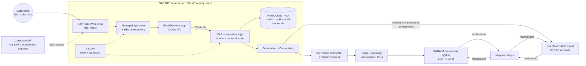
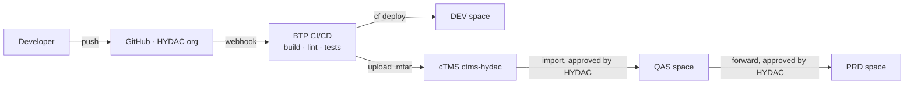
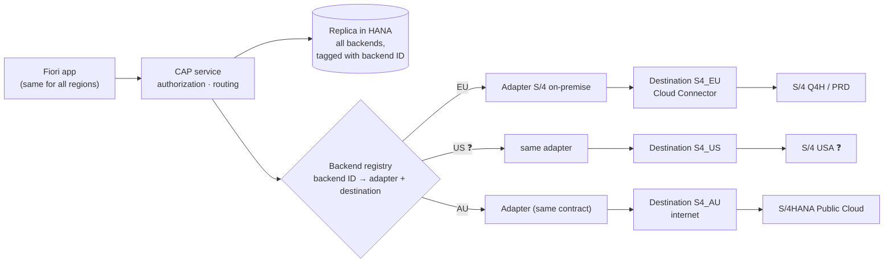
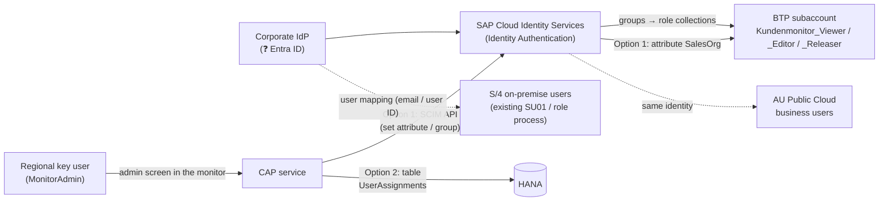

# 11 – Customer Monitor on SAP BTP: Design Review

Status: **Draft for the review session with HYDAC IT, 4 November 2026**. Prepared by purplecat (Igor Vorobev) in reply to Peter Wurst's request.
Audience: Peter Wurst, Uli, Franca, Mathias, Gareth.
Proposed slot: **Fri 6 Nov, 17:00–18:00 CET (11:00 ET)**. The Wed 4 Nov slot can no longer be prepared in time. Duration: 60 min. Pre-read: this document, sent at least 24 h ahead; the session walks through §1, §3, §4, §6 and §8, the rest is reference.

This document is the basis for the review session. Each numbered section can be presented as one or two slides. Detailed specifications live in the project repository (`docs/01`–`docs/10`) and are referenced where relevant.

**Legend:** ✅ built and tested · 🟡 designed, not built · 💡 proposal, needs agreement · ❓ open question for HYDAC · *Assumption* = our current understanding, please correct.

---

## Agenda (60 min)

| # | Topic | Time | Section |
|---|---|---|---|
| 1 | Summary and current status | 5 min | §1 |
| 2 | Functional design: purpose, users, use cases, data | 10 min | §2 |
| 3 | Solution architecture | 5 min | §3 |
| 4 | Requested BTP, Git and transport elements mapped to requirements | 10 min | §4 |
| 5 | Integration: Q4H / GWQ, production, S/4HANA Public Cloud, Magento, Integration Suite | 10 min | §5 |
| 6 | **Multi-region: EU, USA, Australia – backends, data restriction, user management** | 10 min | §6 |
| 7 | Ongoing administration and ownership | 5 min | §7 |
| 8 | Decisions and next steps | 5 min | §8–§10 |

---

## 1. Summary

- **What:** a replacement for the SAP GUI report `ZEC_CUSTOMER_MONITOR`. Back-office staff use it to review and process the customer, contact person and ship-to requests that the Magento B2B shops send to SAP.
- **Where:** one monitor for the back offices in **Europe, the USA and Australia**. The requests come from different SAP backends: S/4HANA on-premise (Q4H/GWQ and production) and HYDAC Australia's S/4HANA Public Cloud (§6).
- **How:** a SAP Fiori Elements app (OData V4) on top of a SAP CAP (Node.js) service on SAP BTP, Cloud Foundry. Users open it from SAP Build Work Zone. The SAP backends stay the **systems of record**: request data, customizing, step logic and the notifications to Magento remain in the backend and are not reimplemented on BTP.
- **Data restriction:** every user sees only the requests of the sales organizations assigned to them, per backend (region). Every read and write reaches the backend as the real user (principal propagation), so the backend checks the same user again (§6.4).
- **User management:** identity and roles come from HYDAC's corporate identity provider (groups → role collections); the sales-org scope is assigned by regional key users in an admin screen of the monitor. No per-user maintenance in the BTP cockpit (§6.5).
- **Status today:**
  - ✅ Phase 1 is finished: the complete UI runs against a CAP mock service that reproduces the legacy status machine from a copy of the S/4 customizing. It covers 26 test requests, all process types and all steps, with automated tests (service tests and browser UI journeys).
  - ✅ The deployment package is ready: roles, MTA descriptor, HANA Cloud (HDI), HTML5 repository, Work Zone tile, health check and logging. The MTA archive builds locally. **Nothing has been deployed yet**, because a BTP subaccount is not available yet.
  - 🟡 For the S/4 connection (phase 2) there is a draft interface specification (`docs/10`). The CAP side already has the adapter seam that the multi-backend design builds on. The multi-backend routing (§6) is a design proposal.
- **Ask:** the BTP, Git and transport setup from our email, so that we can deploy, connect to Q4H/GWQ and start phase 2. §4 maps each item to a requirement. Nothing in §6 blocks the DEV setup; it shapes the decisions D4 and D8–D10.

---

## 2. Functional design

### 2.1 Business purpose

Magento sends three kinds of input to the SAP backend (in S/4 on-premise: service `ZEC_CUSTOMER_CREATE_SRV`):

1. **Company registrations.** New companies, or companies that already exist as a customer (Debitor).
2. **New shop users.** Contact persons (Ansprechpartner) for an existing customer.
3. **New delivery addresses.** Ship-to parties (Warenempfänger) for an existing customer.

The backend does **not** create master data directly. It stores each input as a **request** (table `ZEC_CUSTOMER`, original and working copy of the payload) and runs an approval check. The back office reviews and completes the request in the monitor. They then trigger **steps** that create or assign the business partner, customer, contact person or ship-to. The backend reports the results back to Magento.

Business value of the new monitor compared with the SAP GUI report:

| Area | Legacy (SAP GUI) | New (BTP / Fiori) |
|---|---|---|
| Access | SAP GUI, transaction, one system | Browser via Work Zone, one app for all regions, deep links (e.g. in emails) |
| Work queue | One list with filters | Tabs with counters: My work, Errors, Clarification, Release, All; sorted by priority and waiting time; "next step" recommendation per request |
| Concurrency | Steps run without a lock, so two users can create the same customer twice (R-01) | Edit lock (draft), version check (ETag) on every step, serialized per request in the backend |
| Authorization | Two different sales-org checks (R-08) | One sales-org rule, applied to the list, the detail and all sub-data, and checked again by the backend |
| Robustness | Several known defects (R-01…R-16, `docs/07`) | Fixed by design, or listed as requirements for the backend service |

### 2.2 Users and roles

| Role (BTP role collection) | Who | May | Legacy equivalent |
|---|---|---|---|
| `Kundenmonitor_Viewer` | Sales / customer service staff who only need to look up requests | Read requests of their own sales organizations | Display |
| `Kundenmonitor_Editor` | Back office (Innendienst) per sales organization, in EU, USA, AU | + edit request data, run steps | Change |
| `Kundenmonitor_Releaser` | Users who approve requests that need a release (Freigabe) | + see unreleased requests and release them | Auth. object `ZEC_MONITO` ACTVT 43 |

The roles define **what** a user may do. **Which** requests they see is defined by the sales organizations assigned to them per backend (§6.4, §6.5). A user without an assignment sees nothing (fail closed). The same three role collections serve all regions; there are no region-specific roles.

❓ Number of users per role, region and sales organization, and request volume per day per region. We need these for sizing and for the user administration effort (§7).

### 2.3 Use cases

| ID | Use case | Role | Result in the backend |
|---|---|---|---|
| UC-01 | **Work the queue:** open the monitor, see My work / Errors / Clarification / Release with counters, sorted by priority and waiting time; only the user's own sales orgs (and therefore regions) | Viewer+ | – (read) |
| UC-02 | **Review a request:** main data, contact person or ship-to, sales data, assignment (SAP and Magento numbers, release reason), processing log | Viewer+ | – (read) |
| UC-03 | **Correct or complete data** before processing (draft: edit, save, cancel; locked for other users while editing; every field change logged) | Editor | Working copy updated, change log |
| UC-04 | **Release** a request that needs approval (rule per process type + sales org: manual, by credit card, or by order volume limit) | Releaser | Released (manual), log |
| UC-05 | **Create customer and admin contact** (step CREATE) | Editor | Business partner + customer + contact person created; Magento notified |
| UC-06 | **Create / change contact person** (AP_MODIFY) | Editor | Contact person created or changed; Magento notified |
| UC-07 | **Create ship-to party** (CREATE_WE) | Editor | Ship-to created and assigned to the sold-to; Magento notified |
| UC-08 | **Handle duplicates:** assign an existing customer (CHNG_OLD), change the assignment (CNG_DEBI, with a confirmation question if the customer already belongs to another Magento company), convert to a new customer (CNG_NEW) | Editor | Process type changes, release re-checked |
| UC-09 | **Put in clarification (Klärung)** with a mandatory comment | Editor | Flag + comment, status unchanged |
| UC-10 | **Reject** with a mandatory reason (≤ 100 characters) | Editor | Status Rejected; Magento notified with reason |
| UC-11 | **Complete manually** (handled outside the monitor) / **reset** a closed request for reprocessing | Editor | Status Manually completed / back to open |
| UC-12 | **Fix errors:** a failed step sets an error status (140/150/160) and logs the messages; the user corrects the data and repeats the step | Editor | Step repeated |

Which steps are allowed is decided **by the backend** (customizing `ZEC_CUST_PROCESS` + role). Each region keeps its own rules. The UI only shows what the service allows.

### 2.4 Process types, statuses and steps (compact)

| Process type | Meaning | Start | Typical end |
|---|---|---|---|
| `CR_DEB` | New company without SAP customer | 000 New | CREATE → 999 Done |
| `CH_DEB` | Company with existing customer | 000 | AP_MODIFY → 999 |
| `CR_AP` | New shop user for existing customer | 000 | AP_MODIFY → 999 |
| `CH_AP` | Change of existing contact person | 997 Automatically done | – |
| `CR_WE` | New delivery address | 010 | CREATE_WE → 999 |

Status groups: **open** (0xx/1xx), **error** (140, 150, 160), **rejected** (899), **done** (997, 998, 999).
Steps: CREATE, CREATE_WE, AP_MODIFY, CHNG_OLD, CNG_DEBI, CNG_NEW, MANUAL_OK, REJECT, plus RELEASE, CLARIFY, RESET. Full rules: `docs/01` §3–§6.

### 2.5 Data displayed and acted on

| Entity | Content | Source (backend) | Editable |
|---|---|---|---|
| Request (`Requests`) | Backend/region (💡 §6.2), process type, status, source, sales org; SAP numbers (customer, business partner, ship-to, contact person); Magento IDs (company, customer, address); order volume, currency, credit card; release (flag, procedure, reason, limit, by/at); clarification; main data (name 1–4, address, communication, VAT/tax numbers, industry, DUNS) | `ZEC_CUSTOMER` + working copy `PAYLOAD_CHNG` | Main data only; numbers, status, release are read-only |
| Sales data (`SalesData`) | Sales org, distribution channel, division, sales group/office, customer group, sales district, Incoterms | Payload | Yes (except sales org) |
| Contact person (`ContactPersons`) | Shop role, title, name, function, department, language, phone, email | Payload | Yes (not for `CR_WE`) |
| Ship-to (`ShipToParties`) | Name, address, VAT number, "address used in order" | Payload | Yes (only `CR_WE`) |
| Log (`LogEntries`) | Message type/class/number/text, step, field, old/new value, user, time | Monitor log | Read-only |
| Code lists | Statuses, status groups, process types, steps, release states and reasons (texts DE/EN, FR/IT where maintained) | Customizing `ZEC_CUST_*` per backend | Read-only |
| Business partner value help | Number, name, customer, customer role, Magento company (from the request's backend only) | Business Partner API + Magento mapping | Read-only |

Multi-currency (EUR, USD, AUD) is already supported: the order volume and the release limit are always shown with their currency.

**Personal data:** requests contain names, email addresses and phone numbers of contact persons. From phase 2 a replica of the requests is stored in HANA Cloud on BTP (§3). Where it is stored is a data residency question (§6.3). ❓ Retention and deletion rules for completed requests.

Full field list: `docs/03` §1–§2.

### 2.6 Screens

| Screen | Content |
|---|---|
| **List** (List Report) | Filter bar (search, region 💡, status group, released, in clarification, customer, sales org, process type, status, source, order exists, created/changed at/by); tabs My work / Errors / Clarification / Release / All with counters; columns status, hints (lock, clarification, order), release reason, process type, name, next step, waiting since, customer, sales org, Magento company, order volume, created, changed; errors highlighted red |
| **Detail** (Object Page) | Header: status, release, next step, key figures; sections Main data, Contact person *or* Ship-to (depending on process type), Sales data, Assignment, Log; actions: Edit, "Run step" menu (only allowed steps active), Refresh |
| **Dialogs** | Parameter dialogs for reject (reason), clarify (comment), assign / change assignment (business partner with value help); confirmation questions coming from the backend |

UI languages: English and German (more can be added). Times are shown in the user's local time zone. We can show a live demo of the current version (mock data) in the session.

### 2.7 Requirements from the legacy system

The analysis of the SAP GUI monitor found 16 defects (`docs/07`). The most relevant for HYDAC IT:

- **R-01:** duplicate master data from parallel steps. The new solution prevents this with a version check plus serialization in the backend.
- **R-03 / R-04:** notifications to Magento are sent before the commit, and errors are swallowed. The new backend service must send notifications only after the commit and log the result.
- **R-05 / R-16:** a rejected address cannot be identified in Magento, and the typo `RejectCusomterSet` is part of the Magento contract. Both need coordination with TechDivision / Magento.
- **R-07:** the release limit is compared without currency conversion. This matters more with EUR, USD and AUD.
- **R-08:** two different authorization checks. The new solution uses one sales-org rule.

---

## 3. Solution architecture

### 3.1 Why BTP, and not a Fiori app inside S/4

| Alternative | Why not |
|---|---|
| Fiori Elements app inside S/4 on-premise (RAP, embedded launchpad) | Serves only the system it runs in. The AU requests live in S/4HANA Public Cloud, which an on-premise UI cannot reach with the user's identity and which cannot host the classic ABAP monitor logic. EU and US would get the new monitor, AU would not. |
| One app per backend (RAP on-premise + ABAP Cloud RAP in AU) | Two UIs and two codebases for the same process, no common work queue, no cross-region support. |
| **BTP side-by-side (chosen)** | One UI and one service for all regions; each backend keeps its own data, customizing and step logic (clean core on both sides). The price is HANA Cloud and a replica, explained below. |

If HYDAC decided that only one on-premise S/4 is in scope, an in-S/4 RAP app would be the cheaper choice. The multi-region requirement is what makes BTP the right place.

### 3.2 Overview

| Component | Role |
|---|---|
| Fiori Elements app | List, detail, editing, steps. Annotation-driven, no business logic. Same app for all regions. |
| CAP service | Stable OData V4 contract for the UI, authorization (role + sales org), error mapping; facade that routes every request to its backend (§6.2). |
| HANA Cloud (HDI) | Draft data while a user edits (lock, version check) and, in phase 2, a replica of the requests of all backends with write-through to the backend. **Why it is needed:** CAP's draft locking and version checks need local tables. A pure pass-through would fail on every edit and every step (decisions E-12, E-14). The backends stay the systems of record. |
| XSUAA | Login, role collections, attribute `SalesOrg`. |
| S/4HANA on-premise / Public Cloud | Systems of record: request data, customizing, step logic, master data creation, notifications to Magento. |
| Magento | Unchanged on the EU side; ❓ AU and US shop flows to be confirmed. |

Phases: **1** UI + mock ✅ → **2** S/4 on-premise connection on Q4H/GWQ 🟡 → **2b** further backends (AU Public Cloud, US ❓) 🟡 → **3** production operation 🟡.

---

## 4. Requested elements mapped to requirements

Requirements referenced below:

- **REQ-A Access:** business users in EU, USA and AU open the app in the browser via Work Zone, with roles per sales org.
- **REQ-P Persistence:** drafts and the request replica (E-12, E-14).
- **REQ-I Integration:** read and process requests in the backends (Q4H/GWQ first).
- **REQ-S Security:** authorization per role and sales org; backend authorizations and logs on the real user.
- **REQ-D Delivery:** reproducible builds, automated tests, controlled transport DEV → QAS → PRD.
- **REQ-O Operation:** health monitoring, logs, support.
- **REQ-V Version control:** source code and iFlows versioned and reviewable, owned by HYDAC.

### 4.1 Subaccount

| Item | Requirement | Why | Note |
|---|---|---|---|
| Development subaccount (FSM-DEV-CPI or a dedicated one) | all | Place for the DEV space, service instances and subscriptions | ❓ FSM-DEV-CPI also hosts Integration Suite. That works for DEV. For QAS/PRD we recommend separate subaccounts (or at least separate spaces) so that application and integration lifecycles stay independent. The region of the productive subaccount(s) depends on the data residency decision (§6.3). HYDAC decides. |

### 4.2 Entitlements

| Entitlement | Requirement | Why it is needed | Needed from | If not granted |
|---|---|---|---|---|
| **Cloud Foundry Runtime (MEMORY), 2–4 GB** | REQ-A, REQ-I | Runs the CAP service (≈ 256–512 MB), the HDI deployer task and the content deployers during deployment. Headroom for zero-downtime redeploys. | First deployment | No deployment possible |
| **SAP HANA Cloud** (`hana-cloud` / `hana` + tools) | REQ-P | Database instance for the HDI container | First deployment | Drafts would only work in memory, which is not usable on BTP. ❓ An existing HANA Cloud instance in HYDAC's global account could be shared (instance mapping) to save cost. HANA Cloud is the **main cost item** of the setup. Non-productive instances can be stopped outside working hours. |
| **SAP HANA Schemas & HDI Containers** (`hana` / `hdi-shared`) | REQ-P | The application's own schema (container) in the HANA Cloud instance, deployed from `db/` | First deployment | as above |
| **Continuous Integration and Delivery** (`cicd-app` / `default`) | REQ-D | Builds the MTA archive on every push to Git, runs lint and service tests, deploys to DEV, uploads to cTMS | When Git is set up | Alternative: GitHub Actions + `cf` CLI (no entitlement, but a pipeline to maintain). Manual builds are possible but not reproducible. |
| **SAP Build Work Zone, standard edition** (`SAPLaunchpad` / `standard`) | REQ-A | Entry point for business users: tile, role-based visibility, later navigation to the S/4 app "Manage Business Partners" (B-05) | Before user tests | Users would need a direct app URL. ❓ If HYDAC already runs a Work Zone site, the app can be added there instead. |
| **Cloud Transport Management** (`transport` / `standard`) | REQ-D | Connects the subaccount to the existing cTMS tenant so that the same archive moves DEV → QAS → PRD with approval and audit trail | Before QAS exists | DEV alone works without it. Without cTMS, transports are manual `cf deploy` runs per space. |

Already entitled in FSM-DEV-CPI (no new entitlement):

| Service | Requirement | Why |
|---|---|---|
| `xsuaa` (application) | REQ-A, REQ-S | Login, roles `Viewer`/`Editor`/`Releaser`, attribute `SalesOrg` |
| `destination` (lite) | REQ-A, REQ-I | Route UI → CAP; one destination per backend (Q4H/GWQ, AU Public Cloud, …) |
| `connectivity` (lite) | REQ-I | Cloud Connector tunnel from the CF app to the on-premise S/4 (not needed for Public Cloud) |
| `html5-apps-repo` (app-host, app-runtime) | REQ-A | Hosting the UI for Work Zone / managed approuter |
| `application-logs` / Cloud Logging | REQ-O | Central logs. CAP supports both. Our MTA has an optional SAP Cloud Logging binding; without it logs stay available via `cf logs`. |

Not requested yet, needed for the user management proposal (§6.5): **SAP Cloud Identity Services** (Identity Authentication). ❓ HYDAC probably already has a tenant (every S/4HANA Public Cloud comes with one).

### 4.3 Cloud Foundry space and roles

| Item | Requirement | Why | Least-privilege alternative |
|---|---|---|---|
| CF space `cap-monitor` (DEV) | all | Isolated runtime for the app and its service instances | – |
| **Space Developer** for purplecat developers | REQ-D | Deploy the MTA, create service instances in the space, read logs | – (needed) |
| **Org Manager** | – | Only needed to create spaces or manage org members ourselves | **Not needed if HYDAC creates the spaces.** Space Manager is enough for adding team members to the space. We are happy to drop this. |
| **Subaccount Service Administrator** (role collection) | REQ-A, REQ-D | Create subscriptions (Work Zone, CI/CD, cTMS) and service instances in the cockpit | HYDAC's BTP admin does the one-time subscriptions and assigns the app role collections. After that Space Developer is enough for daily work. |
| App role collections `Kundenmonitor_*` for test users | REQ-S | Testing the role and sales-org behaviour | Assigned by HYDAC or by us; in production through IdP groups (§6.5) |
| Work Zone `Launchpad_Admin` (DEV) | REQ-A | Add the tile to a site, assign roles | Can stay with HYDAC |
| CI/CD `CICD Service Administrator` / `Developer` | REQ-D | Configure the pipeline and credentials | – |
| cTMS roles (e.g. `TMS_Viewer`, `TMS_Export_Operator`; import roles stay with HYDAC) | REQ-D | Upload archives and track transports; HYDAC controls imports into QAS/PRD | – |

### 4.4 Connectivity to Q4H / GWQ

| Item | Requirement | Why |
|---|---|---|
| Confirmation that GWQ is exposed via Cloud Connector (or a destination for it) | REQ-I | The monitor's OData service will run on the system where HYDAC publishes Gateway services (§5.1) |
| Cloud Connector resources (URL paths of the monitor's OData services + `API_BUSINESS_PARTNER`) | REQ-I | The Cloud Connector only lets through the paths that are listed explicitly. The exact list follows from decision E-07 (§5.2). |
| Authentication method | REQ-S | Principal propagation (recommended) or a technical user (§5.3) |
| S/4 test users for purplecat developers in Q4H/GWQ (incl. SE80/ADT for the S/4 service, if purplecat builds it) | REQ-I | Testing with real authorizations per sales org; ❓ who builds the S/4 service (B-02/B-03) |

### 4.5 Git

| Item | Requirement | Why |
|---|---|---|
| HYDAC-owned GitHub organization | REQ-V | HYDAC owns the code; Integration Suite's built-in Git integration only supports github.com |
| Repositories `cap-monitor` and `cpi-iflows` | REQ-V, REQ-D | One repository per lifecycle: the app is built by CI/CD, the iFlows are pushed and pulled by Integration Suite |
| Write access for purplecat developers | REQ-V | Daily development; branch protection and reviews as HYDAC requires |
| Personal access tokens (fine-grained, limited to these repos, with expiry) | REQ-V | Integration Suite asks for a token on every push/pull |
| Read-only technical access + webhook to BTP CI/CD | REQ-D | Builds start automatically on push |
| Integration Suite tenant admin registers the repositories (Settings → Integrations → Git Access) | REQ-V | One-time setup per repository |

Limitation: the built-in feature covers iFlows only, not message mappings or script collections. These stay in Integration Suite packages until SAP extends the feature.

### 4.6 Transport

| Item | Requirement | Why |
|---|---|---|
| Confirm owner of the cTMS tenant `ctms-hydac` (eu10) and reuse | REQ-D | One transport tool for all HYDAC BTP content |
| Transport node for the DEV space, later QAS and PRD nodes (each with a destination to the deploy service of the target space; with regional deployments one PRD node per region, §6.3) | REQ-D | Same MTA archive through all stages and regions; space-specific values (destinations, backends) via MTA extension descriptors, never a rebuilt archive |
| TMS role collections for the team | REQ-D | Export/upload by purplecat, import approval by HYDAC |

---

## 5. Integration

### 5.1 Landscape and system mapping

*Assumption:* Q4H is the S/4HANA quality system holding `ZEC_CUSTOMER*`, the customizing and the step classes. GWQ is the SAP Gateway (hub) system of the same stage, where OData services such as `ZEC_CUSTOMER_CREATE_SRV` are published to Magento. ❓ Please confirm, including the production pair (P-system / Gateway).

| BTP stage | Backend EU (on-premise) | Backend USA | Backend AU (Public Cloud) |
|---|---|---|---|
| DEV (now) | Q4H via GWQ | ❓ | ❓ AU test tenant |
| QAS (later) | Q4H (❓ or a separate test client) | ❓ | ❓ AU test tenant |
| PRD (later) | ❓ production S/4 + Gateway | ❓ | ❓ AU production tenant |

The same archive is deployed on every stage. Only the destinations, which the admin maintains per subaccount/space, point to different backends.

### 5.2 Interfaces between the monitor and S/4 on-premise

All calls go **CAP → Destination → Connectivity → Cloud Connector → Gateway → S/4**, over HTTPS as OData. **No RFC from BTP:** CAP Node.js uses OData. If GWQ is a hub, it calls Q4H via its existing trusted RFC connection inside the HYDAC network.

| ID | Interface | Direction | Content | Technology |
|---|---|---|---|---|
| I-01 | Requests: list, detail, **delta** ("changed since") | BTP ← S/4 | Header, sales data, contact person, ship-to, log, version counter | New S/4 OData service (🟡 B-03) |
| I-02 | Customizing | BTP ← S/4 | Allowed steps (`ZEC_CUST_PROCESS`), approval rules, status/step texts | same service |
| I-03 | `GetFunctions` | BTP ← S/4 | Allowed steps for the current user | same service |
| I-04 | `ExecuteFunction` | BTP → S/4 | Step, version, reason/comment, business partner, confirm flag → result + messages | same service; reuses the existing step classes (`ZCL_EC_CUSTOMER`) without GUI popups (🟡 B-02) |
| I-05 | `ChangeData` | BTP → S/4 | Changed fields + version → change log in S/4 | same service |
| I-06 | Business partner value help | BTP ← S/4 | Number, name, customer, customer role | Standard `API_BUSINESS_PARTNER` |
| – | Magento → S/4 registrations | Magento → S/4 | unchanged | `ZEC_CUSTOMER_CREATE_SRV` (not touched by the monitor) |
| – | S/4 → Magento notifications | S/4 → Magento | unchanged, triggered by the steps in S/4 | `ZEC_CUSTOMER_READ_SRV`, `RejectCusomterSet` |

I-01…I-05 together form the **backend contract**. Every backend that the monitor connects to must provide it (§6.2).

**Decision E-07 (open):** build the new S/4 service as **RAP (OData V4)** or as **SEGW (OData V2)**. We recommend RAP if the S/4 release allows it (clean core, typed actions), with SEGW as a fallback. With Australia in scope, RAP has an additional advantage: the same service design can also be built in ABAP Cloud on S/4HANA Public Cloud, where SEGW does not exist (§6.2). ❓ S/4 release of Q4H and HYDAC's ABAP development guidelines. Details: `docs/10`.

**Cloud Connector resources** (final list after E-07; paths are examples):

| Virtual host | Path (prefix) | Purpose |
|---|---|---|
| `gwq-virtual:443` (HTTPS) | `/sap/opu/odata4/sap/zec_customer_monitor/` (RAP) **or** `/sap/opu/odata/sap/ZEC_CUSTOMER_MONITOR_SRV/` (SEGW) | I-01 … I-05 |
| same | `/sap/opu/odata/sap/API_BUSINESS_PARTNER/` | I-06 |

Access policy: "path and all sub-paths" for exactly these prefixes, nothing else.

### 5.3 Authentication

| Hop | Mechanism |
|---|---|
| User → Work Zone / app | HYDAC corporate identity provider via SAP Cloud Identity Services (❓ Entra ID?) → XSUAA, role collections (§6.5) |
| UI → CAP | OAuth token forwarded by the managed approuter |
| CAP → S/4 on-premise | **Recommended: principal propagation.** The Cloud Connector issues a short-lived X.509 certificate for the logged-in user, and S/4 maps it to the S/4 user (rule in `CERTRULE`). Alternative: technical user (basic auth) |
| CAP → S/4HANA Public Cloud | Communication arrangement in the AU tenant; user propagation via OAuth 2.0 SAML bearer assertion (destination type `OAuth2SAMLBearerAssertion`) |
| CAP → backend, delta sync of the replica | Runs inside the user's request (pull on list read, `docs/09` §7) with the same principal propagation. **No technical user that can read every request.** Optional nightly full resync with a read-only communication user, only if HYDAC wants one. |

Why principal propagation for user actions:

- The backend checks the sales-org authorization of the real user (R-08, §6.4).
- Change documents, the monitor log and the created master data show the real user, not a technical one.
- No shared password to rotate.

Effort for HYDAC: a one-time Cloud Connector trust setup (system certificate, CA), an ICM/certificate mapping in GWQ/Q4H, and a user mapping rule (e.g. email → S/4 user).

Pragmatic start: a **technical user on DEV** for the first connectivity tests, then principal propagation **before user tests on QAS**. ❓ HYDAC decides. If HYDAC prefers a technical user permanently, the backends cannot check authorizations per user. CAP would then be the only authorization layer, and the real user name would have to be passed as a parameter for logging.

### 5.4 Magento

- **No change for the EU Magento flow in phase 2.** Registrations still arrive in S/4 via `ZEC_CUSTOMER_CREATE_SRV`. Notifications still go from S/4 to Magento. The monitor never calls Magento directly.
- Each backend notifies its own Magento shop (or store view). ❓ Do US and AU use separate Magento instances, and how do AU registrations reach the Public Cloud today?
- Coordination with TechDivision / Magento is needed for: address-level rejection (R-05), keeping `RejectCusomterSet` as is (R-16), and notifications only after the commit, without duplicates (R-03).

### 5.5 S/4HANA Public Cloud (HYDAC Australia): what is different

| Aspect | On-premise S/4 (Q4H) | S/4HANA Public Cloud (Australia) |
|---|---|---|
| Connection | Cloud Connector, principal propagation | Internet, no Cloud Connector; communication arrangement (OAuth 2.0 SAML bearer for user propagation; a communication user only for an optional resync) |
| Custom tables / step classes | Exist (`ZEC_CUSTOMER*`, `ZCL_EC_CUSTOMER`) | Classic ABAP is not possible; only ABAP Cloud (developer extensibility, RAP) or side-by-side on BTP |
| APIs for master data | BAPIs / CMD API inside the step classes | Released APIs only (Business Partner, customer, contact person via their communication scenarios) |
| RFC | Possible inside the HYDAC network | Not available for custom logic |

How Australia fits into the monitor: see §6.2.

### 5.6 Relationship to the Integration Suite iFlows

- **The monitor's runtime calls do not go through Integration Suite.** They are synchronous UI calls with user context (principal propagation), and an iFlow in between would add latency and complexity without benefit.
- **Integration Suite is relevant for:**
  - the Magento ↔ backend flows, if they are routed through Integration Suite today (❓ please confirm the current Magento ↔ GWQ and Magento ↔ AU paths);
  - the Australia option B in §6.2 (registrations and notifications via iFlows);
  - reliable notifications with retry (R-03/R-04), if HYDAC prefers to move them out of the backend.
- **Version control:** iFlows go into the separate repository `cpi-iflows` in the same GitHub organization (§4.5), so app and integration changes can be reviewed and traced together.

---

## 6. Multi-region: EU, USA, Australia

### 6.1 Requirement

One monitor for the back offices in **Europe, the USA and Australia**. Users work only on the requests of their own sales organizations. The requests come from different backends:

| Region | Backend | Connection | Status |
|---|---|---|---|
| EU | S/4HANA on-premise (Q4H/GWQ → production) | Cloud Connector | Interface draft ready (`docs/10`) |
| USA | ❓ Same S/4 on-premise as EU (own sales orgs) **or** own system | Cloud Connector (if on-premise) | ❓ to confirm |
| AU | S/4HANA Public Cloud | Internet, communication arrangement | ❓ scope and option to agree (§6.2) |

If the USA runs on the same S/4 as Europe, it is simply more sales orgs in the same backend, with no extra integration.

### 6.2 Multi-backend design 💡

**Principle: one UI, one service contract, one backend contract, one adapter per backend.**

| Element | How it works |
|---|---|
| **Backend ID per request** | Every request carries the backend it comes from (`backendSystem`, e.g. `EU`, `US`, `AU`). It is read-only and appears in the UI as a filter and column "Region". 💡 This is a small extension of the service contract. |
| **Backend registry** | Configuration (not code): backend ID → adapter type + destination name. Adding a region means adding an entry and a destination, without changing the app. It builds on the adapter seam that already exists in the CAP service (`srv/backend/`, B-04). |
| **Reading** | The list and the counters read from the replica, so there is one list across all backends, filtered by the user's sales orgs (§6.4). Each backend has its own delta sync, pulled in the user's session with the user's identity (§5.3). |
| **Writing** | Every step and every save goes to the backend of the request, as the real user. |
| **Rules per backend** | Allowed steps, approval rules and texts are loaded and cached per backend. Each region keeps its own customizing. |
| **Value help** | The business partner value help searches only in the backend of the current request. |
| **Isolation** | If one backend is unreachable, the others keep working. Requests of the unreachable backend stay visible with their last synced state, and their steps fail with a clear message (💡 new error code `BACKEND_UNAVAILABLE`). |

**Australia: two ways to provide the backend contract**

| | **Option A (recommended): request handling in the AU Public Cloud** | **Option B: request handling on BTP for AU** |
|---|---|---|
| Idea | Rebuild the monitor backend in ABAP Cloud in the AU tenant (developer extensibility): intake from Magento AU, request store, approval check, step logic on the released Public Cloud APIs, notifications to Magento, and on top the backend contract (I-01…I-05) as a RAP service. | For AU, the BTP replica becomes the system of record. Magento sends registrations to BTP (directly or via an iFlow), the steps call the released Public Cloud APIs from BTP, and notifications go back via iFlows. |
| Monitor side | Same adapter as EU, only another destination | Second adapter type with its own step logic in CAP |
| Consistency | Same architecture for all regions: the backend is the system of record | AU differs from EU/US |
| Prerequisites | Developer extensibility (3-system landscape) in the AU tenant; ABAP Cloud development capacity | Magento AU → BTP interface; notifications via iFlows |
| Size | Large: the on-premise monitor backend, built once more in ABAP Cloud | Large: intake and step logic in CAP, integration flows in Integration Suite |
| Effect on E-07 | Strong argument for RAP in EU too (one design) | none |

Neither option is "five interfaces": both rebuild a backend that exists today only on-premise. Both also assume that AU wants the review-before-create process at all; if Magento AU creates customers directly today, that is a business decision for AU before any technical one. Effort estimate only after the workshop.

❓ We propose a short workshop with Gareth: scope, AU sales orgs, current Magento AU flow, and the availability of developer extensibility.

### 6.3 Deployment options and data residency

| | **Central** (one deployment) | **Regional** (one deployment per region) |
|---|---|---|
| Setup | One subaccount (e.g. EU region), one app, one HANA Cloud, all backends registered | Same archive deployed into one subaccount per region (EU, US, AU), each with its own backend(s) and HANA Cloud |
| Data location | Replica of all regions in one BTP region | Each region's data stays in its BTP region (e.g. Sydney for AU) |
| Users | One URL / tile for everyone, cross-region support possible | One tile per region (can be in one Work Zone site) |
| Cost and operation | 1× HANA Cloud, 1× deployment | 3× HANA Cloud, 3× deployments (one cTMS route per region) |
| Code | Multi-backend routing (§6.2) | Works without routing (one backend per deployment), routing still possible |

The code supports both options with the same archive. **Recommendation:** central, **on the condition** that HYDAC data protection confirms AU contact data may be stored in an EU BTP region (Australian Privacy Principle 8 restricts cross-border disclosure of personal information). If not: regional for AU (one more subaccount and HANA Cloud instance, same archive), central for EU and US. ❓ HYDAC data protection decides, before the productive subaccount is created (§4.1).

### 6.4 Data restriction per user

A user sees and changes only what all of these layers allow:

| # | Layer | Where | Controls |
|---|---|---|---|
| 1 | Login | Corporate IdP → Identity Services → XSUAA | Only HYDAC users; the Work Zone tile is visible only with the Work Zone content role for the monitor (its own role collection) |
| 2 | Function | Role collection (Viewer / Editor / Releaser) | Read, edit and run steps, release |
| 3 | **Rows** | Sales-org assignment **per backend** (§6.5): app table `UserAssignments` (backend, sales org), or IAS attribute `SalesOrg` with backend-qualified values such as `EU-0001`, `AU-xxxx` | Which requests are visible: list, counters, detail, sub-data (sales data, contact person, ship-to), log, value helps. Enforced in the CAP service on every read (✅ today with the attribute, one backend). The region follows from the assignment: a user with only AU sales orgs sees only Australian requests. |
| 4 | Release | Releaser role | Unreleased requests are visible only to releasers (✅) |
| 5 | **Backend check** | Principal propagation: S/4 on-premise via Cloud Connector, Public Cloud via SAML bearer | Every delta read, step and save runs in the backend as the real user, so the backend checks the sales org as well (defence in depth). There is no technical user with read access to all requests (§5.3). |

Why per backend: the same sales org code (e.g. `1000`) can exist in different backends with a different meaning. The app table carries the backend as its own column; the IAS attribute (Option 1) is a flat list and needs the `EU-` prefix plus a stored key column in the service. ❓ If HYDAC confirms that sales org codes are unique across all systems, plain codes are enough in both options.

Example:

| User | Roles | Backend: sales orgs | Sees |
|---|---|---|---|
| Back office Germany | Editor | EU: 0001, 2000 | Open EU requests of 0001/2000, can run steps |
| Back office USA | Editor, Releaser | US: xxxx | US requests incl. unreleased ones, can release |
| Back office Australia | Editor | AU: xxxx | AU requests only |
| Global support | Viewer | all backends, all sales orgs | Everything, read only |

### 6.5 User management 💡

**Goal: no user-by-user maintenance in the BTP cockpit.** Identity and roles come from HYDAC's corporate identity provider through SAP Cloud Identity Services (IAS). For the **data scope (sales orgs per user)** there are two workable options; both were checked against SAP's documentation (Nov 2026) and both keep the UI and the service contract unchanged except for an admin screen.

**Building blocks (documented by SAP; not yet tried in a HYDAC tenant)**

| Block | What SAP provides | Status |
|---|---|---|
| Identity | Corporate IdP → IAS (as proxy) → BTP trust. IAS users are created at first login or by Identity Provisioning. One login for all regions, SSO to Work Zone. | Standard |
| Roles | IAS groups (e.g. `CUSTMON_VIEWER`, `CUSTMON_EDITOR`, `CUSTMON_RELEASER`) mapped once to the three role collections in the subaccount trust configuration (`Groups` assertion attribute). | Standard |
| Data scope via an IAS attribute | IAS user attribute (custom attribute 1–10, or an attribute of a custom schema; up to 20 schemas × 20 attributes, attributes can be `multiValued`) → application "Attributes" configuration (e.g. `${customAttribute1}` sent as `SalesOrg`) → BTP role attribute with source **Identity Provider** → JWT `xs.user.attributes.SalesOrg` → CAP `$user.SalesOrg`. CAP treats the attribute as a list: a row is visible if any value matches, an empty list means nothing is visible. **This is exactly how the service filters today** (mock users carry the attribute). | Documented; points (1) and (2) below to confirm |
| Identity Directory SCIM API | `POST /scim/Users`, `PATCH /scim/Groups/{id}` (membership), attribute values via the extension `urn:sap:cloud:scim:schemas:extension:custom:2.0:User` (or the custom schema). Authentication: API client (secret or certificate) of an administrator of type *system* with the authorizations `Manage Users` / `Manage Groups`. | Documented |

**Option 1 – IAS is the authorization store, administered from the monitor**

A regional key user with the role `MonitorAdmin` opens an admin screen in the monitor and assigns a user their role group and sales orgs. The CAP service writes this to IAS through the SCIM API (group membership, `SalesOrg` attribute). The user gets the new scope at the next login (token).

| Pros | Cons |
|---|---|
| One source of truth for identity, roles and scope | The CAP service holds a **tenant-wide `Manage Users` credential**. The IAS tenant is probably shared with other HYDAC applications and the AU Public Cloud, so HYDAC's identity owners must accept this |
| Existing CAP filter unchanged | Effective only at the next token, not immediately |
| Visible in the IAS admin console and audit log | Custom attributes 1–10 are single-valued: several sales orgs need a multi-valued custom-schema attribute or a delimited string that CAP splits |
| Users can also be pre-registered in IAS from the screen (user record; the login still comes from the corporate IdP) | Attribute source "Identity Provider" is documented for SAML trust; to confirm for an OIDC trust |

**Option 2 – data scope in the application, roles in IAS**

Roles come from IAS groups as above, with no API. The sales-org assignment lives in an application table (`UserAssignments`: user, backend, sales org), maintained by regional key users in the same admin screen (a small Fiori Elements list, role `MonitorAdmin` per backend). The CAP filter reads the table instead of `$user.SalesOrg`.

| Pros | Cons |
|---|---|
| No IAS credential in the application | Scope lives in the app, identity and roles in IAS (two places; one matrix, see "Consistency" below) |
| Immediate effect, per-backend values and regional delegation are trivial | The user must exist (first login, or the admin enters the email in advance) |
| Change log of assignments in the app, exportable for audits | Not visible in the IAS console |
| Nothing to verify in the IdP setup | |

**Recommendation:** Option 2 for the data scope, IAS groups for the roles, no user creation from the application (users come from the corporate IdP). The deciding factor is the credential: a tenant-wide `Manage Users` secret inside a business application is a finding in any security review, and it buys nothing that the table does not give faster and per backend. Option 1 only if HYDAC wants every authorization visible in IAS and its identity owners accept the credential. Static role collections with sales orgs maintained in the BTP cockpit remain the simplest interim solution for the first test users on DEV. ❓ Decision D10.

**Common to both options**

| Topic | How |
|---|---|
| Joiner / mover / leaver | Identity and role groups in the IdP, HYDAC's normal process. A leaver loses access everywhere at once; group administration can be delegated per region. |
| Backend users | Principal propagation needs a matching backend user with matching authorizations. **S/4 on-premise:** existing SU01 / PFCG process, mapped by email or user ID. **AU Public Cloud:** business users with a business role restricted to the AU sales orgs; Public Cloud uses IAS as well, so it can be the same identity (❓ same tenant as BTP?). Optional: Identity Provisioning creates them from IdP groups. |
| Consistency | One authorization matrix (role × region × sales org), owned by HYDAC, for IdP groups, the app or IAS scope, and the backend roles. Out of sync → "no authorization" on the step, never exposed data, because the CAP filter applies first. Quarterly review. |
| Audit | BTP audit log (roles, trust), IdP/IAS logs (identity), app log (assignments, Option 2), backend change documents (master data, real user). |

**To confirm during the identity setup** (not verifiable from the documentation alone): (1) SAML or OIDC trust between the subaccount and IAS, and attribute pass-through for role attributes under that trust; (2) a multi-valued custom-schema attribute arrives as multiple assertion values; (3) which IAS tenant HYDAC uses and whether the AU Public Cloud shares it.

### 6.6 Impact on the current solution

| Area | Change | Size |
|---|---|---|
| Service contract | New read-only field `backendSystem` + code list (region texts), filter/column; error code `BACKEND_UNAVAILABLE`; entity `UserAssignments` for the admin screen (Option 2) or a stored sales-org key column (Option 1) | Small (💡 needs agreement) |
| CAP facade | Backend registry and routing per request, customizing cache and delta sync per backend | Medium, on top of the existing seam (B-04) |
| Backends | Backend contract (I-01…I-05) per backend type: EU on-premise (B-02/B-03), AU per option A or B | EU as planned; AU new |
| UI | One additional filter and column; admin screen (Fiori Elements list on `UserAssignments`, role `MonitorAdmin`) | Small |
| Roles (`xs-security.json`) | Unchanged roles; new role `MonitorAdmin` for the admin screen; attribute source "Identity Provider" (Option 1) or table `UserAssignments` (Option 2) | Small |

---

## 7. Ongoing administration

The table lists the recurring tasks. **"Owner" is for HYDAC to decide.** The proposal is only a starting point.

| Area | Task | Frequency | Proposed owner | Owner (HYDAC decision) |
|---|---|---|---|---|
| **Users & roles** | Role group membership in the corporate IdP; sales-org assignment in the monitor's admin screen (IAS attribute or app table, D10) | On joiner/mover/leaver | Regional HYDAC key users (`MonitorAdmin`) | |
| | IdP ↔ Identity Services ↔ BTP trust, group → role collection mapping, attribute mapping | One-time + on change | HYDAC IT (identity) | |
| | Authorization matrix role × region × sales org, periodic review | Quarterly | HYDAC IT + business owners | |
| **Work Zone** | Site, tile, roles; refresh the content provider after a deployment | Per release | HYDAC BTP admin | |
| **Cloud Connector** | Operation, upgrades, resources (paths), certificates (system + CA for principal propagation) | Quarterly / on expiry | HYDAC Basis | |
| **Destinations / backends** | One destination per backend and stage; registry entry for a new backend; optional communication user for a nightly resync | On change / certificate or password rotation | HYDAC BTP admin | |
| **AU Public Cloud** | Communication arrangement, communication user, business users and roles | On change | HYDAC Australia IT | |
| **HANA Cloud** | Instance size, start/stop of non-productive instances, upgrades (SAP-managed, scheduled by customer), backups (SAP-managed) | Monthly check | HYDAC BTP admin | |
| **Application** | Monitor health, logs, alerts, sync status per backend; restart on incidents | Continuous (health check restarts automatically) | purplecat (AMS) or HYDAC IT | |
| | Updates of CAP, UI5, Node.js runtime (security patches, SAP maintenance) | ≈ quarterly | purplecat (development / AMS) | |
| | Deploy through cTMS: upload (DEV) / import approval (QAS, PRD per region) | Per release | purplecat upload, HYDAC approval | |
| **CI/CD** | Pipeline configuration, credentials, failed builds | On change | purplecat | |
| **GitHub** | Organization members, branch protection, token policy, offboarding | On change | HYDAC IT | |
| | Rotation of tokens (developer PATs, CI read token, Integration Suite) | On expiry (e.g. 90 days) | Token owner / HYDAC IT | |
| **Backends** | Customizing `ZEC_CUST_*` (approval rules, steps, texts) per backend | On business change | HYDAC SAP team per region | |
| | Backend service and step logic (bug fixes, transports in S/4 / Public Cloud) | Per release | HYDAC SAP team or purplecat | |
| | Backend authorizations (sales org), user mapping | On joiner/mover/leaver | HYDAC SAP Basis / security per region | |
| **Integration Suite** | Monitor iFlows (Magento, Australia), Git repository registration | Continuous / one-time | HYDAC integration team | |
| **Business** | First-level support for users, clarification of business rules | Continuous | HYDAC key users per region | |
| **Data protection** | Retention and deletion of completed requests (backends and replica), data residency | Yearly / per policy | HYDAC data protection + IT | |
| **Cost & entitlements** | Monitor consumption (HANA Cloud, CF memory, Work Zone), adjust quotas | Monthly | HYDAC IT | |

---

## 8. Decisions requested from HYDAC

| # | Decision | Our recommendation |
|---|---|---|
| D1 | Subaccount for development: FSM-DEV-CPI or a dedicated one; target subaccounts for QAS/PRD | DEV in FSM-DEV-CPI is fine; separate QAS/PRD subaccounts for the app |
| D2 | Scope of our BTP roles | Space Developer + one-time subscriptions by HYDAC (no Org Manager needed) |
| D3 | Authentication CAP → backends | Principal propagation for reads and writes; technical user only for the first DEV connectivity tests (and an optional nightly resync) |
| D4 | S/4 service technology (E-07) and who builds it (B-02/B-03) | RAP, also because it can be reused for Australia |
| D5 | Git platform and organization | GitHub (github.com), HYDAC-owned organization |
| D6 | Reuse of cTMS tenant `ctms-hydac` | Yes, with nodes DEV → QAS → PRD |
| D7 | HANA Cloud: new instance or shared existing instance | Shared instance if one exists |
| D8 | Central or regional deployment (data residency) | Central, unless data residency requires regional |
| D9 | Australia: option A (RAP in Public Cloud) or B (handling on BTP) | Option A, after a workshop with Gareth |
| D10 | User management: roles via IdP groups; sales-org scope in IAS via the SCIM API (Option 1) or in an app table (Option 2), both administered from the monitor | Option 2 for the scope, IAS groups for roles; static role collections only for the first test users |
| D11 | Owners for the administration tasks (§7) | HYDAC to fill in the table |

## 9. Open questions for HYDAC

1. Role of GWQ (hub Gateway for Q4H?) and the production pair of systems.
2. S/4 release of Q4H (for E-07).
3. **USA:** same S/4 system as Europe, or a separate one?
4. **Australia:** scope, sales orgs, Magento AU flow, developer extensibility (3-system landscape) in the Public Cloud tenant.
5. Are sales org codes unique across all backends?
6. Current path Magento ↔ backends: direct or via Integration Suite?
7. Corporate identity provider (Entra ID?), existing Identity Services tenant(s), and whether the AU Public Cloud uses the same tenant.
8. Data residency and retention requirements for request data (contact names, emails, phone numbers), especially for Australia.
9. Existing Work Zone site and HANA Cloud instance that could be reused?
10. Number of users per role / region / sales org and request volume per day.

## 10. Next steps after the review

1. HYDAC confirms subaccount, roles, Git and transport setup (§4, §8).
2. purplecat deploys phase 1 (mock data) to the DEV space. This is the first end-to-end check of Work Zone, XSUAA and HANA Cloud, and the first chance for key users to click through.
3. Decide E-07 and start the S/4 service (B-02/B-03) on Q4H/GWQ in parallel with the Cloud Connector setup.
4. CAP adapter + replica (B-04/B-06) with the backend registry (§6.2), connection tests on DEV, then principal propagation.
5. Identity setup: IdP ↔ Identity Services ↔ BTP, groups for roles; sales-org scope per D10 (§6.5).
6. Australia workshop (D9), then the AU backend contract.

---

### Glossary

| German term | English | Note |
|---|---|---|
| Debitor | Customer (SAP customer account) | `KUNNR` |
| Geschäftspartner | Business partner | `PARTNER` |
| Ansprechpartner | Contact person | Shop user, admin = first contact person |
| Warenempfänger | Ship-to party | `CR_WE` |
| Freigabe | Release / approval | Rules per process type + sales org |
| Klärung | Clarification | Flag + comment, status unchanged |
| Innendienst | Back office / inside sales | Main user group |
| VKORG | Sales organization | Attribute `SalesOrg` |

### References in the repository

`docs/01_fachkonzept.md` (business logic) · `docs/02_architektur.md` (architecture, roles, deployment, operation) · `docs/03_service_vertrag.md` (service contract, data model) · `docs/04_ui_spezifikation.md` (screens) · `docs/07_anforderungen_aus_altsystem.md` (legacy defects) · `docs/09_migration_fiori_elements.md` (architecture decisions, replica) · `docs/10_s4_schnittstelle.md` (S/4 interface draft, E-07)
