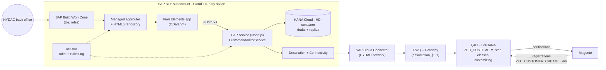
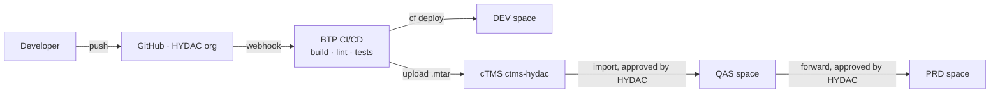

# 11 – Customer Monitor on SAP BTP: Design Review

Status: **Draft for the review session with HYDAC IT, 2 November 2026**. Prepared by purplecat (Igor Vorobev) in reply to Peter Wurst's request.
Audience: Peter Wurst, Uli, Franca, Mathias, Gareth.
Proposed slot: Wed 4 Nov, 16:00–17:00 CET (10:00 ET) or Fri 6 Nov, 17:00–18:00 CET (11:00 ET). Duration: 60 min.

This document is the basis for the review session. Each numbered section can be presented as one or two slides. Detailed specifications live in the project repository (`docs/01`–`docs/10`) and are referenced where relevant.

**Legend:** ✅ built and tested · 🟡 designed, not built · ❓ open question for HYDAC · *Assumption* = our current understanding, please correct.

---

## Agenda (60 min)

| # | Topic | Time | Section |
|---|---|---|---|
| 1 | Summary and current status | 5 min | §1 |
| 2 | Functional design: purpose, users, use cases, data | 15 min | §2 |
| 3 | Solution architecture | 5 min | §3 |
| 4 | Requested BTP, Git and transport elements mapped to requirements | 10 min | §4 |
| 5 | Integration: Q4H / GWQ, production, HYDAC Australia (S/4HANA Public Cloud), Magento, Integration Suite | 15 min | §5 |
| 6 | Ongoing administration and ownership | 5 min | §6 |
| 7 | Decisions and next steps | 5 min | §7, §8 |

---

## 1. Summary

- **What:** a replacement for the SAP GUI report `ZEC_CUSTOMER_MONITOR`. Back-office staff use it to review and process the customer, contact person and ship-to requests that the Magento B2B shop sends to S/4HANA.
- **How:** a SAP Fiori Elements app (OData V4) on top of a SAP CAP (Node.js) service on SAP BTP, Cloud Foundry. Users open it from SAP Build Work Zone. S/4HANA stays the **system of record**: the request tables, the customizing, the step logic and the notifications to Magento remain in S/4 and are not reimplemented on BTP.
- **Status today:**
  - ✅ Phase 1 is finished: the complete UI runs against a CAP mock service that reproduces the legacy status machine from a copy of the S/4 customizing. It covers 26 test requests, all process types and all steps, with automated tests (service tests and browser UI journeys).
  - ✅ The deployment package is ready: roles (`xs-security.json`), MTA descriptor, HANA Cloud (HDI), HTML5 repository, Work Zone tile, health check and logging. The MTA archive builds locally. **Nothing has been deployed yet**, because a BTP subaccount is not available yet.
  - 🟡 For the S/4 connection (phase 2) there is a draft interface specification (`docs/10`). The CAP side already has the adapter seam. The S/4 service itself still has to be built.
- **Ask:** the BTP, Git and transport setup from our email, so that we can deploy, connect to Q4H/GWQ and start phase 2. §4 maps each item to a requirement.

---

## 2. Functional design

### 2.1 Business purpose

Magento sends three kinds of input to S/4HANA (service `ZEC_CUSTOMER_CREATE_SRV`):

1. **Company registrations.** New companies, or companies that already exist as a customer (Debitor).
2. **New shop users.** Contact persons (Ansprechpartner) for an existing customer.
3. **New delivery addresses.** Ship-to parties (Warenempfänger) for an existing customer.

S/4 does **not** create master data directly. It stores each input as a **request** (table `ZEC_CUSTOMER`, original and working copy of the payload) and runs an approval check. The back office reviews and completes the request in the monitor. They then trigger **steps** that create or assign the business partner, customer, contact person or ship-to. S/4 reports the results back to Magento.

Business value of the new monitor compared with the SAP GUI report:

| Area | Legacy (SAP GUI) | New (BTP / Fiori) |
|---|---|---|
| Access | SAP GUI, transaction | Browser via Work Zone, deep links (e.g. in emails) |
| Work queue | One list with filters | Tabs with counters: My work, Errors, Clarification, Release, All; sorted by priority and waiting time; "next step" recommendation per request |
| Concurrency | Steps run without a lock, so two users can create the same customer twice (R-01) | Edit lock (draft), version check (ETag) on every step, serialized per request in S/4 |
| Authorization | Two different sales-org checks (R-08) | One sales-org rule (role attribute `SalesOrg`), applied to the list, the detail and all sub-data |
| Robustness | Several known defects (R-01…R-16, `docs/07`) | Fixed by design, or listed as requirements for the S/4 service |

### 2.2 Users and roles

| Role (BTP role collection) | Who | May | Legacy equivalent |
|---|---|---|---|
| `Kundenmonitor_Viewer` | Sales / customer service staff who only need to look up requests | Read requests of their own sales organizations | Display |
| `Kundenmonitor_Editor` | Back office (Innendienst) per sales organization | + edit request data, run steps | Change |
| `Kundenmonitor_Releaser` | Users who approve requests that need a release (Freigabe) | + see unreleased requests and release them | Auth. object `ZEC_MONITO` ACTVT 43 |

Each role carries the attribute **`SalesOrg`** (list of sales organizations, VKORG). A user without a value sees nothing (fail closed). In the current customizing these sales organizations appear: 0001, 2000, 7020, 7050, 7060, 7080, 7110.

❓ Number of users per role and per sales organization, and request volume per day. We need these for sizing and for the user administration effort (§6).

### 2.3 Use cases

| ID | Use case | Role | Result in S/4 |
|---|---|---|---|
| UC-01 | **Work the queue:** open the monitor, see My work / Errors / Clarification / Release with counters, sorted by priority and waiting time | Viewer+ | – (read) |
| UC-02 | **Review a request:** main data, contact person or ship-to, sales data, assignment (SAP and Magento numbers, release reason), processing log | Viewer+ | – (read) |
| UC-03 | **Correct or complete data** before processing (draft: edit, save, cancel; locked for other users while editing; every field change logged) | Editor | Working copy updated, change log |
| UC-04 | **Release** a request that needs approval (rule per process type + sales org: manual, by credit card, or by order volume limit) | Releaser | Released (manual), log |
| UC-05 | **Create customer and admin contact** (step CREATE) | Editor | Business partner + customer + contact person created; Magento notified |
| UC-06 | **Create / change contact person** (AP_MODIFY) | Editor | Contact person created or changed; Magento notified |
| UC-07 | **Create ship-to party** (CREATE_WE) | Editor | Ship-to created and assigned to the sold-to; Magento notified |
| UC-08 | **Handle duplicates:** assign an existing customer (CHNG_OLD), change the assignment (CNG_DEBI, with a confirmation question if the customer already belongs to another Magento company), convert to a new customer (CNG_NEW) | Editor | Process type changes, release re-checked |
| UC-09 | **Put in clarification (Klärung)** with a mandatory comment | Editor | Flag + comment, status unchanged |
| UC-10 | **Reject** with a mandatory reason (≤ 100 characters) | Editor | Status Rejected; Magento notified with reason |
| UC-11 | **Complete manually** (handled outside the monitor) / **reset** a closed request for reprocessing | Editor | Status Manually completed / back to open |
| UC-12 | **Fix errors:** a failed step sets an error status (140/150/160) and logs the messages; the user corrects the data and repeats the step | Editor | Step repeated |

Which steps are allowed is decided **by the backend** (customizing `ZEC_CUST_PROCESS` + role). The UI only shows what the service allows.

### 2.4 Process types, statuses and steps (compact)

| Process type | Meaning | Start | Typical end |
|---|---|---|---|
| `CR_DEB` | New company without SAP customer | 000 New | CREATE → 999 Done |
| `CH_DEB` | Company with existing customer | 000 | AP_MODIFY → 999 |
| `CR_AP` | New shop user for existing customer | 000 | AP_MODIFY → 999 |
| `CH_AP` | Change of existing contact person | 997 Automatically done | – |
| `CR_WE` | New delivery address | 010 | CREATE_WE → 999 |

Status groups: **open** (0xx/1xx), **error** (140, 150, 160), **rejected** (899), **done** (997, 998, 999).
Steps: CREATE, CREATE_WE, AP_MODIFY, CHNG_OLD, CNG_DEBI, CNG_NEW, MANUAL_OK, REJECT, plus RELEASE, CLARIFY, RESET. Full rules: `docs/01` §3–§6.

### 2.5 Data displayed and acted on

| Entity | Content | Source (S/4) | Editable |
|---|---|---|---|
| Request (`Requests`) | Process type, status, source, sales org; SAP numbers (customer, business partner, ship-to, contact person); Magento IDs (company, customer, address); order volume, currency, credit card; release (flag, procedure, reason, limit, by/at); clarification; main data (name 1–4, address, communication, VAT/tax numbers, industry, DUNS) | `ZEC_CUSTOMER` + working copy `PAYLOAD_CHNG` | Main data only; numbers, status, release are read-only |
| Sales data (`SalesData`) | Sales org, distribution channel, division, sales group/office, customer group, sales district, Incoterms | Payload | Yes (except sales org) |
| Contact person (`ContactPersons`) | Shop role, title, name, function, department, language, phone, email | Payload | Yes (not for `CR_WE`) |
| Ship-to (`ShipToParties`) | Name, address, VAT number, "address used in order" | Payload | Yes (only `CR_WE`) |
| Log (`LogEntries`) | Message type/class/number/text, step, field, old/new value, user, time | Monitor log | Read-only |
| Code lists | Statuses, status groups, process types, steps, release states and reasons (texts DE/EN, FR/IT where maintained) | Customizing `ZEC_CUST_*` | Read-only |
| Business partner value help | Number, name, customer, customer role, Magento company | `API_BUSINESS_PARTNER` + Magento mapping | Read-only |

**Personal data:** requests contain names, email addresses and phone numbers of contact persons. From phase 2 a replica of the requests is stored in HANA Cloud on BTP (§3). ❓ Retention and deletion rules for completed requests (S/4 and replica), and data residency for Australian data (§5.5).

Full field list: `docs/03` §1–§2.

### 2.6 Screens

| Screen | Content |
|---|---|
| **List** (List Report) | Filter bar (search, status group, released, in clarification, customer, sales org, process type, status, source, order exists, created/changed at/by); tabs My work / Errors / Clarification / Release / All with counters; columns status, hints (lock, clarification, order), release reason, process type, name, next step, waiting since, customer, sales org, Magento company, order volume, created, changed; errors highlighted red |
| **Detail** (Object Page) | Header: status, release, next step, key figures; sections Main data, Contact person *or* Ship-to (depending on process type), Sales data, Assignment, Log; actions: Edit, "Run step" menu (only allowed steps active), Refresh |
| **Dialogs** | Parameter dialogs for reject (reason), clarify (comment), assign / change assignment (business partner with value help); confirmation questions coming from the backend |

We can show a live demo of the current version (mock data) in the session.

### 2.7 Requirements from the legacy system

The analysis of the SAP GUI monitor found 16 defects (`docs/07`). The most relevant for HYDAC IT:

- **R-01:** duplicate master data from parallel steps. The new solution prevents this with a version check plus serialization in S/4.
- **R-03 / R-04:** notifications to Magento are sent before the commit, and errors are swallowed. The new S/4 service must send notifications only after the commit and log the result.
- **R-05 / R-16:** a rejected address cannot be identified in Magento, and the typo `RejectCusomterSet` is part of the Magento contract. Both need coordination with TechDivision / Magento.
- **R-08:** two different authorization checks. The new solution uses one sales-org rule.

---

## 3. Solution architecture

| Component | Role |
|---|---|
| Fiori Elements app | List, detail, editing, steps. Annotation-driven, no business logic. |
| CAP service | Stable OData V4 contract for the UI, authorization (role + sales org), error mapping; facade to S/4. |
| HANA Cloud (HDI) | Draft data while a user edits (lock, version check) and, in phase 2, a replica of the requests with write-through to S/4. **Why it is needed:** CAP's draft locking and version checks need local tables. A pure pass-through to S/4 would fail on every edit and every step (decisions E-12, E-14). S/4 stays the system of record. |
| XSUAA | Login, role collections, attribute `SalesOrg`. |
| S/4HANA | System of record: tables, customizing, step classes, master data creation, notifications to Magento. |
| Magento | Unchanged. |

Phases: **1** UI + mock ✅ → **2** S/4 connection on Q4H/GWQ 🟡 → **3** production operation 🟡.

---

## 4. Requested elements mapped to requirements

Requirements referenced below:

- **REQ-A Access:** business users open the app in the browser via Work Zone, with roles per sales org.
- **REQ-P Persistence:** drafts and the request replica (E-12, E-14).
- **REQ-I Integration:** read and process requests in S/4 Q4H/GWQ (phase 2).
- **REQ-S Security:** authorization per role and sales org; S/4 authorizations and logs on the real user.
- **REQ-D Delivery:** reproducible builds, automated tests, controlled transport DEV → QAS → PRD.
- **REQ-O Operation:** health monitoring, logs, support.
- **REQ-V Version control:** source code and iFlows versioned and reviewable, owned by HYDAC.

### 4.1 Subaccount

| Item | Requirement | Why | Note |
|---|---|---|---|
| Development subaccount (FSM-DEV-CPI or a dedicated one) | all | Place for the DEV space, service instances and subscriptions | ❓ FSM-DEV-CPI also hosts Integration Suite. That works for DEV. For QAS/PRD we recommend separate subaccounts (or at least separate spaces) so that application and integration lifecycles stay independent. HYDAC decides. |

### 4.2 Entitlements

| Entitlement | Requirement | Why it is needed | Needed from | If not granted |
|---|---|---|---|---|
| **Cloud Foundry Runtime (MEMORY), 2–4 GB** | REQ-A, REQ-I | Runs the CAP service (≈ 256–512 MB), the HDI deployer task and the content deployers during deployment. Headroom for zero-downtime redeploys. | First deployment | No deployment possible |
| **SAP HANA Cloud** (`hana-cloud` / `hana` + tools) | REQ-P | Database instance for the HDI container | First deployment | Drafts would only work in memory, which is not usable on BTP. ❓ An existing HANA Cloud instance in HYDAC's global account could be shared (instance mapping) to save cost. HANA Cloud is the **main cost item** of the setup. Non-productive instances can be stopped outside working hours. |
| **SAP HANA Schemas & HDI Containers** (`hana` / `hdi-shared`) | REQ-P | The application's own schema (container) in the HANA Cloud instance, deployed from `db/` | First deployment | as above |
| **Continuous Integration and Delivery** (`cicd-app` / `default`) | REQ-D | Builds the MTA archive on every push to Git, runs lint and service tests, deploys to DEV, uploads to cTMS | When Git is set up | Alternative: GitHub Actions + `cf` CLI (no entitlement, but a pipeline to maintain). Manual builds are possible but not reproducible. |
| **SAP Build Work Zone, standard edition** (`SAPLaunchpad` / `standard`) | REQ-A | Entry point for business users: tile, role-based visibility, later navigation to the S/4 app "Manage Business Partners" (B-05) | Before user tests | Users would need a direct app URL. ❓ If HYDAC already runs a Work Zone site, the app can be added there instead. |
| **Cloud Transport Management** (`transport` / `standard`) | REQ-D | Connects the subaccount to the existing cTMS tenant so that the same archive moves DEV → QAS → PRD with approval and audit trail | Before QAS exists | DEV alone works without it. Without cTMS, transports are manual `cf deploy` runs per space. |

Already entitled in FSM-DEV-CPI (no new entitlement):

| Service | Requirement | Why |
|---|---|---|
| `xsuaa` (application) | REQ-A, REQ-S | Login, roles `Viewer`/`Editor`/`Releaser`, attribute `SalesOrg` |
| `destination` (lite) | REQ-A, REQ-I | Route UI → CAP; destination to S/4 (Q4H/GWQ) |
| `connectivity` (lite) | REQ-I | Cloud Connector tunnel from the CF app to the on-premise S/4 |
| `html5-apps-repo` (app-host, app-runtime) | REQ-A | Hosting the UI for Work Zone / managed approuter |
| `application-logs` / Cloud Logging | REQ-O | Central logs. CAP supports both. Our MTA has an optional SAP Cloud Logging binding; without it logs stay available via `cf logs`. |

### 4.3 Cloud Foundry space and roles

| Item | Requirement | Why | Least-privilege alternative |
|---|---|---|---|
| CF space `cap-monitor` (DEV) | all | Isolated runtime for the app and its service instances | – |
| **Space Developer** for purplecat developers | REQ-D | Deploy the MTA, create service instances in the space, read logs | – (needed) |
| **Org Manager** | – | Only needed to create spaces or manage org members ourselves | **Not needed if HYDAC creates the spaces.** Space Manager is enough for adding team members to the space. We are happy to drop this. |
| **Subaccount Service Administrator** (role collection) | REQ-A, REQ-D | Create subscriptions (Work Zone, CI/CD, cTMS) and service instances in the cockpit | HYDAC's BTP admin does the one-time subscriptions and assigns the app role collections. After that Space Developer is enough for daily work. |
| App role collections `Kundenmonitor_*` for test users | REQ-S | Testing the role and sales-org behaviour | Assigned by HYDAC or by us; `SalesOrg` values maintained per role |
| Work Zone `Launchpad_Admin` (DEV) | REQ-A | Add the tile to a site, assign roles | Can stay with HYDAC |
| CI/CD `CICD Service Administrator` / `Developer` | REQ-D | Configure the pipeline and credentials | – |
| cTMS roles (e.g. `TMS_Viewer`, `TMS_Export_Operator`; import roles stay with HYDAC) | REQ-D | Upload archives and track transports; HYDAC controls imports into QAS/PRD | – |

### 4.4 Connectivity to Q4H / GWQ

| Item | Requirement | Why |
|---|---|---|
| Confirmation that GWQ is exposed via Cloud Connector (or a destination for it) | REQ-I | The monitor's OData service will run on the system where HYDAC publishes Gateway services (§5.1) |
| Cloud Connector resources (URL paths of the monitor's OData services + `API_BUSINESS_PARTNER`) | REQ-I | The Cloud Connector only lets through the paths that are listed explicitly. The exact list follows from decision E-07 (§5.2). |
| Authentication method | REQ-S | Principal propagation (recommended) or a technical user (§5.3) |
| S/4 test users for purplecat developers in Q4H/GWQ (incl. SE80/ADT for the S/4 service, if purplecat builds it) | REQ-I | Testing with real authorizations per sales org; ❓ who builds the S/4 service (B-02/B-03) |

### 4.5 Git

| Item | Requirement | Why |
|---|---|---|
| HYDAC-owned GitHub organization | REQ-V | HYDAC owns the code; Integration Suite's built-in Git integration only supports github.com |
| Repositories `cap-monitor` and `cpi-iflows` | REQ-V, REQ-D | One repository per lifecycle: the app is built by CI/CD, the iFlows are pushed and pulled by Integration Suite |
| Write access for purplecat developers | REQ-V | Daily development; branch protection and reviews as HYDAC requires |
| Personal access tokens (fine-grained, limited to these repos, with expiry) | REQ-V | Integration Suite asks for a token on every push/pull |
| Read-only technical access + webhook to BTP CI/CD | REQ-D | Builds start automatically on push |
| Integration Suite tenant admin registers the repositories (Settings → Integrations → Git Access) | REQ-V | One-time setup per repository |

Limitation: the built-in feature covers iFlows only, not message mappings or script collections. These stay in Integration Suite packages until SAP extends the feature.

### 4.6 Transport

| Item | Requirement | Why |
|---|---|---|
| Confirm owner of the cTMS tenant `ctms-hydac` (eu10) and reuse | REQ-D | One transport tool for all HYDAC BTP content |
| Transport node for the DEV space, later QAS and PRD nodes (each with a destination to the deploy service of the target space) | REQ-D | Same MTA archive through all stages; space-specific values via MTA extension descriptors, never a rebuilt archive |
| TMS role collections for the team | REQ-D | Export/upload by purplecat, import approval by HYDAC |

---

## 5. Integration

### 5.1 Landscape and system mapping

*Assumption:* Q4H is the S/4HANA quality system holding `ZEC_CUSTOMER*`, the customizing and the step classes. GWQ is the SAP Gateway (hub) system of the same stage, where OData services such as `ZEC_CUSTOMER_CREATE_SRV` are published to Magento. ❓ Please confirm, including the production pair (P-system / Gateway).

| BTP stage | S/4 target | Gateway | Destination (same name on all stages) |
|---|---|---|---|
| DEV (now) | Q4H | GWQ | `S4_HYDAC` → GWQ (or Q4H if embedded) |
| QAS (later) | Q4H (❓ or a separate test client) | GWQ | same name, different target |
| PRD (later) | ❓ production S/4 | ❓ production Gateway | same name, different target |

The same archive is deployed on every stage. Only the destination (maintained per subaccount/space by the admin) points to a different backend.

### 5.2 Interfaces between the monitor and S/4

All calls go **CAP → Destination → Connectivity → Cloud Connector → Gateway → S/4**, over HTTPS as OData. **No RFC from BTP:** CAP Node.js uses OData. If GWQ is a hub, it calls Q4H via its existing trusted RFC connection inside the HYDAC network.

| ID | Interface | Direction | Content | Technology |
|---|---|---|---|---|
| I-01 | Requests: list, detail, **delta** ("changed since") | BTP ← S/4 | Header, sales data, contact person, ship-to, log, version counter | New S/4 OData service (🟡 B-03) |
| I-02 | Customizing | BTP ← S/4 | Allowed steps (`ZEC_CUST_PROCESS`), approval rules, status/step texts | same service |
| I-03 | `GetFunctions` | BTP ← S/4 | Allowed steps for the current user | same service |
| I-04 | `ExecuteFunction` | BTP → S/4 | Step, version, reason/comment, business partner, confirm flag → result + messages | same service; reuses the existing step classes (`ZCL_EC_CUSTOMER`) without GUI popups (🟡 B-02) |
| I-05 | `ChangeData` | BTP → S/4 | Changed fields + version → change log in S/4 | same service |
| I-06 | Business partner value help | BTP ← S/4 | Number, name, customer, customer role | Standard `API_BUSINESS_PARTNER` |
| – | Magento → S/4 registrations | Magento → S/4 | unchanged | `ZEC_CUSTOMER_CREATE_SRV` (not touched by the monitor) |
| – | S/4 → Magento notifications | S/4 → Magento | unchanged, triggered by the steps in S/4 | `ZEC_CUSTOMER_READ_SRV`, `RejectCusomterSet` |

**Decision E-07 (open):** build the new S/4 service as **RAP (OData V4)**, which we recommend if the S/4 release allows it (clean core, typed actions), or as **SEGW (OData V2)** as a fallback. CAP can consume both equally well. ❓ S/4 release of Q4H and HYDAC's ABAP development guidelines. Details: `docs/10`.

**Cloud Connector resources** (final list after E-07; paths are examples):

| Virtual host | Path (prefix) | Purpose |
|---|---|---|
| `gwq-virtual:443` (HTTPS) | `/sap/opu/odata4/sap/zec_customer_monitor/` (RAP) **or** `/sap/opu/odata/sap/ZEC_CUSTOMER_MONITOR_SRV/` (SEGW) | I-01 … I-05 |
| same | `/sap/opu/odata/sap/API_BUSINESS_PARTNER/` | I-06 |

Access policy: "path and all sub-paths" for exactly these prefixes, nothing else.

### 5.3 Authentication

| Hop | Mechanism |
|---|---|
| User → Work Zone / app | HYDAC identity provider via SAP Cloud Identity Services (❓ which IdP: Entra ID / IAS) → XSUAA, role collections |
| UI → CAP | OAuth token forwarded by the managed approuter |
| CAP → S/4 | **Recommended: principal propagation.** The Cloud Connector issues a short-lived X.509 certificate for the logged-in user, and S/4 maps it to the S/4 user (rule in `CERTRULE`). Alternative: technical user (basic auth) |

Why principal propagation:

- S/4 checks the sales-org authorization of the real user (R-08).
- Change documents, the monitor log and the created master data show the real user, not a technical one.
- No shared password to rotate.

Effort for HYDAC: a one-time Cloud Connector trust setup (system certificate, CA), an ICM/certificate mapping in GWQ/Q4H, and a user mapping rule (e.g. email → S/4 user).

Pragmatic start: a **technical user on DEV** for the first connectivity tests, then principal propagation **before user tests on QAS**. ❓ HYDAC decides. If HYDAC prefers a technical user permanently, S/4 cannot check authorizations per user. CAP would then be the only authorization layer, and the real user name would have to be passed as a parameter for logging.

### 5.4 Magento

- **No change for Magento in phase 2.** Registrations still arrive in S/4 via `ZEC_CUSTOMER_CREATE_SRV`. Notifications still go from S/4 to Magento. The monitor never calls Magento directly.
- Coordination with TechDivision / Magento is needed for: address-level rejection (R-05), keeping `RejectCusomterSet` as is (R-16), and notifications only after the commit, without duplicates (R-03).

### 5.5 HYDAC Australia: SAP S/4HANA Public Cloud

❓ **We need to clarify the scope.** Our design so far targets the on-premise S/4 (Q4H/GWQ), where the monitor logic (`ZEC_CUSTOMER*`, step classes) exists today. S/4HANA Public Cloud works differently:

| Aspect | On-premise S/4 (Q4H) | S/4HANA Public Cloud (Australia) |
|---|---|---|
| Connection | Cloud Connector, principal propagation | Internet, no Cloud Connector; communication arrangement (OAuth 2.0 / SAML bearer for user propagation, or a communication user) |
| Custom tables / step classes | Exist (`ZEC_CUSTOMER*`) | Classic ABAP is not possible; only ABAP Cloud (developer extensibility, RAP) or side-by-side on BTP |
| APIs | Custom OData service (I-01…I-05) | Released standard APIs only (e.g. Business Partner, customer, contact person) + own ABAP Cloud services |
| RFC | Possible inside the HYDAC network | Not available for custom logic |

Options, if the monitor also has to serve Australian requests:

1. **Logic in Public Cloud (ABAP Cloud):** rebuild the request store and steps as a RAP business object in the Public Cloud tenant. The monitor gets a second backend adapter (the adapter seam in `srv/backend/` is already in place), and the UI stays the same.
2. **Logic on BTP (side-by-side):** for Australia, BTP holds the requests. Magento sends registrations to BTP (directly or via an Integration Suite iFlow). The steps call the standard Public Cloud APIs. Notifications to Magento go via an iFlow.
3. **Integration Suite orchestration:** iFlows create the master data in Public Cloud, and the monitor only triggers them.

One monitor app can route each request to the right backend by sales org. ❓ Is Australia in scope for this monitor, which sales orgs, does the Australian Magento shop use the same registration flow, and what are the data residency requirements (BTP region)? We propose a separate short workshop with Gareth on this point.

### 5.6 Relationship to the Integration Suite iFlows

- **The monitor's runtime calls do not go through Integration Suite.** They are synchronous UI calls with user context (principal propagation), and an iFlow in between would add latency and complexity without benefit.
- **Integration Suite is relevant for:**
  - the Magento ↔ S/4 flows, if they are routed through Integration Suite today (❓ please confirm the current Magento ↔ GWQ path);
  - the Australia scenario (options 2/3 in §5.5);
  - reliable notifications with retry (R-03/R-04), if HYDAC prefers to move them out of S/4.
- **Version control:** iFlows go into the separate repository `cpi-iflows` in the same GitHub organization (§4.5), so app and integration changes can be reviewed and traced together.

---

## 6. Ongoing administration

The table lists the recurring tasks. **"Owner" is for HYDAC to decide.** The proposal is only a starting point.

| Area | Task | Frequency | Proposed owner | Owner (HYDAC decision) |
|---|---|---|---|---|
| **Users & roles** | Assign role collections `Kundenmonitor_*`, maintain `SalesOrg` values (or IdP group mapping) | On joiner/mover/leaver | HYDAC BTP admin / key user | |
| | Identity provider trust, user mapping for principal propagation | One-time + on change | HYDAC IT (identity) | |
| **Work Zone** | Site, tile, roles; refresh the content provider after a deployment | Per release | HYDAC BTP admin | |
| **Cloud Connector** | Operation, upgrades, resources (paths), certificates (system + CA for principal propagation) | Quarterly / on expiry | HYDAC Basis | |
| **Destinations** | Maintain `S4_HYDAC` per stage, credentials of technical users (if used) | On change / password rotation | HYDAC BTP admin | |
| **HANA Cloud** | Instance size, start/stop of non-productive instances, upgrades (SAP-managed, scheduled by customer), backups (SAP-managed) | Monthly check | HYDAC BTP admin | |
| **Application** | Monitor health, logs, alerts; restart on incidents | Continuous (health check restarts automatically) | purplecat (AMS) or HYDAC IT | |
| | Updates of CAP, UI5, Node.js runtime (security patches, SAP maintenance) | ≈ quarterly | purplecat (development / AMS) | |
| | Deploy through cTMS: upload (DEV) / import approval (QAS, PRD) | Per release | purplecat upload, HYDAC approval | |
| **CI/CD** | Pipeline configuration, credentials, failed builds | On change | purplecat | |
| **GitHub** | Organization members, branch protection, token policy, offboarding | On change | HYDAC IT | |
| | Rotation of tokens (developer PATs, CI read token, Integration Suite) | On expiry (e.g. 90 days) | Token owner / HYDAC IT | |
| **S/4 (Q4H/GWQ/PRD)** | Customizing `ZEC_CUST_*` (approval rules, steps, texts) | On business change | HYDAC SAP team | |
| | S/4 service and step classes (bug fixes, transports in S/4) | Per release | HYDAC SAP team or purplecat | |
| | S/4 authorizations (sales org), user mapping | On joiner/mover/leaver | HYDAC SAP Basis / security | |
| **Integration Suite** | Monitor iFlows (Magento, Australia), Git repository registration | Continuous / one-time | HYDAC integration team | |
| **Business** | First-level support for users, clarification of business rules | Continuous | HYDAC key users | |
| **Data protection** | Retention and deletion of completed requests (S/4 and replica) | Yearly / per policy | HYDAC data protection + IT | |
| **Cost & entitlements** | Monitor consumption (HANA Cloud, CF memory, Work Zone), adjust quotas | Monthly | HYDAC IT | |

---

## 7. Decisions requested from HYDAC

| # | Decision | Our recommendation |
|---|---|---|
| D1 | Subaccount for development: FSM-DEV-CPI or a dedicated one; target subaccounts for QAS/PRD | DEV in FSM-DEV-CPI is fine; separate QAS/PRD subaccounts for the app |
| D2 | Scope of our BTP roles | Space Developer + one-time subscriptions by HYDAC (no Org Manager needed) |
| D3 | Authentication CAP → S/4 | Principal propagation; technical user only for the first DEV tests |
| D4 | S/4 service technology (E-07) and who builds it (B-02/B-03) | RAP if the release allows it |
| D5 | Git platform and organization | GitHub (github.com), HYDAC-owned organization |
| D6 | Reuse of cTMS tenant `ctms-hydac` | Yes, with nodes DEV → QAS → PRD |
| D7 | HANA Cloud: new instance or shared existing instance | Shared instance if one exists |
| D8 | Australia / S/4HANA Public Cloud in scope? | Separate workshop, then choose option 1/2/3 (§5.5) |
| D9 | Owners for the administration tasks (§6) | HYDAC to fill in the table |

## 8. Open questions for HYDAC (to answer before or in the session)

1. Role of GWQ (hub Gateway for Q4H?) and the production pair of systems.
2. S/4 release of Q4H (for E-07).
3. Current path Magento ↔ S/4: direct to GWQ or via Integration Suite?
4. Identity provider for BTP users (Entra ID via IAS?) and user mapping to S/4 users.
5. Existing Work Zone site and HANA Cloud instance that could be reused?
6. Number of users per role / sales org and request volume per day.
7. Australia: scope, sales orgs, Magento flow, data residency.
8. Retention rules for request data.

## 9. Next steps after the review

1. HYDAC confirms subaccount, roles, Git and transport setup (§4, §7).
2. purplecat deploys phase 1 (mock data) to the DEV space. This is the first end-to-end check of Work Zone, XSUAA and HANA Cloud, and the first chance for key users to click through.
3. Decide E-07 and start the S/4 service (B-02/B-03) on Q4H/GWQ in parallel with the Cloud Connector setup.
4. CAP adapter + replica (B-04/B-06), connection tests on DEV, then principal propagation.
5. Australia workshop (D8).

---

### Glossary

| German term | English | Note |
|---|---|---|
| Debitor | Customer (SAP customer account) | `KUNNR` |
| Geschäftspartner | Business partner | `PARTNER` |
| Ansprechpartner | Contact person | Shop user, admin = first contact person |
| Warenempfänger | Ship-to party | `CR_WE` |
| Freigabe | Release / approval | Rules per process type + sales org |
| Klärung | Clarification | Flag + comment, status unchanged |
| Innendienst | Back office / inside sales | Main user group |
| VKORG | Sales organization | Attribute `SalesOrg` |

### References in the repository

`docs/01_fachkonzept.md` (business logic) · `docs/02_architektur.md` (architecture, roles, deployment, operation) · `docs/03_service_vertrag.md` (service contract, data model) · `docs/04_ui_spezifikation.md` (screens) · `docs/07_anforderungen_aus_altsystem.md` (legacy defects) · `docs/09_migration_fiori_elements.md` (architecture decisions, replica) · `docs/10_s4_schnittstelle.md` (S/4 interface draft, E-07)
