# 12 – Solution Design Document: Customer Monitor on SAP BTP

## Document control

| | |
|---|---|
| **Document** | Solution Design Document (SDD) – Customer Monitor on SAP Business Technology Platform |
| **Customer** | HYDAC – Group IT, HYDAC USA, HYDAC Australia |
| **Prepared by** | purplecat AG – Igor Vorobev, SAP BTP solution architecture |
| **Version** | 1.0 – draft for the design review |
| **Date** | 8 November 2026 |
| **Reviewers** | Peter Wurst (IT Manager Business Applications and Integrations, HYDAC USA), Uli Schroeter, Tatjana Podesky (HYDAC IT), Gareth de Bruyn (HYDAC Australia), Gregor Wolf (purplecat); Franca and Mathias as named by Peter |
| **Review session** | Tuesday, 10 November 2026, 16:00–17:00 CET (10:00 ET), Microsoft Teams |
| **Classification** | Confidential – HYDAC / purplecat project documentation |

| Version | Date | Change |
|---|---|---|
| 0.1 | 2 Nov 2026 | First design review draft (`docs/11`): S/4 as system of record with a HANA replica, custom S/4 service |
| 0.2 | 6 Nov 2026 | Architecture decision E-15: BTP is the system of record, S/4 only via `API_BUSINESS_PARTNER`, no custom interfaces |
| 1.0 | 8 Nov 2026 | This document: full solution design with context, building-block, runtime, integration, security, deployment and operations views; architecture decision records; risks |

**Conventions.** ✅ built and tested · 🟡 designed, not built · 💡 proposal, needs agreement · ❓ open question for HYDAC · *Assumption* = our current understanding, please correct. Identifiers: `AD-nn` architecture decision (this document), `E-nn` / `D-nn` decisions in the engineering docs, `R-nn` legacy findings, `B-nn` backlog items, `UC-nn` use cases, `NFR-nn` non-functional requirements, `I-nn` interfaces.

**Related documents.** `docs/11` is the review agenda for 10 November and lists the decisions requested from HYDAC (D1–D13) and the open questions; this document is the design it refers to. The version sent to HYDAC (`docs/presentation/Customer_Monitor_Solution_Design.md` → `.docx`) contains only the answers to Peter Wurst's four questions and is derived from this document; keep both in sync. Engineering detail: `docs/01` business logic, `docs/02` target architecture and decisions E-01…E-19, `docs/03` service contract, `docs/04` UI specification, `docs/07` legacy findings, `docs/09` Fiori Elements migration and decision D-15, `docs/10` backend interfaces.

---

## 1. Executive summary

HYDAC's B2B shops (Magento) send company registrations, new shop users and new delivery addresses to SAP. Today a custom SAP GUI report (`ZEC_CUSTOMER_MONITOR`) with custom tables, custom OData services and custom step classes in S/4HANA on-premise lets the back office review these requests and create the business partner, customer, contact person and ship-to party. The report serves one SAP system; HYDAC now needs the same process for Europe, the USA and Australia, where Australia runs SAP S/4HANA Cloud Public Edition.

**The solution** is a side-by-side application on SAP BTP, Cloud Foundry: a SAP Fiori Elements user interface (OData V4) on a SAP CAP (Node.js) service with SAP HANA Cloud as the database. **BTP is the system of record for the requests.** Magento delivers registrations to the CAP service, the approval check, the status machine and the processing steps run in CAP, and the service notifies Magento after each committed step. The SAP systems are reached **exclusively through the released standard API `API_BUSINESS_PARTNER`**, on-premise through SAP Cloud Connector with principal propagation, in the Public Cloud through the communication scenario `SAP_COM_0008`. **No custom (Z) development is needed in any SAP system**, which is the only workable option for the Public Cloud and removes all custom monitor code from the on-premise systems.

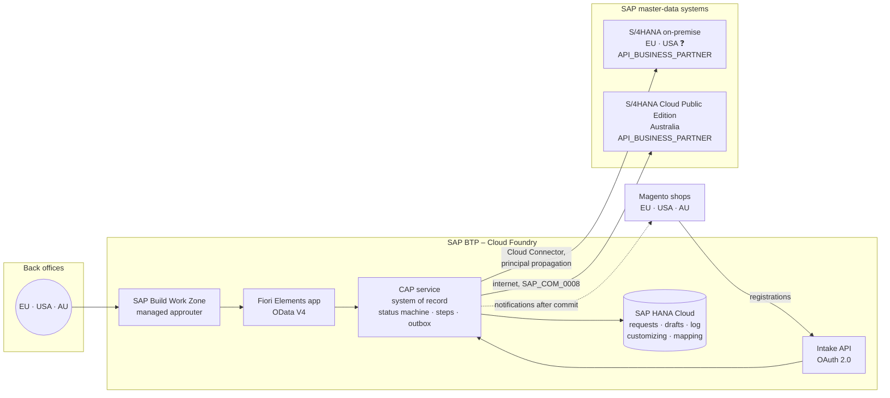

**Status.** Phase 1 is complete: the full user interface runs against a CAP service that implements the legacy status machine from a copy of the S/4 customizing, with 137 automated service tests and 15 browser journeys ✅. The deployment package (MTA, HANA HDI, XSUAA roles, HTML5 repository, Work Zone tile, health check) builds locally ✅. Nothing is deployed yet because no BTP subaccount is available. The phase-2 interfaces (intake, business-partner API, notifications) are designed 🟡.

**What we need from HYDAC** to proceed: the development subaccount, entitlements, space and roles, Git organization and transport setup listed in §9.4 and Appendix B, the activation of `API_BUSINESS_PARTNER` in Q4H/GWQ with the Cloud Connector resource, and the decisions D1–D13 in `docs/11` §8.

---

## 2. Business context and scope

### 2.1 Business process

The monitor is the human review step between the shop and SAP master data. Neither today nor in the target does the intake create master data directly.

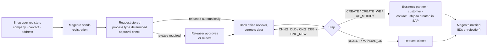

| Input from Magento | Process type | Result in SAP |
|---|---|---|
| Company registration, no SAP customer yet | `CR_DEB` | Business partner with customer role, company code and sales area data; admin contact person |
| Company registration, customer exists (duplicate handling) | `CH_DEB` | Contact person created or changed on the existing customer |
| New shop user for an existing customer | `CR_AP` / `CH_AP` | Contact person created (`CR_AP`) or changed automatically (`CH_AP`) |
| New delivery address for an existing customer | `CR_WE` | Ship-to party as customer, partner function on the sold-to |

### 2.2 Stakeholders and users

| Group | Interest | Role in the solution |
|---|---|---|
| Back office / inside sales (Innendienst), per sales organization in EU, USA, AU | Process requests quickly and correctly, see only their own work | `Kundenmonitor_Editor` |
| Releasers (Freigabe) | Approve requests above the order-volume limit or without credit card | `Kundenmonitor_Releaser` |
| Sales / customer service | Look up the state of a registration | `Kundenmonitor_Viewer` |
| Regional key users | Maintain approval rules, steps, texts and sales-org assignments without IT | `Kundenmonitor_Admin` 💡 (phase 2) |
| HYDAC IT (BTP, SAP Basis, identity, integration) | Operate the platform, own security and transport | Administration roles (§10.5) |
| HYDAC Australia (Gareth) | Same process on the Public Cloud tenant without ABAP development | AU backend, AU shop |
| TechDivision (Magento) | Switch endpoints at cutover, keep the payload contract | External party for I-01 / I-03 |
| purplecat | Build, deploy, support | Development, AMS |

❓ Number of users per role, region and sales organization, and the request volume per day per region. Needed for sizing (§9.5) and for the user administration effort (§10.5).

### 2.3 Scope

| In scope | Out of scope | Later / optional |
|---|---|---|
| Review and processing of the three request kinds for all process types, statuses and steps of the legacy report (`docs/01`) | Changes to the Magento shops beyond endpoint and credentials | API Management proxy in front of the intake (D4) |
| Intake from Magento, approval check, notifications to Magento | Replacing the S/4 BAdI notification on customer maintenance with partner role ZO (business-partner events, separate work package) | Business-partner events S/4 → BTP |
| Master-data creation through `API_BUSINESS_PARTNER` in S/4 on-premise and S/4HANA Cloud Public Edition | Master-data maintenance beyond what the steps create (done in S/4 apps) | Navigation to the S/4 app "Manage Business Partner Master Data" from the monitor (B-05) |
| Multi-region operation: EU, USA, AU with one deployment or one per region | Workflow / approval outside the monitor (SAP Build Process Automation) | Work Zone integration of further apps |
| Customizing per region in the application, administered by key users | | Retention job for completed requests, audit log of personal-data access (E-19) 💡 |
| Cutover: migration of open requests and Magento mappings, retirement of the custom S/4 objects | | |

### 2.4 Drivers and constraints

| Driver / constraint | Consequence for the design |
|---|---|
| **Clean core.** HYDAC wants no custom interfaces in S/4; Australia runs the Public Cloud, where custom OData services do not exist and the released ABAP Cloud business-partner object cannot create customer roles (SAP note 3655149) | All process logic on BTP; SAP reached through the released API only (AD-01) |
| **Three regions, two SAP deployment models** | One design, configuration per backend (AD-05); the API is the same in both models |
| **Concurrency and robustness defects of the legacy report** (R-01…R-17, `docs/07`) | Transactional step execution with lock and ETag, outbox after commit, every returned number persisted immediately (AD-06, AD-07) |
| **Personal data of contact persons on BTP** | Data classification, audit log, retention, residency decision (§8.5, AD-11) |
| **HYDAC operates the platform** | Standard BTP services only, no self-hosted components, documented operating model (§10) |
| **Small team, long lifetime** | Fiori Elements instead of freestyle UI, declarative authorization, one archive through all stages, automated tests (AD-02, AD-08) |

---

## 3. Requirements overview

### 3.1 Functional requirements (use cases)

| ID | Use case | Role | Status |
|---|---|---|---|
| UC-01 | Work the queue: views My work / Errors / Clarification / Release / All with counters, sorted by priority and waiting time, restricted to the user's sales organizations | Viewer+ | ✅ |
| UC-02 | Review a request: main data, contact person or ship-to, sales data, assignment (SAP and Magento numbers, release reason), processing log | Viewer+ | ✅ |
| UC-03 | Correct or complete data before processing (draft with lock; every field change logged) | Editor | ✅ |
| UC-04 | Release a request that needs approval (rule per process type and sales org: manual, credit card, order-volume limit) | Releaser | ✅ |
| UC-05 | Create customer and admin contact (CREATE) | Editor | ✅ logic, 🟡 API call |
| UC-06 | Create or change contact person (AP_MODIFY) | Editor | ✅ logic, 🟡 API call |
| UC-07 | Create ship-to party and assign it to the sold-to (CREATE_WE) | Editor | ✅ logic, 🟡 API call |
| UC-08 | Handle duplicates: assign existing customer (CHNG_OLD), change assignment (CNG_DEBI, with confirmation if the customer belongs to another Magento company), convert to new customer (CNG_NEW) | Editor | ✅ |
| UC-09 | Put in clarification with a mandatory comment | Editor | ✅ |
| UC-10 | Reject with a mandatory reason; Magento notified | Editor | ✅ logic, 🟡 notification |
| UC-11 | Complete manually; reset a closed request for reprocessing | Editor | ✅ |
| UC-12 | Fix errors: failed step sets an error status with the SAP messages in the log; correct and repeat without creating duplicates (R-11) | Editor | ✅ logic, 🟡 API call |
| UC-13 | Maintain customizing and user assignments per region in the application | Admin | 💡 |
| UC-14 | Intake of registrations from Magento (three operations), idempotent | Magento (technical client) | 🟡 |
| UC-15 | Migrate open requests and Magento mappings from `ZEC_CUSTOMER` at cutover | purplecat / HYDAC | 🟡 |

Business rules (process types, statuses, allowed steps per status, approval rules) are specified in `docs/01` and implemented in the CAP status machine; the UI never derives them.

### 3.2 Non-functional requirements

Targets are proposals to be confirmed by HYDAC (❓ where no figure exists today).

| ID | Quality | Requirement / target | How the design meets it |
|---|---|---|---|
| NFR-01 | Availability | Business hours of three regions cover ~20 h/day; target 99.5 % monthly for the application (BTP Cloud Foundry platform SLA 99.9 %) | Stateless CAP service, two instances in PRD, HANA Cloud managed service, CF health-check restart (§10.3) |
| NFR-02 | Performance | List with filters ≤ 2 s at 100 k requests; detail ≤ 1 s; step with SAP call ≤ 5 s (dominated by `API_BUSINESS_PARTNER`); intake ≤ 1 s | All reads local in HANA (no remote reads), indexed status/sales-org columns, computed columns for priority and criticality, `$batch` from Fiori Elements |
| NFR-03 | Capacity | ❓ requests/day; design assumption ≤ 1 000 requests/day across regions, ≤ 2 M rows in 10 years, ≤ 200 named users | Smallest HANA Cloud size, CF memory 512 MB per instance (§9.5) |
| NFR-04 | Security | SSO with HYDAC's corporate identity provider; TLS everywhere; no shared technical user that can create master data; least privilege; secrets only in BTP services | §8 |
| NFR-05 | Authorization | A user sees and changes only requests of the sales organizations assigned to them, per region; unreleased requests only for releasers; fail closed | Declarative CDS `@restrict` on every entity (§8.3) ✅ |
| NFR-06 | Integrity | No duplicate master data from parallel processing; a step is atomic per request; notifications exactly once after commit | Row lock + ETag, one HANA transaction per step, persistent outbox (AD-06, AD-07) ✅ lock, 🟡 outbox |
| NFR-07 | Auditability | Every field change, step result, release and notification result in the request log; master data created under the real user in SAP (change documents) | Log entity, principal propagation (§8.1), SAP Audit Log for personal-data access 💡 |
| NFR-08 | Data protection | GDPR and Australian Privacy Act: personal data classified, access logged, retention rule, residency decided per region | §8.5, AD-11 |
| NFR-09 | Maintainability | One codebase, one archive for all stages and regions, configuration over code, automated regression (service tests, UI journeys, lint) | AD-05, §10.1 ✅ |
| NFR-10 | Portability | No custom code in any SAP system; a new region is configuration | AD-01, AD-05 |
| NFR-11 | Operability | Health endpoint, structured logs with correlation ID, business KPIs in the app, outbox and intake monitoring | §10.3 |
| NFR-12 | Usability | SAP Fiori design, keyboard and screen-reader support of Fiori Elements, English and German UI, status and step texts per language from the service | Fiori Elements V4 ✅ |
| NFR-13 | Recoverability | RPO ≤ 15 min, RTO ≤ 4 h for the database; point-in-time recovery | HANA Cloud backups: daily full, log backups ≤ 15 min, retention 14 days default (§10.4) |

### 3.3 Legacy findings that shape the design

The analysis of the SAP GUI report found 17 defects (`docs/07`). The ones that change the architecture rather than a single function:

| ID | Legacy defect | Design answer |
|---|---|---|
| R-01 | Steps run without a lock; two users can create the same customer twice | ETag on every step action plus a row lock per request inside one HANA transaction (AD-06) ✅ |
| R-03 / R-04 | Notifications sent before the commit; send errors swallowed | Persistent outbox, sent after commit, retried, result logged (AD-07) |
| R-08 | Two different sales-org authorization checks | One declarative rule in the service for list, detail, children and log ✅ |
| R-11 | A ship-to number is lost after a partial failure; retry creates a second ship-to | Every number returned by the API is persisted before the next call; partial steps are repeatable |
| R-05 / R-16 | Address-level rejection not identifiable in Magento; typo `RejectCusomterSet` is part of the contract | Payload agreed with TechDivision; name kept |
| R-07 | Release limit compared without currency conversion | Limit currency in the approval rules; comparison only in the same currency (business decision) |
| R-15 | Wrong and missing status texts | Texts maintained per language in the application (E-18) |

---

## 4. Solution overview

### 4.1 Architecture principles

| # | Principle | Meaning in this project |
|---|---|---|
| P-1 | **Clean core on both sides** | No custom tables, services or classes for the monitor in any SAP system; no modification of SAP standard. BTP holds everything that is specific to the process. |
| P-2 | **One design for all regions** | Regions differ in configuration (destinations, customizing, user assignments), never in code. Adding a region means adding registry entries. |
| P-3 | **Clear system of record** | The request and its history belong to BTP (HANA Cloud). Master data belongs to the SAP system of the region. No replication in either direction. |
| P-4 | **Standard before custom** | Fiori Elements over freestyle UI; CAP draft over hand-written locking; `API_BUSINESS_PARTNER` over custom services; BTP managed services over self-built infrastructure. |
| P-5 | **The service decides** | Authorization, allowed steps, criticality and texts are computed in the service and delivered as data. The UI renders; it holds no business logic. |
| P-6 | **Real user end to end** | Master data is created in SAP under the identity of the back-office user (principal propagation). SAP authorizations and change documents stay meaningful. |
| P-7 | **Transactional integrity** | A step is one database transaction; side effects to other systems are recorded in the same transaction and executed after commit. |
| P-8 | **Secure by default** | Fail closed (no assignment, no data), least privilege, secrets in platform services, no landscape-wide redirect wildcards. |
| P-9 | **Operable by HYDAC** | Standard observability, one transport route, documented owners for every recurring task. |

### 4.2 System context

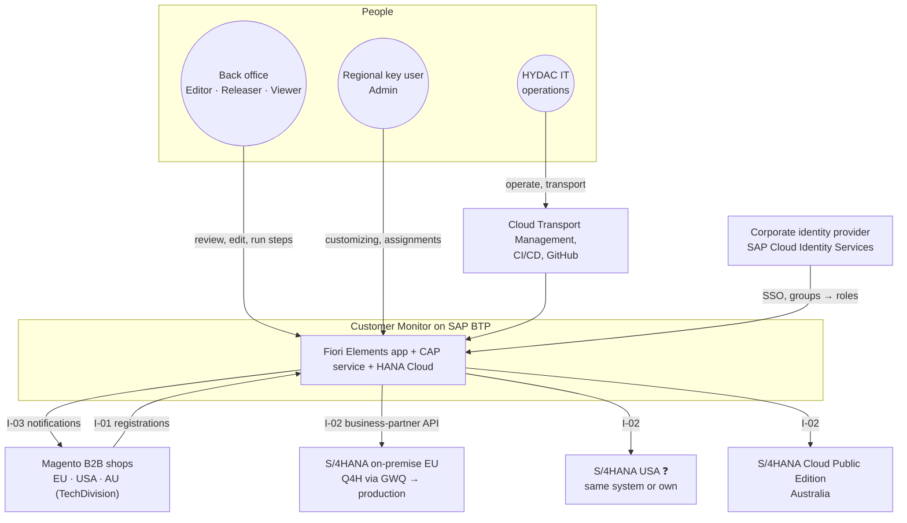

| Neighbour | Relationship | Owner |
|---|---|---|
| Corporate identity provider → SAP Cloud Identity Services (IAS) → BTP | Authentication and group-based role assignment | HYDAC IT identity |
| Magento shops | Source of requests (I-01), target of notifications (I-03) | HYDAC eCommerce / TechDivision |
| S/4HANA on-premise (Q4H/GWQ, production) | Master-data system EU (and USA ❓) via `API_BUSINESS_PARTNER` (I-02) through Cloud Connector | HYDAC SAP Basis |
| S/4HANA Cloud Public Edition (AU) | Master-data system AU via `API_BUSINESS_PARTNER` (I-02), communication scenario `SAP_COM_0008` | HYDAC Australia IT |
| GitHub, SAP CI/CD, Cloud Transport Management | Source control, build, transport DEV → QAS → PRD | HYDAC IT, purplecat |

### 4.3 Alternatives considered

| Option | Assessment | Decision |
|---|---|---|
| **A. Fiori app inside S/4 on-premise** (RAP, embedded launchpad) | Serves one system only; Australia would need a second implementation in ABAP Cloud, which cannot create customer roles; keeps all custom code HYDAC wants to retire; every process change is a transport in each SAP system | Rejected |
| **B. BTP UI, logic stays in S/4** (custom OData service per system, HANA replica on BTP for locking) – design of 2 Nov | Requires a custom service in each SAP system (impossible in the Public Cloud), two codebases for the same logic, replica consistency problems | Superseded by C (E-15) |
| **C. BTP side-by-side, BTP system of record, SAP via standard API** | One UI, one service, one request store, one step logic for all regions; the API exists in both SAP deployment models; no ABAP anywhere; price: HANA Cloud becomes a business-critical database | **Chosen (AD-01, AD-03)** |
| **D. SAP Build Process Automation / Workflow** for the approval | Adds a second runtime and licence for a one-step release that the status machine already models; useful only if HYDAC wants cross-application approval inboxes | Not needed now; the release step could be surfaced as a task later |

---

## 5. Building-block view

### 5.1 Container view

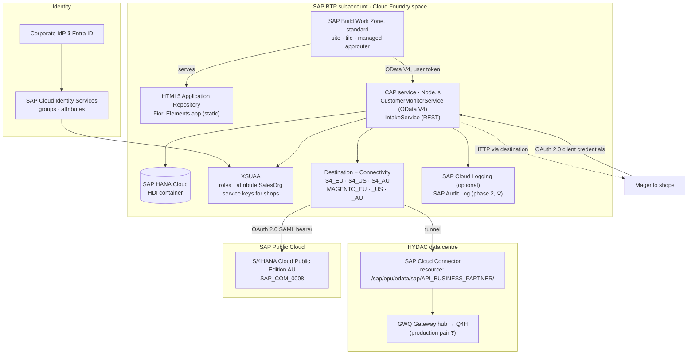

| Container | Technology | Responsibility | Status |
|---|---|---|---|
| Fiori Elements app `hydac.custmon.monitor` | SAPUI5 `sap.fe.templates` (List Report + Object Page, flexible column layout), JavaScript extensions only (~300 lines) | Rendering, navigation, draft editing, action dialogs; everything else is annotation-driven from the service | ✅ |
| CAP service `CustomerMonitorService` | SAP CAP Node.js 9, OData V4 with draft | UI contract, authorization, flags per request, status machine, step dispatcher, change log | ✅ (mock backend) |
| CAP service `IntakeService` | Same application, separate service, REST/OData, client-credentials scope | Registration intake, process-type determination, approval check, idempotency | 🟡 B-01 |
| Backend adapter `srv/backend/` | Node.js module behind an interface (`loadCustomizing`, `executeStep`, `saveChanges`) | Step logic (phase-1 implementation becomes production) and thin S/4 adapter for `API_BUSINESS_PARTNER` | ✅ seam, 🟡 S/4 adapter B-03 |
| Outbox | CAP persistent queue (`cds.queued`) in the HDI container | Notifications to Magento after commit, retries, result logging | 🟡 B-07 |
| SAP HANA Cloud (HDI container) | `hdi-shared` in a HANA Cloud instance | System of record: requests, drafts, log, customizing per backend, Magento mapping, user assignments, outbox | ✅ deployable, 🟡 phase-2 tables |
| XSUAA | `application` plan, `xs-security.json` | Login, scopes, role templates and collections, attribute `SalesOrg`, technical clients for the shops | ✅ |
| Destination + Connectivity | `lite` plans | One destination per SAP system and per shop and stage; Cloud Connector tunnel for on-premise | 🟡 (needs subaccount) |
| Work Zone + HTML5 repository | `SAPLaunchpad` standard, `html5-apps-repo` app-host | Entry point, managed approuter, tile, role-based visibility | ✅ packaged |
| Cloud Logging / Audit Log | optional bindings | Central logs and dashboards; audit of personal-data access | 🟡 opt-in |

### 5.2 Component view of the CAP service

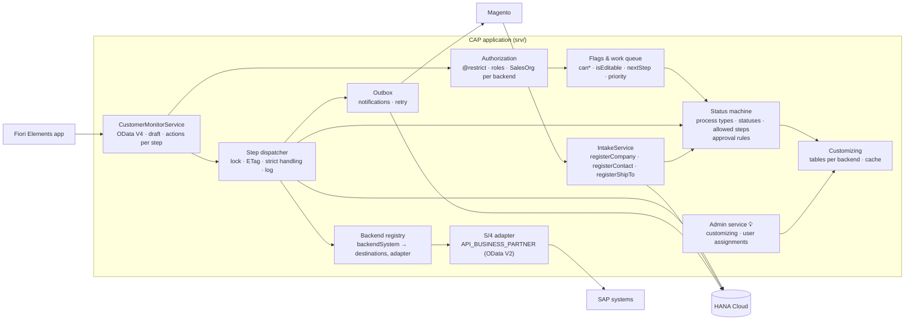

| Component | Responsibility | Key design points |
|---|---|---|
| `CustomerMonitorService` | Stable OData V4 contract for the UI including the UI semantics as annotations (labels, value helps, criticality, side effects; decision E-13) | One bound action per step (`release`, `rejectRequest`, `clarify`, `reset`, `createCustomer`, `createShipTo`, `modifyContact`, `convertToNewCustomer`, `completeManually`, `assignExistingCustomer`, `changeCustomerAssignment`); availability via `Core.OperationAvailable` on `can*` flags; confirmation questions via OData strict handling (412 + `Preference-Applied: handling=strict`) |
| Authorization | Row and function authorization | Declarative `@restrict` with `where: salesOrganization = $user.SalesOrg` and `released = true` for non-releasers on `Requests`, its three children and the log (§8.3) |
| Flags & work queue | Everything the UI needs to show state and allowed actions | Computed per request from status, release, roles and customizing; `nextStep`, `waitingSince`, `priority`, `rowCriticality` as data |
| Status machine | Process types, statuses, allowed steps per status, approval rules, process-type changes | Pure functions in `srv/lib/status-machine.js`, driven by customizing data, fully unit-tested |
| Step dispatcher | Executes a step atomically | Reads the request `FOR UPDATE`, validates the ETag, runs the step, writes status, numbers, log and outbox messages in one transaction; on failure sets the error status and logs the SAP messages (R-09) |
| Backend registry | Maps `backendSystem` to the S/4 destination, the Magento destination and number rules | Configuration (not code); the basis for multi-region (§9.1) |
| S/4 adapter | Thin wrapper over `API_BUSINESS_PARTNER` | CAP remote service from the EDMX (`cds import`, OData V2) via the destination; falls back to the SAP Cloud SDK OData V2 client if needed; no business logic inside |
| Outbox | Notifications to Magento | Message written in the step's transaction, sent after commit, exponential retry, result as log entry (R-03/R-04) |
| Customizing | Steps, allowed steps, approval rules, texts per backend | Tables in HANA, initial load from CSV, in-memory cache invalidated on save; maintained by key users (UC-13) |

### 5.3 User interface

| Screen | Floorplan | Content |
|---|---|---|
| Request list | List Report (responsive table) | Filter bar (search, region 💡, status group, released, in clarification, customer, sales org, process type, status, source, order exists, created/changed); views My work / Errors / Clarification / Release / All with counters; columns status, hints, release reason, process type, name, next step, waiting since, customer, sales org, Magento company, order volume, created, changed; error rows highlighted |
| Request detail | Object Page with draft | Header: status, release, next step, key figures; sections Main data, Contact person *or* Ship-to (by process type), Sales data, Assignment, Log; actions Edit and the step menu (only allowed steps enabled) |
| Dialogs | Fiori Elements action parameter dialogs | Reject (reason), clarify (comment), assign / change assignment (business partner with value help); confirmation questions from the service |
| Admin 💡 | Small List Report / Object Page apps | Customizing tables and user assignments per region, role `Kundenmonitor_Admin` |

Own code is limited to two XML fragments and one controller extension (`app/monitor/webapp/ext/`) plus a hash rewrite for legacy bookmarks. UI texts come from i18n; status, step, process-type and release texts come from the service code lists. Languages: English, German (extensible).

### 5.4 Data architecture

**The request aggregate** (phase 1 ✅, outbox 🟡):

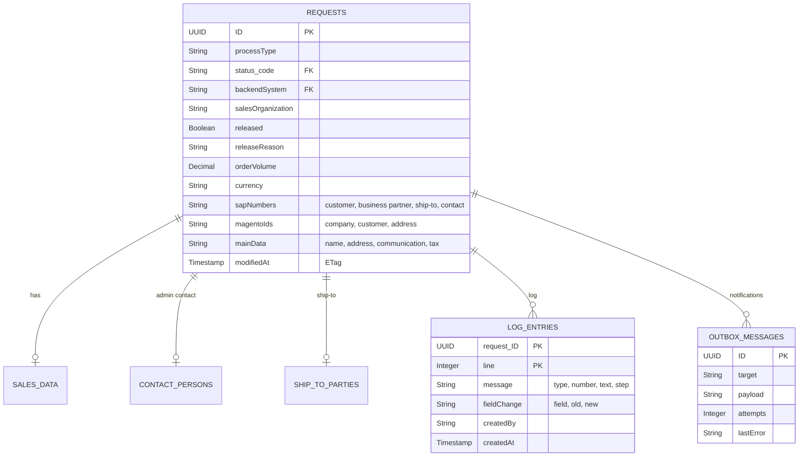

**Configuration per backend** (phase 2 🟡; `status_code` and `processType` reference the code lists `Statuses` and `ProcessTypes`, not shown):

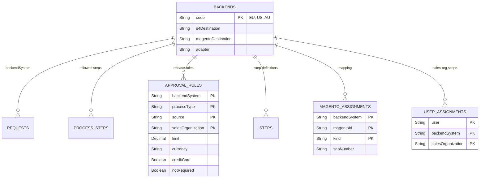

| Entity group | Content | Phase | Notes |
|---|---|---|---|
| `Requests` + `SalesData`, `ContactPersons`, `ShipToParties` | The request with its working data; compositions of one; ETag on each; draft-enabled root | ✅ | Equivalent of `ZEC_CUSTOMER` + `PAYLOAD_CHNG`; the original payload is kept as JSON for audit 🟡 |
| `LogEntries` | Processing log per request: messages, field changes, step results, notification results | ✅ | Association (no draft) so the log is never part of an edit |
| Code lists `Statuses`, `StatusGroups`, `ProcessTypes`, `Steps`, `ReleaseStates`, `ReleaseReasons` | Texts per language, criticality, step success/error status | ✅ | Localized via CAP `localized` |
| Customizing `ProcessSteps`, `ApprovalRules` (+ `backendSystem`) | Allowed steps per process type and status; release rules per process type, source, sales org, with limit currency | ✅ CSV, 🟡 per backend | Copy of `ZEC_CUST_PROCESS`, `ZEC_CUST_APPROV`; maintained in the admin app (E-18) |
| `Backends` (registry) | Backend ID → destinations, adapter, number rules | 🟡 | Configuration entity, maintained by admins |
| `MagentoAssignments` | Magento company / customer / address ↔ business partner / customer / contact / ship-to | 🟡 | Replaces the Z field on the customer; migrated at cutover (D13) |
| `UserAssignments` | User → backend → sales organizations | 🟡 (D10, option 2) | Alternative: IAS attribute (§8.4) |
| Outbox | CAP persistent queue table | 🟡 | Standard CAP table, monitored (§10.3) |

**Data classification.** Requests contain company data (public) and **personal data** of contact persons: name, email address, telephone number, language. From phase 2 HANA Cloud on BTP holds the only copy. The fields are annotated `@PersonalData` (E-19) so that CAP's audit-logging plugin writes read and change events to the SAP Audit Log service 💡. Retention: completed requests (status 899/997/998/999) are deleted after a period to be defined by HYDAC ❓ (proposal: 24 months) by a scheduled job. Residency: see §9.2.

**Volume.** A request with children and log is a few kilobytes. Even at 1 000 requests per day across all regions the database stays below 10 GB in ten years; the smallest HANA Cloud instance suffices (§9.5).

---

## 6. Runtime view

### 6.1 Intake of a registration (I-01)

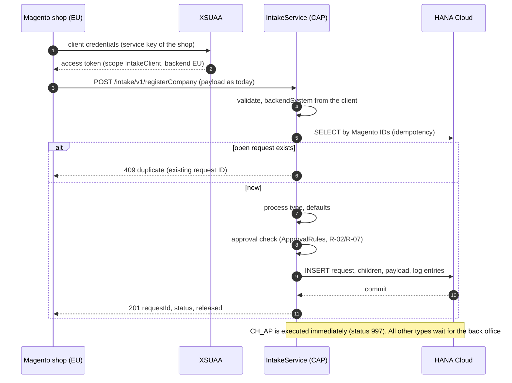

Error contract: 400 with a message list for missing mandatory fields, 401/403 for an invalid client, 409 for a duplicate, 503 if the database is unavailable (Magento retries). The payload structure is the one Magento sends to `ZEC_CUSTOMER_CREATE_SRV` today, so TechDivision changes only endpoint and credentials.

### 6.2 Review and edit (draft)

Editing uses CAP draft: `draftEdit` (with ETag) creates a draft and locks the request for other users; PATCH requests on the draft send only changed fields; `draftActivate` writes the working data, logs every field change and releases the lock. Steps are blocked while a draft exists; a draft expires after 15 minutes without activity. This replaces the legacy "no lock" behaviour (R-01) and the risk of overwriting with empty screen fields (R-12).

### 6.3 Step CREATE with principal propagation (I-02)

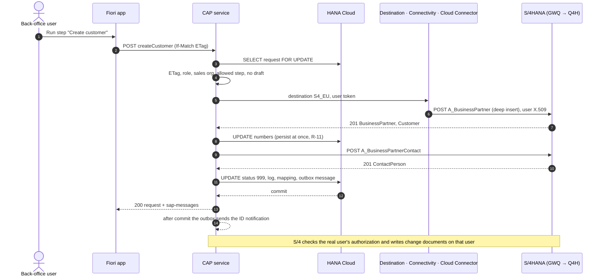

Failure paths: an API error sets status 150 and logs all messages, the created numbers stay on the request; a repeat continues with the missing part. An unreachable backend returns 503 `BACKEND_UNAVAILABLE` and leaves the request unchanged. A stale ETag returns 412. A missing S/4 authorization of the propagated user returns 403 with the API message.

### 6.4 Notification to Magento (I-03)

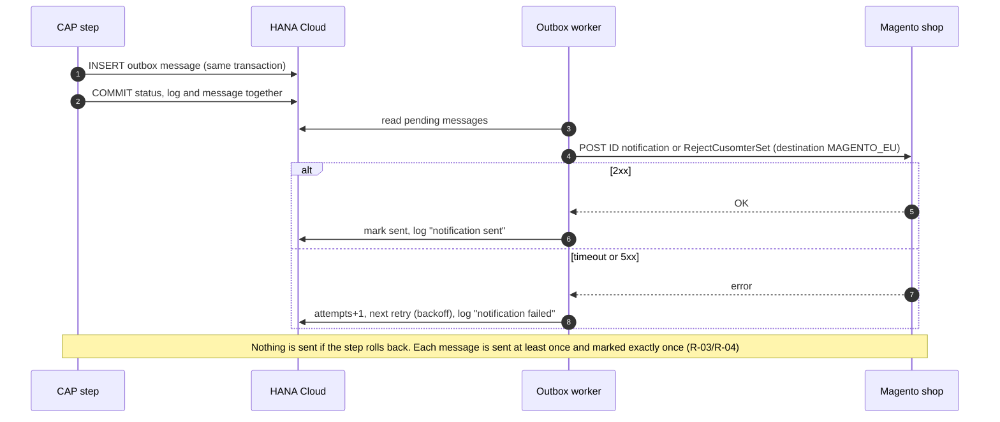

A "resend notification" action for editors covers the case of a permanently failed message after the retries are exhausted.

### 6.5 Status machine

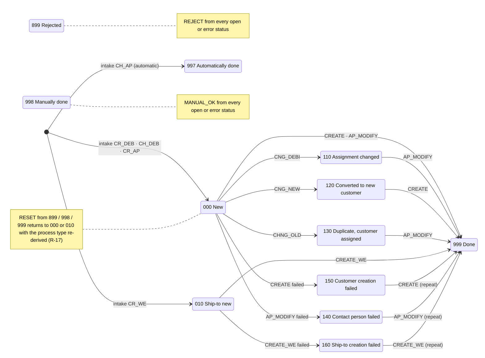

| Status group | Statuses | Meaning |
|---|---|---|
| Open | 000, 010, 110, 120, 130 | Waiting for the back office; the allowed steps depend on process type and status |
| Error | 140, 150, 160 | A master-data step failed; the SAP messages are in the log; the step can be repeated |
| Closed | 899, 997, 998, 999 | Rejected, done automatically, done manually, done; only RESET is offered |

The allowed steps per process type and status, the release check (manual, credit card, order-volume limit per sales organization) and the process-type changes (CHNG_OLD and CNG_DEBI → `CH_DEB`, CNG_NEW → `CR_DEB` with a fresh release check, R-02) are customizing data per backend. CLARIFY and RELEASE do not change the status. Full rules: `docs/01` §3–§6.

### 6.6 Error handling and resilience

| Situation | Behaviour | Code |
|---|---|---|
| Stale request version (another user changed it) | Step refused, UI reloads | 412 `ETAG_REQUIRED` |
| Draft exists (another user is editing) | Steps blocked, lock owner shown | 423 draft lock |
| Confirmation needed (customer belongs to another Magento company; critical steps) | Question returned, repeated call without `Prefer: handling=strict` executes | 412 `CONFIRM_REQUIRED` |
| Business partner not found / no customer role (CHNG_OLD, CNG_DEBI) | Rejected with message | 400 `BP_NOT_FOUND` / `BP_NOT_CUSTOMER` |
| SAP API business error (mandatory field, number range, lock) | Error status 140/150/160, all API messages in the log and in `sap-messages` | 200 with messages |
| SAP system unreachable, destination missing | Request unchanged, log entry, clear message; other regions unaffected | 503 `BACKEND_UNAVAILABLE` |
| Partial success (business partner created, contact failed) | Numbers persisted, error status; repeat continues with the missing part | – |
| Magento unreachable (notification) | Message stays in the outbox, retried with backoff, visible in the log; resend action | – |
| Magento intake duplicate | Existing request returned | 409 |
| HANA Cloud unavailable | Service answers 503, CF health check restarts the instance if needed; no data loss (committed transactions) | 503 |

---

## 7. Integration architecture

### 7.1 Interface catalogue

| ID | Interface | Direction | Protocol / auth | Content | Replaces |
|---|---|---|---|---|---|
| I-01 | Intake | Magento → BTP | REST/OData V4 over HTTPS, OAuth 2.0 client credentials (one XSUAA service key per shop/region); optional API Management proxy | Company registration, new shop user, new delivery address; today's payload structure; idempotent | `ZEC_CUSTOMER_CREATE_SRV` |
| I-02 | Master data | BTP → S/4 | `API_BUSINESS_PARTNER` (OData V2) via destination; on-premise: Cloud Connector + principal propagation; Public Cloud: `SAP_COM_0008` + OAuth 2.0 SAML bearer | Business partner, customer, contact person, ship-to, partner function; read for duplicate check and value help | CMD-API / BAPI calls in `ZCL_EC_CUSTOMER*` |
| I-03 | Notifications | BTP → Magento | HTTPS via destination per shop, credentials as today (❓ TechDivision); persistent outbox | ID notification after CREATE / CREATE_WE / AP_MODIFY; rejection (`RejectCusomterSet`) | BAdI notification, `ZEC_CUSTOMER_READ_SRV` read-back |
| – | Legacy Magento ↔ S/4 services | – | – | Retired per shop at cutover after a parallel run | – |

No RFC, no IDoc, no custom OData service, no ABAP.

### 7.2 Step to API mapping (I-02)

| Step | Calls on `API_BUSINESS_PARTNER` | Notes |
|---|---|---|
| CREATE (`CR_DEB`) | `POST A_BusinessPartner` (organization, `to_BusinessPartnerAddress`, `to_BusinessPartnerRole` FLCU00/FLCU01, `to_BusinessPartnerTax`) with deep insert `to_Customer` (`A_Customer`, `to_CustomerCompany`, `to_CustomerSalesArea`); then `POST A_BusinessPartnerContact` (+ `to_ContactAddress`, `to_ContactRelationship`) for the admin contact | Internal number assignment; ❓ grouping / number range per sales org. Sales org 7110 carrier as supplier role (`to_Supplier`) ❓ still needed |
| CREATE for an existing business partner without customer role | `POST .../to_BusinessPartnerRole` + `to_Customer` | |
| AP_MODIFY (`CR_AP`, `CH_DEB`) | `GET A_BusinessPartnerContact`; `POST` or `PATCH A_BusinessPartnerContact`, `A_BPContactToAddress`, `A_BPContactToFuncAndDept` | Sales org 2000 "CRM number mandatory": ❓ which field; key-user custom field or rule retired |
| CREATE_WE (`CR_WE`) | `POST A_BusinessPartner` with `to_Customer` (ship-to as customer); then `POST A_CustSalesPartnerFunc` on the sold-to (partner function ship-to, sales area of the request) | New number persisted before the second call (R-11) |
| CHNG_OLD, CNG_DEBI | `GET A_BusinessPartner('…')?$expand=to_Customer,to_BusinessPartnerRole` | `BP_NOT_FOUND` / `BP_NOT_CUSTOMER` (R-06); Magento mapping read locally |
| Value help | `GET A_BusinessPartner?$filter=…&$expand=to_Customer` | Only in the request's backend, result limited |
| RELEASE, REJECT, CLARIFY, RESET, CNG_NEW, MANUAL_OK | none | Request in HANA only |

### 7.3 Connectivity and destinations

| Destination | Type | Authentication | Used for |
|---|---|---|---|
| `S4_EU` (`S4_US` ❓) | OnPremise (Cloud Connector), URL = virtual host of GWQ | `PrincipalPropagation`; DEV start: `BasicAuthentication` with a technical user | I-02 |
| `S4_AU` | Internet | `OAuth2SAMLBearerAssertion` (audience, token service URL and client from the communication arrangement; `nameIdFormat` email); alternative `ClientCertificateAuthentication` with a communication user | I-02 |
| `MAGENTO_EU`, `MAGENTO_US`, `MAGENTO_AU` | Internet | As configured in S/4 today (basic or token) ❓ TechDivision | I-03 |
| `srv-api` | Internet (generated by the MTA) | Token forwarding from the approuter | UI → CAP |

**Cloud Connector.** One resource per on-premise backend: virtual host `gwq-virtual:443` (HTTPS), path `/sap/opu/odata/sap/API_BUSINESS_PARTNER/` with sub-paths. Nothing else. Principal propagation needs the Cloud Connector system certificate trusted in GWQ/Q4H (ICM), a certificate-to-user mapping rule (`CERTRULE`, for example on the email address) and the business-partner creation authorizations on the S/4 users of the editors. Viewers, releasers and admins need no S/4 user.

**Stage mapping.** *Assumption:* Q4H is the S/4HANA quality system and GWQ its Gateway hub where OData services are published. ❓ Please confirm, including the production pair.

| BTP stage | SAP EU (on-premise) | SAP USA | SAP AU (Public Cloud) | Magento |
|---|---|---|---|---|
| DEV | Q4H via GWQ | ❓ | ❓ test tenant | test shop / replayed payloads |
| QAS | Q4H (❓ or separate client) | ❓ | ❓ test tenant | staging shops |
| PRD | ❓ production S/4 + Gateway | ❓ | ❓ production tenant | production shops |

### 7.4 S/4HANA Cloud Public Edition (Australia)

| Aspect | On-premise (Q4H) | Public Cloud (AU) |
|---|---|---|
| Connection | Cloud Connector, principal propagation | Internet, communication arrangement `SAP_COM_0008`, OAuth 2.0 SAML bearer (user propagation) or client certificate with a communication user |
| API | `API_BUSINESS_PARTNER`, activated standard service | `API_BUSINESS_PARTNER` – **the same API and the same adapter**; in the Public Cloud it is the only way to create customers from outside |
| Custom code | none | none; no developer extensibility, no ABAP Cloud |
| Custom fields | Z fields on the customer today (Magento company, CRM number ❓) | Key-user custom fields if HYDAC wants them visible; otherwise the mapping lives in the monitor (D13) |
| Users | S/4 users mapped by email / user ID | Business users with a business role for business-partner maintenance, same IAS identity possible |
| Number ranges, grouping | ❓ per sales org | ❓ per AU configuration |

The effort for Australia is configuration, authorizations and testing, not a second implementation (D9).

### 7.5 Integration Suite

The monitor's runtime calls do not pass through SAP Integration Suite: the master-data calls are synchronous user calls with user context, the notifications have their own retry. An iFlow in between would add latency and a second place to monitor without benefit. Integration Suite is relevant for an optional **API Management** proxy in front of the intake (API key, spike arrest, analytics – D4), for a transformation iFlow only if a shop cannot adapt its payload, for the existing Magento ↔ SAP flows that may run there today ❓, and later for replacing the legacy BAdI notification with business-partner events. iFlows are versioned in the separate repository `cpi-iflows` (§10.1).

---

## 8. Security architecture

### 8.1 Identity and access flow

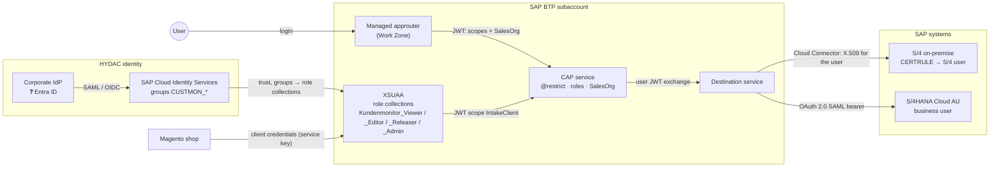

| Hop | Mechanism |
|---|---|
| User → Work Zone / app | Corporate IdP via SAP Cloud Identity Services → XSUAA; role collections from IdP groups |
| UI → CAP | OAuth token forwarded by the managed approuter; CSRF protection by Fiori Elements |
| Magento → intake | OAuth 2.0 client credentials: one XSUAA service key per shop/region (identifies the backend), rotated by HYDAC; optional API key + quota in API Management |
| CAP → S/4 on-premise | Principal propagation: the user's JWT is exchanged; the Cloud Connector issues a short-lived X.509 certificate; S/4 maps it to the S/4 user. Alternative: technical user (basic auth) for the first DEV tests only |
| CAP → S/4HANA Cloud | OAuth 2.0 SAML bearer assertion from the communication arrangement; alternative client certificate with a communication user |
| CAP → Magento | Credentials of the shop stored in the destination |

### 8.2 Roles and scopes

| Role template (scope) | Role collection | May | Legacy equivalent |
|---|---|---|---|
| `MonitorViewer` | `Kundenmonitor_Viewer` | Read released requests of own sales orgs | Display |
| `MonitorEditor` | `Kundenmonitor_Editor` (+ Viewer) | Edit, run steps | Change |
| `MonitorReleaser` | `Kundenmonitor_Releaser` (+ Viewer) | See unreleased requests, release | `ZEC_MONITO` ACTVT 43 |
| `MonitorAdmin` 💡 | `Kundenmonitor_Admin` | Maintain customizing and user assignments of own backend | Customizing transactions |
| `IntakeClient` 🟡 | – (technical, service key per shop) | Call the intake | – |

Attribute `SalesOrg` (list) on the user; empty means nothing is visible. The service requires `MonitorViewer` for everything; `xs-security.json` is verified by a test against the CDS model so that no role or attribute can go missing.

### 8.3 Authorization layers

| # | Layer | Where | Effect |
|---|---|---|---|
| 1 | Login | IdP → IAS → XSUAA | Only HYDAC identities; the tile is visible only with the Work Zone content role |
| 2 | Function | Role collection | Read / edit and run steps / release / administer |
| 3 | **Rows** | Sales-org assignment per backend: CDS `@restrict … where salesOrganization = $user.SalesOrg` on `Requests`, `SalesData`, `ContactPersons`, `ShipToParties`, `LogEntries`, value helps | Which requests are visible anywhere (list, counters, detail, children, log). This is the **single read path**: reads never touch S/4 ✅ |
| 4 | Release | `MonitorReleaser` | Unreleased requests visible only to releasers (`released = true` for everyone else) ✅ |
| 5 | **SAP** | Principal propagation on CREATE / CREATE_WE / AP_MODIFY | S/4 checks the creation authorization of the real user (sales org, company code) and writes change documents on that user. No technical user can create master data anywhere |

Why per backend: the same sales-org code can exist in two SAP systems with different meaning. The assignment therefore carries the backend (table) or a prefixed value (`EU-0001`) in the attribute. ❓ If sales-org codes are unique across all systems, plain codes suffice.

### 8.4 User management

**Goal: no user-by-user maintenance in the BTP cockpit.** Identity and roles come from the corporate IdP through IAS groups mapped to role collections. For the **data scope** (sales organizations per user and backend) two options were checked against SAP's documentation:

| | Option 1 – IAS attribute via SCIM API | Option 2 – application table `UserAssignments` |
|---|---|---|
| Where the scope lives | IAS user attribute `SalesOrg` → XSUAA role attribute (source Identity Provider) → `$user.SalesOrg` | Table in HANA, read by the CAP filter |
| Administered by | Regional key user in the monitor's admin screen; CAP writes to IAS through the Identity Directory SCIM API | Regional key user in the same admin screen; no external call |
| Effect | At the next login (new token) | Immediate |
| Credential | CAP holds a tenant-wide IAS `Manage Users` / `Manage Groups` client – a finding in any security review if the tenant is shared | None |
| Per-backend values, delegation per region | Prefixed values or multi-valued custom-schema attribute; to verify under the trust type | Native |
| Visibility | IAS admin console and audit log | Application table with change log, exportable |

**Recommendation (AD-10): Option 2** for the data scope, IAS groups for the roles, no user creation from the application. Static role collections with sales orgs maintained in the cockpit remain the interim for the first DEV test users. Joiner / mover / leaver follow HYDAC's IdP process; a leaver loses access everywhere at once. One authorization matrix (role × region × sales org), owned by HYDAC, covers IdP groups, the application scope and the S/4 roles; it is reviewed quarterly. Out of sync means "no authorization" on the master-data step, never exposed data, because the CAP filter applies first.

### 8.5 Data protection

| Topic | Design |
|---|---|
| Personal data | Contact-person name, email, telephone, language on requests and contact persons; annotated `@PersonalData` (E-19) |
| Audit of access | CAP audit-logging plugin → SAP Audit Log service (read and change of personal data) 💡; application log for assignments and customizing changes; BTP audit log for roles and trust; S/4 change documents on the real user |
| Retention | Completed requests deleted after ❓ months by a scheduled job (SAP Job Scheduling Service); the log of deleted requests is anonymized |
| Residency | Central deployment keeps all regions' requests in one BTP region; Australian Privacy Principle 8 restricts cross-border disclosure of personal information. HYDAC data protection decides before the AU production subaccount exists (§9.2, D8) |
| Transport encryption | TLS 1.2+ on every hop (browser, approuter, CAP, destinations, Cloud Connector tunnel) |
| Encryption at rest | HANA Cloud data and backups encrypted by SAP |
| Secrets | Service keys, destination credentials and certificates in BTP services only; nothing in the repository; redirect URIs limited to the Cloud Foundry domain and the Work Zone host (no landscape-wide wildcard) |

---

## 9. Multi-region and deployment architecture

### 9.1 Backend registry and routing

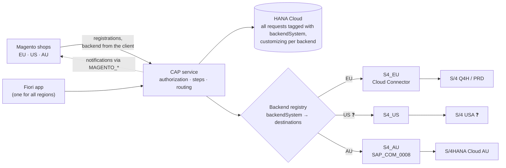

| Element | How it works |
|---|---|
| `backendSystem` per request | Set by the intake from the shop's technical client; read-only; filter and column "Region" in the UI. Small contract extension 💡 |
| Backend registry | Configuration: backend → S/4 destination, Magento destination, adapter type, number rules. A new region = one entry + two destinations, no code change |
| Reads | Always from HANA: one list across all regions, filtered by the user's assignments. No remote reads, no synchronization |
| Writes | Every step and save changes the request in HANA; CREATE, CREATE_WE and AP_MODIFY additionally call the S/4 system of the request as the real user |
| Rules per backend | Allowed steps, approval rules and texts are customizing tables per backend, maintained by the regional key users |
| Isolation | If one SAP system is down, only that region's master-data steps fail with `BACKEND_UNAVAILABLE`; if a shop is down, its notifications wait in the outbox |

If the USA runs on the same S/4 system as Europe, it is simply more sales organizations in backend EU.

### 9.2 Deployment options and data residency

| | **Central** (one deployment) | **Regional** (one deployment per region) |
|---|---|---|
| Setup | One PRD subaccount (e.g. EU region), one app, one HANA Cloud, all backends registered | Same archive in one subaccount per region (EU, US, AU), each with its own SAP system(s), shop(s) and HANA Cloud |
| Data location | All requests in one BTP region – the only copy | Each region's requests stay in its BTP region (e.g. Sydney for AU) |
| Users | One URL / tile, cross-region support possible | One tile per region (can sit in one Work Zone site) |
| Cost and operation | 1× HANA Cloud, 1× deployment, 1× transport route | 3× HANA Cloud, 3× deployments, one cTMS target node per region |
| Code | Multi-backend routing (§9.1) | Works without routing; routing still possible |

**Recommendation (AD-12): central**, on the condition that HYDAC data protection confirms that AU contact data may be stored in an EU BTP region. Otherwise regional for AU and central for EU and US. The same archive serves both; the decision is needed before AU goes live, not before DEV.

### 9.3 BTP landscape

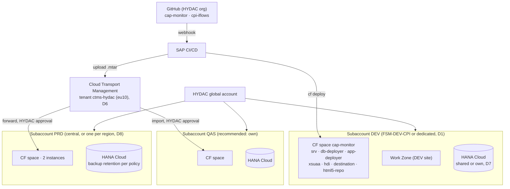

Subaccount recommendation: DEV may share FSM-DEV-CPI (which also hosts Integration Suite); QAS and PRD should be separate subaccounts (or at least spaces) so that application and integration lifecycles stay independent. The region of the PRD subaccount(s) follows §9.2.

### 9.4 BTP services and entitlements

| Service / entitlement | Plan | Purpose | Needed from | If not granted |
|---|---|---|---|---|
| Cloud Foundry Runtime | MEMORY, 2–4 GB (DEV) | CAP service (≈ 256–512 MB), deployer tasks, headroom for zero-downtime redeploys | First deployment | No deployment |
| SAP HANA Cloud | `hana-cloud` / `hana` + tools | Database instance for the HDI container; the system of record from phase 2; main cost item | First deployment | No persistence. ❓ an existing instance can be shared (instance mapping) |
| SAP HANA Schemas & HDI Containers | `hana` / `hdi-shared` | The application's container, deployed from `db/` | First deployment | as above |
| SAP Build Work Zone, standard | `SAPLaunchpad` / `standard` | Entry point, managed approuter, tile, roles | Before user tests | Direct app URL only. ❓ existing site can be reused |
| Authorization & Trust Management (XSUAA) | `application` | Login, roles, attribute, technical clients | First deployment | already entitled |
| Destination | `lite` | SAP systems, shops, UI routing | First deployment | already entitled |
| Connectivity | `lite` | Cloud Connector tunnel to on-premise | Phase 2 (B-04) | already entitled |
| HTML5 Application Repository | `app-host` | UI hosting | First deployment | already entitled |
| Continuous Integration and Delivery | `cicd-app` / `default` | Build, lint, tests, deploy to DEV, upload to cTMS on every push | With Git | Alternative: GitHub Actions + `cf` CLI |
| Cloud Transport Management | `transport` / `standard` | DEV → QAS → PRD with approval and audit trail | Before QAS | Manual `cf deploy` per stage |
| SAP Cloud Logging (or Application Logging) | `standard` / `lite` | Central logs, dashboards, alerts | Recommended for QAS/PRD | `cf logs` only |
| SAP Cloud Identity Services | – (tenant) | IdP proxy, groups, SSO | Before user tests | ❓ HYDAC tenant exists (every Public Cloud ships one) |
| SAP Audit Log service 💡 | `premium` or default | Personal-data access audit (E-19) | Before PRD | Application log only |
| SAP Job Scheduling Service 💡 | `standard` | Retention job | Before PRD | Retention by manual script |
| SAP Integration Suite – API Management (optional, D4) | existing | External API gateway for the intake | If HYDAC wants central governance | Direct intake |

Appendix B maps each requested element to the requirement it supports.

### 9.5 Sizing

| Component | DEV | PRD (proposal) | Rationale |
|---|---|---|---|
| CAP service | 1 instance × 512 MB | 2 instances × 512 MB | Node.js, stateless; two instances for rolling deployments and resilience, not for load |
| HANA Cloud | Smallest size (shared instance possible) | Smallest size, own instance per PRD subaccount | Data volume in the low gigabytes; HDI container isolates the schema |
| Work Zone, HTML5 repository | – | – | Static content, served by SAP |
| Cloud Connector | Existing | Existing, HA pair recommended | One additional resource path |

❓ User and volume figures (§2.2) confirm or adjust these numbers.

---

## 10. Delivery and operations

### 10.1 Build, delivery and transport

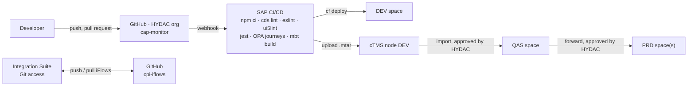

| Aspect | Design |
|---|---|
| Repository | One CAP monorepo (`db/`, `srv/`, `app/monitor`, `test/`, `docs/`), npm workspaces; iFlows in `cpi-iflows` via Integration Suite's built-in Git access (github.com only) |
| Build | `mbt build` produces one archive `kundenmonitor-btp_<version>.mtar` with the CAP service, HDI deployer, UI content and destination content |
| Quality gates | `cds lint`, ESLint, `ui5lint`; 137 service tests (jest), 15 UI journeys (OPA5 with `sap.fe.test`, headless Chrome); all green before deploy ✅ |
| Stages | The same archive moves DEV → QAS → PRD; stage-specific values (destinations, Cloud Logging binding, redirect URIs to the Work Zone host) come from MTA extension descriptors, never from a rebuilt archive |
| Customizing | Data, not code: maintained in the admin app per region, does not travel with the archive; the CSV in `db/data` is the initial load only |
| Versioning | Semantic version in `mta.yaml` and `package.json`, bumped before every forward |

### 10.2 Environments and configuration

| Environment | Database | Authentication | SAP backend | Magento | Purpose |
|---|---|---|---|---|---|
| Local (`cds watch`) | SQLite in-memory + test data | Mocked users (alice / bob / carol) | Mock adapter, `cds mock API_BUSINESS_PARTNER` | none | Development, automated tests |
| DEV | HANA Cloud | XSUAA, test users with static role collections | Q4H via GWQ, technical user → principal propagation | test shop / replayed payloads | Integration, key-user click-through |
| QAS | HANA Cloud | XSUAA + IAS groups | Q4H or separate client ❓ | staging shops | User acceptance, cutover rehearsal |
| PRD | HANA Cloud (backup per policy) | XSUAA + IAS groups | Production S/4, AU tenant | production shops | Operation |

### 10.3 Observability

| Signal | Source | Use |
|---|---|---|
| Health | `GET /health` (CAP, no login); CF health check `http` restarts the instance | Availability |
| Logs | Structured JSON on stdout with correlation ID per request; optional SAP Cloud Logging binding (`mta-cloud-logging.mtaext`) for dashboards and alerts; authorization headers masked | Troubleshooting, audit trail of technical errors |
| Business KPIs | Counters of the list views (open, errors, clarification, release) inside the app; outbox status (pending, attempts, last error) 🟡; intake rejections 🟡 | Daily operations by key users |
| Alerts | Cloud Logging alerts on error rate, outbox age, intake failures 🟡; BTP Alert Notification optional | Operations |
| Platform | BTP cockpit, `cf app`, HANA Cloud Central (memory, backups) | Capacity |

### 10.4 Backup, restore and continuity

HANA Cloud is managed by SAP: daily full backups and log backups at least every 15 minutes, point-in-time recovery, retention 14 days by default (configurable 1–215 days) – set per HYDAC policy for PRD and rehearse a restore once a year. The CAP service is stateless and redeployable from the archive at any time. Drafts are database rows and survive restarts. A regional BTP outage is covered by SAP's platform disaster recovery for HANA Cloud (❓ HYDAC's DR requirement decides whether a cross-region replica is needed).

### 10.5 Operating model

Recurring tasks and the proposed owner; **the owner column is HYDAC's decision (D11)**.

| Area | Task | Frequency | Proposed owner |
|---|---|---|---|
| Users & roles | Role group membership in the IdP; sales-org assignment in the admin screen | On joiner / mover / leaver | Regional key users (`Kundenmonitor_Admin`) |
| | IdP ↔ IAS ↔ BTP trust, group → role collection mapping | One-time, on change | HYDAC IT identity |
| | Authorization matrix review | Quarterly | HYDAC IT + business owners |
| Customizing | Steps, approval rules, limits, texts per region (no deployment) | On business change | Regional key users |
| Work Zone | Site, tile, roles; refresh the content provider after a deployment | Per release | HYDAC BTP admin |
| Cloud Connector | Operation, upgrades, the one resource path, certificates | Quarterly / on expiry | HYDAC Basis |
| Destinations | One per SAP system and shop and stage; credential and certificate rotation | On change | HYDAC BTP admin |
| SAP systems | `API_BUSINESS_PARTNER` available and authorized, user mapping, number ranges; AU communication arrangement and business users | On change | HYDAC SAP Basis / security per region; HYDAC Australia IT |
| HANA Cloud | Size, start/stop of non-productive instances, upgrades, backup retention, yearly restore test | Monthly check | HYDAC BTP admin |
| Application | Health, logs, alerts, outbox, failed intakes; incident handling | Continuous | purplecat (AMS) or HYDAC IT |
| | CAP / UI5 / Node.js updates (security, SAP maintenance) | ≈ quarterly | purplecat |
| | Deploy through cTMS: upload (DEV) / import approval (QAS, PRD) | Per release | purplecat upload, HYDAC approval |
| CI/CD, GitHub | Pipeline, credentials, organization members, branch protection, token rotation | On change / expiry | purplecat, HYDAC IT |
| Magento | Intake and notification credentials, endpoint changes | On rotation / change | TechDivision with HYDAC eCommerce |
| Integration Suite | API proxy (if used), legacy iFlows, Git registration | Continuous / one-time | HYDAC integration team |
| Business | First-level support, business rules | Continuous | HYDAC key users per region |
| Data protection | Retention, audit-log review, residency | Yearly / per policy | HYDAC data protection + IT |
| Cost | Consumption of HANA Cloud, CF memory, Work Zone; quotas | Monthly | HYDAC IT |

Retired with the new solution: customizing transports in S/4, maintenance of the `ZEC_*` objects and Gateway services, the BAdI, and the monitoring of the Magento ↔ S/4 custom services.

---

## 11. Architecture decisions

| ID | Decision | Alternatives | Rationale | Consequences | Ref. |
|---|---|---|---|---|---|
| AD-01 | **No custom development in any SAP system**; SAP reached only through the released `API_BUSINESS_PARTNER` | Custom OData / RAP service on-premise; ABAP Cloud in the Public Cloud | Clean core; the Public Cloud offers no other way to create customer roles; one adapter for both deployment models | Field logic that lived in Z fields moves to the monitor or to key-user custom fields; API coverage to verify (CRM number, carrier) | E-15 |
| AD-02 | **SAP Fiori Elements for OData V4** with JavaScript extensions, UI semantics as CDS annotations in the service | Freestyle SAPUI5 (phase 1) | Standard floorplans, draft, accessibility and theming for free; contract = annotations | Own code limited to extension points | E-02, E-13 |
| AD-03 | **BTP (HANA Cloud) is the system of record for the requests** | S/4 as system of record with a HANA replica (design of 2 Nov) | Removes the custom S/4 service and replica consistency; the step logic already exists in CAP | HANA Cloud becomes business-critical: backups, retention, residency; cutover migrates open requests | E-15, D-15 |
| AD-04 | **CAP draft** for editing with pessimistic lock, ETag on every step | Optimistic locking only | Fiori Elements V4 edits only draft entities; the lock prevents lost updates and parallel steps | Drafts need a persistent database (HANA Cloud) | E-05, E-12 |
| AD-05 | **One design, one archive for all regions**; backend registry and customizing per backend | One deployment per backend with own code | Configuration over code; a new region is registry entries and destinations | `backendSystem` on the request (small contract change) | §9.1 |
| AD-06 | **Step execution serialized per request**: row lock `FOR UPDATE` plus ETag in one HANA transaction | Application-level mutex, no lock | Eliminates duplicate master data (R-01) with database means | SQLite in development has no row lock (single connection serializes) | B-02 |
| AD-07 | **Notifications via persistent outbox**, sent after commit, retried, result logged | Direct HTTP call in the step; iFlow | Exactly-once marking, no notification before commit (R-03/R-04), no dependency on Magento availability | Outbox monitoring; resend action | E-17 |
| AD-08 | **Declarative authorization** (`@restrict` with `$user.SalesOrg`) instead of handler code | Custom read handler (phase 1) | Enforced by CAP on every read path including `$expand` and value helps; reviewable in the model | Attribute semantics (list; empty = nothing) must hold in the token | E-08, R-08 |
| AD-09 | **Principal propagation** for the master-data calls; technical user only for the first DEV connectivity tests | Technical user permanently | S/4 authorization and change documents on the real user; no shared secret that can create master data | Cloud Connector trust and `CERTRULE` setup; editors need S/4 users | D3 |
| AD-10 | **Roles from IdP groups; sales-org scope in an application table administered by key users** | IAS attribute written through the SCIM API from the monitor | No tenant-wide identity credential in a business application; immediate effect; per-backend values | Two places (identity vs scope) reconciled by one authorization matrix | D10 |
| AD-11 | **Personal data on BTP**: `@PersonalData`, audit log, retention job | No special handling | Legal requirement once BTP holds the only copy | Audit Log and Job Scheduling services before PRD | E-19 |
| AD-12 | **Central deployment** unless data residency requires regional for AU | Regional for all | Lowest cost and one work queue; the archive supports both | Decision by HYDAC data protection before AU go-live | D8 |
| AD-13 | **Direct intake on CAP** with OAuth 2.0 client credentials; API Management optional | Mandatory API Management proxy; iFlow | Simplest secure path; the proxy adds governance when HYDAC wants it | Service key per shop managed by HYDAC | E-16, D4 |
| AD-14 | **GitHub (github.com)** as the common Git platform for the app and the iFlows; SAP CI/CD and Cloud Transport Management for delivery | GitLab / Azure DevOps; manual deploys | Integration Suite's Git access supports github.com only; cTMS tenant exists | HYDAC-owned organization, token policy | D5, D6 |

---

## 12. Risks, assumptions and open points

| ID | Type | Description | Impact | Mitigation / owner |
|---|---|---|---|---|
| RK-01 | Risk | `API_BUSINESS_PARTNER` does not cover a legacy rule (CRM number on the customer for sales org 2000, carrier creation for 7110, Z fields) | Step logic incomplete | Verify in Q4H early (B-03); key-user custom fields or retire the rule with the business ❓ |
| RK-02 | Risk | Principal propagation setup (Cloud Connector trust, `CERTRULE`, user mapping) takes longer than the DEV phase | Steps testable only with a technical user | Start with a technical user on DEV, plan the setup with HYDAC Basis before QAS (AD-09) |
| RK-03 | Risk | OAuth 2.0 SAML bearer with `SAP_COM_0008` not available or not configured in the AU tenant | No user propagation to the Public Cloud | Fallback: client certificate with a communication user; S/4 authorization then on the communication user, the monitor's own checks remain |
| RK-04 | Risk | CAP's OData V2 outbound is deprecated | Adapter maintenance | Adapter kept thin; SAP Cloud SDK OData V2 client as fallback (no change to the steps) |
| RK-05 | Risk | HANA Cloud cost and operation for a small application | Budget, ownership | Share an existing instance (D7); stop non-productive instances outside working hours |
| RK-06 | Risk | Data residency rules prevent storing AU personal data in an EU region | Regional deployment for AU | Decision before AU go-live (AD-12); the archive supports both |
| RK-07 | Risk | Magento payload or read-back behaviour differs from the assumption (`ZEC_CUSTOMER_READ_SRV` read-back, address-level rejection) | Intake / notification contract rework | Payload workshop with TechDivision early in phase 2 (B-01, B-07) |
| RK-08 | Risk | User and volume figures unknown | Wrong sizing or admin effort | ❓ HYDAC provides figures; design scales with instances |
| AS-01 | Assumption | GWQ is the Gateway hub of Q4H; production has an equivalent pair | Destination and Cloud Connector setup | ❓ confirm |
| AS-02 | Assumption | USA uses the same S/4 system as Europe or an on-premise system reachable through the same Cloud Connector | One or two on-premise backends | ❓ confirm |
| AS-03 | Assumption | HYDAC has (or will have) an IAS tenant and a corporate IdP (Entra ID) and the AU Public Cloud can share the IAS tenant | Identity setup | ❓ confirm |
| AS-04 | Assumption | Sales-org codes are not guaranteed unique across SAP systems | Per-backend assignment | ❓ confirm; simplifies if unique |
| OP-01 | Open point | Retention period and deletion rules for completed requests | Retention job, audit | HYDAC data protection ❓ |
| OP-02 | Open point | Number ranges and grouping for business partners per sales org and in the AU tenant | CREATE / CREATE_WE | HYDAC SAP Basis ❓ |
| OP-03 | Open point | Current path Magento ↔ SAP (direct or via Integration Suite) and the AU shop flow today | Cutover plan | HYDAC eCommerce / TechDivision ❓ |

The full list of decisions requested from HYDAC (D1–D13) and the open questions for the review are in `docs/11` §8–§9.

---

## 13. Roadmap

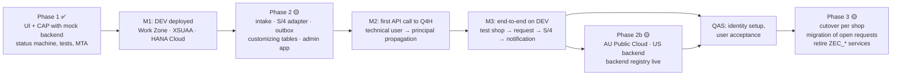

| Phase | Content | Backlog | Depends on |
|---|---|---|---|
| 1 – Frontend against CAP mock | Done: Fiori Elements app, status machine, step actions, draft, authorization, tests, deployment package | F-00 … F-26 ✅ | – |
| 2 – Persistence and integration (DEV) | Deploy phase 1 to DEV (first end-to-end check of Work Zone, XSUAA, HANA Cloud); intake service; S/4 adapter for `API_BUSINESS_PARTNER`; outbox notifications; customizing tables and admin app; `backendSystem`; personal-data annotations | B-01 … B-07 | Subaccount, entitlements, Git, `API_BUSINESS_PARTNER` in Q4H/GWQ, Cloud Connector path, test user, payload agreement with TechDivision |
| 2b – Further backends | AU destination (`SAP_COM_0008`), US backend, registry entries, shops per region; AU workshop (D9) | B-04 (AU/US) | AU tenant access, identity decision |
| 3 – Production and cutover | QAS/PRD subaccounts, cTMS route, identity setup with IAS groups, user acceptance, migration of open requests and Magento mappings, endpoint switch per shop with parallel run, retirement of the custom S/4 objects | B-08 | Decisions D1–D13, data residency, retention |

Immediate next steps after the review: HYDAC confirms the DEV setup (§9.4), purplecat deploys phase 1 to DEV, HYDAC activates the API and opens the Cloud Connector path, first connectivity test, then phase-2 development on DEV.

---

## Appendix A – Glossary

| Term | Meaning |
|---|---|
| Debitor | Customer (SAP customer account, `KUNNR`) |
| Geschäftspartner (BP) | Business partner (`PARTNER`), the SAP master object; a customer is a BP with the customer role |
| Ansprechpartner | Contact person (shop user); the admin is the first contact person of a registration |
| Warenempfänger | Ship-to party (`CR_WE`), a customer with partner function ship-to on the sold-to |
| Freigabe | Release / approval of a request before processing; rule per process type and sales organization |
| Klärung | Clarification flag with a comment; status unchanged |
| Innendienst | Back office / inside sales, the main user group |
| VKORG | Sales organization; user attribute `SalesOrg` |
| Request (Vorgang) | One registration, shop user or delivery address from Magento with its working data, status and log |
| Step (Schritt) | A bound action on a request: CREATE, CREATE_WE, AP_MODIFY, CHNG_OLD, CNG_DEBI, CNG_NEW, MANUAL_OK, REJECT, plus RELEASE, CLARIFY, RESET |
| Outbox | CAP's persistent queue; messages written in the business transaction and delivered after commit |
| Intake | The inbound API for Magento registrations |
| Backend / `backendSystem` | The SAP system (region) a request belongs to: EU, US, AU |
| Principal propagation | Forwarding the logged-in user's identity to the SAP system so that it executes under that user |
| HDI | HANA Deployment Infrastructure: the application's schema container in HANA Cloud |
| cTMS | SAP Cloud Transport Management |

## Appendix B – Requested elements mapped to requirements

Requirements: **REQ-A** access via Work Zone with roles per sales org · **REQ-P** persistence in HANA Cloud · **REQ-I** integration with Magento and the SAP systems · **REQ-S** security (roles, sales org, real user in SAP) · **REQ-D** delivery (reproducible builds, tests, controlled transport) · **REQ-O** operation (health, logs, backups) · **REQ-V** version control owned by HYDAC.

| Requested element | Requirement | Why it is needed | Least-privilege note |
|---|---|---|---|
| Development subaccount (FSM-DEV-CPI or dedicated) | all | Home of the DEV space, instances and subscriptions | QAS/PRD separate (§9.3) |
| Entitlements in §9.4 (CF memory, HANA Cloud, HDI, CI/CD, Work Zone, cTMS) | REQ-A, P, D | See the table | Already entitled: xsuaa, destination, connectivity, html5-apps-repo, logging |
| CF space `cap-monitor` | all | Isolated runtime | – |
| Space Developer for purplecat developers | REQ-D | Deploy, create instances in the space, read logs | Needed |
| Org Manager | – | Only to create spaces ourselves | **Not needed** if HYDAC creates the space; Space Manager suffices for team members |
| Subaccount Service Administrator | REQ-A, D | Subscriptions (Work Zone, CI/CD, cTMS) and instances in the cockpit | HYDAC's BTP admin can do the one-time subscriptions instead |
| App role collections for test users | REQ-S | Test role and sales-org behaviour | In PRD through IdP groups |
| Work Zone `Launchpad_Admin` (DEV), CI/CD admin/developer, cTMS viewer/export roles | REQ-A, D | Tile and site; pipeline; upload and tracking | Import roles stay with HYDAC |
| GWQ exposed via Cloud Connector; resource `/sap/opu/odata/sap/API_BUSINESS_PARTNER/`; `API_BUSINESS_PARTNER` activated | REQ-I | The only path the monitor needs | ❓ Q4H release/SP |
| Authentication method (principal propagation vs technical user) | REQ-S | S/4 checks the real user | Technical user for DEV tests only |
| S/4 test users for purplecat in Q4H/GWQ with BP creation authorizations | REQ-I | Testing the steps with real authorizations | No SE80/ADT access needed |
| HYDAC GitHub organization, repositories `cap-monitor` and `cpi-iflows`, write access, PATs, CI read token + webhook, Integration Suite Git registration | REQ-V, D | HYDAC owns the code; builds start on push; iFlows versioned | Fine-grained tokens with expiry |
| cTMS tenant `ctms-hydac` reuse, node for the DEV space, TMS role collections | REQ-D | One transport tool for all HYDAC BTP content | Import approval by HYDAC |

## Appendix C – References

- SAP CAP documentation: authorization (`@restrict`, user attributes), draft, outbox (`cds.queued`), remote services and destinations, audit logging, `@PersonalData`.
- SAP Fiori Elements for OData V4: List Report / Object Page, `Core.OperationAvailable`, `Common.SideEffects`, strict handling.
- SAP API Business Hub: `API_BUSINESS_PARTNER` (Business Partner (A2X)); communication scenario `SAP_COM_0008` (S/4HANA Cloud Public Edition).
- SAP notes 3655149 (released ABAP Cloud business-partner object cannot create customer roles) and 3518445 (`API_BUSINESS_PARTNER` availability on older releases).
- SAP BTP: Cloud Connector principal propagation (X.509, `CERTRULE`), destination types `PrincipalPropagation` / `OAuth2SAMLBearerAssertion`, SAP HANA Cloud backup and recovery, Cloud Transport Management, SAP Cloud Identity Services (groups, attributes, SCIM API).
- Project repository: `docs/01` … `docs/11`, `srv/monitor-service.cds`, `db/schema.cds`, `xs-security.json`, `mta.yaml`.
- Legacy reference: Confluence EXTHYDAC › Australien › *Kundenmonitor (ZEC_CUSTOMER_MONITOR) – Technische und fachliche Dokumentation*.
