# Customer Monitor on SAP BTP – Answers to the design review questions

| | |
|---|---|
| **Document** | Customer Monitor on SAP Business Technology Platform – answers to the questions for the design review |
| **In reply to** | Peter Wurst's email of 30 October 2026 ("BTP Services for Customer Monitor") and the meeting invite of 4 November 2026 |
| **Customer** | HYDAC – Group IT, HYDAC USA, HYDAC Australia |
| **Prepared by** | purplecat AG – Igor Vorobev, SAP BTP solution architecture |
| **Version** | 1.1 – takes HYDAC's BTP usage export of October 2026 (`Subaccount_Details.xlsx`) into account |
| **Date** | 9 November 2026 |
| **Review session** | Tuesday, 10 November 2026, 16:00–17:00 CET (10:00 ET), Microsoft Teams |
| **Classification** | Confidential – HYDAC / purplecat project documentation |

**How to read this document.** The four points of the email are answered in the order they were asked. The topics of the meeting invite are covered inside them.

| Asked | Chapter |
|---|---|
| **Functional design:** business purpose, users, use cases, the data the monitor displays and acts on | 1 |
| **Requested elements mapped to requirements:** for each entitlement, role, space, Git and transport item, which requirement it supports and why it is needed | 2 |
| **Ongoing administration:** the types of administration and maintenance responsibilities of the application and its BTP services, so HYDAC can decide who owns each one | 3 |
| **Integration:** connection to Q4H / GWQ and later production; HYDAC Australia's S/4HANA Public Cloud; Magento; Cloud Connector resources; OData services / RFC modules / APIs; authentication; relationship to the Integration Suite iFlows | 4 |
| Invite topics: required BTP services · connection setup · multi-backend architecture · roles and authorizations · user management | 2.2 · 4.2, 4.4, 4.5 · 4.1, 4.7 · 1.2, 4.5 · 3.2 |

**Conventions.** ✅ built and tested · 🟡 designed, not built · 💡 proposal, needs agreement · ❓ open point for HYDAC · *Assumption* = our current understanding, please correct. Identifiers: `UC-nn` use case (chapter 1), `REQ-x` requirement (chapter 2), `I-nn` interface (chapter 4).

---

## 1. Functional design

### 1.1 Business purpose

HYDAC's Magento B2B shops send three kinds of input to SAP: **company registrations** (new companies, or companies that already exist as a customer – Debitor), **new shop users** (contact persons – Ansprechpartner – for an existing customer) and **new delivery addresses** (ship-to parties – Warenempfänger – for an existing customer). Today a custom SAP GUI report (`ZEC_CUSTOMER_MONITOR`) with custom tables, custom OData services and custom step classes in S/4HANA on-premise lets the back office review these requests and create the business partner, customer, contact person and ship-to party. The report serves one SAP system. HYDAC now needs the same process for Europe, the USA and Australia, where Australia runs SAP S/4HANA Cloud Public Edition.

The Customer Monitor is the human review step between the shop and SAP master data. Neither today nor in the target does the intake create master data directly. Each input is stored as a **request** with the original payload and a working copy, and an approval check runs. The back office reviews and completes the request in the monitor and then triggers **steps** that create or assign the business partner, customer, contact person or ship-to in the SAP system of the region. The monitor reports the result back to Magento.

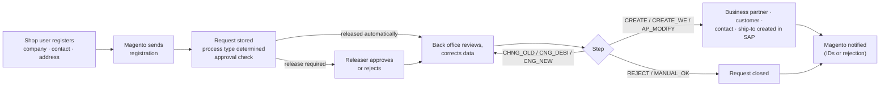

| Input from Magento | Process type | Result in SAP |
|---|---|---|
| Company registration, no SAP customer yet | `CR_DEB` | Business partner with customer role, company code and sales area data; admin contact person |
| Company registration, customer exists (duplicate handling) | `CH_DEB` | Contact person created or changed on the existing customer |
| New shop user for an existing customer | `CR_AP` / `CH_AP` | Contact person created (`CR_AP`) or changed automatically (`CH_AP`) |
| New delivery address for an existing customer | `CR_WE` | Ship-to party as customer, partner function on the sold-to |

Business value of the new monitor compared with the SAP GUI report:

| Area | Legacy (SAP GUI) | New (BTP / Fiori) |
|---|---|---|
| Access | SAP GUI, transaction, one system | Browser via SAP Build Work Zone, one app for all regions, deep links (for example in emails) |
| Work queue | One list with filters | Tabs with counters: My work, Errors, Clarification, Release, All; sorted by priority and waiting time; "next step" recommendation per request |
| Concurrency | Steps run without a lock, so two users can create the same customer twice | Edit lock (draft), version check (ETag) on every step, steps serialized per request in one database transaction |
| Authorization | Two different sales-org checks | One sales-org rule in the service for the list, the detail and all sub-data; S/4 checks the real user when master data is created |
| Robustness | Several known defects found in the analysis of the legacy report (lost ship-to numbers after partial failures, notifications sent before the commit, swallowed send errors, release limit compared without currency) | Fixed by design in the service; nothing depends on changes in S/4 |
| Custom code in SAP | Tables, customizing, step classes, Gateway services, BAdI (`ZEC_*`, `ZCL_EC_*`) | **None.** The SAP systems serve the standard business-partner API only |

### 1.2 Users and roles

| Role (BTP role collection) | Who | May | Legacy equivalent |
|---|---|---|---|
| `Kundenmonitor_Viewer` | Sales / customer service staff who only need to look up requests | Read requests of their own sales organizations | Display |
| `Kundenmonitor_Editor` | Back office (Innendienst) per sales organization, in EU, USA, AU | + edit request data, run steps | Change |
| `Kundenmonitor_Releaser` | Users who approve requests that need a release (Freigabe) | + see unreleased requests and release them | Authorization object `ZEC_MONITO`, activity 43 |
| `Kundenmonitor_Admin` 💡 | Regional key users | Maintain customizing (steps, approval rules, texts) and sales-org assignments for their region | Customizing transactions |

The roles define **what** a user may do. **Which** requests they see is defined by the sales organizations assigned to them per backend (region), enforced in the service on every read (section 4.5). A user without an assignment sees nothing (fail closed). The same role collections serve all regions; there are no region-specific roles.

| User | Roles | Backend: sales orgs | Sees |
|---|---|---|---|
| Back office Germany | Editor | EU: 0001, 2000 | Open EU requests of 0001/2000, can run steps |
| Back office USA | Editor, Releaser | US: xxxx | US requests including unreleased ones, can release |
| Back office Australia | Editor | AU: xxxx | AU requests only |
| Global support | Viewer | all backends, all sales orgs | Everything, read only |

Other parties: HYDAC IT (BTP, SAP Basis, identity, integration) operates the platform and owns security and transport (chapter 3); HYDAC Australia runs the same process on the Public Cloud tenant without ABAP development (section 4.7); TechDivision (Magento) switches the shop endpoints at cutover and keeps the payload contract (section 4.6); purplecat builds, deploys and supports.

❓ Number of users per role, region and sales organization, and the request volume per day per region. We need these for sizing and for the user administration effort.

### 1.3 Use cases

| ID | Use case | Role | Status |
|---|---|---|---|
| UC-01 | **Work the queue:** views My work / Errors / Clarification / Release / All with counters, sorted by priority and waiting time, restricted to the user's sales organizations | Viewer+ | ✅ |
| UC-02 | **Review a request:** main data, contact person or ship-to, sales data, assignment (SAP and Magento numbers, release reason), processing log | Viewer+ | ✅ |
| UC-03 | **Correct or complete data** before processing (draft with lock; every field change logged) | Editor | ✅ |
| UC-04 | **Release** a request that needs approval (rule per process type and sales org: manual, credit card, order-volume limit) | Releaser | ✅ |
| UC-05 | **Create customer and admin contact** (step CREATE) | Editor | ✅ logic, 🟡 API call |
| UC-06 | **Create or change contact person** (AP_MODIFY) | Editor | ✅ logic, 🟡 API call |
| UC-07 | **Create ship-to party** and assign it to the sold-to (CREATE_WE) | Editor | ✅ logic, 🟡 API call |
| UC-08 | **Handle duplicates:** assign an existing customer (CHNG_OLD), change the assignment (CNG_DEBI, with a confirmation question if the customer belongs to another Magento company), convert to a new customer (CNG_NEW) | Editor | ✅ |
| UC-09 | **Put in clarification** (Klärung) with a mandatory comment | Editor | ✅ |
| UC-10 | **Reject** with a mandatory reason; Magento notified | Editor | ✅ logic, 🟡 notification |
| UC-11 | **Complete manually;** reset a closed request for reprocessing | Editor | ✅ |
| UC-12 | **Fix errors:** a failed step sets an error status with the SAP messages in the log; the user corrects the data and repeats the step. Numbers already created in SAP are kept, so a repeat never creates a second business partner | Editor | ✅ logic, 🟡 API call |
| UC-13 | **Maintain customizing** and user assignments per region in the application | Admin | 💡 |
| UC-14 | **Intake of registrations** from Magento (three operations), idempotent | Magento (technical client) | 🟡 |
| UC-15 | **Migrate open requests** and Magento mappings from `ZEC_CUSTOMER` at cutover | purplecat / HYDAC | 🟡 |

Which steps are allowed is decided **by the service** (customizing per backend plus role). The UI only shows what the service allows; it holds no business rules.

### 1.4 Process types, statuses and steps

| Process type | Meaning | Start | Typical end |
|---|---|---|---|
| `CR_DEB` | New company without SAP customer | 000 New | CREATE → 999 Done |
| `CH_DEB` | Company with existing customer | 000 | AP_MODIFY → 999 |
| `CR_AP` | New shop user for existing customer | 000 | AP_MODIFY → 999 |
| `CH_AP` | Change of existing contact person | 997 Automatically done | – |
| `CR_WE` | New delivery address | 010 | CREATE_WE → 999 |

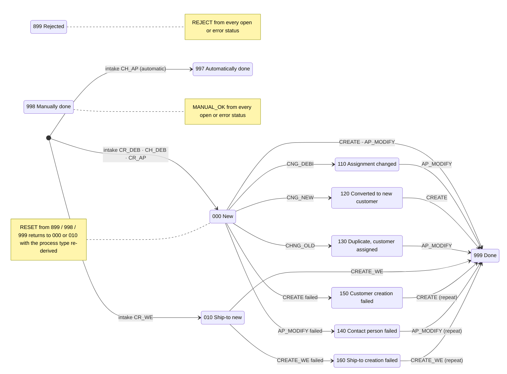

| Status group | Statuses | Meaning |
|---|---|---|
| Open | 000, 010, 110, 120, 130 | Waiting for the back office; the allowed steps depend on process type and status |
| Error | 140, 150, 160 | A master-data step failed; the SAP messages are in the log; the step can be repeated |
| Closed | 899, 997, 998, 999 | Rejected, done automatically, done manually, done; only RESET is offered |

Steps: CREATE, CREATE_WE, AP_MODIFY, CHNG_OLD, CNG_DEBI, CNG_NEW, MANUAL_OK, REJECT, plus RELEASE, CLARIFY and RESET. Only CREATE, CREATE_WE and AP_MODIFY touch the SAP system; all other steps change the request in the monitor's database only. The allowed steps per process type and status, the release check (manual, credit card, order-volume limit per sales organization) and the process-type changes (CHNG_OLD and CNG_DEBI → `CH_DEB`, CNG_NEW → `CR_DEB` with a fresh release check) are customizing data per backend, taken over from today's S/4 customizing tables. CLARIFY and RELEASE do not change the status.

### 1.5 Data displayed and acted on

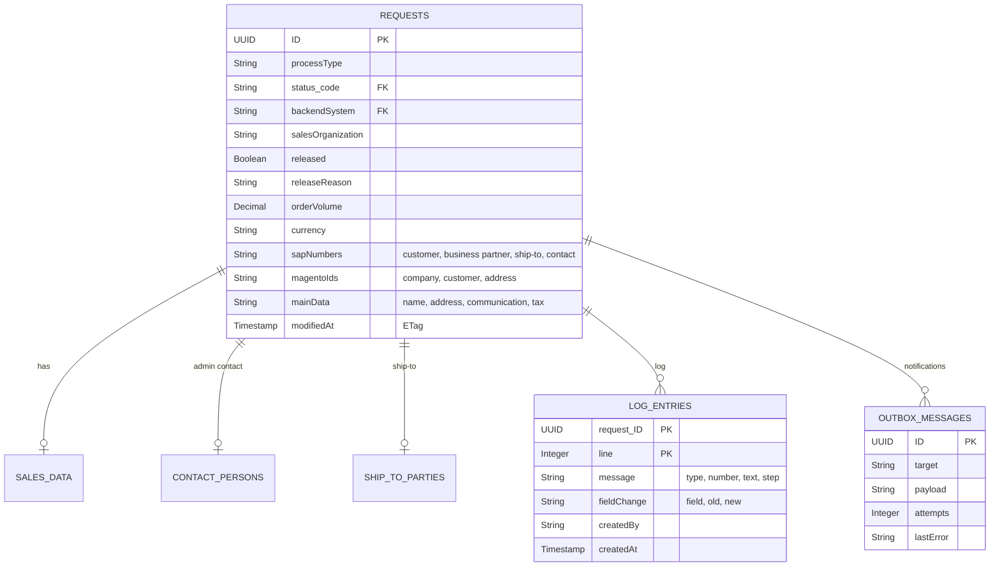

| Entity | Content | Source | Editable |
|---|---|---|---|
| Request (`Requests`) | Backend/region, process type, status, source, sales org; SAP numbers (customer, business partner, ship-to, contact person); Magento IDs (company, customer, address); order volume, currency, credit card; release (flag, procedure, reason, limit, by/at); clarification; main data (name 1–4, address, communication, VAT/tax numbers, industry, DUNS) | SAP HANA Cloud on BTP (today: `ZEC_CUSTOMER` + working copy `PAYLOAD_CHNG`); created by the intake, changed by the user and the steps | Main data only; numbers, status, release are read-only |
| Sales data (`SalesData`) | Sales org, distribution channel, division, sales group/office, customer group, sales district, Incoterms | Payload | Yes (except sales org) |
| Contact person (`ContactPersons`) | Shop role, title, name, function, department, language, phone, email | Payload | Yes (not for `CR_WE`) |
| Ship-to (`ShipToParties`) | Name, address, VAT number, "address used in order" | Payload | Yes (only `CR_WE`) |
| Log (`LogEntries`) | Message type/class/number/text, step, field, old/new value, user, time; messages returned by the SAP API; notification results | Monitor log in HANA Cloud | Read-only |
| Code lists | Statuses, status groups, process types, steps, release states and reasons (texts DE/EN, FR/IT where maintained) | Customizing tables in HANA Cloud per backend, initial load from `ZEC_CUST_*`, maintained in the admin screen (UC-13) | Read-only for users |
| Business partner value help | Number, name, customer, customer role, Magento company (from the request's backend only) | `API_BUSINESS_PARTNER` of the request's backend + Magento mapping in HANA Cloud | Read-only |
| Magento mapping 💡 | Magento company / customer / address ↔ business partner / customer / contact / ship-to | HANA Cloud (today: field or table on the customer in S/4 ❓) | Written by the steps |

Multi-currency (EUR, USD, AUD) is supported: the order volume and the release limit are always shown with their currency.

**Personal data.** Requests contain names, email addresses and phone numbers of contact persons. From phase 2 the requests are stored in HANA Cloud on BTP, which is then the **only** copy. The service marks these fields as personal data (CAP `@PersonalData`) and writes read and change audit entries to the SAP Audit Log service 💡. Completed requests are deleted by a scheduled retention job after a period to be defined by HYDAC ❓ (proposal: 24 months). Where the data is stored is a data residency question (section 4.1).

### 1.6 Screens

| Screen | Content |
|---|---|
| **List** (List Report) | Filter bar (search, region 💡, status group, released, in clarification, customer, sales org, process type, status, source, order exists, created/changed at/by); tabs My work / Errors / Clarification / Release / All with counters; columns status, hints (lock, clarification, order), release reason, process type, name, next step, waiting since, customer, sales org, Magento company, order volume, created, changed; errors highlighted red |
| **Detail** (Object Page) | Header: status, release, next step, key figures; sections Main data, Contact person *or* Ship-to (depending on process type), Sales data, Assignment, Log; actions: Edit, "Run step" menu (only allowed steps active), Refresh |
| **Dialogs** | Parameter dialogs for reject (reason), clarify (comment), assign / change assignment (business partner with value help); confirmation questions coming from the service |
| **Admin** 💡 | Small Fiori Elements lists for customizing and user assignments per region (role `Kundenmonitor_Admin`) |

The UI is SAP Fiori Elements (List Report and Object Page), so it follows the SAP Fiori design and accessibility standards. UI languages: English and German (more can be added). Times are shown in the user's local time zone. We can show a live demo of the current version (mock data) in the session.

### 1.7 Scope

| In scope | Out of scope | Later / optional |
|---|---|---|
| Review and processing of the three request kinds for all process types, statuses and steps of the legacy report | Changes to the Magento shops beyond endpoint and credentials | API Management proxy in front of the intake (section 4.8) |
| Intake from Magento, approval check, notifications to Magento | Replacing the S/4 BAdI notification on customer maintenance with partner role ZO (business-partner events, separate work package) | Business-partner events S/4 → BTP |
| Master-data creation through `API_BUSINESS_PARTNER` in S/4 on-premise and S/4HANA Cloud Public Edition | Master-data maintenance beyond what the steps create (done in S/4 apps) | Navigation from the monitor to the S/4 app "Manage Business Partner Master Data" |
| Multi-region operation: EU, USA, AU with one deployment or one per region | Workflow / approval outside the monitor (SAP Build Process Automation) | Work Zone integration of further apps |
| Customizing per region in the application, administered by key users | | Retention job for completed requests, audit log of personal-data access 💡 |
| Cutover: migration of open requests and Magento mappings, retirement of the custom S/4 objects | | |

---

## 2. Requested elements mapped to requirements

The requirements referenced in this chapter follow from the functional design in chapter 1:

- **REQ-A Access:** business users in EU, USA and AU open the app in the browser via SAP Build Work Zone, with roles per sales organization (UC-01, UC-02, section 1.2).
- **REQ-P Persistence:** requests, drafts, log, customizing, Magento mapping and outbox live in SAP HANA Cloud. The edit lock, the version check and the repeatable steps work on local rows (UC-03, UC-04, UC-12).
- **REQ-I Integration:** Magento intake and notifications; master data through the business-partner API of each SAP system, Q4H/GWQ first (UC-05 to UC-08, UC-10, UC-14).
- **REQ-S Security:** authorization per role and sales organization; SAP authorizations and change documents on the real user for master-data creation (section 1.2, section 4.5).
- **REQ-D Delivery:** reproducible builds, automated tests, controlled transport DEV → QAS → PRD.
- **REQ-O Operation:** health monitoring, logs, backups (chapter 3).
- **REQ-V Version control:** source code and iFlows versioned and reviewable, owned by HYDAC.

The application is a SAP Fiori Elements user interface on a SAP CAP (Node.js) service with SAP HANA Cloud, deployed as one archive into a Cloud Foundry space. BTP is the system of record for the requests; the SAP systems are reached only through the standard API `API_BUSINESS_PARTNER` (chapter 4). The picture shows where each requested service is used:

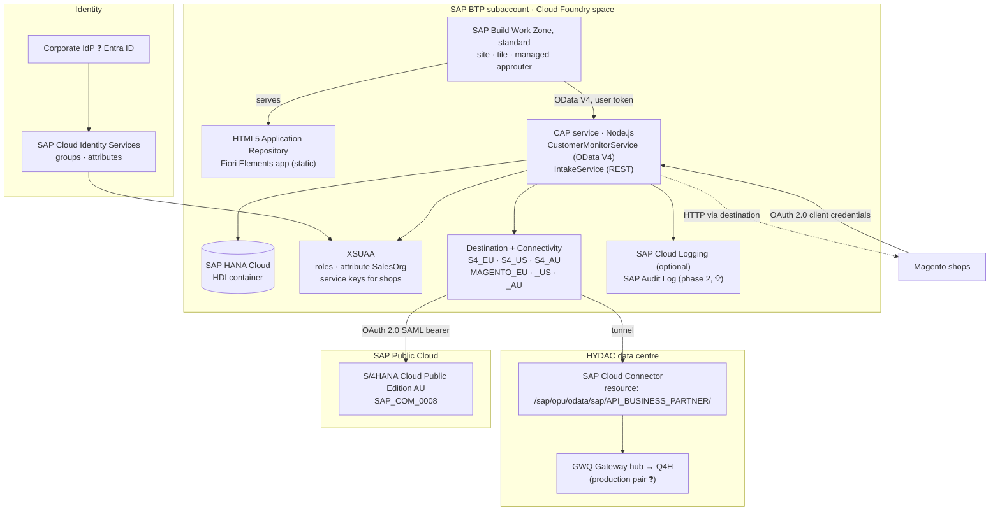

**What HYDAC's global account already provides.** HYDAC's BTP usage export for October 2026 (`Subaccount_Details.xlsx`: 22 subaccounts, all in region eu10 on AWS or eu20 on Azure) shows the following subaccounts that matter for the monitor. The mapping in this chapter takes them into account.

| Subaccount (directory) | What it runs today | Relevance for the monitor |
|---|---|---|
| `DEV` (Development), CF space `dev` | Cloud Foundry Runtime (Free plan), Destination, HTML5 Application Repository, Identity Authentication, SAP Build Code, SAP Build Process Automation, AI Core, Document Information Extraction | **Recommended development subaccount** instead of FSM-DEV-CPI |
| `QAS`, CF space `space_qas` | Market Rates (Bring Your Own Rates) | Candidate for the QAS stage ❓ |
| `CFLPDEV`, `CFLPPRD` (Workzone) | SAP Build Work Zone, standard edition (DEV and PRD launchpad), Destination | HYDAC's central launchpads: the monitor is integrated there as a content provider; no Work Zone subscription in the application subaccount |
| `GeneralServices` ("General Services f.e. HanaDB") | SAP HANA Cloud | Shared database instance; can be mapped to the monitor's space (same region) |
| `CTMS` | Cloud Transport Management, Destination | The cTMS tenant `ctms-hydac` |
| `FSM-DEV-CPI`, `FSM-PRD-CPI` (Integration) | Integration Suite (standard edition, messages), Destination | Integration only: API Management proxy and iFlows (section 4.8); not the place for the application |
| `IASIPS` | Identity Provisioning connectivity (Europe) | Identity Authentication and Identity Provisioning exist (section 3.2) |
| `HYDAC-AP-AUTOMATE` | SAP HANA Cloud (HYDAC USA accounts payable automation) | Shows that HYDAC USA application data already lives in region eu10 |
| No application PRD subaccount, no subaccount outside Europe | – | PRD subaccount to be created; a regional AU deployment would be HYDAC's first non-EU subaccount (section 4.1) |

The export lists consumed services. Free services such as XSUAA, Connectivity and Application Logging do not appear in it and are to be confirmed in the entitlements of `DEV`.

### 2.1 Subaccount

| Item | Requirement | Why | Note |
|---|---|---|---|
| Development subaccount: **`DEV`** (directory Development, eu10) | all | Place for the DEV space, service instances and subscriptions | `DEV` already runs Cloud Foundry, Destination, HTML5 Application Repository and Identity Authentication, so the monitor fits in with a new space `cap-monitor`. We withdraw the question about FSM-DEV-CPI: that subaccount is Integration Suite only. QAS could use the existing `QAS` subaccount ❓; a PRD subaccount for applications does not exist yet and has to be created. The region of the productive subaccount(s) depends on the data residency decision (section 4.1). HYDAC decides. |

All subaccounts below are in HYDAC's global account, region eu10:

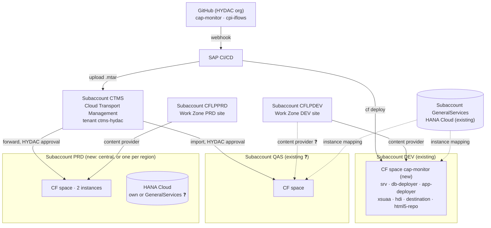

### 2.2 Entitlements

| Entitlement | Requirement | Why it is needed | Needed from | If not granted |
|---|---|---|---|---|
| **Cloud Foundry Runtime (MEMORY), 2–4 GB** | REQ-A, REQ-I | Runs the CAP service (≈ 256–512 MB per instance), the HDI deployer task and the content deployers during deployment. Headroom for zero-downtime redeploys. | First deployment | No deployment possible. `DEV` currently uses the **Free** plan; the monitor needs the Standard (MEMORY) plan quota of 2–4 GB in `DEV` ❓ (the Free plan's quota may not suffice). |
| **SAP HANA Cloud** (`hana-cloud` / `hana` + tools) | REQ-P | Database instance for the HDI container; **the system of record from phase 2**. Data volume stays in the low gigabytes, the smallest size suffices. | First deployment | No persistence at all. **Recommendation:** map the existing HANA Cloud instance in `GeneralServices` to the monitor's DEV (and QAS) space (instance mapping, same region eu10); then no `hana-cloud` entitlement is needed in `DEV`, only `hdi-shared`. HANA Cloud is the **main cost item** of the setup. For PRD: own instance or `GeneralServices` per HYDAC's policy ❓, with the backup retention set to HYDAC's policy. |
| **SAP HANA Schemas & HDI Containers** (`hana` / `hdi-shared`) | REQ-P | The application's own schema (container) in the HANA Cloud instance, deployed from the archive | First deployment | as above |
| **Continuous Integration and Delivery** (`cicd-app` / `default`) | REQ-D | Builds the archive on every push to Git, runs lint and service tests, deploys to DEV, uploads to cTMS | When Git is set up | Alternative: GitHub Actions + `cf` CLI (no entitlement, but a pipeline to maintain). Manual builds are possible but not reproducible. The export shows no CI/CD subscription; SAP Build Code (Standard) is active in `DEV` – ❓ check whether its bundle already covers the CI/CD service before a separate entitlement. |
| **SAP Build Work Zone, standard edition** (`SAPLaunchpad` / `standard`) | REQ-A | Entry point for business users: tile, role-based visibility, later navigation to the S/4 app "Manage Business Partners" | Before user tests | **Not needed in the application subaccount.** HYDAC runs central launchpads in `CFLPDEV` and `CFLPPRD`; the monitor is added there as a content provider (a design-time and a runtime destination from the launchpad subaccount to the application subaccount; both subaccounts use the same identity provider; the app role collections stay in the application subaccount). ❓ Confirm that this is HYDAC's standard and which site serves QAS. |
| **Cloud Transport Management** (`transport` / `standard`) | REQ-D | Moves the same archive DEV → QAS → PRD with approval and audit trail | Before QAS exists | **Not an entitlement for the application subaccount:** the tenant `ctms-hydac` runs in subaccount `CTMS`. We need from there a transport node per target space, a service key of the `transport` instance for the CI/CD upload, and the TMS role collections (section 2.6). DEV alone works without it. |

Services without a new entitlement (in use in `DEV` according to the export, or unmetered and therefore not in the export – ❓ to confirm in the entitlements of `DEV`):

| Service | Requirement | Why | In the export |
|---|---|---|---|
| `xsuaa` (application) | REQ-A, REQ-S | Login, roles `Viewer` / `Editor` / `Releaser` / `Admin`, attribute `SalesOrg`; technical client per Magento shop | not listed (unmetered) |
| `destination` (lite) | REQ-A, REQ-I | Route UI → CAP; one destination per SAP system and per Magento shop (Q4H/GWQ, AU Public Cloud, shops EU/US/AU) | in use in `DEV` |
| `connectivity` (lite) | REQ-I | Cloud Connector tunnel from the CF app to the on-premise business-partner API (not needed for the Public Cloud) | not listed (unmetered) |
| `html5-apps-repo` (app-host, app-runtime) | REQ-A | Hosting the UI, consumed by the launchpad subaccount | app-host in use in `DEV` |
| `application-logs` / Cloud Logging | REQ-O | Central logs. CAP supports both. Our archive has an optional SAP Cloud Logging binding; without it logs stay available via `cf logs`. | not listed |

**SAP Cloud Identity Services** exist: Identity Authentication is bound to `DEV` and Identity Provisioning connectivity runs in `IASIPS`. ❓ Confirm that this is the tenant for productive use and whether the AU Public Cloud shares it (section 3.2). Optional, recommended once personal data is on BTP (section 1.5): **SAP Audit Log service** (audit of personal-data access) and **SAP Job Scheduling Service** (retention job).

### 2.3 Cloud Foundry space and roles

| Item | Requirement | Why | Least-privilege alternative |
|---|---|---|---|
| CF space `cap-monitor` (DEV) | all | Isolated runtime for the app and its service instances | – |
| **Space Developer** for purplecat developers | REQ-D | Deploy the archive, create service instances in the space, read logs | – (needed) |
| **Org Manager** | – | Only needed to create spaces or manage org members ourselves | **Not needed if HYDAC creates the spaces.** Space Manager is enough for adding team members to the space. We are happy to drop this. |
| **Subaccount Service Administrator** (role collection) | REQ-A, REQ-D | Create subscriptions (Work Zone, CI/CD, cTMS) and service instances in the cockpit | HYDAC's BTP admin does the one-time subscriptions and assigns the app role collections. After that Space Developer is enough for daily work. |
| App role collections `Kundenmonitor_*` for test users | REQ-S | Testing the role and sales-org behaviour | Assigned by HYDAC or by us; in production through IdP groups (section 3.2) |
| Work Zone `Launchpad_Admin` in `CFLPDEV` | REQ-A | Register the content provider, add the tile to the DEV site, assign roles | Can stay with HYDAC's launchpad team; we provide the destination values |
| CI/CD `CICD Service Administrator` / `Developer` | REQ-D | Configure the pipeline and credentials | – |
| cTMS roles (for example `TMS_Viewer`, `TMS_Export_Operator`; import roles stay with HYDAC) | REQ-D | Upload archives and track transports; HYDAC controls imports into QAS/PRD | – |

### 2.4 Connectivity to Q4H / GWQ

| Item | Requirement | Why |
|---|---|---|
| Confirmation that GWQ is exposed via Cloud Connector (or a destination for it) | REQ-I | The business-partner API will be called on the system where HYDAC publishes Gateway services (section 4.2) |
| Activation of the standard service `API_BUSINESS_PARTNER` in Q4H/GWQ (`/IWFND/MAINT_SERVICE`) | REQ-I | Standard SAP service, delivered with S/4HANA since 1709; no development. ❓ Release/SP of Q4H |
| Cloud Connector resource `/sap/opu/odata/sap/API_BUSINESS_PARTNER/` (path and all sub-paths) | REQ-I | The Cloud Connector only lets through the paths that are listed explicitly. **This is the only path the monitor needs** (section 4.4). |
| Authentication method | REQ-S | Principal propagation (recommended) or a technical user (section 4.5) |
| S/4 test users for purplecat developers in Q4H/GWQ with business-partner creation authorizations per sales org | REQ-I | Testing the steps with real authorizations. No development access (SE80/ADT) needed. |

### 2.5 Git

| Item | Requirement | Why |
|---|---|---|
| HYDAC-owned GitHub organization | REQ-V | HYDAC owns the code; Integration Suite's built-in Git integration only supports github.com |
| Repositories `cap-monitor` and `cpi-iflows` | REQ-V, REQ-D | One repository per lifecycle: the app is built by CI/CD, the iFlows (if any, section 4.8) are pushed and pulled by Integration Suite |
| Write access for purplecat developers | REQ-V | Daily development; branch protection and reviews as HYDAC requires |
| Personal access tokens (fine-grained, limited to these repositories, with expiry) | REQ-V | Integration Suite asks for a token on every push/pull |
| Read-only technical access + webhook to BTP CI/CD | REQ-D | Builds start automatically on push |
| Integration Suite tenant admin registers the repositories (Settings → Integrations → Git Access) | REQ-V | One-time setup per repository |

Limitation: the built-in feature covers iFlows only, not message mappings or script collections. These stay in Integration Suite packages until SAP extends the feature.

### 2.6 Transport

| Item | Requirement | Why |
|---|---|---|
| Reuse of the cTMS tenant `ctms-hydac` in subaccount `CTMS` (eu10); confirm its owner | REQ-D | One transport tool for all HYDAC BTP content; the export confirms the tenant |
| In `CTMS`: transport node for the DEV space, later QAS and PRD nodes (each with a destination to the deploy service of the target space; with regional deployments one PRD node per region) | REQ-D | Same archive through all stages and regions; space-specific values (destinations, backends) via extension descriptors, never a rebuilt archive |
| Service key of the `transport` (standard) instance in `CTMS` for the CI/CD upload destination | REQ-D | CI/CD uploads the archive to the DEV node after each successful build |
| TMS role collections in `CTMS` for the team | REQ-D | Export/upload by purplecat, import approval by HYDAC |

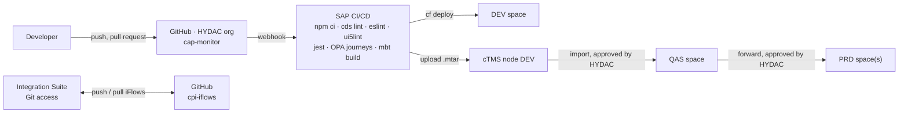

| Aspect | Design |
|---|---|
| Build | `mbt build` produces one archive with the CAP service, HDI deployer, UI content and destination content |
| Quality gates | `cds lint`, ESLint, `ui5lint`; 137 service tests, 15 UI journeys in headless Chrome; all green before deploy ✅ |
| Stages | The same archive moves DEV → QAS → PRD; stage-specific values (destinations, Cloud Logging binding, redirect URIs to the Work Zone host) come from extension descriptors, never from a rebuilt archive |
| Customizing | Data, not code: maintained in the admin screen per region, does not travel with the archive; the initial load comes from today's S/4 customizing |

---

## 3. Ongoing administration

### 3.1 Recurring tasks and proposed owners

The table lists the recurring tasks the application and its BTP services require. **"Owner" is for HYDAC to decide.** The proposal is only a starting point.

| Area | Task | Frequency | Proposed owner | Owner (HYDAC decision) |
|---|---|---|---|---|
| **Users & roles** | Role group membership in the corporate IdP; sales-org assignment in the monitor's admin screen | On joiner / mover / leaver | Regional HYDAC key users (`Kundenmonitor_Admin`) | |
| | IdP ↔ Identity Services ↔ BTP trust, group → role collection mapping, attribute mapping | One-time + on change | HYDAC IT (identity) | |
| | Authorization matrix role × region × sales org, periodic review | Quarterly | HYDAC IT + business owners | |
| **Customizing** | Process steps, approval rules and limits, status/step texts per region in the monitor's admin screen (no deployment, no transport) | On business change | Regional HYDAC key users (`Kundenmonitor_Admin`) | |
| **Work Zone** (`CFLPDEV` / `CFLPPRD`) | Content provider for the monitor, site, tile, roles; refresh the content provider after a deployment | Per release | HYDAC launchpad team | |
| **Cloud Connector** | Operation, upgrades, the one resource path, certificates (system + CA for principal propagation) | Quarterly / on expiry | HYDAC Basis | |
| **Destinations** | One destination per SAP system and per Magento shop and stage; registry entry for a new region; credential rotation | On change / certificate or password rotation | HYDAC BTP admin | |
| **SAP systems** | `API_BUSINESS_PARTNER` available and authorized (business-partner creation per sales org), user mapping for principal propagation, number ranges; AU: communication arrangement `SAP_COM_0008`, communication system, business users and roles | On change / joiner-mover-leaver | HYDAC SAP Basis / security per region; HYDAC Australia IT | |
| **HANA Cloud** (`GeneralServices`, PRD instance) | Instance size and mapping to the monitor's spaces, start/stop of non-productive instances, upgrades (SAP-managed, scheduled by the customer), backup retention (default 14 days) and a yearly restore test | Monthly check | HYDAC BTP admin | |
| **Application** | Monitor health, logs, alerts, outbox (stuck notifications), failed intakes; restart on incidents | Continuous (the health check restarts automatically) | purplecat (AMS) or HYDAC IT | |
| | Updates of CAP, UI5, Node.js runtime (security patches, SAP maintenance) | ≈ quarterly | purplecat (development / AMS) | |
| | Deploy through cTMS: upload (DEV) / import approval (QAS, PRD per region) | Per release | purplecat upload, HYDAC approval | |
| **CI/CD** | Pipeline configuration, credentials, failed builds | On change | purplecat | |
| **GitHub** | Organization members, branch protection, token policy, offboarding | On change | HYDAC IT | |
| | Rotation of tokens (developer PATs, CI read token, Integration Suite) | On expiry (for example 90 days) | Token owner / HYDAC IT | |
| **Magento** | Intake credentials (service key per shop) and notification credentials, endpoint changes | On rotation / change | TechDivision with HYDAC eCommerce | |
| **Integration Suite** | API proxy for the intake (if used), legacy Magento iFlows, Git repository registration | Continuous / one-time | HYDAC integration team | |
| **Business** | First-level support for users, clarification of business rules | Continuous | HYDAC key users per region | |
| **Data protection** | Retention and deletion of completed requests (retention job), audit log review, data residency | Yearly / per policy | HYDAC data protection + IT | |
| **Cost & entitlements** | Monitor consumption (HANA Cloud, CF memory, Work Zone), adjust quotas | Monthly | HYDAC IT | |

What is **gone** compared with today: customizing transports in S/4, maintenance of the `ZEC_*` objects and Gateway services, the BAdI, and the monitoring of the Magento ↔ S/4 custom services.

### 3.2 User management

**Goal: no user-by-user maintenance in the BTP cockpit.** Identity and roles come from HYDAC's corporate identity provider through SAP Cloud Identity Services (IAS): IAS groups (for example `CUSTMON_VIEWER`, `CUSTMON_EDITOR`, `CUSTMON_RELEASER`, `CUSTMON_ADMIN`) are mapped once to the role collections in the subaccount trust configuration. The **data scope** (sales organizations per user and backend) is maintained by regional key users in an admin screen of the monitor and stored in an application table; the service filter reads it on every request.

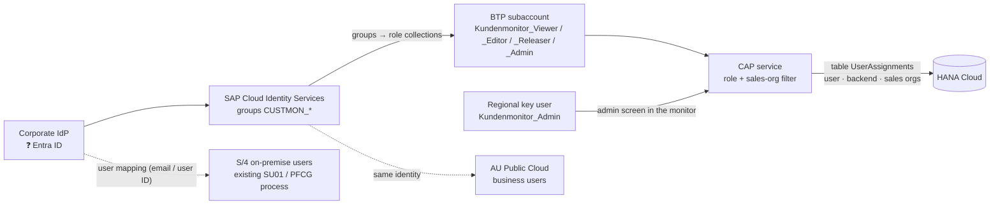

| Topic | How |
|---|---|
| Roles | IAS groups → role collections, standard BTP trust configuration; no API, no maintenance in the cockpit per user |
| Data scope | Application table `UserAssignments` (user, backend, sales organizations), maintained by regional key users in the admin screen; immediate effect; per-backend values and regional delegation are native; change log in the app, exportable for audits 💡 |
| Alternative considered | Writing the scope as an IAS user attribute through the Identity Directory SCIM API from the monitor. Rejected as the default because the application would hold a tenant-wide `Manage Users` credential of an IAS tenant that is probably shared with other HYDAC applications; it takes effect only at the next login. Available if HYDAC wants every authorization visible in IAS ❓ |
| Interim | Static role collections with sales orgs maintained in the BTP cockpit for the first test users on DEV |
| Joiner / mover / leaver | Identity and role groups in the IdP, HYDAC's normal process. A leaver loses access everywhere at once; group administration can be delegated per region |
| S/4 users | Principal propagation needs a matching S/4 user with business-partner authorizations **only for editors who run CREATE / CREATE_WE / AP_MODIFY**; viewers, releasers and admins need no S/4 user. **S/4 on-premise:** existing SU01 / PFCG process, mapped by email or user ID. **AU Public Cloud:** business users with a business role for business-partner maintenance restricted to the AU sales orgs; the Public Cloud uses IAS as well, so it can be the same identity (❓ same tenant as BTP?) |
| Consistency | One authorization matrix (role × region × sales org), owned by HYDAC, for IdP groups, the application scope and the S/4 roles. Out of sync means "no authorization" on the master-data step, never exposed data, because the service filter applies first. Quarterly review |
| Audit | BTP audit log (roles, trust), IdP/IAS logs (identity), application log (assignments and customizing changes), SAP Audit Log service (personal data 💡), S/4 change documents (master data, real user) |

To confirm during the identity setup ❓: SAML or OIDC trust between the subaccount and IAS; which IAS tenant HYDAC uses and whether the AU Public Cloud shares it; the corporate identity provider (Entra ID?).

### 3.3 Customizing per region

Allowed steps per process type and status, approval rules and limits, and status and step texts are **data, not code**. They are stored per backend in HANA Cloud, loaded initially from today's S/4 customizing tables (`ZEC_CUST_*`) and maintained by the regional key users in the admin screen of the monitor (UC-13) 💡. A change takes effect immediately, without a deployment or a transport, and each region keeps its own rules.

### 3.4 Platform and application operation

| Signal | Source | Use |
|---|---|---|
| Health | `GET /health` (no login); the Cloud Foundry health check restarts the instance | Availability |
| Logs | Structured JSON with a correlation ID per request; optional SAP Cloud Logging binding for dashboards and alerts; authorization headers masked | Troubleshooting, audit trail of technical errors |
| Business KPIs | Counters of the list views (open, errors, clarification, release) inside the app; outbox status (pending, attempts, last error) 🟡; intake rejections 🟡 | Daily operations by key users |
| Alerts | Cloud Logging alerts on error rate, outbox age, intake failures 🟡; BTP Alert Notification optional | Operations |
| Platform | BTP cockpit, `cf app`, HANA Cloud Central (memory, backups) | Capacity |

**Backup and continuity.** HANA Cloud is managed by SAP: daily full backups and log backups at least every 15 minutes, point-in-time recovery, retention 14 days by default (configurable 1–215 days), to be set per HYDAC policy for PRD with a restore rehearsal once a year. The CAP service is stateless and redeployable from the archive at any time. Drafts are database rows and survive restarts. ❓ HYDAC's disaster-recovery requirement decides whether a cross-region replica is needed.

---

## 4. Integration

### 4.1 One monitor, several SAP systems

**Principle: one UI, one service, one request store, one step logic; per region one SAP destination and one Magento destination.** The requests of all regions are stored in the monitor; the master data goes to the region's SAP system.

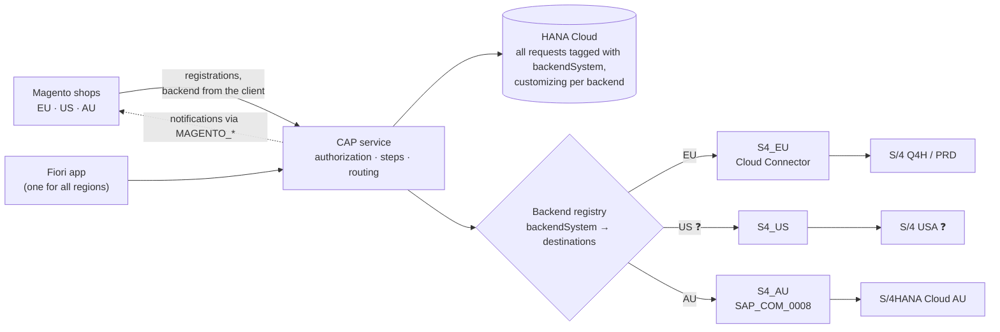

| Element | How it works |
|---|---|
| Backend per request | Every request carries the backend it belongs to (`backendSystem`: `EU`, `US`, `AU`), set by the intake from the shop's technical client; read-only; filter and column "Region" in the UI 💡 |
| Backend registry | Configuration, not code: backend → S/4 destination, Magento destination, adapter type, number rules. A new region is one entry plus two destinations, no code change |
| Reads | Always from HANA Cloud: one list across all regions, filtered by the user's assignments. No remote reads, no synchronization |
| Writes | Every step and save changes the request in HANA Cloud; CREATE, CREATE_WE and AP_MODIFY additionally call the SAP system of the request as the real user |
| Rules per backend | Allowed steps, approval rules and texts are customizing tables per backend, maintained by the regional key users |
| Isolation | If one SAP system is unreachable, only that region's master-data steps fail with a clear message (`BACKEND_UNAVAILABLE`); everything else keeps working. If a shop is unreachable, its notifications wait in the outbox and are retried |

| Region | SAP system (master data) | Connection | Status |
|---|---|---|---|
| EU | S/4HANA on-premise (Q4H/GWQ → production) | Cloud Connector | Interface design ready 🟡 |
| USA | ❓ Same S/4 on-premise as EU (own sales orgs) **or** own system | Cloud Connector (if on-premise) | ❓ to confirm |
| AU | S/4HANA Cloud Public Edition | Internet, `SAP_COM_0008` | Same design, no ABAP development (section 4.7) |

If the USA runs on the same S/4 system as Europe, it is simply more sales organizations in backend EU, with no extra integration.

**Central or regional deployment.** The same archive supports one central deployment (one PRD subaccount, one HANA Cloud, all backends registered, one work queue) or one deployment per region (each region's requests stay in its BTP region, three times the HANA Cloud and operation cost). We recommend central, on the condition that HYDAC data protection confirms that Australian contact data may be stored in an EU BTP region (Australian Privacy Principle 8 restricts cross-border disclosure of personal information). Otherwise regional for AU and central for EU and USA. HYDAC's global account today has subaccounts only in Europe (eu10 on AWS, eu20 on Azure), and HYDAC USA's accounts-payable automation already keeps its data in eu10, so a central deployment for EU and USA follows existing practice; a regional AU deployment would be HYDAC's first subaccount outside Europe. ❓ The decision is needed before AU goes live, not before DEV.

### 4.2 Landscape and stage mapping (Q4H / GWQ → production)

*Assumption:* Q4H is the S/4HANA quality system (master data). GWQ is the SAP Gateway (hub) system of the same stage, where OData services are published (today `ZEC_CUSTOMER_CREATE_SRV` to Magento; tomorrow `API_BUSINESS_PARTNER` to BTP). ❓ Please confirm, including the production pair (P-system / Gateway).

| BTP stage | SAP EU (on-premise) | SAP USA | SAP AU (Public Cloud) | Magento |
|---|---|---|---|---|
| DEV (now) | Q4H via GWQ | ❓ | ❓ AU test tenant | test shop / replayed payloads |
| QAS (later) | Q4H (❓ or a separate test client) | ❓ | ❓ AU test tenant | staging shops |
| PRD (later) | ❓ production S/4 + Gateway | ❓ | ❓ AU production tenant | production shops |

The same archive is deployed on every stage: DEV in subaccount `DEV`, QAS in `QAS` ❓, PRD in a new subaccount (section 2.1). Only the destinations, which HYDAC's BTP admin maintains per subaccount, point to different systems and shops.

### 4.3 Interfaces and APIs

Three interfaces replace the six custom objects of today (`ZEC_CUSTOMER_CREATE_SRV`, `ZEC_CUSTOMER_READ_SRV`, `RejectCusomterSet`, `ZEC_CUSTOMER*` tables, `ZCL_EC_CUSTOMER` step classes, BAdI notification). **No RFC function modules, no IDoc, no custom OData service, no ABAP.** The service calls the standard API through SAP's destination and connectivity services (SAP Cloud SDK underneath).

| ID | Interface | Direction | Protocol / authentication | Content | Replaces |
|---|---|---|---|---|---|
| I-01 | **Intake:** company registration, new shop user, new delivery address | Magento → BTP | REST/OData V4 over HTTPS, OAuth 2.0 client credentials (one XSUAA service key per shop/region); optional API Management proxy (section 4.8) | Today's payload structure; creates the request, runs the approval check, writes the intake log entries; idempotent on the Magento IDs | `ZEC_CUSTOMER_CREATE_SRV` |
| I-02 | **Master data:** steps CREATE, CREATE_WE, AP_MODIFY; duplicate check (CHNG_OLD, CNG_DEBI); value help | BTP → SAP | **Standard `API_BUSINESS_PARTNER`** (OData V2) via destination: Cloud Connector + principal propagation (on-premise), communication scenario `SAP_COM_0008` + OAuth 2.0 SAML bearer (Public Cloud) | Business partner with address, roles, tax numbers; customer with company code and sales area; contact person; ship-to and partner function; search by number/name | CMD-API / BAPI calls in `ZCL_EC_CUSTOMER*` |
| I-03 | **Notifications:** ID notification after a successful step, rejection | BTP → Magento | HTTPS via destination per shop, credentials as today (❓ TechDivision); persistent outbox, sent only after the commit, retried, result logged | Same targets and payloads as today (`RejectCusomterSet` kept; address ID for `CR_WE` rejections to agree) | BAdI notification, `ZEC_CUSTOMER_READ_SRV` read-back |
| – | Legacy Magento ↔ S/4 custom services | – | – | Retired per shop at cutover after a parallel run (section 4.6) | – |

How the steps map to the standard API:

| Step | Calls on `API_BUSINESS_PARTNER` | Notes |
|---|---|---|
| CREATE (`CR_DEB`) | `POST A_BusinessPartner` (organization, `to_BusinessPartnerAddress`, `to_BusinessPartnerRole` FLCU00/FLCU01, `to_BusinessPartnerTax`) with deep insert `to_Customer` (`A_Customer`, `to_CustomerCompany`, `to_CustomerSalesArea`); then `POST A_BusinessPartnerContact` (+ `to_ContactAddress`, `to_ContactRelationship`) for the admin contact | Internal number assignment; ❓ grouping / number range per sales org. Sales org 7110 carrier as supplier role (`to_Supplier`) ❓ still needed |
| CREATE for an existing business partner without customer role | `POST .../to_BusinessPartnerRole` + `to_Customer` | |
| AP_MODIFY (`CR_AP`, `CH_DEB`) | `GET A_BusinessPartnerContact`; `POST` or `PATCH A_BusinessPartnerContact`, `A_BPContactToAddress`, `A_BPContactToFuncAndDept` | Sales org 2000 "CRM number mandatory": ❓ which field; key-user custom field or rule retired |
| CREATE_WE (`CR_WE`) | `POST A_BusinessPartner` with `to_Customer` (ship-to as customer); then `POST A_CustSalesPartnerFunc` on the sold-to (partner function ship-to, sales area of the request) | New number persisted before the second call |
| CHNG_OLD, CNG_DEBI | `GET A_BusinessPartner('…')?$expand=to_Customer,to_BusinessPartnerRole` | `BP_NOT_FOUND` / `BP_NOT_CUSTOMER`; Magento mapping read locally |
| Value help | `GET A_BusinessPartner?$filter=…&$expand=to_Customer` | Only in the request's backend, result limited |
| RELEASE, REJECT, CLARIFY, RESET, CNG_NEW, MANUAL_OK | none | Request in HANA Cloud only |

A step end to end, here CREATE against Q4H through GWQ:

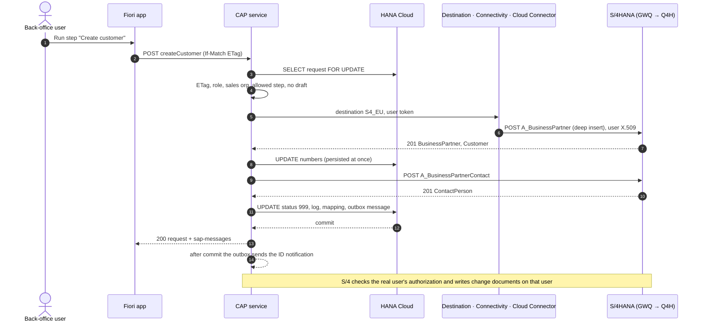

Failure paths: an API error sets the error status (140/150/160) and logs all messages, the created numbers stay on the request; a repeat continues with the missing part. An unreachable backend returns `BACKEND_UNAVAILABLE` and leaves the request unchanged. A stale version returns 412. A missing S/4 authorization of the propagated user returns 403 with the API message.

**Magento mapping 💡.** Today the Magento company hangs on the customer in S/4 (❓ Z field or table). The monitor keeps this mapping in HANA Cloud (written by the steps, migrated at cutover). No Z field in S/4 is needed. If S/4 users must see the Magento company, a key-user custom field on the business partner can be written through the same API ❓.

### 4.4 Cloud Connector resources and destinations

**Cloud Connector.** One resource per on-premise backend: virtual host `gwq-virtual:443` (HTTPS), path `/sap/opu/odata/sap/API_BUSINESS_PARTNER/` with all sub-paths. Nothing else. Principal propagation additionally needs the Cloud Connector system certificate trusted in GWQ/Q4H (ICM), a certificate-to-user mapping rule (`CERTRULE`, for example on the email address) and the business-partner creation authorizations on the S/4 users of the editors. Viewers, releasers and admins need no S/4 user. No RFC resources are needed.

| Destination | Type | Authentication | Used for |
|---|---|---|---|
| `S4_EU` (`S4_US` ❓) | OnPremise (Cloud Connector), URL = virtual host of GWQ | `PrincipalPropagation`; DEV start: `BasicAuthentication` with a technical user | I-02 |
| `S4_AU` | Internet | `OAuth2SAMLBearerAssertion` (audience, token service URL and client from the communication arrangement; name ID format email); alternative `ClientCertificateAuthentication` with a communication user | I-02 |
| `MAGENTO_EU`, `MAGENTO_US`, `MAGENTO_AU` | Internet | As configured in S/4 today (basic or token) ❓ TechDivision | I-03 |
| `srv-api` | Internet (generated by the archive) | Token forwarding from the approuter | UI → CAP |

### 4.5 Authentication and authorization

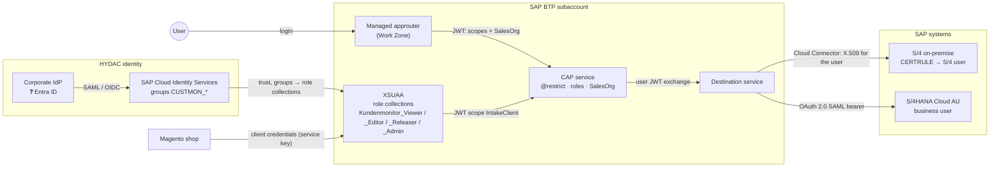

| Hop | Mechanism |
|---|---|
| User → Work Zone / app | HYDAC corporate identity provider via SAP Cloud Identity Services (❓ Entra ID?) → XSUAA; role collections from IdP groups (section 3.2) |
| UI → CAP | OAuth token forwarded by the managed approuter; CSRF protection by Fiori Elements |
| Magento → CAP (intake) | OAuth 2.0 client credentials: one XSUAA service key per shop/region (identifies the backend), rotated by HYDAC; optionally API key + quota in API Management |
| CAP → S/4 on-premise (master-data steps, value help) | **Recommended: principal propagation.** The user's token is exchanged, the Cloud Connector issues a short-lived X.509 certificate for the logged-in user, and S/4 maps it to the S/4 user (rule in `CERTRULE`). Alternative: technical user (basic authentication) |
| CAP → S/4HANA Public Cloud | Communication arrangement `SAP_COM_0008` in the AU tenant; user propagation via OAuth 2.0 SAML bearer assertion; alternative client certificate with a communication user |
| CAP → Magento (notifications) | As S/4 does it today (basic authentication or token per shop; ❓ TechDivision), stored in the destination |

Why principal propagation for the master-data steps: S/4 checks the authorization of the real user to create business partners for that sales org and company code; change documents and the created master data show the real user, not a technical one; there is no shared password to rotate. Effort for HYDAC: a one-time Cloud Connector trust setup (system certificate, CA), an ICM/certificate mapping in GWQ/Q4H, and a user mapping rule (for example email → S/4 user). Only editors who run CREATE / CREATE_WE / AP_MODIFY need an S/4 user.

Pragmatic start: a **technical user on DEV** for the first connectivity tests, then principal propagation **before user tests on QAS**. ❓ HYDAC decides. If HYDAC prefers a technical user permanently, S/4 cannot check per user who creates master data; the monitor's own authorization (role + sales org) is then the only check, and the real user appears in the request log only.

A user sees and changes only what all of these layers allow:

| # | Layer | Where | Controls |
|---|---|---|---|
| 1 | Login | Corporate IdP → Identity Services → XSUAA | Only HYDAC users; the Work Zone tile is visible only with the Work Zone content role for the monitor |
| 2 | Function | Role collection (Viewer / Editor / Releaser / Admin) | Read, edit and run steps, release, maintain customizing |
| 3 | **Rows** | Sales-org assignment per backend (section 3.2), applied by the CAP service as a declarative restriction on every read: list, counters, detail, sub-data, log, value helps ✅ | Which requests are visible anywhere. This is the **single read path**: reads never touch S/4. A user with only AU sales orgs sees only Australian requests |
| 4 | Release | Releaser role | Unreleased requests are visible only to releasers ✅ |
| 5 | **S/4 check** | Principal propagation on CREATE / CREATE_WE / AP_MODIFY | S/4 checks the creation authorization of the real user (sales org, company code) and writes the change documents on that user. No technical user can create master data anywhere |

Why per backend: the same sales-org code (for example `1000`) can exist in two SAP systems with a different meaning, so the assignment carries the backend. ❓ If sales-org codes are unique across all systems, plain codes suffice.

### 4.6 Magento

Intake of a registration (I-01):

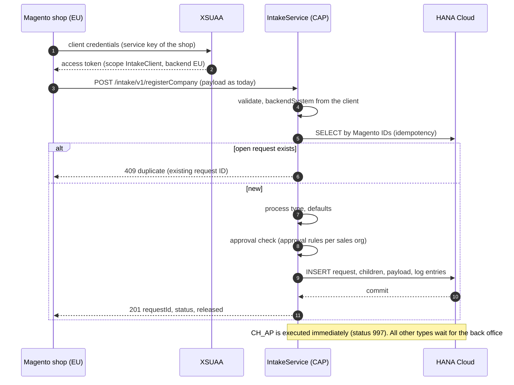

Error contract: 400 with a message list for missing mandatory fields, 401/403 for an invalid client, 409 for a duplicate, 503 if the database is unavailable (Magento retries). The payload structure is the one Magento sends to `ZEC_CUSTOMER_CREATE_SRV` today, so TechDivision changes only endpoint and credentials.

Notification to Magento (I-03):

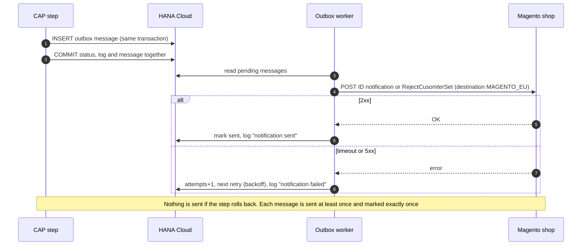

A "resend notification" action for editors covers the case of a permanently failed message after the retries are exhausted.

What changes for Magento and when:

- **No change for Magento in phase 2** (development and tests on DEV/QAS with test shops or replayed payloads).
- **Change at cutover:** TechDivision switches each shop's endpoint and credentials from `ZEC_CUSTOMER_CREATE_SRV` to the intake service. The payload structure stays. Notifications then arrive from BTP instead of S/4 with the same content. What Magento reads back today via `ZEC_CUSTOMER_READ_SRV` after an ID notification is either included in the notification or read from the intake service (❓ TechDivision).
- Parallel run per shop: a shop is switched when its open requests have been migrated; the legacy services are retired after one release cycle.
- Coordination with TechDivision / Magento is needed for: address-level rejection, keeping `RejectCusomterSet` as is, the read-back, and the switch plan.
- ❓ Do the USA and Australia use separate Magento instances, and how do AU registrations reach SAP today?

### 4.7 S/4HANA Cloud Public Edition (HYDAC Australia)

| Aspect | On-premise S/4 (Q4H) | S/4HANA Cloud Public Edition (Australia) |
|---|---|---|
| Connection | Cloud Connector, principal propagation | Internet, no Cloud Connector; communication arrangement `SAP_COM_0008` (OAuth 2.0 SAML bearer for user propagation, or a communication user with certificate) |
| API | `API_BUSINESS_PARTNER` (activated standard service) | `API_BUSINESS_PARTNER` – **the same API, the same adapter**. In the Public Cloud it is the only way to create customers from outside anyway: the released ABAP Cloud business-partner object cannot create customer roles (SAP note 3655149) |
| Custom code | None needed | None needed. **No ABAP Cloud development, no developer extensibility required** |
| Custom fields | Z fields on the customer today (Magento company, CRM number ❓) | Key-user custom fields, if HYDAC wants them visible in S/4; otherwise the mapping lives in the monitor (section 4.3) |
| Number ranges, grouping | ❓ per sales org | ❓ per AU configuration |
| Users | S/4 users mapped by email / user ID | Business users with a business role for business-partner maintenance; same IAS identity possible (section 3.2) |

**Australia is the same design.** The AU Public Cloud is one more SAP destination (`SAP_COM_0008`, SAML bearer) and one more Magento destination in the backend registry (section 4.1). There is no ABAP Cloud development, no developer extensibility and no second backend implementation. The effort for Australia is configuration, authorizations and testing. What has to be agreed with Gareth in a short workshop ❓: scope and AU sales orgs, the AU Magento flow today, whether AU wants the review-before-create process at all (if Magento AU creates customers directly today, that is a business decision before any technical one), business-partner number ranges and grouping in the AU tenant, and the identity setup.

### 4.8 Relationship to the Integration Suite iFlows

- **The monitor's runtime calls do not go through Integration Suite.** The master-data calls are synchronous user calls with user context (principal propagation); the notifications come from the outbox with their own retry. An iFlow in between would add latency and a second place to monitor without benefit.
- **Integration Suite is relevant for:**
  - an **API Management proxy** in front of the intake service, if HYDAC wants all external APIs (TechDivision is external) behind one gateway with API keys, quotas and analytics ❓;
  - a Cloud Integration iFlow only if a Magento shop cannot adapt its payload and a transformation is needed;
  - the Magento ↔ SAP flows that may be routed through Integration Suite today (❓ please confirm the current Magento ↔ GWQ and Magento ↔ AU paths);
  - later, replacing the legacy BAdI notification (customer maintenance with partner role ZO → Magento) with business-partner events from S/4 to BTP. That one is outside the monitor's scope today.
- **Version control:** iFlows go into the separate repository `cpi-iflows` in the same GitHub organization (section 2.5), so application and integration changes can be reviewed and traced together.
