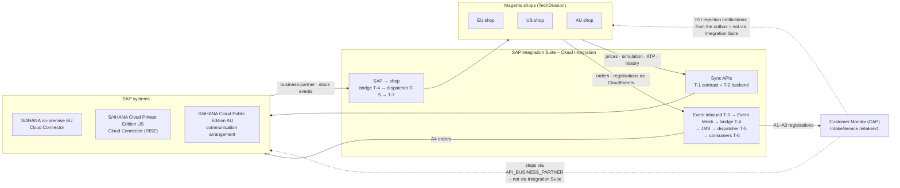
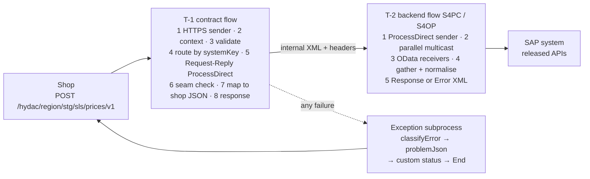
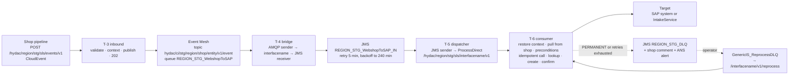
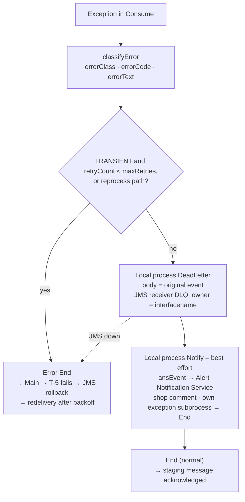

# Webshop iFlow Templates on SAP Integration Suite

| | |
|---|---|
| **Document** | Template iFlows for the HYDAC Magento ↔ SAP webshop integration on SAP Integration Suite (Cloud Integration): sync request-reply, async shop → SAP, async SAP → shop |
| **Builds on** | *AU Webshop iFlow Design – Sync & Async* (8 November 2026) · *Customer Monitor on SAP BTP – Solution Design* (design review 10 November 2026) · read-only review of the tenant `fsm-dev-cpi-hydac` (8 November 2026) |
| **Customer** | HYDAC – Group IT, HYDAC Digital, HYDAC Australia; TechDivision (Magento); DyFlex (S/4HANA Cloud AU) |
| **Prepared by** | purplecat AG – Igor Vorobev, SAP BTP solution architecture |
| **Version** | 0.1 – first draft for review |
| **Date** | 9 November 2026 |
| **Classification** | Confidential – HYDAC / purplecat project documentation |

**Conventions.** ✅ exists in the tenant · 🟡 designed, not built · 💡 proposal, needs agreement · ❓ open point · *My call* = a detail settled by purplecat so that the build can start; say so if you disagree. Identifiers: `T-n` template, `R-n` rule, `TD-n` decision needed. Placeholders: `<REGION>` = `EU` | `US` | `AU`, `<region>` the same in lower case, `<STG>` = `DEV` | `TST` | `PRD`, `<IF>` = interface code (`S1`, `A4`, `B1`, …), `<SYSTEM>` = SAP system flavour (`S4OP` on-premise and RISE, `S4PC` Public Cloud).

**Summary.** Seven template iFlows and one shared package per region cover every webshop interface HYDAC has planned. A synchronous pair – a shop-facing contract flow plus one backend flow per SAP system – serves request-reply APIs such as prices, order simulation and availability. An asynchronous chain – generic inbound, Event Mesh → JMS bridge, dispatcher, consumer – serves everything that must never be lost: orders and registrations towards SAP and the Customer Monitor, business-partner and stock changes towards the shops. The templates are region-neutral: the AU design of 8 November becomes the first instance set; EU and US are copies with a different backend adapter and different parameter values, not new designs. Registrations (A1–A3) end in the Customer Monitor's `IntakeService`; the monitor's own calls to SAP and its notifications back to the shop stay outside Integration Suite, as the solution design proposes (D-10, D-09, §6.2).

---

## 1. Purpose, scope and sources

This document is the one place that says how every webshop iFlow is built, so that a new interface is a copy with a new mapping and a new backend call – in every region – and so that TechDivision, DyFlex and HYDAC Digital meet the same endpoint style, error codes and monitoring everywhere.

| Source | Taken over unchanged | Changed or added here |
|---|---|---|
| AU Webshop iFlow Design (sync S1, async A4) | Two-layer sync design; Event Mesh → JMS staging with backoff and explicit dead-letter queue; the three error classes; RFC 9457 error contract; idempotency; MPL custom headers and statuses; JMS queue budget; dispatcher and reprocessing pattern from the US team | Region placeholders instead of `AU`; backend variants for S/4HANA on-premise (EU), S/4HANA Cloud Private Edition on RISE (US) and S/4HANA Cloud Public Edition (AU); a fixed contract at the ProcessDirect seam (R-9); header-only transport across ProcessDirect; copy checklists per template; the shared Groovy scripts (`scripts/`) |
| Customer Monitor Solution Design (§3.2, §6.2, §7.5, §8.9, D-09, D-10) | `IntakeService` `/intake/v1` as the target for registrations; monitor runtime calls and notifications not through Integration Suite; `cpi-iflows` repository for the iFlows; API Management optional | A1–A3 consumers mapped onto the three intake operations and their error contract (§9); the registration path and the result-notification path per region raised as decisions (TD-01, TD-02) |
| Tenant review `fsm-dev-cpi-hydac` (read-only) | Naming `<REGION>-<AREA>-<Name>` and `com.hydac.<REGION>.<AREA>.<name>`; JMS retry/dead-letter pattern of `US-SLS-GenericIS_Artifacts`; JMS budget 30 queues, 12 used; standard Event Mesh through the AMQP adapter | Template package outside the region naming (TD-03); queue budget per region (§12) |

**Out of scope:** the field mappings of the individual interfaces (interface documents, DyFlex IDD), the Magento side (TechDivision), API Management policies (optional, solution design §8.9), bulk synchronisation SAP → shop beyond the consumer skeleton (§10), and the business-partner event enablement in S/4HANA on-premise (separate work package, solution design §8.9).

## 2. Where the templates sit



| Interface family (AU concept) | Pattern | Templates | Target |
|---|---|---|---|
| S1 customer prices, S2 order simulation, S3 availability, S4 order history, S5 freight | Sync request-reply, shop → SAP | T-1 + T-2 | SAP system of the region |
| A4 order create | Async, shop → SAP | T-3 + T-4 + T-5 + T-6 | SAP system of the region |
| A1 company, A2 contact, A3 address registration | Async, shop → BTP | T-3 + T-4 + T-5 + T-6 | Customer Monitor `IntakeService` |
| B1 business partner, B2 stock, … | Async, SAP → shop | T-4 + T-5 + T-7 | Magento shop system(s) of the region |

**Boundary to the Customer Monitor.** The monitor calls `API_BUSINESS_PARTNER` inside its steps with the user's identity (principal propagation) and sends ID and rejection notifications from its outbox to the destination `MAGENTO_<REGION>` (D-10, D-09). No template sits in these two paths. A shop that can call `/intake/v1` directly with OAuth 2.0 client credentials (solution design §3.2, §6.2) does not need A1–A3 at all; the solution design and docs/10 §2 want an iFlow only where a shop cannot adapt its payload. A1–A3 exist for a shop whose concept routes everything through one event inbound (AU, concept D-38) – a deviation from that criterion that TD-01 puts up for decision. Both paths arrive at the same three intake operations, so the monitor does not know which path a region uses.

## 3. Template catalogue

| # | Template (name · ID pattern) | Instances | Copied per interface? | Role |
|---|---|---|---|---|
| T-1 | `<IF>_<Name>_API` · `com.hydac.<REGION>.SLS.<IF>_<Name>_API` | one per sync interface and region | yes | Shop-facing REST contract: HTTPS endpoint, validation, routing by system key, response mapping, error contract |
| T-2 | `<IF>_<Name>_<SYSTEM>` · `com.hydac.<REGION>.SLS.<IF>_<Name>_<SYSTEM>` | one per sync interface and SAP system | yes | Backend layer: SAP calls (parallel where possible), normalisation to the internal XML |
| T-3 | `Webshop_Event_Inbound` · `com.hydac.<REGION>.SLS.Webshop_Event_Inbound` | one per region | no | Generic inbound: validates the CloudEvent, publishes to Event Mesh, answers 202 |
| T-4 | `Webshop_Event_EM2JMS` / `SAP_Event_EM2JMS` | one per region, direction and stage | no | Bridge: Event Mesh queue → JMS staging queue; sets `interfacename` from the event type |
| T-5 | `Webshop_Event_Dispatch` / `SAP_Event_Dispatch` | one per region, direction and stage | no | JMS sender → ProcessDirect `/hydac/<region>/<stg>/sls/<interfacename>/v1`; owns the JMS transaction and the retry |
| T-6 | `<IF>_<Entity>_Event2<Target>` · `com.hydac.<REGION>.SLS.<IF>_<Entity>_Event2<Target>` | one per async interface and region | yes | Consumer: pull, preconditions, idempotency, target call, confirmation, dead letter |
| T-7 | `<IF>_<Entity>2Webshop` · `com.hydac.<REGION>.SLS.<IF>_<Entity>2Webshop` | one per SAP → shop interface and region | yes | T-6 skeleton with the shop as target; one run per connected shop system |
| Shared | Package `<REGION>-SLS-GenericIS_Artifacts`: script collection `<REGION>_SLS_Common`, value mappings, `GenericIS_ReprocessDLQ`, `GenericIS_QueueWatch`, `Mock_Backend` | one per region | no | Common scripts, replay of dead-lettered messages, queue alerting, test double for the backend layer |

**Where the templates live.** 💡 Package `TPL-SLS-WebshopTemplates` in the non-production tenant. Its content is never deployed: no endpoints, parameters left at placeholder values, description `TEMPLATE – do not deploy`. The template iFlows are versioned in `cpi-iflows/templates` through Integration Suite's Git access (solution design §7.5); script collections and value mappings are outside that feature, so their sources are kept in the same repository as plain files and copied into the package by hand (§14). A new instance means: download the template, add it to the region package under the instance name, work through the copy checklist of the template (§7.4, §8.6). The pseudo-region `TPL` needs an exception from the tenant naming rule `<REGION>-<AREA>-<Name>` (TD-03).

**Package placement of the instances** (the AU design puts the dispatcher with the generic artefacts): T-1 and T-2 instances in `<REGION>-SLS-WebshopSyncAPIs`; T-3, `Webshop_Event_EM2JMS` and the T-6 instances in `<REGION>-SLS-WebshopToSAP`; `SAP_Event_EM2JMS` and the T-7 instances in `<REGION>-SLS-SAPToWebshop`; both dispatchers, `GenericIS_ReprocessDLQ`, `GenericIS_QueueWatch`, `Mock_Backend`, the script collection and the value mappings in `<REGION>-SLS-GenericIS_Artifacts`.

## 4. Rules shared by all templates

| # | Rule | Where it shows |
|---|---|---|
| R-1 | **Two layers per sync interface.** The contract flow owns the shop-facing REST contract (validation, normalisation, RFC 9457 errors, correlation); the backend flow owns the SAP calls and is chosen by system key over ProcessDirect. A new SAP system adds a backend flow, never a new contract. | T-1, T-2 |
| R-2 | **Routing is configuration.** Region, system key, sales area, shop systems, endpoints, credential aliases, timeouts and retry budgets are externalised parameters; nothing is hard-coded, stage copies differ only in parameter values. | §5.3 |
| R-3 | **Error classes drive behaviour, not adapters.** `classifyError` turns every exception into `TRANSIENT`, `PERMANENT_TECH` or `PERMANENT_BUSINESS`. Only `TRANSIENT` is ever retried, and only in the async chain. Unknown errors are `PERMANENT_TECH` – dead letter with alert, never a retry storm. | §6, `scripts/classifyError.groovy` |
| R-4 | **Lean payloads.** Only the fields the shop uses; large results paged from SAP and chunked into Magento. | T-2, T-7 |
| R-5 | **Correlation end-to-end.** `X-Correlation-ID` from the shop (or the CloudEvent `id`) becomes `SAP_ApplicationID` and is returned in every response, comment and alert. | all |
| R-6 | **Observable by non-developers.** MPL custom header properties (`shopSystem`, `websiteCode`, `entity`, `entityId`, `incrementId`, `correlationId`, `sapDocument`, `errorClass`, `errorCode`) on every run, a custom status on every outcome, an Alert Notification Service event on every dead-lettered message. | §13 |
| R-7 | **No secrets in flows.** Credentials only as security material with the aliases of §12; shop → BTP with OAuth 2.0 client credentials and a region-specific user role; BTP → SAP with the technical user of the region; BTP → Magento with TechDivision's integration user per shop system. | §12 |
| R-8 | **Idempotent by design.** Every write to SAP, Magento or the monitor is safe to repeat: lookup before create, PUT semantics, Idempotent Process Call keyed by the business key where the target has one (orders) and by the CloudEvent `id` where the target decides on duplicates itself (registrations, §8.4 step 2), duplicate answers (`409`) treated as success. | T-6, T-7 |
| R-9 | **Fixed contract at the ProcessDirect seam** (*my call*). The caller sends the normalised internal XML and the context as headers; the callee answers with `<Response>` or `<Error class code>` and always ends normally. Error End events never cross the seam; the caller re-raises an `<Error>` into its own exception subprocess. Exchange properties stay inside one iFlow – everything that must cross ProcessDirect travels as a header. | T-1 ↔ T-2, T-5 ↔ T-6 (exception: the deliberate Error End for a transient retry, §8.4) |
| R-10 | **Sync never persists and never retries; async persists first and retries only `TRANSIENT`.** A retry inside a sync flow would double the SAP load exactly when SAP is struggling; the shop already degrades and retries on the next request. | T-1, T-6 |
| R-11 | **Templates are never deployed** and carry no customer-specific values. An instance differs from its template only in the places listed in its copy checklist; everything else is a defect of the template and is fixed there first. | §3, §14 |

## 5. Naming, stages, parameters, context

### 5.1 Names

| Object | Pattern | Example (AU, S1) |
|---|---|---|
| Package | `<REGION>-SLS-WebshopSyncAPIs`, `<REGION>-SLS-WebshopToSAP`, `<REGION>-SLS-SAPToWebshop`, `<REGION>-SLS-GenericIS_Artifacts` | `AU-SLS-WebshopSyncAPIs` |
| iFlow name · ID | see §3 · `com.hydac.<REGION>.SLS.<name>` | `S1_CustomerPrices_API` · `com.hydac.AU.SLS.S1_CustomerPrices_API` |
| Shop-facing endpoint | `/hydac/<region>/<stg>/sls/<interface>/v<n>` (version in the path, not in the iFlow name; a v2 contract is a new contract flow next to the old one) | `/hydac/au/tst/sls/prices/v1` |
| Event inbound endpoint | `/hydac/<region>/<stg>/sls/events/v1` | `/hydac/au/tst/sls/events/v1` |
| ProcessDirect backend | `/hydac/<region>/<stg>/sls/<SYSTEMKEY>/<interface>/v1` | `/hydac/au/tst/sls/AU/prices/v1` |
| ProcessDirect consumer | `/hydac/<region>/<stg>/sls/<interfacename>/v1` and `…/v1/reprocess` | `/hydac/au/tst/sls/A4_Order_Event2SalesOrder/v1` |
| JMS queue | `<REGION>_<STG>_WebshopToSAP_IN`, `<REGION>_<STG>_SAPToWebshop_IN`, `<REGION>_<STG>_DLQ` | `AU_TST_WebshopToSAP_IN` |
| Event Mesh topic / queue | `hydac/ci/<stg>/<region>/shop/<entity>/v1/<event>` · `<REGION>_<STG>_WebshopToSAP`; `hydac/ci/<stg>/<region>/s4/<entity>/v1/<event>` · `<REGION>_<SHOPSYSTEM>_<Entity>Data` (`hydac/ci/<stg>` is the namespace of the stage's message client, §12) | `hydac/ci/tst/au/shop/order/v1/export-requested` |
| Security material | `<REGION>_S4_<STG>`, `<REGION>_Magento_<SHOPSYSTEM>`, `<REGION>_Monitor_<STG>`, `EM_<STG>`, `ANS_<STG>`, `IS_Monitoring_<STG>` (the last three are per tenant and stage, not per region) | `AU_Magento_SHL` |
| User role (HTTPS sender) | `<REGION>_Webshop_Send` | `AU_Webshop_Send` |
| MPL custom status | `<REGION>_SYNC_OK`, `<REGION>_SYNC_FAILED_<CLASS>`, `<REGION>_<IF>_DONE`, `<REGION>_<IF>_RETRY`, `<REGION>_<IF>_DEAD_LETTERED`, `<REGION>_<IF>_SKIPPED_DUPLICATE` | `AU_A4_DEAD_LETTERED` |
| Error code | upper snake case, stable across regions and systems (§6) | `S4_UNAVAILABLE` |

Renamed against the AU design (*my call*, so that the names work for every interface): `ORDER_PRECONDITION_FAILED` → `PRECONDITION_FAILED`, `AU_A4_CREATED` → `<REGION>_A4_DONE`, `AU_SYNC_FAILED_PERMANENT` → `<REGION>_SYNC_FAILED_PERMANENT_TECH` and `…_PERMANENT_BUSINESS` (one status per class, so the two alert routes are visible in the monitor).

### 5.2 Stages

Two stages share the non-production tenant and one stage has its own tenant, so the suffix rule is: `_DEV` and `_TST` copies in name and ID in the non-production tenant (AU concept §8.9), no suffix in the production tenant (*my call*; the AU design leaves production open). Queues and credentials carry `<STG>` in all three stages. HTTPS endpoint paths, ProcessDirect addresses and Event Mesh topics must be unique per tenant, so they carry the stage as well – `<stg>` in every address, the stage's message-client namespace in every topic – otherwise the `_DEV` and `_TST` copies could not both be deployed and both stage queues would receive every event. The stage is the externalised parameter `stage` and appears nowhere else in a flow. Stage copies differ only in parameter values (R-2); a diff of two stage copies must show nothing but the externalised parameters.

### 5.3 Externalised parameters

| Group | Parameters (defaults) | Used by |
|---|---|---|
| Region and stage | `region` (`AU`), `stage` (`DEV`), `systemKey` (`AU`), `salesOrg`, `distChannel`, `division`, `shopSystems` (comma list, e.g. `DEV,TST,STG,SHL,PRD`) | all |
| Shop contract | `maxBodySizeKb` (`512`), `maxItemsPerCall` (`100`), `allowedEventTypes` (comma list), `cacheControl` (`no-store`), `retryAfterSeconds` (`30`) | T-1, T-3 |
| Backend | `s4.baseUrl`, `s4.credentialAlias` (`<REGION>_S4_<STG>`), `s4.proxyType` (`Internet` or `OnPremise`), `s4.locationId` (Cloud Connector, on-premise only), `s4.timeoutMs` (`1200` sync short, `8000` sync long – HTTP receiver), `s4.timeoutMin` (`1` – OData receiver in the async flows, whose timeout is in whole minutes) | T-2, T-6 |
| Monitor | `monitor.baseUrl` (`…/intake/v1`), `monitor.credentialAlias` (`<REGION>_Monitor_<STG>`), `monitor.timeoutMs` (`10000`) | T-6 (A1–A3) |
| Shop systems | `magento.<SHOPSYSTEM>.baseUrl`, `magento.<SHOPSYSTEM>.credentialAlias`, `magento.<SHOPSYSTEM>.storeCode` – or the value mapping `<REGION>_ShopSystems` when the list is long | T-6, T-7 |
| Messaging | `em.credentialAlias` (`EM_<STG>`), `em.namespace` (`hydac/ci/<stg>`), `em.maxRedelivery` (`20`, set on the queue), `jms.inQueue`, `jms.dlq`, `jms.retryIntervalMin` (`5`), `jms.maxRetryIntervalMin` (`240`), `maxRetries` (`8`), `dispatch.maxRetries` (`10` = `maxRetries` + 2, the poison-message guard of T-5) | T-3 … T-7 |
| Operations | `ans.credentialAlias` (`ANS_<STG>`), `ans.baseUrl`, `monitoring.credentialAlias` (`IS_Monitoring_<STG>`), `alert.businessRecipients`, `alert.technicalRecipients`, `log.level` (`INFO` in TST, `NONE` for sync flows in PRD), `log.attachPayloadOnPermanent` (`true`) | all |

The context step of every flow copies `region`, `stage`, `maxRetries` and `retryAfterSeconds` into exchange properties of the same name, so that the shared scripts can read them without knowing the parameters.

### 5.4 Context: properties and headers

| Name | Set by | Carried as | Used for |
|---|---|---|---|
| `correlationId` | T-1 step 2, T-3 step 3, T-6 step 2 | header `correlationId` inside the chain; `X-Correlation-ID` only at the shop boundary (request in, response out) | `SAP_ApplicationID`, response header, problem `instance`, comments, alerts |
| `systemKey` | T-1 (request or parameter), T-6 (event) | header | router to the backend flow, credential alias composition |
| `shopSystem`, `websiteCode`, `entity`, `entityId`, `incrementId`, `eventType` | T-3 from the CloudEvent (`source`, `type`, `subject`, data) | **headers** in T-3 (the AMQP receiver forwards message headers as application properties, not exchange properties) → JMS headers → headers; T-6 copies them to properties for local use | credential and endpoint selection, idempotency key, MPL headers |
| `region`, `stage`, `maxRetries`, `retryAfterSeconds` | context step, from the parameters of the same name | property | shared scripts (alerts, problem body, retry budget) |
| `originalBody` | T-6 step 2 | property | the CloudEvent as received, restored as body before the dead-letter write, so that reprocessing starts from the event and not from the response of the step that failed |
| `validationErrors` | validation step of T-1 and T-3 | property (JSON array) | `errors[]` of the problem body |
| `acceptStatuses` | Content Modifier before a Request-Reply with *Throw Exception on Failure* off | property (e.g. `201,409`) | `evaluateHttpStatus` raises every other status |
| `interfacename` | T-4 via value mapping `<REGION>_EventTypes` | header | ProcessDirect address in T-5, dead-letter owner, reprocessing |
| `retryCount` | T-6 step 2 from header `SAPJMSRetries` (0 on the first attempt) | property | retry budget against `maxRetries` |
| `idempotencyKey` | T-6 step 2 | property | Idempotent Process Call |
| `errorTarget` | Content Modifier before every Request-Reply (`S4`, `MONITOR`, `SHOP`, `MESSAGING`) | property | lets `classifyError` name the target in the code (`<TARGET>_UNAVAILABLE`, `<TARGET>_BUSINESS_ERROR`) and treat a 404 from the shop as technical, from SAP or the monitor as business |
| `errorClass`, `errorCode`, `errorText`, `errorHttpStatus` | `classifyError`, or a script that raises a business error before | property; MPL header `errorClass`, `errorCode` | error contract, routing in the exception subprocess, alerts |
| `SAP_ApplicationID` | = `correlationId` | **header** (as a property it has no effect) | Application Message ID in the monitor |
| `SAP_MessageProcessingLogCustomStatus` | last step of every path | property | custom status (§5.1) |

## 6. Error contract

Three classes, one script, one behaviour per class.

| Class | Typical causes | Sync behaviour (T-1) | Async behaviour (T-6, T-7) |
|---|---|---|---|
| `TRANSIENT` | Target answers 5xx, 429 or 408; connection refused or reset; connect or read timeout; Event Mesh or JMS not available | `503` with `Retry-After: 30`; no retry in the flow (R-10) | Error End → JMS rolls back and redelivers with backoff until `maxRetries`, then dead letter |
| `PERMANENT_TECH` | Schema or contract validation; mapping or script error; the shop, the monitor or the messaging layer answers 400, 401, 403, 404, 405, 415; unknown system key; TLS or certificate problem; any unclassified exception | `400`, `404` or `500` | Dead letter at once, alert *technical* |
| `PERMANENT_BUSINESS` | SAP returns a message of type E – SAP Gateway sends it as HTTP 400 with an error body, so a 400 from an SAP target is business, not technical; SAP answers 404 for customer or material; precondition not met; a target answers 422 or 409 where the interface is not idempotent | `404` or `422` | Dead letter at once, alert *business*, comment to the shop where the interface has one |

Stable codes (one code per situation, identical in every region and for every SAP system):

| Situation | Class | HTTP (sync) | `code` | Shop behaviour |
|---|---|---|---|---|
| Schema or business validation of the request fails | `PERMANENT_TECH` | 400 | `VALIDATION_FAILED` (+ `errors[]`) | Fix the request; no retry |
| Unknown system key, sales area or shop system | `PERMANENT_TECH` | 404 | `UNKNOWN_SYSTEM` | Configuration error; alert purplecat |
| Customer, material or document not found in the target | `PERMANENT_BUSINESS` | 404 | `NOT_FOUND` | Show fallback (list price, message) |
| SAP returns a business error (E message, HTTP 400 with error body) | `PERMANENT_BUSINESS` | 422 | `S4_BUSINESS_ERROR`; SAP message id and text in `detail` | Message to the user; no retry |
| Precondition for an async write not met (unpaid order, missing SAP number) | `PERMANENT_BUSINESS` | – | `PRECONDITION_FAILED` | Comment on the order; back office acts |
| Target timeout, 5xx, 429, connection refused (maintenance window) | `TRANSIENT` | 503 + `Retry-After: 30` | `S4_UNAVAILABLE` / `MONITOR_UNAVAILABLE` / `SHOP_UNAVAILABLE` | Sync: degrade, retry next request. Async: automatic |
| Event Mesh or JMS not reachable at the inbound | `TRANSIENT` | 503 + `Retry-After: 30` | `MESSAGING_UNAVAILABLE` | Shop pipeline retries (leg 1 belongs to the shop) |
| Integration error (mapping, script, unclassified) | `PERMANENT_TECH` | 500 | `INTEGRATION_ERROR` | Alert purplecat; shop degrades as for 503 |

Sync error body – always `application/problem+json` (RFC 9457), never a Cloud Integration HTML error page, therefore the exception subprocess of T-1 and T-3 ends with a normal End:

```json
{
  "type": "https://hydac.com/problems/S4_UNAVAILABLE",
  "title": "SAP system not reachable",
  "status": 503,
  "detail": "Read timed out after 1200 ms (S4_AU, prices)",
  "instance": "8d3f2c4e-…-correlation-id",
  "code": "S4_UNAVAILABLE",
  "errors": []
}
```

The exception-type table that `classifyError` relies on (HTTP adapter `HttpOperationFailedException` with `statusCode`, OData adapter exception text with the status, `SocketTimeoutException`, `ConnectException`, JMS and AMQP exceptions, mapping and Groovy exceptions) is written from SAP's documentation and the US flows and **has to be verified on the tenant in the first test cycle** ❓; the script is built so that an unknown type lands in `PERMANENT_TECH`, never in a retry.

## 7. Sync template – T-1 contract and T-2 backend



### 7.1 Steps of T-1 (contract flow)

| # | Step | Detail |
|---|---|---|
| 1 | HTTPS sender | `POST /hydac/<region>/<stg>/sls/<interface>/v1`; OAuth 2.0 client credentials; user role `<REGION>_Webshop_Send` (custom role per region, not `ESBMessaging.send`, so a shop client of one region cannot call another region's endpoints); CSRF off; max body size from `maxBodySizeKb`; *Allowed Header(s)* `X-Correlation-ID`, `X-Shop-System` – the sender drops every request header that is not listed, so without this the correlation id would silently fall back to the MPL id |
| 2 | Content Modifier *Capture context* + `mplHeaders` | Properties `correlationId` (`X-Correlation-ID`, fallback the MPL id), `systemKey`, `shopSystem`, sales area, `customerId`, `itemCount`; header `SAP_ApplicationID`; MPL custom headers |
| 3 | Validate request | Groovy *Validate*: parses the JSON (a parse error is classified as `VALIDATION_FAILED`, because `errorTarget` is still unset), checks required fields and business limits (`maxItemsPerCall`) and collects the message list in `validationErrors`; then JSON → XML and XML Validator with the XSD derived from the OpenAPI contract, *Prevent Exception on Failure* on, followed by a Groovy step that turns the validator's result (written to a message header when this option is on; the exact header name is taken from the step's help on the tenant) into `errorClass` `PERMANENT_TECH`, `errorCode` `VALIDATION_FAILED` and `validationErrors`, and `raiseError`. Result: HTTP 400 with `errors[]`, never a 500 from a converter exception. ❓ A JSON-schema library is not bundled in the Groovy runtime; the XSD route is the fallback that works everywhere |
| 4 | Router by `systemKey` | Content Modifier `errorTarget = S4` first (from here on a parser or mapping exception is an integration error, not a validation failure); known key → Request-Reply ProcessDirect `/hydac/<region>/<stg>/sls/<SYSTEMKEY>/<interface>/v1`; unknown key → `raiseError` `UNKNOWN_SYSTEM`. A new SAP system is one more branch and one more backend flow |
| 5 | Request-Reply ProcessDirect | No timeout of its own (the ProcessDirect adapter has none); the response time is bounded by the backend's call timeouts (§7.3); context travels as headers (R-9) |
| 6 | Seam check (`raiseError`) | Body root `<Error>` → properties `errorClass`, `errorCode`, `errorText` from its attributes → throw, so the exception subprocess runs with the backend's classification |
| 7 | Message mapping to the shop contract | Internal XML → shop JSON (`listPrice`, `netPrice`, `conditions[]`, `scales[]`, amounts with currency, quantities with unit); the only interface-specific step besides the backend |
| 8 | Content Modifier *Response* + `responseHeaders` | `Content-Type: application/json`, `X-Correlation-ID`, `Cache-Control` from parameter (the shop caches, BTP does not), HTTP 200, custom status `<REGION>_SYNC_OK`; `responseHeaders` drops every other header, because the HTTPS sender returns all message headers to the shop and the seam context (`hydacResult`, `systemKey`, …) must not leak |
| E | Exception subprocess | `classifyError` → `problemJson` (body, `CamelHttpResponseCode`, `Retry-After` for `TRANSIENT`, internal headers dropped) → log attachment only when `PERMANENT` and `log.attachPayloadOnPermanent` → custom status `<REGION>_SYNC_FAILED_<CLASS>` → **End** (normal) |

### 7.2 Steps of T-2 (backend flow) and the variants per SAP system

| # | Step | Detail |
|---|---|---|
| 1 | ProcessDirect sender | `/hydac/<region>/<stg>/sls/<SYSTEMKEY>/<interface>/v1` |
| 2 | Parallel Multicast | One branch per SAP call that does not depend on another (S1: price API and condition-record API); sequential multicast or a single call where the interface has one API (S2 simulation) |
| 3 | HTTP receivers against the OData URLs | `$select` only the fields used, `$filter` on customer, materials and sales area, `$top` paging above `maxItemsPerCall`; timeout `s4.timeoutMs` in milliseconds; connection reuse on; credential `s4.credentialAlias`. The HTTP adapter, not the OData adapter, because the OData receiver's timeout is set in whole minutes and cannot express a 1 200 ms budget (the AU design has the same slip); the OData adapter stays where its features pay off – deep insert and `$batch` in the async flows |
| 4 | Gather + Groovy *Normalise* | Join by key (material), keep only the condition types of the value mapping `<REGION>_ConditionTypes`, sum totals, convert scales to the sales unit → internal XML `<Response interface="prices" version="1">` |
| 5 | End | Internal XML back to the contract flow, header `hydacResult = OK` |
| E | Exception subprocess | `classifyError` → Content Modifier builds `<Error class="…" code="…" httpStatus="…">text</Error>`, header `hydacResult = ERROR` → **End** (normal; R-9). An unreachable SAP system therefore reaches the contract flow as `TRANSIENT` / `S4_UNAVAILABLE`, not as a ProcessDirect exception |

| | EU – S/4HANA on-premise | US – S/4HANA Cloud Private Edition (RISE) | AU – S/4HANA Cloud Public Edition |
|---|---|---|---|
| Instance name | `<IF>_<Name>_S4OP` | `<IF>_<Name>_S4OP` (copy of EU with other parameter values) | `<IF>_<Name>_S4PC` |
| Receiver adapter | HTTP against the OData service (sync); OData V2 (async writes); legacy `ZEC_*` / `ZSD_*` services only while still in use ❓ | as EU | HTTP against the released OData V2 / V4 APIs (sync); OData adapter (async writes); released APIs only (DyFlex IDD, Q-01) |
| Proxy type | On-Premise, Cloud Connector location ID `s4.locationId` | On-Premise, Cloud Connector of the RISE landscape | Internet |
| Authentication | Basic with technical user `EU_S4_<STG>`; client certificate once the Cloud Connector is set up for it | as EU, `US_S4_<STG>` | Communication arrangement per scenario, technical user `AU_S4_<STG>` – basic as DyFlex sets it up today, X.509 when supported ❓ |
| Principal propagation | not used – the shop calls are technical calls without a named user; the monitor's steps use principal propagation on their own destination (solution design I-02) | as EU | not applicable |
| APIs | standard OData APIs of the on-premise release where available; otherwise the interface document names the service | as EU | released APIs per interface document |

### 7.3 Timeouts

Shop client timeout > SAP call timeout (HTTP receiver, milliseconds) plus the mapping time, with the parallel branches counting once; ProcessDirect adds no timeout of its own. Defaults for the short interfaces (S1, S3, S4): shop 2 000 ms, SAP 1 200 ms; for S2: shop 10 000 ms, SAP 8 000 ms. Values are parameters and are adjusted after the latency and load test (AU concept §10.2); the structure stays.

### 7.4 Copy checklist T-1 / T-2 (what an instance changes, nothing else)

1. Name and ID (`<IF>_<Name>_API`, `<IF>_<Name>_<SYSTEM>`), description `instance of T-1 v1.0` / `T-2 v1.0`.
2. Endpoint path and ProcessDirect address of the interface.
3. XSD of the request (from the OpenAPI contract) in step 3; business limits in the Groovy check.
4. Message mapping to the shop contract (step 7).
5. Backend calls (T-2 steps 2–4): APIs, `$select`/`$filter`, normalisation script, value mapping.
6. Parameter values: timeouts, `maxItemsPerCall`, credential aliases, Cloud Connector location.
7. Custom status prefix `<REGION>_SYNC_*` stays; interface-specific codes only if a new business situation needs one (then add it to §6 first).

## 8. Async template – T-3 inbound, T-4 bridge, T-5 dispatcher, T-6 consumer



### 8.1 Why Event Mesh and JMS

Event Mesh gives the multiplex (one copy per subscriber) that the SAP → shop direction needs and decouples the shop from Cloud Integration; its redelivery is immediate and bounded, which a weekend maintenance window would exhaust within seconds. The JMS staging queue adds exponential backoff (the US flows run 10 → 600 minutes; the AU design proposes 5 → 240 for the shop flows, taken over here) and a transaction that acknowledges the message only when the target has accepted it. The cost is one tiny bridge message per event. The JMS adapter's own dead-letter flag only parks a message that crashed a worker node twice; the business dead letter of this design is explicit (§8.4). Event Mesh queues need `maxRedeliveryCount` (`em.maxRedelivery`, 20) and a dead-message queue set at creation.

### 8.2 Steps of T-3 (generic inbound, one per region)

| # | Step | Detail |
|---|---|---|
| 1 | HTTPS sender | `POST /hydac/<region>/<stg>/sls/events/v1`, OAuth 2.0 client credentials, role `<REGION>_Webshop_Send` |
| 2 | Groovy *Validate CloudEvent* | `specversion`, `id`, `source`, `type` in `allowedEventTypes`, `subject`, `data` present; on failure `raiseError` `VALIDATION_FAILED` |
| 3 | Content Modifier *Context* + `mplHeaders` | **Headers** `eventType`, `shopSystem` (from `source`), `websiteCode`, `entity`, `entityId`, `incrementId`, `correlationId = id`, `SAP_ApplicationID = id` – headers, because the AMQP receiver forwards message headers as application properties and exchange properties would not survive the bridge; the same values as properties for the local steps; property `topic` = `{{em.namespace}}/<region>/shop/<entity>/v1/<event>` (externalised parameters are referenced in `{{…}}` syntax) derived from the event type |
| 4 | AMQP receiver (Event Mesh) | `errorTarget = MESSAGING` before the call; dynamic topic `${property.topic}`; message client of the stage (`em.credentialAlias`); body = the CloudEvent as received |
| 5 | Response 202 | `{ "id": …, "correlationId": … }`, custom status `<REGION>_EVT_ACCEPTED` |
| E | Exception subprocess | `classifyError` → `problemJson`: Event Mesh unreachable → 503 with `Retry-After` so that the shop pipeline retries (leg 1 belongs to the shop); validation → 400. No JMS fallback here – the shop is the retry owner for leg 1 |

### 8.3 T-4 bridge and T-5 dispatcher (one per region, direction and stage)

| Flow | Steps | Settings |
|---|---|---|
| T-4 `Webshop_Event_EM2JMS` | AMQP sender on queue `<REGION>_<STG>_WebshopToSAP` → Content Modifier (properties `region`, `stage` from the parameters) → `resolveEventType` (value mapping `<REGION>_EventTypes` → headers `interfacename`, `entity`; a Content Modifier cannot read a value mapping) → JMS receiver `<REGION>_<STG>_WebshopToSAP_IN` → End | Transaction handling *Required for JMS*. Exception subprocess: `classifyError` → Router: `TRANSIENT` (JMS not available) → **Error End**, so Event Mesh redelivers (`em.maxRedelivery` 20 on the queue; JMS outages are short, and the Event Mesh dead-message queue remains the residual gap that `GenericIS_QueueWatch` checks ❓ API) · `PERMANENT` (unknown event type) → Content Modifier *Alert context* (headers `interfacename`, `correlationId`, parameters `region`, `stage` into properties) → JMS receiver `<REGION>_<STG>_DLQ` with owner `Webshop_Event_EM2JMS` → Process Call → local process `Notify` (best effort, own exception subprocess → End, as in T-6) → End, so the Event Mesh message is acknowledged and never redelivered. A second process `Reprocess` (ProcessDirect sender `/hydac/<region>/<stg>/sls/Webshop_Event_EM2JMS/v1/reprocess`) runs the same steps, so a dead-lettered unknown event type is replayed through the bridge once the value mapping is fixed |
| T-5 `Webshop_Event_Dispatch` | JMS sender `<REGION>_<STG>_WebshopToSAP_IN` → Request-Reply ProcessDirect `/hydac/<region>/<stg>/sls/${header.interfacename}/v1` → End | JMS: retry interval `jms.retryIntervalMin`, exponential backoff on, max `jms.maxRetryIntervalMin`, 1 concurrent process per node (raise per flow after the load test), dead-letter flag on. Exception subprocess as poison-message guard: Router on `${header.SAPJMSRetries}` < `dispatch.maxRetries` → **Error End** (rollback, redelivery with backoff – the path a transient failure in T-6 takes on purpose) · otherwise → Content Modifier *Alert context* (headers `interfacename`, `correlationId`, parameters `region`, `stage`, `errorClass` `PERMANENT_TECH`, `errorCode` `DISPATCH_FAILED`, `errorText` = `${exception.message}` into properties – T-5 has no context step and no `classifyError`, so the alert would otherwise be empty) → JMS receiver `<REGION>_<STG>_DLQ` with owner = `interfacename` → Process Call → local process `Notify` (best effort) → End (acknowledged). Without the guard a consumer that is not deployed, an unknown address or a failure inside the consumer's own error handling would retry until the 30-day queue expiry deletes the message – a silent loss |

The dispatcher variant saves JMS queues (3 per region and stage instead of 3 + one per consumer). If HYDAC IT grants a larger budget, the consumers get their own queue and their own JMS sender; nothing else changes (TD-04).

### 8.4 T-6 consumer – structure and steps

A start event takes exactly one sender channel, so T-6 has two small integration processes that share one local integration process `Consume`: `Main` (ProcessDirect sender `/hydac/<region>/<stg>/sls/<interfacename>/v1`, called by T-5) and `Reprocess` (ProcessDirect sender `…/v1/reprocess`, called by `GenericIS_ReprocessDLQ`; a Content Modifier sets the header `SAPJMSRetries = 0` and the property `reprocess = true` first). Each consists of a Process Call to `Consume` and an End; neither has an exception subprocess, so an Error End of `Consume` propagates to T-5 (rollback, retry) and a normal end acknowledges. Transaction handling *Required for JMS* on every process. Slots marked ⚙ are interface-specific; everything else is the template.

| # | Step of `Consume` | Detail |
|---|---|---|
| 2 | Content Modifier *Restore context* + `mplHeaders` | Properties from the headers of the persisted event (`shopSystem`, `entity`, `entityId`, `incrementId`, `correlationId`, …) and from the parameters (`region`, `stage`, `maxRetries`); `retryCount = ${header.SAPJMSRetries}` (0 when absent, 0 from `Reprocess`); `originalBody` = the body, i.e. the CloudEvent, so that the dead-letter write and reprocessing see the event and not the response of the step that failed; `idempotencyKey` ⚙ – A4: `<shopSystem>:<incrementId>` (an order is exported once, ever); A1–A3: the CloudEvent `id` (a replay of the same event is skipped; a new registration of the same company after a rejection is a new event and reaches the intake, which answers `409` only while a request is open – keying by company id would silently swallow it); credential alias and base URL of the shop system from the value mapping `<REGION>_ShopSystems`; custom status `<REGION>_<IF>_RETRY` when `retryCount > 0` |
| 3 | Request-Reply HTTP *Pull from shop* ⚙ | `errorTarget = SHOP`; `GET /rest/<store>/V1/<entity>/<entityId>` with the shop system's credential; the event carries IDs, the shop stays the source of the data (lean events); 404 → `PERMANENT_TECH` |
| 4 | Groovy *Preconditions* ⚙ | A4: customer has an SAP number and is approved, ship-to has a partner number, card orders are paid. A1–A3: mandatory intake fields present (§9). On failure `raiseError` `PERMANENT_BUSINESS` / `PRECONDITION_FAILED` |
| 5 | Request-Reply *Lookup* ⚙ | `errorTarget = S4`; target lookup by business key before any create (A4: `A_SalesOrder?$filter=<reference field> eq '<shopSystem>:<incrementId>'`, field per TD-07; A1–A3: none – the intake answers `409`). A hit fills `sapDocument`. Deliberately outside the idempotent call, so that a retry after a failure in step 8 or 9 finds the number again and the confirmation never goes out without it. This also covers "created, but the response was lost", which no idempotent repository can |
| 6 | Idempotent Process Call → local process `Create` | Message ID `<interfacename>:${property.idempotencyKey}`; *Skip Process Call for Duplicates* **off**, so the flow sees a duplicate in the property `CamelDuplicateMessage` and can set a status instead of silently skipping; the retention of the IDs is the step's setting – verify the available options and the maximum on the tenant ❓. `Create` starts with a Router: `CamelDuplicateMessage` true or `sapDocument` already set → custom status `<REGION>_<IF>_SKIPPED_DUPLICATE`, skip 7–8 · else 7–8 |
| 7 | Mapping + Request-Reply *Create* ⚙ (in `Create`) | A4: OData V2 deep insert `API_SALES_ORDER_SRV`, timeout `s4.timeoutMin`. A1–A3: `errorTarget = MONITOR`; HTTP `POST /intake/v1/register<Kind>`, timeout `monitor.timeoutMs`, *Throw Exception on Failure* off, so that step 8 can treat `409` as done instead of as an error |
| 8 | `evaluateHttpStatus` + Groovy *Evaluate result* ⚙ (in `Create`) | `evaluateHttpStatus` with `acceptStatuses` (`201,409` for A1–A3) raises every other status with the class of §6, so a 503 from the intake can never pass as success; A4's OData adapter throws itself (SAP E message = HTTP 400 → `S4_BUSINESS_ERROR`). Then the interface part: A4 201 → sales order number into `sapDocument`, A and W messages per agreement (TD-07); A1–A3 201 → `requestId` into `sapDocument`, 409 → `_SKIPPED_DUPLICATE` (R-8) |
| 9 | Request-Reply HTTP *Confirm to shop* ⚙ | `errorTarget = SHOP`; A4: `POST /V1/orders/<entityId>/comments` "SAP order <no>". A1–A3: none – the monitor notifies the shop itself (TD-02). A failure here is `TRANSIENT` but must not recreate the document – steps 5–6 guarantee that on retry; a repeated comment is accepted as at-least-once |
| 10 | End | Normal end → `Main` ends → T-5 completes → JMS message acknowledged; custom status `<REGION>_<IF>_DONE` |
| E | Exception subprocess of `Consume` | `classifyError` → Router: **`TRANSIENT` and `retryCount < maxRetries`, or `reprocess` = true → Error End** (propagates through `Main` to T-5: rollback, redelivery with backoff; custom status `<REGION>_<IF>_RETRY`. On the reprocess path every failure ends this way, so the entry stays in the DLQ under the reprocess flow's backoff – re-writing it would make the running reprocess flow pick it up again at once, one alert per pass) · **otherwise** → Process Call → local process `DeadLetter` → custom status `<REGION>_<IF>_DEAD_LETTERED` → **End** (normal → T-5 acknowledges the staging message) |
| DL | Local process `DeadLetter` | Content Modifier: body = `${property.originalBody}`, headers `interfacename`, `errorClass`, `errorCode`, `errorText`, `retryCount`, `correlationId` → JMS receiver `<REGION>_<STG>_DLQ` → Process Call → local process `Notify` → End. If the dead-letter write itself fails (JMS down), the exception propagates: Error End → T-5 rollback → the staging message stays and is retried; nothing is lost |
| NF | Local process `Notify` (best effort) | `ansEvent` → HTTP receiver Alert Notification Service (`ans.credentialAlias`) → shop comment "Not exported: <code> <text>" ⚙ where the interface has one. Own exception subprocess that ends with **End**, so an ANS or shop outage never rolls back the dead-letter write – an exception subprocess cannot hold a try/catch of its own, which is why the notification is a separate local process |



Transaction boundary, to be measured on DEV before the first go-live ❓: the AU design (p. 13) assumes that the dead-letter write and the acknowledgement of the staging message share one JMS transaction. With the dispatcher variant they sit in two iFlows; whether `Consume`'s *Required for JMS* joins T-5's transaction across ProcessDirect or opens its own is not documented. If it is two transactions, a node crash between them yields a second dead-letter entry with the same `correlationId` on redelivery, which the operator deletes – at-least-once, never lost. The acceptance test of §15 forces a failure after the dead-letter write to settle it; the document is corrected with the result.

### 8.5 Reprocessing

An operator with write access (purplecat) fixes the cause – for example the missing SAP number is now maintained through the Customer Monitor – and deploys `GenericIS_ReprocessDLQ` for the stage: JMS sender on `<REGION>_<STG>_DLQ` (retry 10 minutes with exponential backoff to 600 minutes, 1 concurrent process, as the US pattern) → Request-Reply ProcessDirect `/hydac/<region>/<stg>/sls/${header.interfacename}/v1/reprocess` → End. The consumer's `Reprocess` process resets `SAPJMSRetries` to 0 and enters `Consume` at step 2 with the original event as body. Every failure during reprocessing, transient or permanent, ends in Error End (property `reprocess`): the entry stays in the DLQ with its original headers, the consumer's MPL shows the new error, and the reprocess flow's own JMS sender redelivers it with its backoff until the operator undeploys the flow. `GenericIS_ReprocessDLQ` itself has an exception subprocess that ends in Error End as well, so an entry whose owner has no `/reprocess` endpoint – a consumer that is not deployed, a `DISPATCH_FAILED` entry – also stays and is visible instead of failing silently; the operator deploys the consumer first, then replays. Entries owned by `Webshop_Event_EM2JMS` (unknown event type) are replayed through the bridge's own `/reprocess` endpoint once the value mapping is fixed (§8.3). Single entries are deleted in *Manage Message Queues* when the business decides not to export a document. The pattern is the US `process_JMSQueues` flow with the AU naming.

### 8.6 Copy checklist T-6 (what an instance changes, nothing else)

1. Name and ID (`<IF>_<Entity>_Event2<Target>`), description `instance of T-6 v1.0`; the two ProcessDirect addresses with the instance name.
2. Entry in the value mapping `<REGION>_EventTypes` (event type → instance name, entity) and in `allowedEventTypes` of T-3.
3. `idempotencyKey` expression (step 2).
4. The ⚙ slots: pull (3), preconditions (4), lookup (5), mapping, create and evaluation (7–8 in `Create`, with `acceptStatuses`), confirmation (9) and the shop comment in `Notify`.
5. Parameter values: target base URL, credential alias, timeouts, `maxRetries`.
6. Custom status prefix `<REGION>_<IF>_*`; interface-specific codes only after §6 has them.

T-3, T-4 and T-5 are not copied per interface; a new async interface touches them only through the value mapping and the `allowedEventTypes` parameter.

## 9. Registrations A1–A3 and the Customer Monitor

The consumer target for registrations is the monitor's `IntakeService` (solution design §6.2, docs/10 §2): three operations, OAuth 2.0 client credentials against the monitor's XSUAA with the scope `IntakeClient`, the region (`backendSystem`) bound to the client. Integration Suite therefore holds one service key per region and stage as security material `<REGION>_Monitor_<STG>`, and the monitor sees the region from the token, not from a field.

| Event (`type`) | Instance | Pull from shop (step 3) | Intake call (step 7) | Idempotency key |
|---|---|---|---|---|
| company registered | `A1_Company_Event2Monitor` | `GET /V1/company/{id}` + the admin customer | `POST /intake/v1/registerCompany` – payload as the shop sends it to `ZEC_CUSTOMER_CREATE_SRV` today | CloudEvent `id` |
| customer (contact) registered | `A2_Contact_Event2Monitor` | `GET /V1/customers/{id}` | `POST /intake/v1/registerContact` | CloudEvent `id` |
| address added | `A3_Address_Event2Monitor` | `GET /V1/customers/{id}` (address block) | `POST /intake/v1/registerShipTo` | CloudEvent `id` |

Intake answers (docs/10 §2: 400, 401/403, 409, 503) and what the consumer does with them: `201` → done, `requestId` into `sapDocument` and the MPL header; `409` (open request with the same Magento IDs – the intake owns the business duplicate check, which is why the consumer keys only by event id) → done, custom status `…_SKIPPED_DUPLICATE` (R-8); `400` (message list) → `PERMANENT_TECH` / `VALIDATION_FAILED`, dead letter, technical alert – a mapping defect, not a business case; `401` / `403` → `PERMANENT_TECH`, alert purplecat (service key or role); `503` → `TRANSIENT`, retry with backoff.

Nothing goes back to the shop from A1–A3: the monitor sends the ID notification or the rejection from its outbox to `MAGENTO_<REGION>` once the back office has processed the request (D-09).

What the consumer has to assemble from the shop for the intake payload is not written down anywhere yet ❓: the legacy structure carries order volume, currency, credit-card flag, sales data and the admin contact, which `GET /V1/company/{id}` and `GET /V1/customers/{id}` do not return as such. The A1–A3 mapping slot needs an interface document from TechDivision (which Magento attributes feed which intake fields) before it can be filled; the template itself does not depend on it. The exact event type names and the CloudEvent `data` of the AU shop come from the AU concept and TechDivision ❓. Whether a region uses A1–A3 at all, or lets the shop call `/intake/v1` directly, is TD-01; where the shop gets the resulting SAP numbers from is TD-02.

## 10. SAP → shop – T-7

T-7 is the T-6 skeleton with the shop as target, as the AU concept (§6.4) lays it out. Note that docs/10 §4 sketches the replacement of the legacy ZO-partner-role notification as S/4 event → CAP → Magento, without Integration Suite; which of the two carries business-partner changes to the shops is part of TD-02. S/4 publishes a business-partner or stock event to Event Mesh (Public Cloud: standard events; on-premise: event enablement, separate work package); `<IF>_<Entity>_Notification2DataEvent` reads it once, enriches from SAP and publishes one data event per region to `hydac/ci/<stg>/<region>/s4/<entity>/v1/<event>`; one Event Mesh queue per connected shop system subscribes; the bridge `SAP_Event_EM2JMS` and the dispatcher `SAP_Event_Dispatch` feed `<REGION>_<STG>_SAPToWebshop_IN`; `<IF>_<Entity>2Webshop` writes to the shop system named in the header `targetShop` (PUT semantics, R-8) and, for bulk writes, keeps the changelog and polls `/V1/bulk/{uuid}/status` (AU concept §6.4). Error classes, dead-letter queue, alerting and reprocessing are identical to T-6.

## 11. Shared artefacts and scripts

Script collection `<REGION>_SLS_Common` (package `<REGION>-SLS-GenericIS_Artifacts`); sources in `scripts/` next to this document, one script per step so that they can be referenced from any iFlow:

| Script | Step in | What it does |
|---|---|---|
| `mplHeaders.groovy` | context step of T-1, T-3, T-6, T-7 | Copies the context properties to MPL custom header properties and sets the header `SAP_ApplicationID` |
| `classifyError.groovy` | first step of every exception subprocess | Reads `CamelExceptionCaught`; keeps a classification set deliberately before (`raiseError`); otherwise derives class, code, HTTP status and text from the exception; writes `errorClass`, `errorCode`, `errorText`, `errorHttpStatus` and the MPL headers |
| `raiseError.groovy` | seam check of T-1, validation and precondition steps, result evaluation | Takes class, code and text from an `<Error>` body or from properties set by the preceding step and throws, so the exception subprocess runs with that classification |
| `problemJson.groovy` | exception subprocess of T-1 and T-3 | Builds the RFC 9457 body, sets `CamelHttpResponseCode`, `Content-Type`, `X-Correlation-ID` and `Retry-After` for `TRANSIENT` |
| `ansEvent.groovy` | local process `Notify` of T-6 and T-7, `GenericIS_QueueWatch` | Builds the Alert Notification Service event: `eventType` `HYDAC.Webshop.<REGION>.<interface>.<errorClass>`, severity by class, subject, body with correlation id and error text, tags for routing; `alertSubject` / `alertBody` override the wording for the summary alert |
| `evaluateHttpStatus.groovy` | after a Request-Reply with *Throw Exception on Failure* off (T-6 step 8, T-7 writes, shop comment) | Raises every status outside `acceptStatuses` with `errorHttpStatus` set, so that `classifyError` maps it exactly like an adapter exception – one status mapping for both kinds of call; without it a 503 from the intake would pass as success |
| `resolveEventType.groovy` | T-4 | Value-mapping lookup event type → headers `interfacename`, `entity` (a Content Modifier cannot read a value mapping); unknown type → `UNKNOWN_EVENT_TYPE` |
| `responseHeaders.groovy` | last step of T-1 and T-3 | Drops the internal headers before the HTTPS response, which otherwise returns every message header to the shop |

The scripts are written against the documented Cloud Integration Groovy API (`Message`, `messageLogFactory`, `ValueMappingApi`) and have not run on the tenant yet 🟡; the status and seam regular expressions were checked against typical adapter error texts outside the tenant. The first build on stage DEV verifies them together with the exception-type table of §6.

Value mappings and their agencies (a value mapping is addressed by agency and identifier, so these names are part of the contract): `<REGION>_EventTypes` – source agency `<REGION>_CloudEvents`, identifier `type`; target agency `HYDAC`, identifiers `interfacename` and `entity`. `<REGION>_ShopSystems` – source agency `<REGION>_Shop`, identifier `shopSystem`; target agency `HYDAC`, identifiers `credentialAlias`, `baseUrl`, `storeCode`. `<REGION>_ConditionTypes` – source agency `<REGION>_SAP`, identifier `conditionType`; target agency `HYDAC`, identifier `conditionKind` (list, net, discount, surcharge, freight, tax).

Further shared flows: `GenericIS_ReprocessDLQ` (§8.5); `GenericIS_QueueWatch` – timer every 15 minutes, reads the message processing logs of the last 20 minutes through the Cloud Integration OData API `MessageProcessingLogs` (`$filter` on `LogEnd`; the API has no wildcard on `CustomStatus`, so the `_DEAD_LETTERED` statuses are selected in a script afterwards; the 5-minute overlap replaces a stored last-run timestamp, ANS de-duplicates), credential `monitoring.credentialAlias` (API-plan service key with the role `MonitoringDataRead`), and raises one summary alert through `ansEvent` with `alertSubject` / `alertBody` as a safety net behind the per-message alert; it also checks the Event Mesh dead-message queues of the stage through the Event Mesh management API ❓ to be confirmed; `Mock_Backend` – ProcessDirect `/hydac/<region>/<stg>/sls/MOCK/<interface>/v1`, answers canned `<Response>` or `<Error>` XML by a test customer or material number, so that T-1 and T-6 instances are tested before SAP test systems are reachable.

## 12. Queues, Event Mesh and security material per region

Each region needs three JMS queues per stage: `<REGION>_<STG>_WebshopToSAP_IN`, `<REGION>_<STG>_SAPToWebshop_IN`, `<REGION>_<STG>_DLQ`. Settings for the `_IN` queues: expiration 30 days, retry 5 minutes with exponential backoff to 240 minutes, dead-letter flag on, non-exclusive, 1 concurrent process per consumer; for `_DLQ`: expiration 90 days, no consumer deployed by default.

| Tenant | Queues today | AU (DEV + TST / PRD) | EU (DEV + TST / PRD) | US | Remaining of 30 |
|---|---|---|---|---|---|
| Non-production `fsm-dev-cpi-hydac` | 12 (AS2, TPM, EDI, US) | 6 | 6 | existing US flows keep their queues; the US shop flows would take 6 more when they move to the templates ❓ | 6 (0 once US moves) |
| Production | ❓ not reviewed | 3 | 3 | 3 | ❓ |

The budget is tenant-wide, so the plan has to be approved by HYDAC IT as one (TD-04).

Event Mesh queues are not subject to this limit. One message client per stage with the namespace `hydac/ci/<stg>` (`em.namespace`), topic and queue rules `${namespace}/*` (SAP Event Mesh default-plan syntax; the `>` wildcard belongs to Advanced Event Mesh), queue names prefixed with the namespace as Event Mesh does it; the full topic is `hydac/ci/<stg>/<region>/shop/<entity>/v1/<event>`. The queue `<REGION>_<STG>_WebshopToSAP` subscribes `hydac/ci/<stg>/<region>/shop/*/v1/*` with `maxRedeliveryCount` 20 and a dead-message queue; one queue per connected shop system serves the SAP → shop direction. The stage in the namespace is what keeps DEV and TST events apart in the shared non-production tenant. ❓ The AU concept writes the topics without a namespace (`ci/au/shop/…`); the namespace prefix is the Event Mesh convention. T-3 is the only publisher of these topics (D-38), so the naming is internal to Integration Suite and only the AU concept text has to follow.

| Security material | Type | Used by |
|---|---|---|
| `<REGION>_S4_<STG>` | User credentials or client certificate of the technical user (EU/US: Cloud Connector user; AU: communication user of the arrangement, DyFlex) | T-2, T-6 (A4), T-7 enrichment |
| `<REGION>_Magento_<SHOPSYSTEM>` | OAuth 2.0 client credentials or token of TechDivision's integration user per shop system, ACL limited to the entities the flows use | T-6 pulls and comments, T-7 writes |
| `<REGION>_Monitor_<STG>` | OAuth 2.0 client credentials: XSUAA service key of the Customer Monitor with scope `IntakeClient`, region bound to the client | T-6 (A1–A3) |
| `EM_<STG>` | OAuth 2.0 client credentials of the stage's Event Mesh message client (one per stage, shared by the regions) | AMQP sender and receiver |
| `ANS_<STG>` | OAuth 2.0 client credentials of the Alert Notification Service instance (one per tenant, TD-08) | dead-letter alerts, `GenericIS_QueueWatch` |
| `IS_Monitoring_<STG>` | OAuth 2.0 client credentials of the Cloud Integration API-plan service key with the role `MonitoringDataRead` | `GenericIS_QueueWatch` |
| `<REGION>_Webshop_Send` | User role on the Process Integration Runtime instance; one service key per shop system with this role | HTTPS senders of all endpoints of the region |

## 13. Monitoring and alerting

Every failure is visible within one minute to the party that can act on it, and every message is findable by its business key without BTP write access.

| Concern | Mechanism |
|---|---|
| Find a message by business key | MPL custom header properties on every run (R-6); `SAP_ApplicationID` = correlation id, searchable as Application Message ID in *Monitor → Integrations and APIs* |
| Status at a glance | Custom statuses of §5.1 on every outcome |
| Payload for analysis | Log attachments only in the exception subprocess and only on `PERMANENT`; no customer data in logs on the happy path (GDPR, Australian Privacy Act); `log.level` `INFO` in TST, `NONE` for the sync flows in PRD |
| Alerting | `ansEvent` posts to the Alert Notification Service from the dead-letter path; routing by class: business → the region's back office and HYDAC Digital, technical → purplecat; `GenericIS_QueueWatch` adds a 15-minute summary; one ANS instance per tenant, two subscriptions by severity (TD-08) |
| Sync SLA | ANS or Cloud ALM threshold on error rate and P95 of the S flows; input to the hosting decision of the AU concept (D-25) |
| Read access for HYDAC Digital and TechDivision | Access policy `AP_<REGION>_Developer` on all region packages (AU concept Q-12), or a read-only policy per region on the three shop packages if HYDAC IT keeps the EDI packages separate |

## 14. Versioning and delivery

| Topic | Rule |
|---|---|
| Repository | `cpi-iflows` in HYDAC's GitHub organization (solution design §7.5), connected through Integration Suite's built-in Git access: `templates/` holds T-1 … T-7, `<REGION>/<package>/` holds the instances. The Git feature covers iFlows only: the Groovy scripts and the value mappings are committed as plain files (`scripts/`, `valuemappings/`) and copied into the script collection and the value-mapping artefact by hand; a change there is a reviewed commit first, a tenant edit second |
| Template version | In the iFlow description of the template (`T-6 v1.0`) and of every instance (`instance of T-6 v1.0`); a change to a template lists the instances to patch in the commit, and the instance description is updated when the patch is applied |
| Stage promotion | Non-production tenant: `_DEV` → `_TST` copy with the TST parameter values; production tenant: transport of the unsuffixed copy with the PRD values through the tenant's transport mechanism (cTMS from `ctms-hydac` or manual export/import until it is connected ❓) |
| Who may change what | Templates and shared artefacts: purplecat with review by HYDAC Digital; instances: the integration team of the region; parameter values per stage: the operator of the stage |

## 15. Acceptance tests for a template instance

| Template | Test | Expected |
|---|---|---|
| T-1 / T-2 | Valid request against `Mock_Backend` | 200, shop JSON, `X-Correlation-ID` echoed, custom status `<REGION>_SYNC_OK`, MPL headers set |
| T-1 | Invalid body; malformed JSON; unknown system key | 400 `VALIDATION_FAILED` with `errors[]` (also for unparsable JSON, not 500); 404 `UNKNOWN_SYSTEM` – all as `problem+json`, never an HTML error page |
| T-1 | Response headers on 200 and on 503 | only `Content-Type`, `X-Correlation-ID`, `Cache-Control` (and `Retry-After` on 503) reach the shop; no `hydacResult`, `systemKey` or other seam header |
| T-2 | Backend returns `<Error class="TRANSIENT">`; SAP endpoint switched to an unreachable host | 503 `S4_UNAVAILABLE` with `Retry-After`, response time ≤ `s4.timeoutMs` + 300 ms |
| T-3 | Valid CloudEvent; unknown `type`; Event Mesh credentials invalid | 202 with id; 400; 503 with `Retry-After` and nothing published |
| T-4 / T-5 / T-6 | Event with the target switched off, `maxRetries = 2` | MPL shows `_RETRY` with growing intervals, then `_DEAD_LETTERED`, one DLQ entry with the headers of §8.4, one ANS alert |
| T-6 | Same event sent twice; event whose target document already exists (lookup hit) | second run `_SKIPPED_DUPLICATE`; no second document, number taken from the lookup |
| T-6 | Transient failure inside `Create` (intake answers 503 once), then redelivery | `Create` runs again and succeeds – proves that the Idempotent Process Call stores the ID only after a successful run; if it does not, the duplicate check moves to a property set at the end of `Create` |
| Reprocess | Replay of an entry whose cause is not fixed | the entry stays in the DLQ, the consumer's MPL shows the error, redelivery follows the reprocess flow's backoff; no second DLQ entry, no alert per pass |
| T-6 | Precondition violated | `_DEAD_LETTERED` at once, business alert, shop comment where applicable, no retry |
| T-4 | Event with an unknown `type` | one DLQ entry with owner `Webshop_Event_EM2JMS`, Event Mesh message acknowledged, no redelivery |
| T-5 | Consumer undeployed, `dispatch.maxRetries = 3` | retries with backoff, then one DLQ entry `DISPATCH_FAILED`, staging message acknowledged, alert |
| T-6 | ANS endpoint invalid while a message dead-letters | DLQ entry exists, staging message acknowledged, `_DEAD_LETTERED`; the failed alert is visible in the MPL of `Notify` only |
| T-6 | Forced failure between the dead-letter write and the end of `Main` | records whether one or two DLQ entries appear (transaction boundary, §8.4); the document is corrected with the result |
| Reprocess | Deploy `GenericIS_ReprocessDLQ` after the cause is fixed | consumer runs with `retryCount = 0`, `_DONE`, DLQ entry consumed |
| Stage copy | Diff `_DEV` against `_TST` | only externalised parameter values differ (R-2) |

## 16. Decisions needed and next steps

| # | Decision | Owner | Proposal |
|---|---|---|---|
| TD-01 | Registration path per region: A1–A3 consumers through the event inbound (AU concept D-38) or the shop calls `/intake/v1` directly (solution design §6.2; docs/10 §2 and solution design §8.9 want an iFlow only where a shop cannot adapt its payload) | HYDAC Digital, TechDivision, purplecat | AU through A1–A3, deviating from that criterion because its concept routes every shop event through one inbound; EU and US directly. If HYDAC Digital holds to the criterion, AU calls `/intake/v1` directly as well and A1–A3 are not built. The intake contract is the same in both cases |
| TD-02 | Where a shop learns the SAP numbers of a registration: the monitor's outbox notification to `MAGENTO_<REGION>` (today's contract, D-09) or the business-partner event through T-7 (AU concept §6.3); and, for later master-data changes, T-7 (AU concept) or S/4 event → CAP → Magento (docs/10 §4) | HYDAC Digital, TechDivision, purplecat | Outbox notification for every region – it carries the request context (rejection reasons, address-level results) that a business-partner event does not. For later master-data changes, T-7 where a region's shops already consume data events (AU), otherwise the CAP path of docs/10 §4 |
| TD-03 | Template package `TPL-SLS-WebshopTemplates` outside the `<REGION>-<AREA>-<Name>` rule | HYDAC IT | Allow `TPL` as pseudo-region for never-deployed content; alternative: templates only in `cpi-iflows` |
| TD-04 | JMS queue budget: 3 per region and stage with the dispatcher variant; tenant-wide approval | HYDAC IT | Approve §12; revisit one queue per consumer only if the budget grows |
| TD-05 | Seam contract (R-9): `<Response>` / `<Error>` with normal End across ProcessDirect, headers only | purplecat (*my call*) | Confirm with HYDAC Digital's integration team so that the US flows can adopt it when they are reworked |
| TD-06 | Shop → BTP authentication: OAuth 2.0 client credentials, one service key per shop system, role `<REGION>_Webshop_Send` | purplecat, TechDivision | As proposed; the US endpoints keep their own role |
| TD-07 | Reference field for the shop order number on the SAP sales order (idempotency of A4) and handling of A / W messages | DyFlex (AU), HYDAC SAP team (EU, US), purplecat | Custom field `YY1_ShopOrderRef` on the header in Public Cloud, the equivalent customer field on-premise; value `<shopSystem>:<incrementId>`; W logged, A treated as error |
| TD-08 | Alert routing and the ANS instance per tenant | HYDAC Digital, regional back offices, purplecat | One instance per tenant, two subscriptions by severity, recipients per region as parameters |

Next steps: review this document with HYDAC Digital, TechDivision and DyFlex (purplecat) · create `TPL-SLS-WebshopTemplates` and `AU-SLS-GenericIS_Artifacts` on stage DEV with the scripts, value mappings, dispatcher, reprocessing flow and `Mock_Backend`, and verify the exception-type table (purplecat) · build `S1_CustomerPrices_API` + `_S4PC` and `Webshop_Event_Inbound`, `_EM2JMS`, `_Dispatch`, `A4_Order_Event2SalesOrder` as the first instances, run the acceptance tests of §15 with the target switched off (purplecat) · request the JMS queues, Event Mesh queues, user role and access policy from HYDAC IT (purplecat / HYDAC IT) · once TD-01 and TD-02 are decided, instantiate A1–A3 against the monitor's `IntakeService` on DEV and copy the sync template to S2–S5 when the interface documents are frozen.
